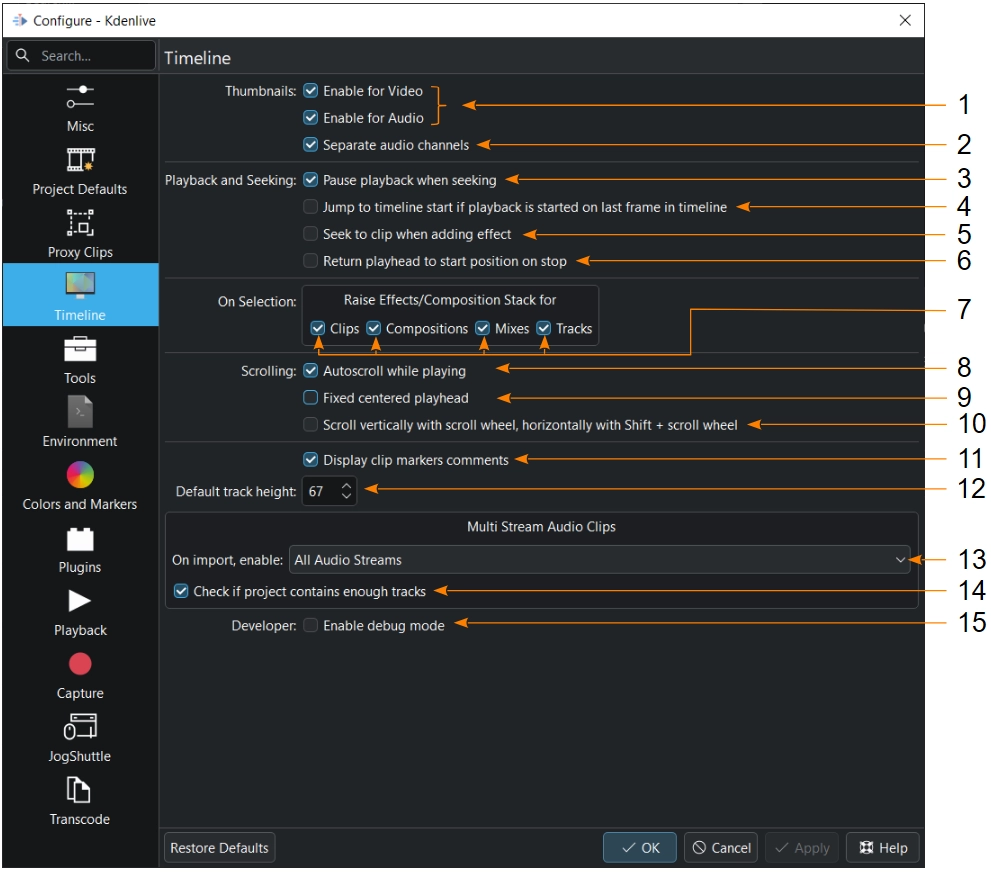

<!-- start-replace-fm field="title" -->
# Kdenlive — configuration : timeline
<!-- end-replace-fm -->
<!-- start-replace-fm field="description" format="blockquote" -->
> Les réglages de la timeline Kdenlive : vignettes, canaux audio, lecture, défilement, hauteur des pistes et comportement à l'import.
<!-- end-replace-fm -->

<!-- start-replace-mediagraphie-fiche -->
> **Référence** — Documentation Kdenlive (2026). Kdenlive — configuration : timeline.. https://docs.kdenlive.org/en/getting_started/configure_kdenlive/configuration_timeline.html. [↗](https://docs.kdenlive.org/en/getting_started/configure_kdenlive/configuration_timeline.html)
>
> | **Type** | webpage |
> | **Auteur·e** | Documentation Kdenlive |
> | **Date** | 2026 |
> | **Statut** | stable |
> | **Mots-clés** | video, montage, kdenlive, configuration, timeline, tutoriel, cours |

**Citation (copier-coller)**

```citation
Documentation Kdenlive (2026). Kdenlive — configuration : timeline.. https://docs.kdenlive.org/en/getting_started/configure_kdenlive/configuration_timeline.html.
```
<!-- end-replace-mediagraphie-fiche -->

## Cité par

<!-- start-replace-mediagraphie-cited-by -->
- [Kdenlive — configuration](../kdenlive-configuration/)
- [Kdenlive — configuration : clips proxy](../kdenlive-configuration-proxy-clips/)
<!-- end-replace-mediagraphie-cited-by -->

---

> 🇫🇷 **Traduction française** de la page officielle [Timeline (configuration)](https://docs.kdenlive.org/en/getting_started/configure_kdenlive/configuration_timeline.html) — la page source n'est pas encore traduite. Adaptation : A26. Images : documentation officielle Kdenlive (interface anglaise).

Cette section contrôle certains aspects de la **timeline**.



1. **Vignettes — activer pour la vidéo et l'audio.** Par défaut, des vignettes sont générées pour les clips vidéo et audio et stockées dans les dossiers `videothumbs` et `audiothumbs` du projet (voir [Valeurs par défaut du projet](../kdenlive-configuration-project-defaults/)).
2. **Séparer les canaux audio.** Si coché, chaque canal audio de la piste obtient sa propre forme d'onde dans la vignette audio. Sinon, une seule forme d'onde combinée est affichée.
3. **Mettre la lecture en pause lors du déplacement.** Si coché, la lecture du moniteur de clip ou de projet est mise en pause quand on déplace la tête de lecture ou qu'on clique ailleurs dans la timeline ; il faut recliquer sur Lecture pour reprendre. Sinon, la lecture continue après le relâchement et pendant les clics — ce qui permet la lecture en boucle (voir *Continuously loop playback*).
4. **Aller au début de la timeline si la lecture démarre sur la dernière image.** Si coché, la lecture revient au début de la timeline quand la tête de lecture est sur la dernière image.
5. **Se placer sur le clip lors de l'ajout d'un effet.** Si coché, la tête de lecture se place sur le clip auquel on ajoute des effets.
6. **Revenir à la position de départ à l'arrêt.** Si coché, la tête de lecture revient à l'endroit où la lecture a commencé lorsqu'on l'arrête.
7. **À la sélection.** Détermine, pour les **clips**, **compositions**, **mixages** et **pistes**, si les sélectionner ouvre le panneau **Pile d'effets/compositions** correspondant (à condition que la vue soit activée ; voir le chapitre sur les [vues](https://docs.kdenlive.org/en/user_interface/menu/view_menu.html)).
8. **Défilement automatique pendant la lecture.** Si coché, la timeline défile pendant la lecture pour garder la tête de lecture visible. Sinon, elle reste fixe et la tête de lecture peut sortir de l'écran.
9. **Tête de lecture fixe et centrée.** Si coché, la tête de lecture reste verrouillée au centre de la timeline pendant que le contenu défile lors de la lecture, du scrubbing et des déplacements.
10. **Défiler verticalement avec la molette, horizontalement avec Maj+molette.** Modifie le comportement par défaut de la molette dans la timeline.
11. **Afficher les commentaires des marqueurs de clip.** Si coché, les commentaires des marqueurs de clip apparaissent dans la timeline.
12. **Hauteur par défaut des pistes.** Hauteur des pistes de la timeline, en pixels. Elle reste ajustable à tout moment en tirant la ligne entre deux pistes (voir *Resizing Tracks*).
13. **À l'import.** Détermine ce que Kdenlive fait lorsqu'un clip audio contient plusieurs flux audio.
14. **Vérifier que le projet contient assez de pistes.** Par défaut, Kdenlive vérifie que le projet possède assez de pistes audio pour recevoir un clip multiflux et propose de créer automatiquement les pistes manquantes.
15. **Développeur.** Fonction réservée aux développeurs : affiche les identifiants des éléments du modèle de timeline dans la timeline.

## Voir aussi

- [Kdenlive — configuration](../kdenlive-configuration/)
- [Kdenlive — configuration : divers](../kdenlive-configuration-misc/)
- [Kdenlive — configuration : clips proxy](../kdenlive-configuration-proxy-clips/)
- [Kdenlive — démarrage rapide](../kdenlive-quickstart/)
