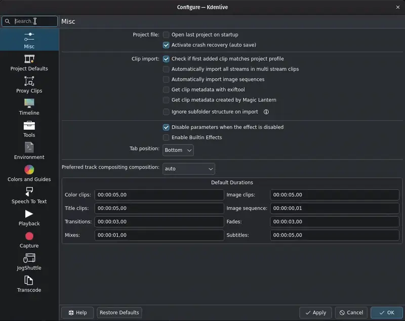

<!-- start-replace-fm field="title" -->
# Kdenlive — configuration
<!-- end-replace-fm -->
<!-- start-replace-fm field="description" format="blockquote" -->
> La fenêtre Configurer Kdenlive : recherche des réglages et présentation des sections (divers, projet, proxy, timeline, environnement, couleurs, etc.).
<!-- end-replace-fm -->

<!-- start-replace-mediagraphie-fiche -->
> **Référence** — Documentation Kdenlive (2026). Kdenlive — configuration.. https://docs.kdenlive.org/en/getting_started/configuration.html. [↗](https://docs.kdenlive.org/en/getting_started/configuration.html)
>
> | **Type** | webpage |
> | **Auteur·e** | Documentation Kdenlive |
> | **Date** | 2026 |
> | **Statut** | stable |
> | **Mots-clés** | video, montage, kdenlive, configuration, tutoriel, cours |

**Citation (copier-coller)**

```citation
Documentation Kdenlive (2026). Kdenlive — configuration.. https://docs.kdenlive.org/en/getting_started/configuration.html.
```
<!-- end-replace-mediagraphie-fiche -->

## Cité par

<!-- start-replace-mediagraphie-cited-by -->
- [Kdenlive — configuration : capture](../kdenlive-configuration-capture/)
- [Kdenlive — configuration : divers](../kdenlive-configuration-misc/)
- [Kdenlive — configuration : valeurs par défaut du projet](../kdenlive-configuration-project-defaults/)
- [Kdenlive — configuration : clips proxy](../kdenlive-configuration-proxy-clips/)
- [Kdenlive — configuration : timeline](../kdenlive-configuration-timeline/)
- [Kdenlive — installation](../kdenlive-installation/)
<!-- end-replace-mediagraphie-cited-by -->

---

> 🇫🇷 **Traduction française** de la page officielle [Configuration](https://docs.kdenlive.org/en/getting_started/configuration.html) — la page source n'est pas encore traduite. Adaptation : A26. Images : documentation officielle Kdenlive (interface anglaise).

Kdenlive offre une grande variété de réglages pour adapter l'application à vos préférences et à votre méthode de travail.

Les réglages généraux se trouvent dans **Menu ‣ Paramètres ‣ Configurer Kdenlive**.

La fenêtre **Configurer Kdenlive** dispose d'une **recherche** qui permet de retrouver rapidement un réglage.



Pendant la saisie, Kdenlive surligne les phrases et sections qui correspondent au terme recherché. Les sections sans correspondance sont masquées.

Les réglages sont répartis dans les sections suivantes :

| Section | Rôle |
|---|---|
| [Divers](../kdenlive-configuration-misc/) | Réglages du comportement général de Kdenlive, de l'import des clips et des effets, et durées par défaut des différents types de clips. |
| [Valeurs par défaut du projet](../kdenlive-configuration-project-defaults/) | Réglages utilisés à la création d'un nouveau projet (Menu ‣ Fichier ‣ Nouveau, ou au démarrage si l'ouverture du dernier projet n'est pas cochée). Pour modifier un projet en cours, utiliser les **Paramètres du projet** ; les modifier peut casser des images clés ou des coupes. |
| [Clips proxy](../kdenlive-configuration-proxy-clips/) | Activation et gestion de la génération des clips proxy. |
| [Timeline](../kdenlive-configuration-timeline/) | Réglages de certains aspects de la timeline. |
| Outils | Réglage de la coupe des sous-titres. |
| Environnement | Tâches de proxy et de transcodage, cache, applications et outils tiers, dossiers et applications par défaut. |
| Couleurs et marqueurs | Couleurs des vignettes, marqueurs et surimpressions des moniteurs, espacement de la grille ; gestion des catégories de marqueurs de timeline et de clips. |
| Reconnaissance vocale | Gestion des modèles de reconnaissance vocale (VOSK et Whisper) et de détection d'objets. |
| Lecture | Réglages de la lecture pendant le montage et sur un écran externe. |
| Capture | Réglages des captures d'écran, du système Blackmagic DeckLink et de l'enregistrement audio. |
| JogShuttle | Réglages de certains périphériques jog/shuttle. |
| Transcodage | Profils disponibles pour transcoder les sources qui ne sont pas dans un format favorable au montage (par exemple en cadence variable). |

> **Attention** — Cliquer sur **Restaurer les valeurs par défaut** réinitialise **tous** les réglages de **toutes** les sections, pas seulement la section sélectionnée. Exception : une catégorie de marqueurs de timeline supprimée ne peut pas être restaurée.

## Voir aussi

- [Kdenlive — configuration : divers](../kdenlive-configuration-misc/)
- [Kdenlive — configuration : valeurs par défaut du projet](../kdenlive-configuration-project-defaults/)
- [Kdenlive — configuration : clips proxy](../kdenlive-configuration-proxy-clips/)
- [Kdenlive — configuration : timeline](../kdenlive-configuration-timeline/)
- [Kdenlive — démarrage rapide](../kdenlive-quickstart/)
