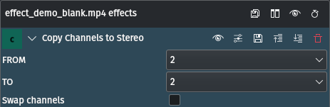

<!-- start-replace-fm field="title" -->
# Kdenlive — copier les canaux vers stéréo
<!-- end-replace-fm -->
<!-- start-replace-fm field="description" format="blockquote" -->
> L'effet copier les canaux vers stéréo de Kdenlive : router un canal source vers un canal cible ou inverser les canaux.
<!-- end-replace-fm -->

<!-- start-replace-mediagraphie-fiche -->
> **Référence** — Documentation Kdenlive (2026). Kdenlive — copier les canaux vers stéréo.. https://docs.kdenlive.org/en/effects_and_filters/audio_effects/channels/copy_channels_to_stereo.html. [↗](https://docs.kdenlive.org/en/effects_and_filters/audio_effects/channels/copy_channels_to_stereo.html)
>
> | **Type** | webpage |
> | **Auteur·e** | Documentation Kdenlive |
> | **Date** | 2026 |
> | **Statut** | stable |
> | **Mots-clés** | audio, canaux, kdenlive, effet, tutoriel, cours |

**Citation (copier-coller)**

```citation
Documentation Kdenlive (2026). Kdenlive — copier les canaux vers stéréo.. https://docs.kdenlive.org/en/effects_and_filters/audio_effects/channels/copy_channels_to_stereo.html.
```
<!-- end-replace-mediagraphie-fiche -->

## Cité par

<!-- start-replace-mediagraphie-cited-by -->
- [Kdenlive — liste des effets audio](../kdenlive-audio-effects-list/)
- [Kdenlive — mappage audio](../kdenlive-audiomap/)
- [Kdenlive — balance audio](../kdenlive-balance/)
<!-- end-replace-mediagraphie-cited-by -->

---

> 🇫🇷 **Traduction française** de la page officielle [Copy Channels to Stereo](https://docs.kdenlive.org/en/effects_and_filters/audio_effects/channels/copy_channels_to_stereo.html) — la page source n'est pas encore traduite. Adaptation : A26. Images : documentation officielle Kdenlive (interface anglaise).



| Champ | Valeur |
|---|---|
| Statut | Maintenu |
| Images clés | Non |
| Bibliothèque source | avfilter |
| Maître seulement | Non |
| Bogues connus | Aucun |

## Description

Copie un canal audio vers un autre.

## Paramètres

| Paramètre | Valeur | Description |
|---|---|---|
| De | Sélection | Numéro du canal source |
| Vers | Sélection | Numéro du canal cible |
| Inverser les canaux | Interrupteur | Active ou désactive l'inversion des canaux |

## Voir aussi

- [Kdenlive — liste des effets audio](../kdenlive-audio-effects-list/)
- [Kdenlive — mappage audio](../kdenlive-audiomap/)
- [Kdenlive — enregistrement audio](../kdenlive-audio-recording/)
