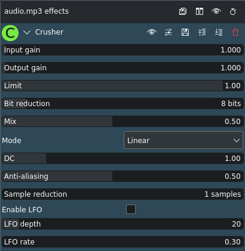

<!-- start-replace-fm field="title" -->
# Kdenlive — Crusher
<!-- end-replace-fm -->
<!-- start-replace-fm field="description" format="blockquote" -->
> L'effet Crusher de Kdenlive : réduction de bits et d'échantillons, mode logarithmique, DC et anti-aliasing.
<!-- end-replace-fm -->

<!-- start-replace-mediagraphie-fiche -->
> **Référence** — Documentation Kdenlive (2026). Kdenlive — Crusher.. https://docs.kdenlive.org/en/effects_and_filters/audio_effects/tools/crusher.html. [↗](https://docs.kdenlive.org/en/effects_and_filters/audio_effects/tools/crusher.html)
>
> | **Type** | webpage |
> | **Auteur·e** | Documentation Kdenlive |
> | **Date** | 2026 |
> | **Statut** | stable |
> | **Mots-clés** | audio, effet, kdenlive, crusher, tutoriel, cours |

**Citation (copier-coller)**

```citation
Documentation Kdenlive (2026). Kdenlive — Crusher.. https://docs.kdenlive.org/en/effects_and_filters/audio_effects/tools/crusher.html.
```
<!-- end-replace-mediagraphie-fiche -->

## Cité par

<!-- start-replace-mediagraphie-cited-by -->
- [Kdenlive — liste des effets audio](../kdenlive-audio-effects-list/)
- [Kdenlive — Crystalizer](../kdenlive-crystalizer/)
<!-- end-replace-mediagraphie-cited-by -->

---

> 🇫🇷 **Traduction française** de la page officielle [Crusher](https://docs.kdenlive.org/en/effects_and_filters/audio_effects/tools/crusher.html) — la page source n'est pas encore traduite. Adaptation : A26. Images : documentation officielle Kdenlive (interface anglaise).



| Champ | Valeur |
|---|---|
| Statut | Maintenu |
| Images clés | Non |
| Bibliothèque source | avfilter |
| Maître seulement | Non |
| Bogues connus | Aucun |

## Description

Ce filtre est un **bit crusher** aux fonctions étendues. Un bit crusher réduit audiblement le nombre de bits avec lesquels un signal audio est échantillonné. Cela ne change pas la profondeur de bits réelle : cela produit seulement l'effet. Un matériel réduit en bits sonne plus **dur** et plus **numérique**. Ce filtre peut même arrondir à des valeurs continues au lieu de profondeurs discrètes. Il possède aussi un **décalage DC** qui produit un écrasement différent des moitiés basse et haute du signal. Un réglage **anti-aliasing** permet un écrasement plus doux.

Le **mode logarithmique** fait passer d'écarts linéaires entre bits à des écarts logarithmiques : le résultat est plus naturel, sans couper les signaux faibles. L'oreille humaine perçoit le volume de façon logarithmique ; cet écrasement est donc plus agréable. L'écrasement logarithmique peut aussi être anti-aliasé.

## Paramètres

| Paramètre | Valeur | Description |
|---|---|---|
| Gain d'entrée | Décimal | Règle le niveau d'entrée |
| Gain de sortie | Décimal | Règle le niveau de sortie |
| Limite | Décimal |  |
| Réduction de bits | Entier | Réduction de bits (1 à 64 ; 8 par défaut) |
| Mix | Décimal | Quantité de mélange |
| Mode | Sélection | Filtrage linéaire ou logarithmique (linéaire par défaut) |
| DC | Décimal | Règle le décalage DC |
| Anti-aliasing | Décimal | Règle l'anti-aliasing |
| Réduction d'échantillons | Entier | Réduction d'échantillons (1 à 250 ; 1 par défaut) |
| Activer le LFO | Interrupteur | Active le LFO (désactivé par défaut) |
| Profondeur du LFO | Entier | Profondeur du LFO |
| Vitesse du LFO | Décimal | Vitesse du LFO |

## Voir aussi

- [Kdenlive — liste des effets audio](../kdenlive-audio-effects-list/)
- [Kdenlive — Crystalizer](../kdenlive-crystalizer/)
- [Kdenlive — transformer un son](../../../../02-activites/03/exercices/10-transformer-un-son/)
