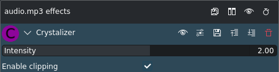

<!-- start-replace-fm field="title" -->
# Kdenlive — Crystalizer
<!-- end-replace-fm -->
<!-- start-replace-fm field="description" format="blockquote" -->
> L'effet Crystalizer de Kdenlive : accentuer les différences entre échantillons pour durcir le son.
<!-- end-replace-fm -->

<!-- start-replace-mediagraphie-fiche -->
> **Référence** — Documentation Kdenlive (2026). Kdenlive — Crystalizer.. https://docs.kdenlive.org/en/effects_and_filters/audio_effects/tools/crystalizer.html. [↗](https://docs.kdenlive.org/en/effects_and_filters/audio_effects/tools/crystalizer.html)
>
> | **Type** | webpage |
> | **Auteur·e** | Documentation Kdenlive |
> | **Date** | 2026 |
> | **Statut** | stable |
> | **Mots-clés** | audio, effet, kdenlive, crystalizer, tutoriel, cours |

**Citation (copier-coller)**

```citation
Documentation Kdenlive (2026). Kdenlive — Crystalizer.. https://docs.kdenlive.org/en/effects_and_filters/audio_effects/tools/crystalizer.html.
```
<!-- end-replace-mediagraphie-fiche -->

## Cité par

<!-- start-replace-mediagraphie-cited-by -->
- [Kdenlive — liste des effets audio](../kdenlive-audio-effects-list/)
- [Kdenlive — Crusher](../kdenlive-crusher/)
<!-- end-replace-mediagraphie-cited-by -->

---

> 🇫🇷 **Traduction française** de la page officielle [Crystalizer](https://docs.kdenlive.org/en/effects_and_filters/audio_effects/tools/crystalizer.html) — la page source n'est pas encore traduite. Adaptation : A26. Images : documentation officielle Kdenlive (interface anglaise).



| Champ | Valeur |
|---|---|
| Statut | Maintenu |
| Images clés | Non |
| Bibliothèque source | avfilter |
| Maître seulement | Non |
| Bogues connus | Aucun |

## Description

Cet effet **durcit le bruit audio** en augmentant linéairement les différences entre chaque échantillon.

## Paramètres

| Paramètre | Valeur | Description |
|---|---|---|
| Intensité | Décimal | Intensité de l'effet : de -10,0 (son inchangé) à 10,0 (effet maximal) ; 2,0 par défaut. Les valeurs négatives inversent le filtrage. |
| Activer le clipping | Interrupteur | Active le clipping (activé par défaut) |

## Voir aussi

- [Kdenlive — liste des effets audio](../kdenlive-audio-effects-list/)
- [Kdenlive — Crusher](../kdenlive-crusher/)
- [Kdenlive — transformer un son](../../../../02-activites/03/exercices/10-transformer-un-son/)
