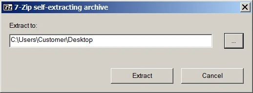
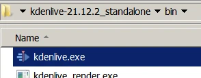
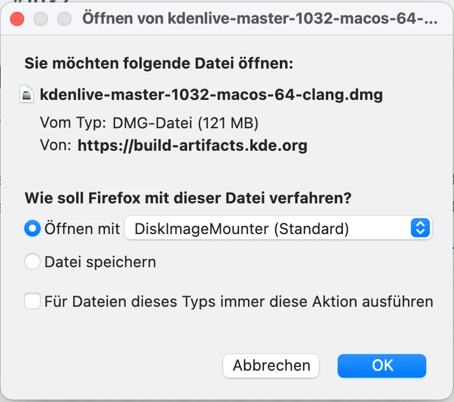
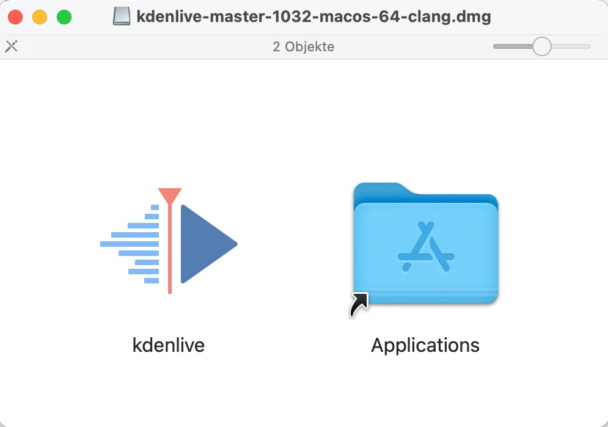
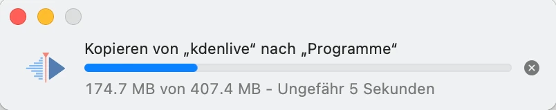
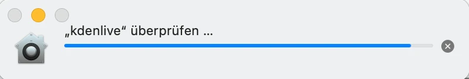
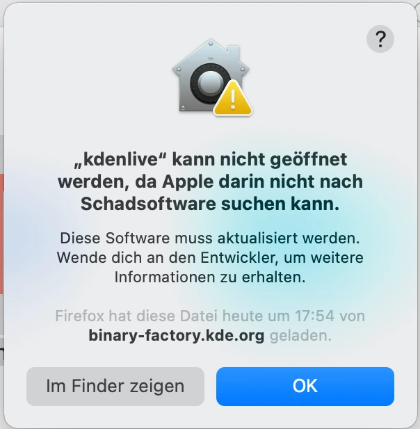
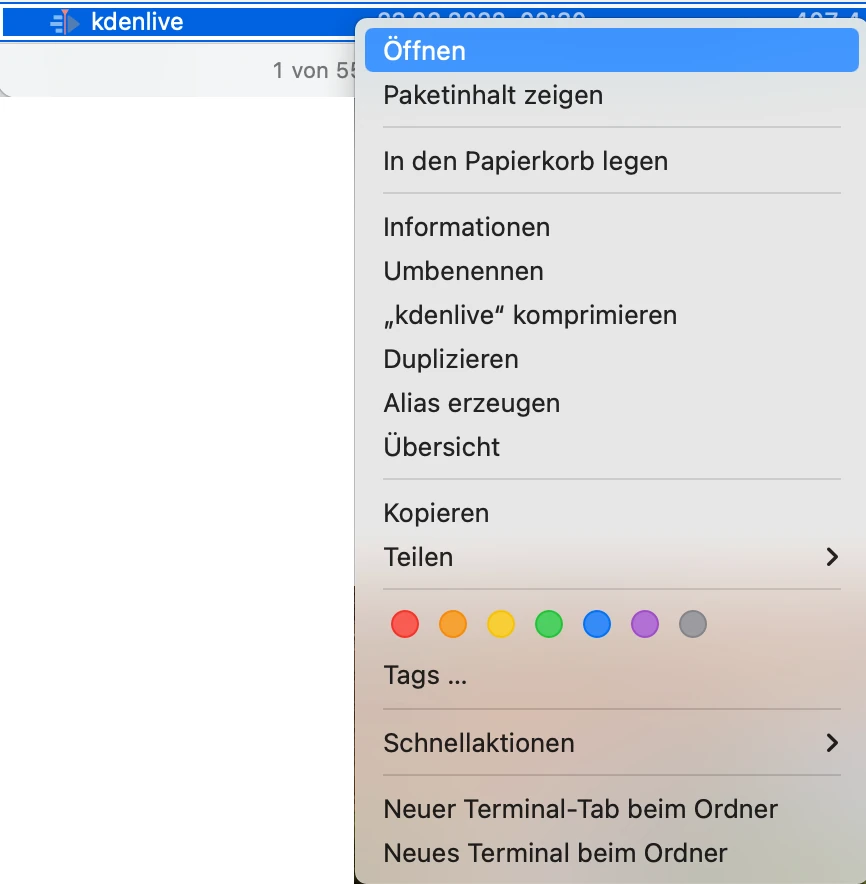
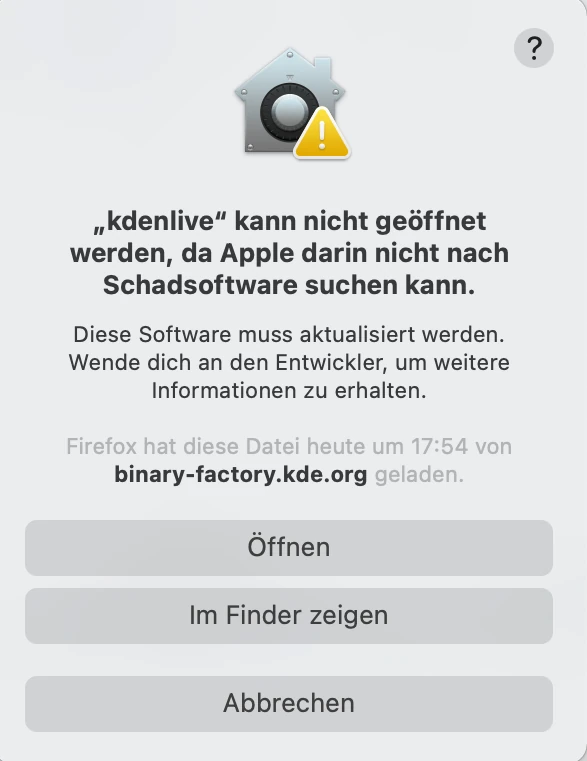
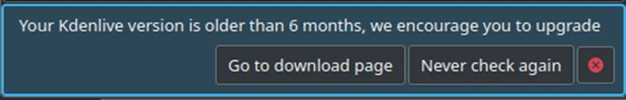

<!-- start-replace-fm field="title" -->
# Kdenlive — installation
<!-- end-replace-fm -->
<!-- start-replace-fm field="description" format="blockquote" -->
> Installation de Kdenlive sous Linux, Windows et macOS : prérequis système, paquets, versions autonomes et vérification des mises à jour.
<!-- end-replace-fm -->

<!-- start-replace-mediagraphie-fiche -->
> **Référence** — Documentation Kdenlive (2026). Kdenlive — installation.. https://docs.kdenlive.org/en/getting_started/installation.html. [↗](https://docs.kdenlive.org/en/getting_started/installation.html)
>
> | **Type** | webpage |
> | **Auteur·e** | Documentation Kdenlive |
> | **Date** | 2026 |
> | **Statut** | stable |
> | **Mots-clés** | video, montage, kdenlive, installation, tutoriel, cours |

**Citation (copier-coller)**

```citation
Documentation Kdenlive (2026). Kdenlive — installation.. https://docs.kdenlive.org/en/getting_started/installation.html.
```
<!-- end-replace-mediagraphie-fiche -->

## Cité par

<!-- start-replace-mediagraphie-cited-by -->
- [Kdenlive — introduction](../kdenlive-introduction/)
<!-- end-replace-mediagraphie-cited-by -->

---

> 🇫🇷 **Traduction française** de la page officielle [Installation](https://docs.kdenlive.org/en/getting_started/installation.html) — la page source n'est pas encore traduite. Adaptation : A26. Images : documentation officielle Kdenlive (interface anglaise).

Kdenlive publie une nouvelle version environ tous les trois mois. Voir la [page d'actualités de Kdenlive](https://kdenlive.org/news/) pour les dernières informations et notes de version, et [What's New](https://docs.kdenlive.org/en/more_information/whats_new.html) pour les ajouts récents.

On peut installer Kdenlive de deux façons :

- avec un **installateur** ;
- comme **exécutable autonome** (Windows : version standalone ; Linux : AppImage).

Sur macOS, seule la version avec installateur est disponible.

La [page de téléchargement](https://kdenlive.org/download/) du site de Kdenlive fournit la dernière version pour votre système. Toutes les versions précédentes sont dans les archives (*attic*).

## Configuration système minimale

**Système d'exploitation :**

- Windows 10 64 bits (1809 ou ultérieur) ou plus récent
- macOS 13 (Ventura) ou plus récent sur Apple Silicon ; macOS 12 (Monterey) ou plus récent sur Mac Intel — voir la note sur les versions ci-dessous
- Linux 64 bits

**Processeur :** x86 Intel ou AMD ; au moins un cœur à 2 GHz pour la SD, 4 cœurs pour la HD, 8 cœurs pour la 4K.

**Carte graphique :** OpenGL 2.0 fonctionnel et compatible. Sous Windows, une carte avec des pilotes DirectX 9 ou 11 compatibles convient aussi.

**Mémoire :** au moins 4 Go pour la SD, 8 Go pour la HD, 16 Go pour la 4K.

> **Astuce** — Si votre ordinateur se situe dans le bas des exigences CPU/RAM, utilisez la **résolution de prévisualisation**, les **proxys** et le **rendu de prévisualisation de la timeline** pour réduire les ralentissements.

> **Note** — Le montage vidéo repose fortement sur le processeur. Kdenlive propose des profils de rendu accélérés par le GPU, mais la lecture de la timeline utilise le CPU : plus le processeur est puissant, meilleure est la fluidité. Un support GPU plus large est prévu à court terme.

## Kdenlive sous Linux

Kdenlive s'installe sans problème sur les bureaux non-KDE. Les paquets officiels maintenus par Kdenlive sont **AppImage** et **Flatpak**.

> **Note** — Depuis la version 24.02, le PPA n'est plus pris en charge ; seuls AppImage et Flatpak sont officiellement supportés.

Avec Flatpak, l'installation s'intègre à votre environnement de bureau ; aucune action supplémentaire.

Avec l'AppImage : téléchargez le fichier, placez-le dans le dossier de votre choix et rendez-le exécutable. En général, utilisez le gestionnaire de fichiers (Dolphin dans KDE Plasma) : clic droit → **Propriétés** → **Rendre exécutable**. Sinon, dans un terminal : `chmod 777 <nom_appimage>`. Double-cliquez ensuite sur l'AppImage ou lancez son nom dans un terminal.

## Kdenlive sous Windows

Kdenlive fonctionne uniquement en 64 bits, sous Windows 10 (1809 ou ultérieur) et plus récent. Le fonctionnement sous Windows Server ou embarqué n'est pas garanti. La dernière version pour Windows 7 (Kdenlive 23.08.5) est dans les archives.

Deux versions :

- **Version avec installateur** : nécessite les droits d'administrateur, s'installe sur la machine, apparaît dans la liste des programmes, disponible pour tous les utilisateurs ; les fichiers Kdenlive sont toujours au même endroit.
- **Version autonome** : pas de droits d'administrateur, pas d'installation, pas dans la liste des programmes ; accessible uniquement à l'utilisateur qui l'a téléchargée. Si vous travaillez avec un compte utilisateur normal, elle fonctionne.
- On peut copier le dossier Kdenlive sur un disque externe et l'exécuter sur un autre ordinateur sans installation ; les réglages personnels et les contenus téléchargés dans Kdenlive restent toutefois sur l'ordinateur utilisé.

Double-cliquez sur le fichier téléchargé.



Indiquez le dossier où placer le dossier Kdenlive.



Pour lancer Kdenlive, allez dans le dossier `bin` et double-cliquez sur `kdenlive.exe`. Vous pouvez créer un raccourci sur le Bureau : clic droit sur `kdenlive.exe` → **Envoyer vers** → **Bureau (créer un raccourci)**.

## Kdenlive dans un domaine Windows

Pour utiliser Kdenlive avec des utilisateurs de domaine Windows Active Directory et/ou des stratégies de groupe (GPO), assurez-vous que tous les utilisateurs ont un accès lecture/écriture aux dossiers suivants :

- `%AppData%\kdenlive`
- `%LocalAppData%\kdenlive`
- `%LocalAppData%\kdenliverc`
- `%LocalAppData%\kdenlive-layoutsrc`
- `%LocalAppData%\kxmlgui5\kdenlive\kdenliveui.rc`
- `%AppData%\kdenlive\.backup`
- `%LocalAppData%\knewstuff3`

Vérifiez aussi qu'aucune GPO ne bloque l'accès à ces dossiers.

## Kdenlive sous macOS

Kdenlive fonctionne sur les Mac Intel sous macOS 12 (Monterey) ou plus récent, et sur les Mac Apple Silicon (disponible sur la page de téléchargement).

La dernière version pour macOS 10.13 (High Sierra) (Kdenlive 23.08.5) et pour macOS 11 (Big Sur) (Kdenlive 24.08.1) est dans les archives.

### Procédure d'installation



Choisissez **Ouvrir avec DiskImageMounter** (option par défaut).



Une fois le fichier `.dmg` téléchargé, DiskImageMounter s'ouvre. Faites glisser le logo Kdenlive dans le dossier **Applications**.



Les fichiers sont copiés.



macOS vérifie les fichiers à la recherche de malwares.



Le message « “kdenlive” ne peut pas être ouvert, car Apple ne peut pas y rechercher de logiciels malveillants » apparaît. Cliquez sur **Afficher dans le Finder**.



Le Finder s'ouvre. Faites un clic droit sur Kdenlive et choisissez **Ouvrir**.



Le message d'avertissement réapparaît : cliquez sur **Ouvrir** et Kdenlive se lance.

## Vérification automatique des mises à jour

Kdenlive vérifie automatiquement les mises à jour au démarrage, d'après la version de l'application (aucune connexion réseau nécessaire).



Vous pouvez désactiver cette fonction dans **Menu ‣ Paramètres ‣ Configurer Kdenlive ‣ Environnement**, en décochant **Vérifier les mises à jour**.

## Notes

- Pour rester compatible avec Qt6, le système de build est passé à C++17 en janvier 2022, ce qui impose macOS 10.15 (Catalina) minimum.
- Qt6 (février 2024) : macOS 11 (Big Sur) minimum ; Qt 6.9 : macOS 12 (Monterey) ; Qt 6.10 : macOS 13 (Ventura).
- Windows 10 (1809 ou ultérieur) minimum depuis Qt6 (février 2024).

## Voir aussi

- [Kdenlive — introduction](../kdenlive-introduction/)
- [Kdenlive — configuration](../kdenlive-configuration/)
- [Kdenlive — démarrage rapide](../kdenlive-quickstart/)
