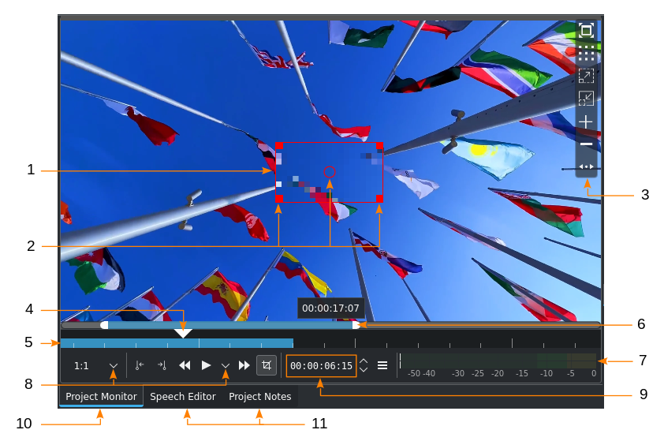
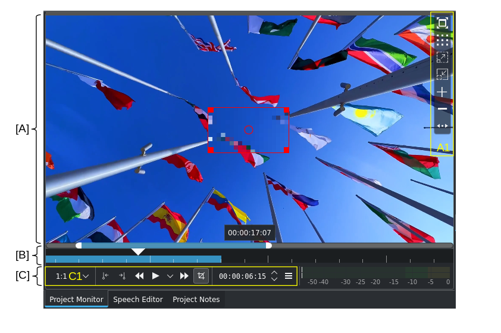
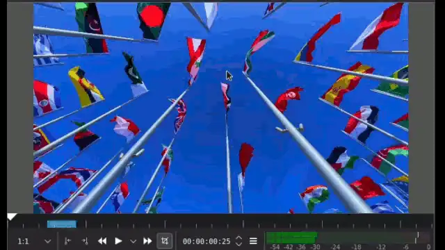
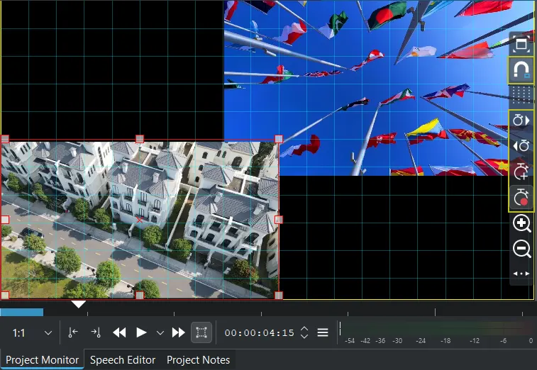
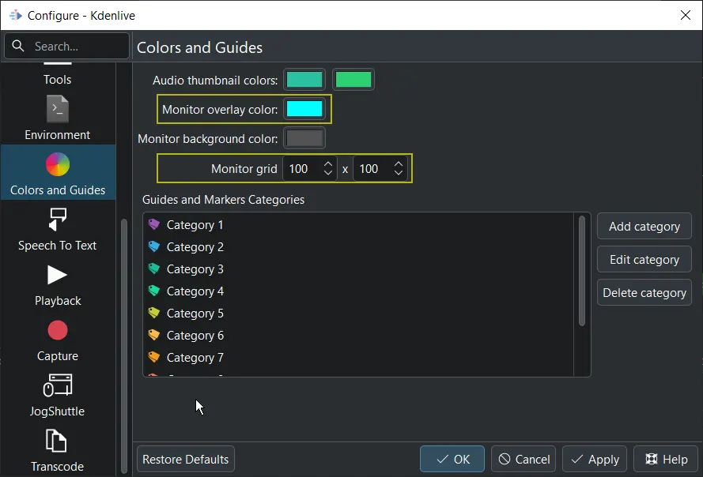
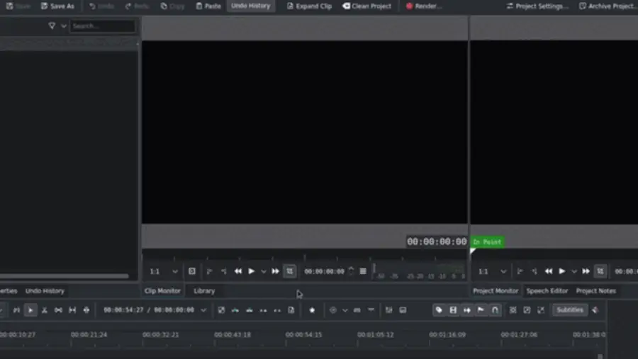
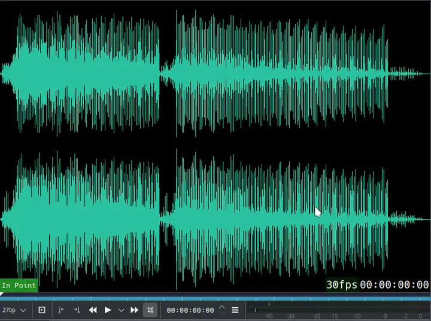
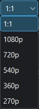
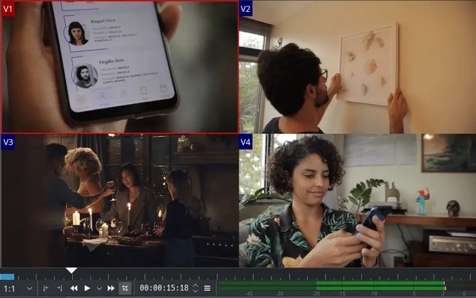
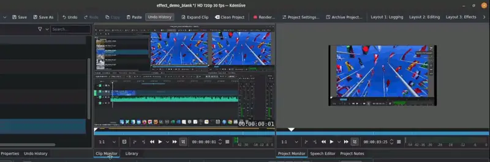

<!-- start-replace-fm field="title" -->
# Kdenlive — les moniteurs
<!-- end-replace-fm -->
<!-- start-replace-fm field="description" format="blockquote" -->
> Les deux moniteurs de Kdenlive — moniteur de clip et moniteur de projet : contrôles, surimpressions, contrôle direct des effets, zoom, résolution de prévisualisation et affichage multipiste.
<!-- end-replace-fm -->

<!-- start-replace-mediagraphie-fiche -->
> **Référence** — Documentation Kdenlive (2026). Kdenlive — les moniteurs.. https://docs.kdenlive.org/en/user_interface/monitors.html. [↗](https://docs.kdenlive.org/en/user_interface/monitors.html)
>
> | **Type** | webpage |
> | **Auteur·e** | Documentation Kdenlive |
> | **Date** | 2026 |
> | **Statut** | stable |
> | **Mots-clés** | video, montage, kdenlive, interface, moniteur, tutoriel, cours |

**Citation (copier-coller)**

```citation
Documentation Kdenlive (2026). Kdenlive — les moniteurs.. https://docs.kdenlive.org/en/user_interface/monitors.html.
```
<!-- end-replace-mediagraphie-fiche -->

## Cité par

<!-- start-replace-mediagraphie-cited-by -->
- [Kdenlive — le moniteur de clip](../kdenlive-clip-monitor/)
- [Kdenlive — le moniteur de projet](../kdenlive-project-monitor/)
- [Kdenlive — la timeline](../kdenlive-timeline/)
- [Kdenlive — barres d'outils](../kdenlive-toolbars/)
- [Kdenlive — les éléments de l'interface](../kdenlive-ui-elements/)
- [Kdenlive — l'interface](../kdenlive-user-interface/)
<!-- end-replace-mediagraphie-cited-by -->

---

> 🇫🇷 **Traduction française** de la page officielle [Monitors](https://docs.kdenlive.org/en/user_interface/monitors.html) — la page source n'est pas encore traduite. Adaptation : A26. Images : documentation officielle Kdenlive (interface anglaise ; GIF convertis en WebP animés).

Kdenlive utilise **deux moniteurs** pour afficher et lire les vidéos, images, titres, animations et fichiers audio :

- le **moniteur de clip** ;
- le **moniteur de projet**.

On les active ou les désactive via **Menu ‣ Vue ‣ Moniteur de clip** et **Moniteur de projet**. Une fois activés, ils se sélectionnent par l'onglet correspondant, en bas de la fenêtre du moniteur.

Kdenlive peut aussi afficher l'image sur un écran externe via les cartes **Blackmagic Design DeckLink**.

Le **moniteur de clip** lit le clip sélectionné dans le bac à projets. Le **moniteur de projet** lit la timeline à partir de la position de la tête de lecture.

## Contrôles et éléments



*Contrôles du moniteur (voir le tableau des contrôles dans la page [Les éléments de l'interface](../kdenlive-ui-elements/)).*



*Zones et éléments du moniteur (voir le tableau des éléments dans la page [Les éléments de l'interface](../kdenlive-ui-elements/)).*

## Barre d'outils d'affichage du moniteur



La barre d'outils d'affichage apparaît au survol de la zone sensible, en haut à droite du moniteur par défaut. Cliquez sur l'icône pour la déplacer à gauche ou revenir. Pour la désactiver : clic droit dans le moniteur → **Surimpression du moniteur courant ‣ Surimpression des informations du moniteur**.

La barre propose :

- **Plein écran** — voir la section correspondante.
- **Changer la surimpression** — cliquez pour parcourir les motifs disponibles. Leur couleur se règle dans **Menu ‣ Paramètres ‣ Configurer Kdenlive ‣ Couleurs et marqueurs**.
- **Zoom avant** et **Zoom arrière**.
- **Ajouter un repère** et **Supprimer un repère**.
- **Déplacer la barre d'outils** — cliquez pour la faire passer de droite (par défaut) à gauche, et inversement.

## Contrôle direct des effets



Les effets qui possèdent des paramètres **X**, **Y**, **largeur**, **hauteur**, **opacité** (alpha, facultatif) et **rotation** se contrôlent directement dans le moniteur — par exemple **Transform** ou **Crop by Padding**. Vérifiez que le **mode Édition** est activé.

Une fois un tel effet appliqué à un clip du bac, à un clip de la timeline, à une piste ou au bus principal, des outils supplémentaires apparaissent :

- activer une **grille** sur laquelle les poignées s'alignent (taille réglable dans **Configurer Kdenlive ‣ Couleurs et marqueurs**) ;
- aller à l'**image clé suivante** ou **précédente** ;
- **ajouter une image clé** ;
- **ajouter une image clé automatique** — une fois activé, un point rouge apparaît au-dessus de la barre.

Tirez les poignées pour redimensionner le clip. **Maj** conserve les proportions ; **Ctrl** redimensionne uniformément dans toutes les directions (le centre reste en place). Dans le moniteur de projet, **Alt+clic gauche** parcourt les clips redimensionnés.

> **Note** — Une fois un tel effet appliqué, le panneau de surimpression n'affiche plus les icônes **Ajouter/Supprimer un repère**. Pour les retrouver, désactivez les effets avec l'icône **Effets activés** dans l'en-tête de la pile d'effets/compositions. Pour réactiver le contrôle direct, cliquez sur **Effets désactivés**.

Le contrôle direct est disponible pour les effets : Alpha Shapes, Alpha Shapes (Mask), Audio Level Visualization Filter, Audio Spectrum Filter, Audio Waveform Filter, Dynamic Text, GPS Graphic, Motion Tracker, Position and Zoom, Pillar Echo, Spot Remover, Timer, Transform, Crop by padding.

## Couleur de surimpression et taille de grille



La couleur des repères et de la grille, ainsi que la taille de la grille, se règlent dans **Menu ‣ Paramètres ‣ Configurer Kdenlive ‣ Couleurs et marqueurs**.

## Redimensionner le moniteur



Redimensionnez les moniteurs en tirant sur les bords du widget, jusqu'à ce que le pointeur prenne la forme de redimensionnement.

## Barre de zoom du moniteur



Les règles de la timeline des moniteurs possèdent des **barres de zoom**. Pour les activer, survolez la règle et utilisez **Ctrl+molette**. Une barre de zoom avec une barre de défilement et des poignées à gauche et à droite apparaît ; les graduations s'adaptent au facteur de zoom. Utile pour les coupes précises à l'image ou pour poser des zones.

## Résolution de prévisualisation



Changer la **résolution de prévisualisation** accélère le montage en réduisant la résolution vidéo des moniteurs. On peut l'utiliser à la place des proxys ou avec eux ; le gain dépend des fichiers sources.

La vitesse de lecture dépend de plusieurs facteurs : source, proxys, type et nombre d'effets, capacité du processeur. Le support GPU pour la lecture est limité ou absent ; le **rendu de prévisualisation** est vivement recommandé si la lecture manque de fluidité.

## Vue multipiste

Activez la vue multipiste via **Menu ‣ Moniteur ‣ Vue multipiste**, par clic droit dans le moniteur de projet → **Vue multipiste**, ou avec **F12**.



La vue multipiste permet de sélectionner une piste de la timeline en cliquant dans le moniteur de projet. Voir la section sur le montage multicaméra.

## Moniteurs de clip et de projet dans des fenêtres séparées

Pour détacher un moniteur, cliquez sur son onglet et faites glisser le widget vers sa propre fenêtre. Vous pouvez ensuite le déplacer sur un autre écran.



Pour les remettre dans la vue à onglets, cliquez sur la barre de titre du moniteur (activez-la via **Menu ‣ Vue ‣ Afficher les barres de titre**) et faites glisser la fenêtre sur un autre widget. Voir le chapitre sur la personnalisation de l'interface.

> **Note** — Il arrive qu'un widget moniteur n'ait pas de barre de titre (défaut intermittent). Dans ce cas, réinitialisez les réglages de Kdenlive en supprimant `~/.config/kdenliverc` (Linux) ou `C:\Users\<nom_utilisateur>\AppData\Roaming\kdenlive\kdenlivestaterc` (Windows).

## Voir aussi

- [Kdenlive — l'interface](../kdenlive-user-interface/)
- [Kdenlive — barres d'outils](../kdenlive-toolbars/)
- [Kdenlive — démarrage rapide](../kdenlive-quickstart/)
