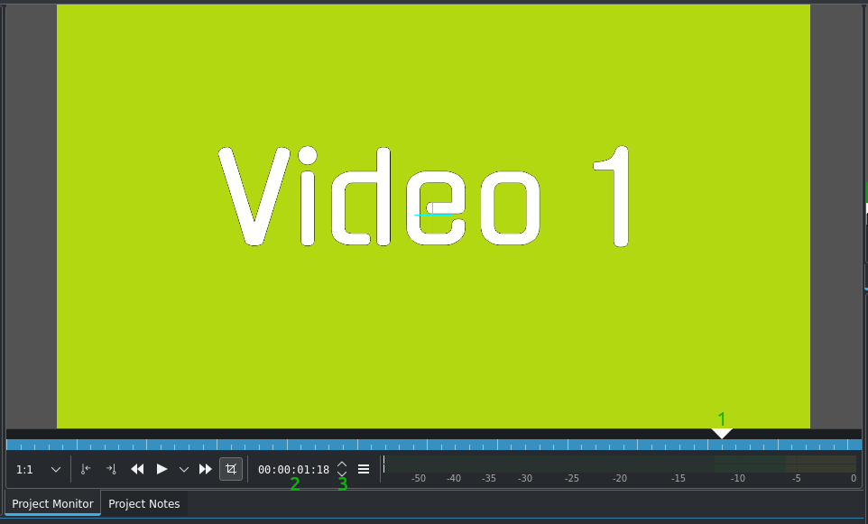
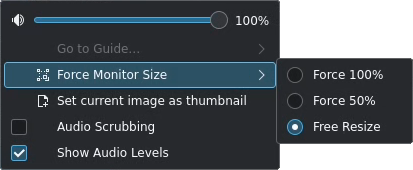
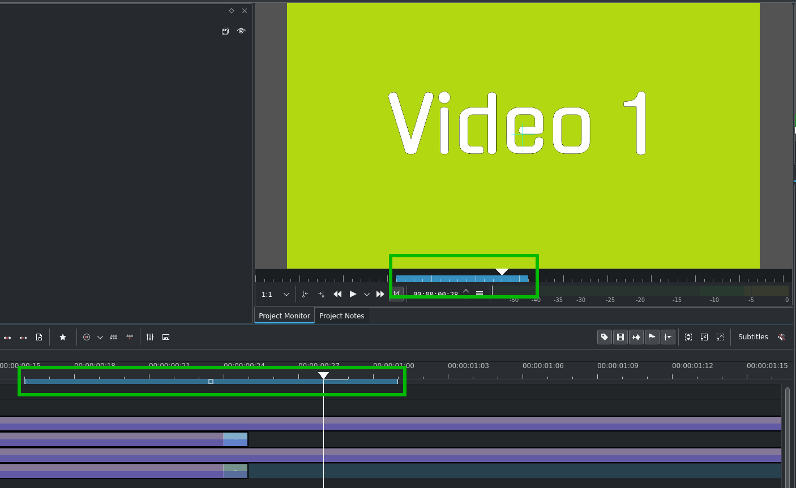
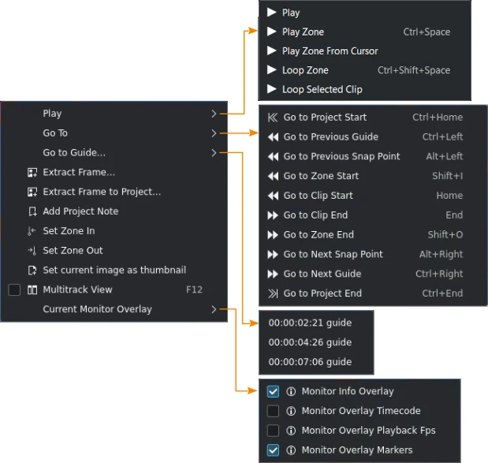
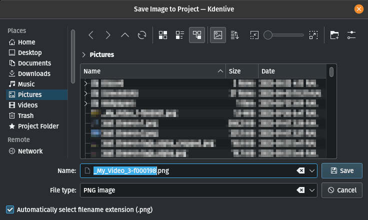
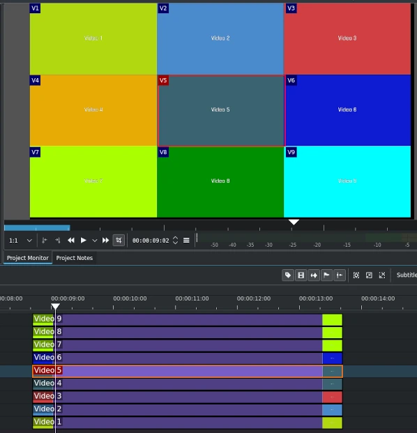

<!-- start-replace-fm field="title" -->
# Kdenlive — le moniteur de projet
<!-- end-replace-fm -->
<!-- start-replace-fm field="description" format="blockquote" -->
> Le moniteur de projet de Kdenlive : contrôles, zones, menu hamburger, menu contextuel, extraction d'images et vue multipiste.
<!-- end-replace-fm -->

<!-- start-replace-mediagraphie-fiche -->
> **Référence** — Documentation Kdenlive (2026). Kdenlive — le moniteur de projet.. https://docs.kdenlive.org/en/user_interface/monitors/project_monitor.html. [↗](https://docs.kdenlive.org/en/user_interface/monitors/project_monitor.html)
>
> | **Type** | webpage |
> | **Auteur·e** | Documentation Kdenlive |
> | **Date** | 2026 |
> | **Statut** | stable |
> | **Mots-clés** | video, montage, kdenlive, interface, moniteur, tutoriel, cours |

**Citation (copier-coller)**

```citation
Documentation Kdenlive (2026). Kdenlive — le moniteur de projet.. https://docs.kdenlive.org/en/user_interface/monitors/project_monitor.html.
```
<!-- end-replace-mediagraphie-fiche -->

## Cité par

<!-- start-replace-mediagraphie-cited-by -->
- [Kdenlive — le moniteur de clip](../kdenlive-clip-monitor/)
- [Kdenlive — l'interface](../kdenlive-user-interface/)
<!-- end-replace-mediagraphie-cited-by -->

---

> 🇫🇷 **Traduction française** de la page officielle [Project Monitor](https://docs.kdenlive.org/en/user_interface/monitors/project_monitor.html) — la page source n'est pas encore traduite. Adaptation : A26. Images : documentation officielle Kdenlive (interface anglaise).



Le **moniteur de projet** affiche la timeline du projet, c'est-à-dire la version montée de la vidéo. Il possède les mêmes fonctions que le moniteur de clip, à l'exception de l'icône qui active/désactive le **mode Édition**.

## Contrôles du moniteur de projet

- **Tête de lecture (curseur de position)** — position courante dans le projet ; cliquez et glissez pour la déplacer.
- **Timecode** — saisissez un timecode et appuyez sur **Entrée** pour placer la tête de lecture à un endroit précis.
- **Flèches du timecode** — déplacent le moniteur d'une image ; les flèches gauche/droite du clavier font de même.

## Menu hamburger



- **Volume** — volume de lecture du moniteur de projet, sans effet sur le volume principal.
- **Aller au marqueur de timeline** — liste des marqueurs de timeline ; en choisir un place la tête de lecture à son timecode.
- **Forcer la taille du moniteur** — 100 % (taille d'origine), 50 %, ou ajustement à la taille du widget.
- **Définir l'image courante comme vignette** — utilise l'image courante comme vignette du clip.
- **Audio au défilement** — lit l'audio pendant le défilement ; à désactiver pour la fluidité ou le bruit.
- **Afficher les niveaux audio** — affiche la courbe de fréquences de l'audio principal.

## Créer des zones



Utilisez **I** et **O**, ou les icônes correspondantes, pour créer une zone dans le moniteur de projet — comme dans le moniteur de clip. Différence notable : la zone définie dans le moniteur de projet définit aussi la zone de la **timeline**, indiquée par une barre colorée sur la timeline et sous le moniteur. Kdenlive peut ne rendre que la zone sélectionnée (voir **Zone sélectionnée**).

## Menu contextuel



Ces actions concernent le clip sélectionné dans la **timeline**. Le moniteur de clip propose des actions semblables, mais elles concernent le clip sélectionné dans le bac à projets.

| Élément | Raccourci | Description |
|---|---|---|
| Lire | `Espace` ou clic dans le moniteur | Lit le clip sélectionné (désactivable dans les réglages). |
| Lire la zone | `Ctrl+Espace` | Lit la zone et s'arrête. |
| Boucler la zone | `Ctrl+Shift+Espace` | Lit la zone en boucle. |
| Lire la zone depuis le curseur |  | Lit du curseur jusqu'à la fin de la zone. |
| Boucler le clip sélectionné |  | Lit le clip sélectionné en boucle. |
| Aller au début du projet | `Ctrl+Origine` | Début du clip. |
| Aller au repère précédent | `Ctrl+Gauche` | Marqueur de timeline précédent. |
| Aller au point d'accroche précédent | `Alt+Gauche` |  |
| Aller au début de la zone | `Shift+I` |  |
| Aller au début du clip | `Origine` |  |
| Aller à la fin du clip | `Fin` |  |
| Aller à la fin de la zone | `Shift+O` |  |
| Aller au point d'accroche suivant | `Alt+Droite` |  |
| Aller au repère suivant | `Ctrl+Droite` | Marqueur de timeline suivant. |
| Aller à la fin du projet | `Ctrl+Fin` | Fin du clip. |
| Aller au repère… |  | Liste des marqueurs de timeline ; en choisir un y déplace la tête de lecture. |
| Extraire l'image |  | Ouvre **Enregistrer l'image** pour sauvegarder l'image courante (`.png` par défaut). |
| Extraire l'image vers le projet |  | Comme ci-dessus, et ajoute l'image au bac à projets. |
| Ajouter une note de projet |  | Ouvre les notes de projet et ajoute un lien vers l'image courante. |
| Définir le point d'entrée | `I` |  |
| Définir le point de sortie | `O` |  |
| Définir l'image courante comme vignette |  | Vignette du clip dans le bac à projets. |
| Vue multipiste | `F12` | Bascule la zone du moniteur en vue multipiste ; toutes les pistes actives sont affichées. |
| Surimpression du moniteur courant |  | Menu des surimpressions disponibles. |
| Surimpression d'infos du moniteur |  | Active/désactive toutes les surimpressions. |
| Surimpression du timecode |  | Affiche/masque le timecode. |
| Surimpression des images par seconde |  | Affiche/masque la cadence. |
| Surimpression des marqueurs |  | Affiche/masque les lignes et vignettes des marqueurs. |



## Vue multipiste



La vue multipiste affiche toutes les pistes vidéo en écran divisé dans le moniteur de projet. Kdenlive commence par la piste vidéo 1 en haut à gauche, puis affiche les autres dans l'ordre. Les pistes masquées ne sont pas affichées. Voir le chapitre sur l'outil Multicam.

## Voir aussi

- [Kdenlive — les moniteurs](../kdenlive-monitors/)
- [Kdenlive — le moniteur de clip](../kdenlive-clip-monitor/)
- [Kdenlive — démarrage rapide](../kdenlive-quickstart/)
