<!-- start-replace-fm field="title" -->
# Kdenlive — démarrage rapide
<!-- end-replace-fm -->
<!-- start-replace-fm field="description" format="blockquote" -->
> Prise en main de Kdenlive : créer un projet, importer des clips, monter sur la timeline, ajouter transitions, effets et images clés, mixer le son et rendre la vidéo.
<!-- end-replace-fm -->

<!-- start-replace-mediagraphie-fiche -->
> **Référence** — Documentation Kdenlive (2026). Kdenlive — démarrage rapide.. https://docs.kdenlive.org/en/getting_started/quickstart.html. [↗](https://docs.kdenlive.org/en/getting_started/quickstart.html)
>
> | **Type** | webpage |
> | **Auteur·e** | Documentation Kdenlive |
> | **Date** | 2026 |
> | **Statut** | stable |
> | **Mots-clés** | video, montage, kdenlive, tutoriel, cours |

**Citation (copier-coller)**

```citation
Documentation Kdenlive (2026). Kdenlive — démarrage rapide.. https://docs.kdenlive.org/en/getting_started/quickstart.html.
```
<!-- end-replace-mediagraphie-fiche -->

## Cité par

<!-- start-replace-mediagraphie-cited-by -->
- [Kdenlive — la table de mixage audio](../kdenlive-audio-mixer/)
- [Kdenlive — enregistrement audio](../kdenlive-audio-recording/)
- [Kdenlive — capturer l'audio](../kdenlive-capturing-audio/)
- [Kdenlive — le moniteur de clip](../kdenlive-clip-monitor/)
- [Kdenlive — configuration](../kdenlive-configuration/)
- [Kdenlive — configuration : divers](../kdenlive-configuration-misc/)
- [Kdenlive — configuration : valeurs par défaut du projet](../kdenlive-configuration-project-defaults/)
- [Kdenlive — configuration : clips proxy](../kdenlive-configuration-proxy-clips/)
- [Kdenlive — configuration : timeline](../kdenlive-configuration-timeline/)
- [Kdenlive — installation](../kdenlive-installation/)
- [Kdenlive — introduction](../kdenlive-introduction/)
- [Kdenlive — les moniteurs](../kdenlive-monitors/)
- [Kdenlive — le moniteur de projet](../kdenlive-project-monitor/)
- [Kdenlive — raccourcis clavier](../kdenlive-shortcuts/)
- [Kdenlive — la timeline](../kdenlive-timeline/)
- [Kdenlive — barres d'outils](../kdenlive-toolbars/)
- [Kdenlive — les éléments de l'interface](../kdenlive-ui-elements/)
- [Kdenlive — l'interface](../kdenlive-user-interface/)
- [Kdenlive — écran d'accueil](../kdenlive-welcome-screen/)
<!-- end-replace-mediagraphie-cited-by -->

---

> 🇫🇷 **Traduction française** de la page officielle [Quick Start](https://docs.kdenlive.org/en/getting_started/quickstart.html) — la page source n'est pas encore traduite. Adaptation : A26. Images : documentation officielle Kdenlive (interface anglaise).
>
> Les captures d'écran proviennent du manuel officiel (interface anglaise) ; les libellés français de l'interface sont indiqués dans le texte.

La première étape consiste à créer un **dossier vide** pour le nouveau projet. Nous l'appelons `quickstart-tutorial/` dans ce tutoriel. Procurez-vous ensuite quelques clips vidéo d'exemple, ou téléchargez-les depuis [Kdenlive-tutorial-videos-2011-avi.zip (7 Mo)](https://docs.kdenlive.org/en/_downloads/c7e578ef491ddf2efbc44c9a4d9c8594/Kdenlive-tutorial-videos-2011-avi.zip) et extrayez-les par exemple dans un sous-dossier `quickstart-tutorial/Videos/` du dossier du projet.

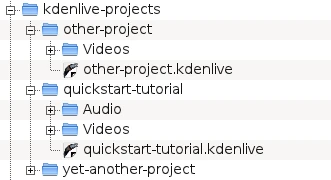

L'image ci-dessus montre la structure conseillée : chaque projet a son propre dossier, avec les fichiers vidéo dans `Videos/`, les fichiers audio dans `Audio/`, etc. (voir aussi [Structure de dossiers](https://docs.kdenlive.org/en/project_and_asset_management/file_management/folder_structure.html)).

La suite du tutoriel suppose que vous utilisez les vidéos d'exemple fournies, mais il fonctionne avec n'importe lesquelles.

## Créer un nouveau projet

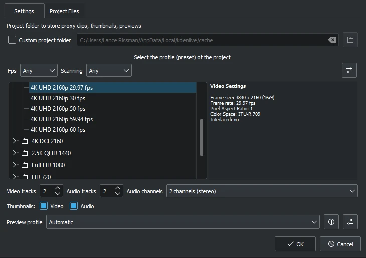

Ouvrez Kdenlive et créez un nouveau projet : **Fichier ‣ Nouveau**.

Choisissez le dossier de projet créé précédemment (`quickstart-tutorial/`) et un profil de projet adapté. Les vidéos d'exemple proposées ci-dessus sont en **720p, 23,97 i/s**. Si vous utilisez vos propres fichiers et ne savez pas quel profil choisir, Kdenlive en suggérera un adapté à l'ajout du premier clip : vous pouvez donc laisser le champ tel quel.

Si vous le souhaitez, passez au thème sombre : **Menu ‣ Paramètres ‣ Thème de couleurs ‣ Breeze-Dark**.

## Ajouter des clips

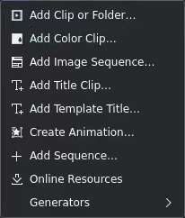

Le projet est prêt : ajoutez les clips téléchargés via le **bac à projets** (*Project Bin*). Un clic sur l'icône **Ajouter un clip ou un dossier** ouvre directement la boîte de dialogue ; un clic sur la petite flèche affiche la liste des autres types de clips. Vidéos, sons, images et autres projets Kdenlive s'ajoutent par la boîte de dialogue par défaut.

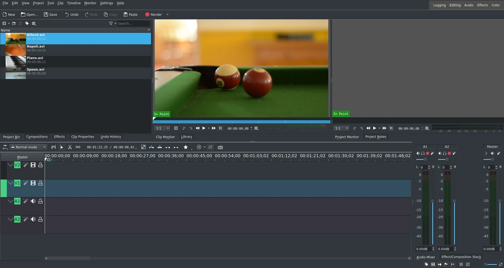

Après le chargement, Kdenlive ressemble à ceci. En haut à gauche, le **bac à projets**. À sa droite, les **moniteurs** : le moniteur de clip montre la vidéo d'origine, le moniteur de projet montre le rendu final avec effets et transitions. En bas, la **timeline** : c'est là que les clips sont montés. Deux types de pistes : **vidéo** et **audio**. Les pistes vidéo acceptent tout type de clip ; une vidéo déposée sur une piste audio ne garde que le son.

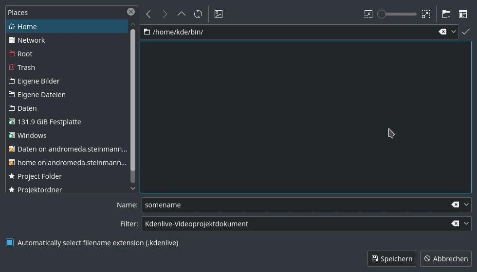

Enregistrez le travail avec **Menu ‣ Fichier ‣ Enregistrer**. Le projet conserve la place des clips sur la timeline, les effets appliqués, etc. — mais il ne se lit pas directement : la fabrication de la vidéo finale s'appelle le **rendu**.

Dans ce démarrage rapide, nous n'entrons pas dans le détail de la timeline ; voir la section [la timeline](../kdenlive-timeline/).

Passons au montage. Les clips du projet se combinent sur la timeline par **glisser-déposer** : glissez par exemple *Napoli* du bac à projets sur la première piste (V2).

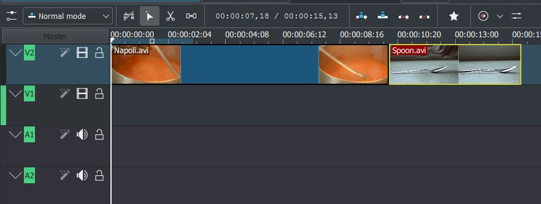

Comme il faut aussi des couverts, prenez le clip *Spoon* et déposez-le aussi sur V2. Placez *Napoli* au début de la timeline (sinon la vidéo commencerait par quelques secondes de noir), puis *Spoon* juste après, comme sur l'image (zoom avec Ctrl+molette).

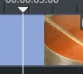

La lecture se lance avec **Espace** (ou le bouton Lecture du moniteur de projet). Si la tête de lecture n'est pas au début, la lecture démarre au milieu ; déplacez-la sur la règle ou dans le moniteur. **Ctrl+Origine** fait de même pour le moniteur actif (sélectionnez d'abord le moniteur de projet).

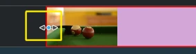

Le clip *Billiards* (billard) arrive ensuite, à placer sur la piste V1. Rien ne se passe pendant la première seconde et demie : on peut couper le début pour éviter l'ennui. Une méthode simple : placer la tête de lecture à l'endroit de la coupe, puis tirer la bordure gauche du clip quand la poignée de redimensionnement apparaît — le clip s'aligne sur la tête de lecture.

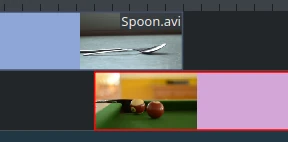

Pour ajouter une **transition** entre *Spoon* et *Billiards*, les deux clips doivent se chevaucher : placez le second au-dessus ou en dessous du premier, la fin du premier dépassant de quelques images le début du second. Zoomez jusqu'à voir les images (curseur de zoom en bas à droite ou Ctrl+molette) ; on obtient ainsi une transition de durée constante, ici cinq images. Kdenlive zoome autour de la tête de lecture : placez-la d'abord à l'endroit à agrandir, puis zoomez.

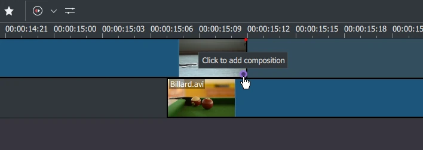

Une fois le chevauchement en place, ajoutez la transition : clic droit sur le clip supérieur → **Insérer une composition** → **Balayage** (*Wipe*), ou plus simplement survolez le coin inférieur droit du clip *Spoon* jusqu'à voir « Cliquer pour ajouter une composition ». Par défaut, cela ajoute une transition **Balayage**, qui convient ici. La transition fond le premier clip dans le second (voir [Balayage (Wipe)](https://docs.kdenlive.org/en/compositing/transitions.html)).

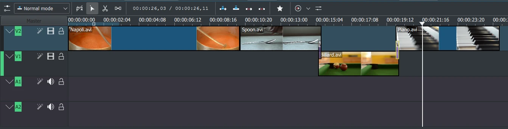

Ajoutez le dernier clip, *Piano*, et appliquez de nouveau une transition Balayage. Sur V2, cliquez sur la bordure inférieure gauche du nouveau clip pour ajouter la transition au clip précédent.

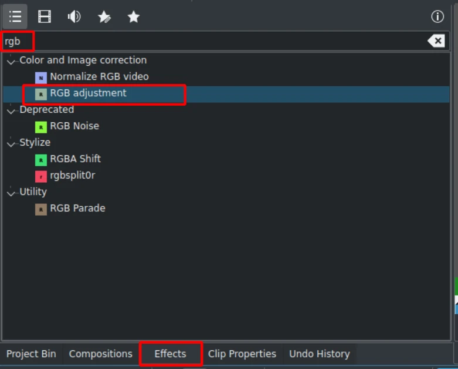

On peut coloriser le piano avec un effet : cliquez sur la vue des effets (sinon **Menu ‣ Vue ‣ Effets**), tapez `rgb` dans la recherche, puis double-cliquez sur **Ajustement RVB**.

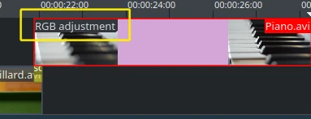

Une fois l'effet ajouté, cliquez sur une zone vide de la timeline : son nom apparaît sur le clip et dans la **pile d'effets/compositions**.

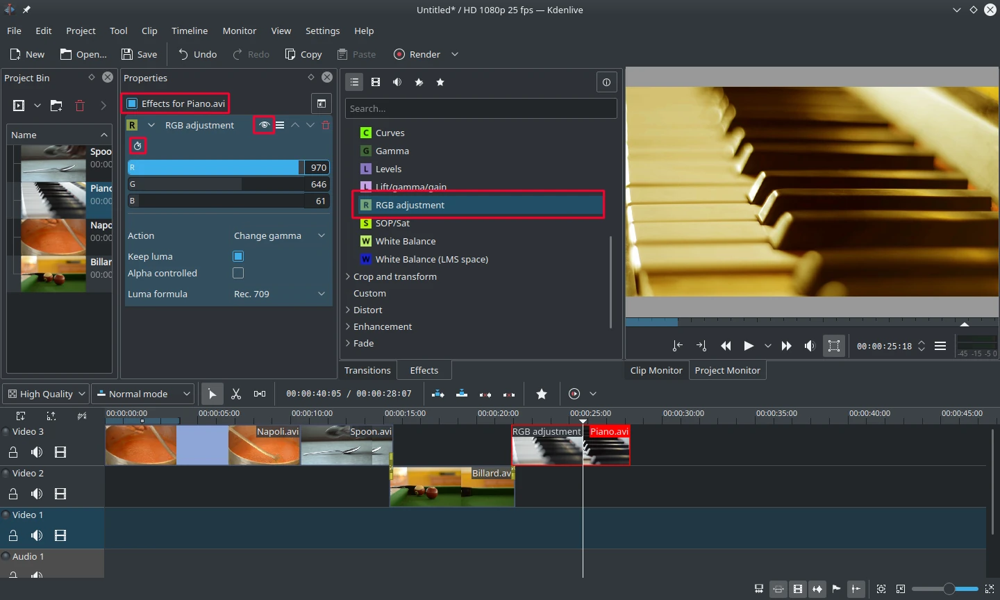

Pour obtenir un ton jaune-orangé chaud, réduisez le bleu et augmentez le rouge et le vert. Les valeurs se règlent au curseur (clic milieu = valeur par défaut) ou en saisissant la valeur à droite. La pile d'effets concerne le clip sélectionné. Chaque effet peut être désactivé par l'icône œil (ou tous par la case en haut) — les réglages sont conservés ; utile pour les effets coûteux en calcul.

Certains effets acceptent des **images clés** : l'icône d'horloge encadrée l'indique. Elles permettent de faire varier les paramètres dans le temps — ici, faire passer la couleur du piano d'un soir chaud à une nuit froide.

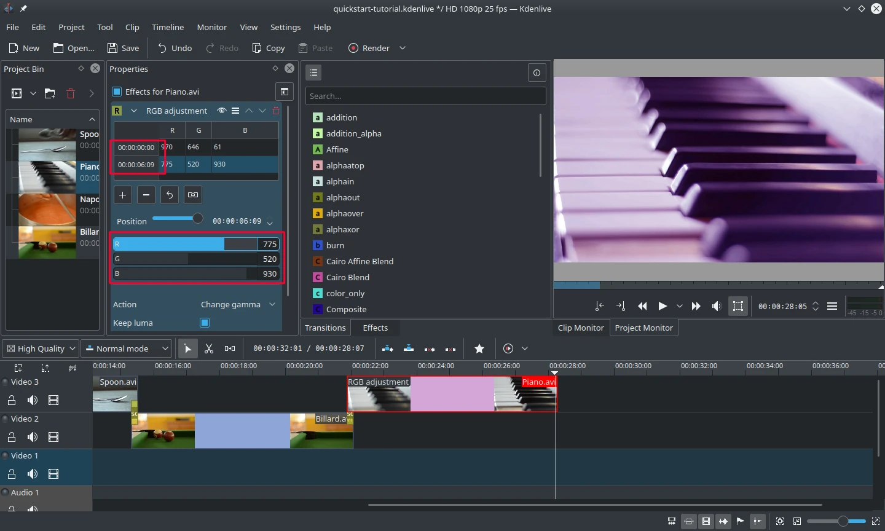

Après un clic sur l'icône d'images clés, le panneau **Propriétés** se réorganise. Par défaut, deux images clés : au début et à la fin du clip. Placez la tête de lecture à la fin du clip, sélectionnez la dernière image clé, puis réglez un bleu profond. Revenez au début et lisez : la couleur évolue.

Les images clés sont la partie la plus difficile de ce tutoriel — si vous y arrivez, vous maîtriserez Kdenlive facilement ! Plus de détails dans [Effets et filtres](https://docs.kdenlive.org/en/effects_and_filters.html#effects-and-filters).

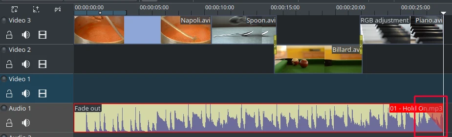

Les clips n'ont pas de son : cherchez une musique dans votre collection ou sur [Jamendo](https://www.jamendo.com). Ajoutez le clip audio au bac à projets, puis glissez-le sur une piste audio. Il se redimensionne comme un clip vidéo et s'aligne automatiquement sur la fin du projet. Pour un **fondu de sortie**, survolez le coin supérieur droit (ou gauche) du clip et tirez le triangle rouge jusqu'au début du fondu.

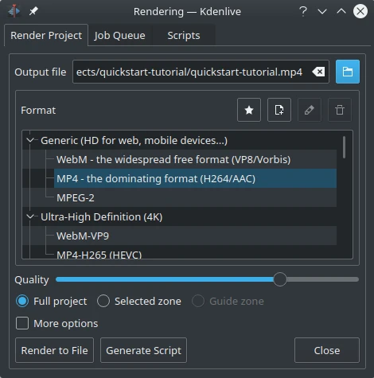

Le projet est prêt ! Cliquez sur **Rendre** (ou **Menu ‣ Fichier ‣ Rendre**, Ctrl+Entrée). Choisissez le fichier de sortie, le format **MP4** (compatible partout), l'emplacement, puis **Rendre dans un fichier**.

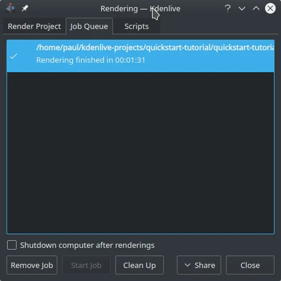

Quelques secondes plus tard, le rendu est terminé : votre premier projet Kdenlive est achevé. Félicitations !

## Notes

1. Téléchargement : [Kdenlive-tutorial-videos-2011-avi.zip](https://docs.kdenlive.org/en/_downloads/c7e578ef491ddf2efbc44c9a4d9c8594/Kdenlive-tutorial-videos-2011-avi.zip). Une version Theora est aussi disponible : [kdenlive-tutorial-videos-2011-ogv.tar.bz2](https://docs.kdenlive.org/en/_downloads/edd18389105f65d9cecf3694ad045d7f/kdenlive-tutorial-videos-2011-ogv.tar.bz2) (à éviter : le format Ogg Video pose souvent problème).
2. `720` est la hauteur de la vidéo, `p` signifie [balayage progressif](https://en.wikipedia.org/wiki/Progressive_scan) (par opposition à la [vidéo entrelacée](https://en.wikipedia.org/wiki/Interlaced_video)), et le nombre d'images par seconde indique le nombre d'images complètes par seconde.
3. À condition que **Configurer Kdenlive ‣ Divers** soit réglé sur « Vérifier si le premier clip ajouté correspond au profil du projet ».
4. Pour être exact, on peut le lire avec `melt votreprojet.kdenlive`, mais ce n'est pas une façon de présenter la vidéo finale (trop lente), et cela suppose que `melt` soit installé.
5. Outre le glisser-déposer, on peut utiliser les [raccourcis clavier](../kdenlive-shortcuts/) et les zones de clip pour insérer des clips (voir [Montage 3 points](https://docs.kdenlive.org/en/cutting_and_assembling/editing.html#three-point-editing) et [Utiliser les zones de clip](../kdenlive-clip-monitor/)).
6. Plusieurs méthodes permettent de couper un clip.
7. Ce triangle rouge est un raccourci pour ajouter l'effet **Fondu ‣ Fondu de sortie** ; les deux méthodes donnent le même résultat.
