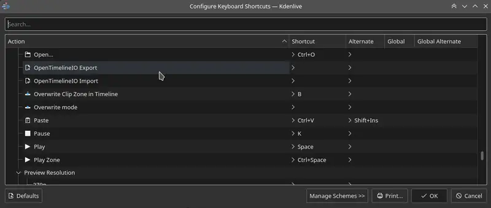
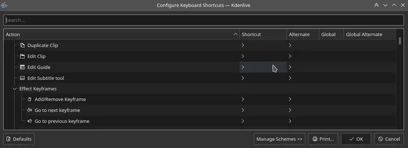
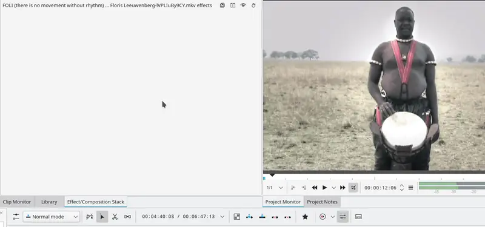

<!-- start-replace-fm field="title" -->
# Kdenlive — raccourcis clavier
<!-- end-replace-fm -->
<!-- start-replace-fm field="description" format="blockquote" -->
> Les raccourcis clavier par défaut de Kdenlive : fichier, édition, navigation, timeline, titres, rendu, réglages et fonctions d'images clés.
<!-- end-replace-fm -->

<!-- start-replace-mediagraphie-fiche -->
> **Référence** — Documentation Kdenlive (2026). Kdenlive — raccourcis clavier.. https://docs.kdenlive.org/en/user_interface/shortcuts.html. [↗](https://docs.kdenlive.org/en/user_interface/shortcuts.html)
>
> | **Type** | webpage |
> | **Auteur·e** | Documentation Kdenlive |
> | **Date** | 2026 |
> | **Statut** | stable |
> | **Mots-clés** | video, montage, kdenlive, raccourcis, tutoriel, cours |

**Citation (copier-coller)**

```citation
Documentation Kdenlive (2026). Kdenlive — raccourcis clavier.. https://docs.kdenlive.org/en/user_interface/shortcuts.html.
```
<!-- end-replace-mediagraphie-fiche -->

## Cité par

<!-- start-replace-mediagraphie-cited-by -->
- [Kdenlive — démarrage rapide](../kdenlive-quickstart/)
- [Kdenlive — la timeline](../kdenlive-timeline/)
<!-- end-replace-mediagraphie-cited-by -->

---

> 🇫🇷 **Traduction française** de la page officielle [Keyboard Shortcuts](https://docs.kdenlive.org/en/user_interface/shortcuts.html) — la page source n'est pas encore traduite. Adaptation : A26. Images : documentation officielle Kdenlive (interface anglaise ; GIF convertis en WebP animés).

Kdenlive propose de nombreux raccourcis clavier par défaut. Ils se modifient dans **Menu ‣ Paramètres ‣ Configurer les raccourcis clavier**, ou avec **Ctrl+Alt+,**. On peut aussi télécharger des schémas de raccourcis depuis le KDE Store.

## Fichier

| Action | Raccourci | Description |
|---|---|---|
| Nouveau | `Ctrl+N` | Crée un nouveau projet Kdenlive. |
| Ouvrir… | `Ctrl+O` | Ouvre un projet Kdenlive. |
| Quitter | `Ctrl+Q` | Quitte Kdenlive. |
| Enregistrer | `Ctrl+S` | Enregistre l'état courant du projet. |
| Enregistrer sous… | `Ctrl+Shift+S` | Enregistre le projet sous un nom choisi. |

## Général

| Action | Raccourci | Description |
|---|---|---|
| Réduire/développer un élément | `<` | — |
| Couper | `Ctrl+X` | Sélection courante. |
| Copier | `Ctrl+C` ou `Ctrl+Ins` | Sélection courante. |
| Supprimer l'élément sélectionné | `Suppr` | — |
| Chercher une action… | `Ctrl+Alt+I` | Ouvre la fenêtre d'actions. |
| Plein écran | `Ctrl+Shift+F` | — |
| Manuel de Kdenlive | `F1` | — |
| Basculer le moniteur en plein écran | `F11` ou double-clic | Moniteur. |
| Coller | `Ctrl+V` ou `Shift+Ins` | — |
| Rétablir | `Ctrl+Shift+Z` | — |
| Renommer… | `F2` | — |
| Afficher la barre de menus | `Ctrl+M` | Réaffiche la barre de menus après l'avoir masquée. |
| Tout sélectionner | `Ctrl+A` | Timeline, bac à projets, éditeur de titres. |
| Annuler | `Ctrl+Z` | — |
| Haut | `Alt+Haut` | — |
| Qu'est-ce que c'est ? | `Shift+F1` | — |
| Zoom avant | `Ctrl++` | Timeline seulement. |
| Zoom avant | `Ctrl+=` ou `Ctrl+molette` | Timeline, moniteurs, bac à projets, panneau d'images clés des effets. |
| Zoom arrière | `Ctrl+-` | Timeline seulement. |
| Zoom arrière | `Ctrl+molette` | Timeline, moniteurs, bac à projets, panneau d'images clés des effets. |
| Incrémenter/décrémenter | Molette | Timeline : défilement horizontal ; **Maj+molette** : vertical. Règle, moniteurs, bac à projets, panneau d'images clés. |
| Ajouter à la sélection | `Shift+clic gauche` ou `Shift+glisser` | Timeline : ajoute des clips ; éditeur de titres ; bac à projets : ajoute les clips entre le premier et le dernier cliqué. |
| Développer/réduire | `Shift+clic gauche` | Timeline : toutes les pistes du même type ; pile d'effets : tous les effets ; bac à projets : tous les dossiers. |
| Naviguer | Flèches haut/bas | Piste suivante, effet suivant, dossier suivant. |
| Ajouter à la sélection | `Ctrl+clic gauche` | Bac à projets : ajoute des clips ; effets : sélectionne des images clés. |
| Double-clic |  | Signet d'édition ; propriétés d'un clip ; ajout de clip ; durée d'un clip ; activation d'une piste ; moniteur en plein écran. |
| Réinitialiser une valeur | Clic milieu ou clic droit | Table de mixage audio, fonctions des effets. |

## Navigation et lecture

| Action | Raccourci | Description |
|---|---|---|
| Aligner la tête de lecture sur la souris | `P` | Timeline. |
| Avance | `L` | Lecture ; appuyez à nouveau pour cycler les vitesses (1x, 1,5x, 2x, 3x, 5,5x, 10x). |
| Avancer d'une image | `Droite` | Lecture. |
| Avancer d'une seconde | `Shift+Droite` | Lecture. |
| Aller à la fin du clip | `Fin` | Timeline. |
| Aller au début du clip | `Origine` | Timeline. |
| Repère suivant | `Ctrl+Droite` | Timeline. |
| Point d'accroche suivant | `Alt+Droite` | Timeline. |
| Repère précédent | `Ctrl+Gauche` | Timeline. |
| Point d'accroche précédent | `Alt+Gauche` | Timeline. |
| Aller à la fin du projet | `Ctrl+Fin` | Timeline. |
| Aller au début du projet | `Ctrl+Origine` | Timeline. |
| Aller à la fin de la zone | `Shift+O` | Timeline. |
| Aller au début de la zone | `Shift+I` | Timeline. |
| Boucler la zone | `Ctrl+Shift+Espace` | Lecture. |
| Pause | `K` | Lecture. |
| Lecture/arrêt | `Espace` | Lecture. |
| Lire la zone | `Ctrl+Espace` | Lecture. |
| Retour arrière | `J` | Lecture ; appuyez à nouveau pour cycler les vitesses (-1x à -10x). |
| Reculer d'une image | `Gauche` | Lecture. |
| Reculer d'une seconde | `Shift+Gauche` | Lecture. |
| Parcourir le clip | `Shift` + souris gauche/droite | Dans le moniteur de clip. |

## Bac à projets

| Action | Raccourci | Description |
|---|---|---|
| Fermer les bacs supplémentaires | `Ctrl+W` | — |

## Montage

| Action | Raccourci | Description |
|---|---|---|
| Focus sur le timecode | `=` | — |
| Insérer la zone dans le bac à projets | `Ctrl+I` | Moniteur de clip. |
| Définir le point d'entrée de zone | `I` | — |
| Définir le point de sortie de zone | `O` | — |
| Ajuster la zone de timeline | `Shift+Z` | Ajuste la zone aux clips sélectionnés. |
| Changer de moniteur | `T` | Bascule entre moniteur de clip et moniteur de projet. |
| Sélectionner la cible 1 à 9 | `Ctrl+1` à `Ctrl+9` | Montage 3 points. |
| Activer toutes les pistes | `Alt+Shift+A` | Montage 3 points. |
| Verrouiller toutes les pistes | `Ctrl+Shift+L` | Pistes. |
| Masquer/couper le son de la piste | `Ctrl+Shift+H` | Piste vidéo/audio sélectionnée. |
| Activer/désactiver toutes les pistes | `Shift+A` | Montage 3 points. |
| Activer la piste | `A` | Active la piste comme cible (la relie à la source). |
| Glisser plusieurs clips | `Shift+déplacer` | Sélectionnez les clips, activez l'outil Glissement, puis déplacez. |
| Glisser un clip | `Gauche`/`Droite` | Au clavier ou avec les boutons du moniteur. |

## Timeline

| Action | Raccourci | Description |
|---|---|---|
| Ajouter le clip à la sélection | `Alt++` | Ajoute le clip de la piste active à la position de la tête de lecture. |
| Ajouter un marqueur rapidement | `Num+*` | Sur le pavé numérique. |
| Ajouter un sous-titre | `Shift+S` | À la position de la tête de lecture. |
| Créer un calque de sous-titres | `Shift+glisser` | Fait glisser un sous-titre sous la piste de sous-titres. |
| Ajouter une transition à la sélection | `Alt+Shift++` | — |
| Dupliquer le clip | `Ctrl+D` | Copie le clip sélectionné après lui. |
| Ajouter/supprimer un repère | `G` | Ajoute un marqueur de timeline. |
| Grouper des clips | `Ctrl+G` | Sélection courante. |
| Dégrouper des clips | `Ctrl+Shift+G` | Sélection courante. |
| Modifier un groupe | `Ctrl+clic` | Sélection courante. |
| Couper tous les clips | `Ctrl+Shift+R` | À la tête de lecture, sauf pistes verrouillées. |
| Couper le clip | `Shift+R` | Clip de la piste active, à la tête de lecture. |
| Désélectionner le clip | `-` | — |
| Désélectionner la transition | `Shift+-` | — |
| Extraire la zone de timeline | `Shift+X` | — |
| Saisir l'élément courant | `Shift+G` | Sélectionner un clip, puis le déplacer avec gauche/droite. |
| Insérer la zone de clip | `V` | — |
| Soulever la zone de timeline | `Z` | — |
| Mélanger des clips | `U` ou double-clic | La tête de lecture doit être à la jonction de deux clips ; crée une transition sur la même piste. |
| Extraire le clip | `Shift+Suppr` | Supprime le clip et comble l'espace. |
| Vue multipiste | `F12` | L'outil Multicam doit être désactivé. |
| Écraser avec la zone de clip | `B` | — |
| Redimensionner la fin | `)` | Coupe à la tête de lecture et supprime la suite, ou supprime l'espace avec Ripple. |
| Redimensionner le début | `(` | Coupe à la tête de lecture et supprime le début, ou supprime l'espace avec Ripple. |
| Sélectionner le clip | `+` | — |
| Sélectionner la transition | `Shift++` | — |
| Lancer le rendu de prévisualisation | `Shift+Entrée` | — |
| Outil Rasoir | `X` | Outils. |
| Outil Sélection | `S` | Outils. |
| Outil Espaceur | `M` | Outils. |
| Désélectionner | `Ctrl+Shift+A` | Pistes. |
| Sélectionner les pistes audio 1 à 9 | `Alt+1` à `Alt+9` | Pistes. |
| Sélectionner les pistes vidéo 1 à 9 | `1` à `9` | Piste cible, notamment pour le montage 3 points et Multicam. |
| Changer le flux audio cible | `'` | Pistes. |
| Désactiver la piste | `Shift+H` | Pistes. |
| Verrouiller la piste | `Shift+L` | Pistes. |
| Changer la piste cible | `Shift+T` | Sélectionne une piste avec haut/bas, puis la définit comme source. |
| Redimensionner seulement l'audio ou la vidéo | `Shift+redimensionner` | Au clavier. |
| Déplacer l'audio ou la vidéo sur une autre piste | `Alt+déplacer` | Au clavier. |
| Ajuster la vitesse d'un clip | `Ctrl+glisser` | Au clavier. |
| Défilement de la timeline | `Ctrl+glisser` ou `clic milieu+glisser` | Maintenir et déplacer. |
| Revenir à l'outil Sélection | `Échap` | — |
| Redimensionner les pistes simultanément | `Shift+glisser` | Pistes vidéo ou audio. |
| Rétablir la hauteur normale | `Shift+double-clic` | Normalise la hauteur des pistes vidéo ou audio. |
| Sélection de piste | `Haut`/`Bas` | — |
| Onglets de séquence | `Ctrl+Tab` / `Ctrl+Shift+Tab` | Séquence suivante / précédente. |

## Éditeur de titres

| Action | Raccourci | Description |
|---|---|---|
| Ajouter du texte | `Alt+T` | Cliquez sur le canevas pour ajouter le texte. |
| Ajouter un rectangle | `Alt+R` | Faites glisser la souris. |
| Ajouter une ellipse | `Alt+E` | Faites glisser la souris. |
| Insérer une image | `Alt+I` | — |
| Revenir à l'outil Sélection | `Alt+S` | — |
| Déplacer verticalement seulement | `Shift` | Maintient le déplacement vertical. |
| Déplacer horizontalement seulement | `Shift+Alt` | Maintient le déplacement horizontal. |

## Rendu et réglages

| Action | Raccourci | Description |
|---|---|---|
| Rendre | `Ctrl+Entrée` | Ouvre la fenêtre de rendu. |
| Configurer Kdenlive… | `Ctrl+Shift+,` | Ouvre la fenêtre de configuration. |
| Configurer les raccourcis clavier… | `Ctrl+Alt+,` | Ouvre la fenêtre des raccourcis. |

## Afficher un widget par raccourci

On peut assigner un raccourci pour afficher un widget ancré. Dans **Menu ‣ Paramètres ‣ Configurer les raccourcis clavier** (ou **Ctrl+Alt+,**), cherchez « raise » : la liste des widgets affichables apparaît. Assignez un raccourci ; la combinaison donne le focus au widget et le sélectionne.



## Raccourcis des images clés

On peut assigner des raccourcis à trois fonctions d'images clés : **ajouter/supprimer une image clé**, **aller à l'image clé suivante**, **aller à l'image clé précédente**. Cliquez sur un clip dans la timeline, puis utilisez les raccourcis.



## Barre de recherche de commandes

La barre de commandes permet de chercher n'importe quelle action de Kdenlive : changer de thème, ajouter un effet, ouvrir un fichier, etc. Elle s'ouvre avec **Ctrl+Alt+I**. Ce raccourci est défini par KDE Frameworks : ne le changez pas.

> **Note** — Cette fonction exige KDE Frameworks 5.83.



## Notes

- **Molette** = molette de la souris ; **clic milieu** = molette enfoncée.
- **Clic gauche** / **clic droit** = bouton gauche / droit de la souris.

## Voir aussi

- [Kdenlive — les éléments de l'interface](../kdenlive-ui-elements/)
- [Kdenlive — la timeline](../kdenlive-timeline/)
- [Kdenlive — démarrage rapide](../kdenlive-quickstart/)
