<!-- start-replace-fm field="title" -->
# Kdenlive — la timeline
<!-- end-replace-fm -->
<!-- start-replace-fm field="description" format="blockquote" -->
> La timeline de Kdenlive : zones, règle, barre d'outils, pistes, en-têtes, menus contextuels, redimensionnement, défilement et lecture en boucle.
<!-- end-replace-fm -->

<!-- start-replace-mediagraphie-fiche -->
> **Référence** — Documentation Kdenlive (2026). Kdenlive — la timeline.. https://docs.kdenlive.org/en/user_interface/timeline.html. [↗](https://docs.kdenlive.org/en/user_interface/timeline.html)
>
> | **Type** | webpage |
> | **Auteur·e** | Documentation Kdenlive |
> | **Date** | 2026 |
> | **Statut** | stable |
> | **Mots-clés** | video, montage, kdenlive, timeline, tutoriel, cours |

**Citation (copier-coller)**

```citation
Documentation Kdenlive (2026). Kdenlive — la timeline.. https://docs.kdenlive.org/en/user_interface/timeline.html.
```
<!-- end-replace-mediagraphie-fiche -->

## Cité par

<!-- start-replace-mediagraphie-cited-by -->
- [Kdenlive — la table de mixage audio](../kdenlive-audio-mixer/)
- [Kdenlive — enregistrement audio](../kdenlive-audio-recording/)
- [Kdenlive — capturer l'audio](../kdenlive-capturing-audio/)
- [Kdenlive — propriétés du clip](../kdenlive-clip-properties/)
- [Kdenlive — démarrage rapide](../kdenlive-quickstart/)
- [Kdenlive — raccourcis clavier](../kdenlive-shortcuts/)
- [Kdenlive — les éléments de l'interface](../kdenlive-ui-elements/)
- [Kdenlive — l'interface](../kdenlive-user-interface/)
- [Exercice — Maquette sonore (sons de bouche)](../../../../02-activites/03/exercices/13-maquette-sonore/)
- [Exercice — Voir le son](../../../../02-activites/03/exercices/14-visualiser-le-son/)
<!-- end-replace-mediagraphie-cited-by -->

---

> 🇫🇷 **Traduction française** de la page officielle [Timeline](https://docs.kdenlive.org/en/user_interface/timeline.html) — la page source n'est pas encore traduite. Adaptation : A26. Images : documentation officielle Kdenlive (interface anglaise ; GIF convertis en WebP animés).

La **timeline** est le cœur de Kdenlive. Elle se compose de quatre zones :

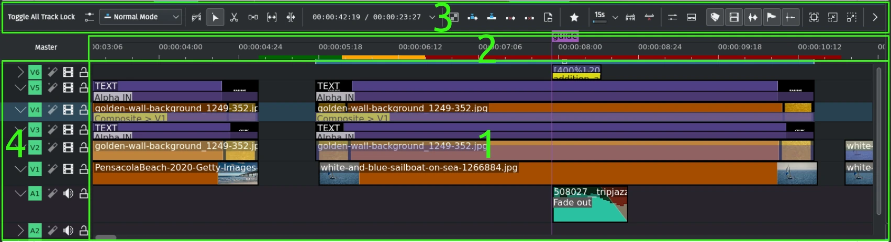

## Zones de la timeline

1. **Timeline** — zone où les clips sont déposés sur les pistes. Affiche les clips avec ou sans vignettes, avec ou sans forme d'onde audio, les noms et informations, les transitions et compositions, les marqueurs, marqueurs de timeline et images clés. Tout cela se règle depuis la barre d'état.
2. **Règle de la timeline** — affiche le temps en `hh:mm:ss:ff`, la zone courante, les zones de rendu de prévisualisation et leur état. Un clic gauche déplace la tête de lecture. Voir le menu contextuel plus bas.
3. **Barre d'outils de la timeline** — accès rapide aux outils de montage. Personnalisable (voir la configuration des barres d'outils).
4. **En-tête de piste** — type de piste (**V** vidéo, **A** audio), numéro, effets, masquage/coupure du son, verrouillage et nom facultatif. Chaque piste se redimensionne, se développe ou se réduit. Voir les menus contextuels plus bas.

## Timeline

### Barres de zoom

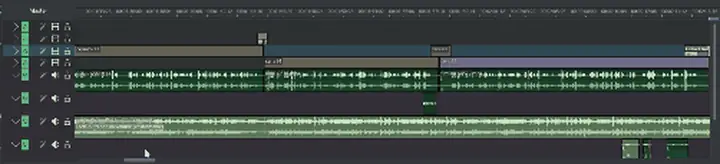

En plus des barres de zoom des moniteurs et des images clés, la timeline possède désormais les siennes : tirez les bords de la barre de défilement pour zoomer ou dézoomer. (Barres de zoom verticales à venir.)

### Défilement et panoramique

**Défiler la timeline** : tirez la barre de zoom horizontale ou verticale avec le bouton gauche ; ou dans la timeline avec la molette (horizontal) et **Maj+molette** (vertical) — ce comportement peut être inversé dans les réglages de la timeline.

**Panoramique continu** : **Ctrl+clic gauche**, ou maintenez le **clic milieu** et faites glisser la timeline à gauche ou à droite.

### Raccourcis et informations contextuelles

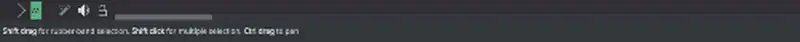

### Nouveaux visuels

La timeline a été redessinée : marqueurs et couleurs plus lisibles, marqueurs au-dessus de la règle, barres de zone et de prévisualisation en dessous.

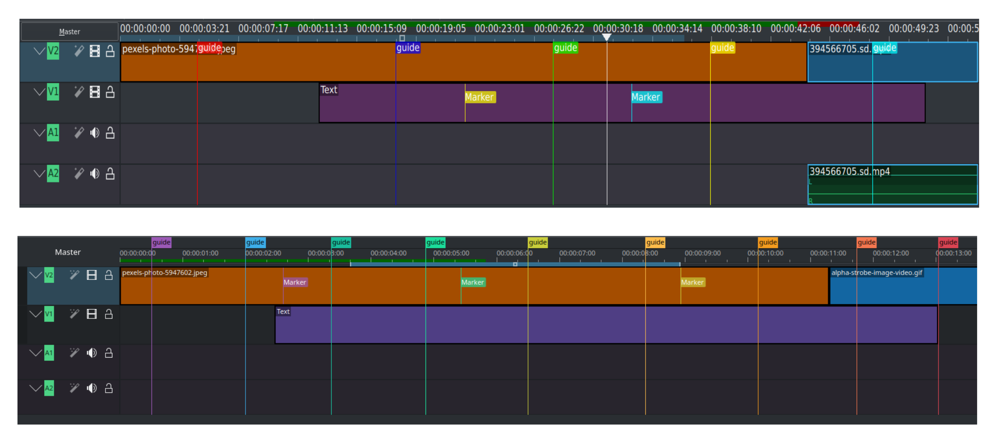

### Séparation audio/vidéo

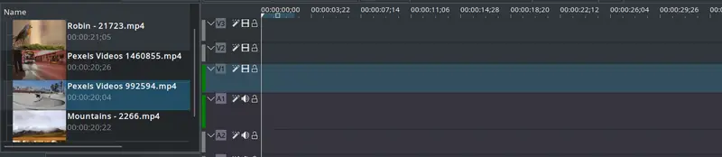

Chaque piste est désormais **audio** ou **vidéo** et n'accepte que les clips correspondants. Quand un clip AV est déposé depuis le bac à projets, il est automatiquement scindé : la vidéo va sur une piste vidéo, l'audio sur une piste audio. Cette séparation permet les transitions sur une même piste.

### Tête de lecture

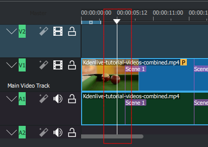

Une **tête de lecture fixe et centrée** s'active dans **Paramètres ‣ Configurer Kdenlive ‣ Timeline ‣ Tête de lecture fixe et centrée** : elle reste au centre pendant que le contenu défile.

Le **retour de la tête de lecture au départ** s'active dans **Paramètres ‣ Configurer Kdenlive ‣ Timeline ‣ Revenir à la position de départ à l'arrêt** : la tête revient au point de départ de la lecture, utile pour prévisualiser une section sans perdre sa place.

### Navigation au clavier

On peut déplacer clips et compositions au clavier : sélectionnez un clip, puis utilisez **Saisir l'élément courant** (**Menu ‣ Séquence**, ou **Shift+G**). Déplacez ensuite avec les flèches.

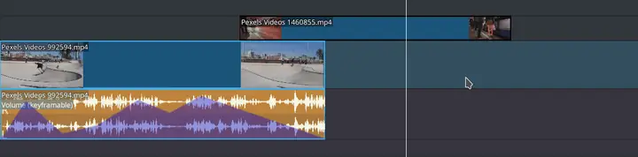

Les images clés se déplacent aussi individuellement : cliquez sur une image clé, déplacez-la avec gauche/droite, changez sa valeur avec **+** et **-**, et passez à une autre avec **Alt+flèche**.

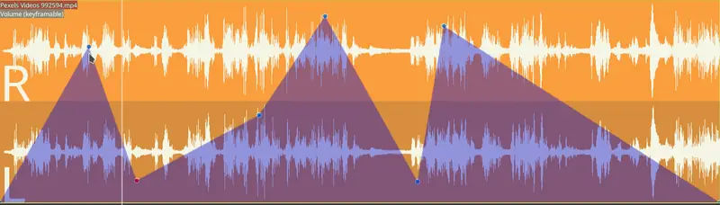

### Gestion des images clés

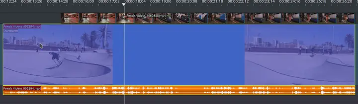

- Ajouter une image clé par double-clic dans la timeline.
- Déplacez une image clé sans changer sa valeur en utilisant la ligne verticale qui apparaît au-dessus ou en dessous.
- Supprimer une image clé en la faisant glisser loin au-dessus ou en dessous des limites du clip.

### Désactiver la pile d'effets d'un clip

La pile d'effets d'un clip s'active/désactive en cliquant sur l'icône d'effet.

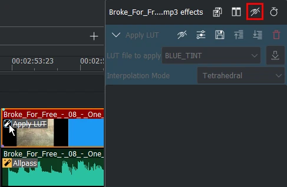

### Désactiver des clips individuellement

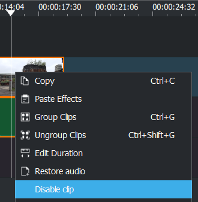

Un clip peut être désactivé tout en restant dans la timeline, sans audio ni vidéo (tous types de clips). Clic droit sur le clip → **Désactiver le clip** ou **Activer le clip**.

### Passer d'un onglet de séquence à l'autre

- Séquence suivante : **Ctrl+Tab**
- Séquence précédente : **Ctrl+Shift+Tab**

## Règle de la timeline

La règle affiche le timecode en `hh:mm:ss:ff` (par défaut) ou en images. Elle montre la zone de timeline (1), la zone de rendu de prévisualisation (2) et son état : rouge = non rendu, jaune = en cours, vert = terminé.

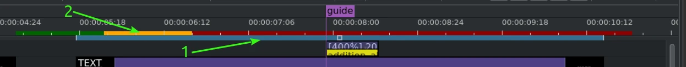

La zone se déplace en tirant le carré central et se redimensionne en tirant les bords, ou en plaçant la tête de lecture et en appuyant sur **I** / **O**.

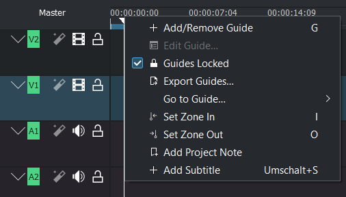

Clic droit dans la règle :

- manipuler les marqueurs de timeline ;
- définir les points d'entrée/sortie de zone ;
- ajouter des notes de projet ;
- ajouter un sous-titre.

## Barre d'outils de la timeline

La barre d'outils contrôle divers aspects du montage et se personnalise (voir **Configurer les barres d'outils**).

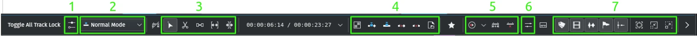

1. Activer la composition des pistes et basculer la vue audio/vidéo séparée ou mixte.
2. Mode de montage : **Normal**, **Écraser**, **Insérer**.
3. Outils de montage : Sélection, Rasoir, Espaceur, Glissement, Ripple.
4. Outils de clip et de zone : Mélanger des clips, Insérer la zone, Écraser avec la zone, Extraire la zone, Soulever la zone, Développer le clip.
5. Outils de rendu de prévisualisation : lancer/arrêter, options, ajouter une zone, supprimer toutes les zones.
6. Afficher/masquer la table de mixage audio.
7. Icônes de la barre d'état (version personnalisée ; ne fait pas partie de la barre par défaut).

## Pistes

La timeline est faite de **pistes** audio et vidéo. Leur nombre se définit à la création du projet. On ajoute un clip en le glissant depuis le bac à projets ou les moniteurs.

### En-tête de piste

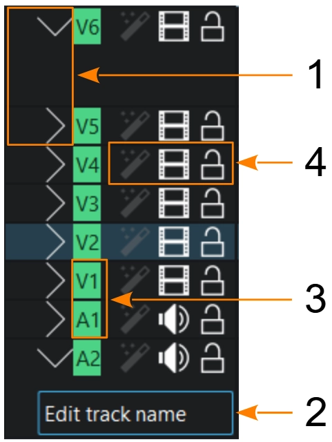

1. **Développer/réduire** la piste ; **Shift+clic gauche** pour toutes les pistes du même type.
2. **Nom de la piste** — cliquez pour le modifier.
3. **Type et numéro de piste**.
4. **Icônes de contrôle** — verrouiller la piste (empêche ajout, suppression et déplacement de clips) ; couper le son (pistes audio) ; masquer la vidéo (**Ctrl+Shift+H**) ; activer/désactiver les effets de piste.

Les flèches haut/bas passent à la piste suivante.

### Menu contextuel d'une piste

**Piste vidéo**

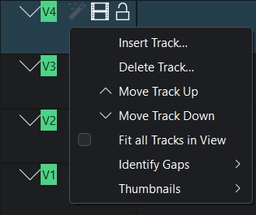

- **Insérer une piste** — voir *Ajouter des pistes*.
- **Supprimer la piste** — voir *Supprimer des pistes*.
- **Déplacer la piste vers le haut/bas** — voir *Réorganiser les pistes*.
- **Ajuster toutes les pistes à la vue** — voir *Ajuster à la hauteur de la vue*.
- **Identifier la piste** — voir *Identifier les espaces de la timeline*.
- **Vignettes** — image d'entrée, images d'entrée/sortie, toutes les images ou aucune.

**Piste audio**

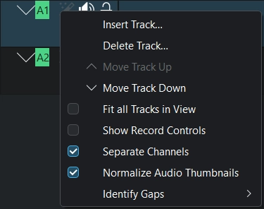

- **Insérer une piste**, **Supprimer la piste**, **Déplacer**, **Ajuster à la vue**, **Identifier la piste** — comme ci-dessus.
- **Afficher les contrôles d'enregistrement** — enregistrement audio direct dans la piste.
- **Séparer les canaux** — affiche chaque canal d'une piste audio (stéréo, 5.1).
- **Normaliser les vignettes audio** — porte le pic à -3 dB.

### Ajouter des pistes

Clic droit dans l'en-tête de piste, puis **Ajouter une piste** : choisissez le type, l'emplacement et le nombre de pistes.

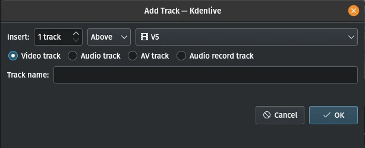

Le nombre de pistes d'un nouveau projet se règle dans **Menu ‣ Paramètres ‣ Configurer Kdenlive ‣ Valeurs par défaut du projet**.

### Réorganiser les pistes

Les pistes ne se réorganisent qu'entre pistes du même type. Clic droit dans l'en-tête → **Déplacer la piste vers le haut/bas**. Annulation possible avec **Ctrl+Z** ou **Menu ‣ Édition ‣ Annuler**. Les clips groupés restent ensemble ; les compositions attachées suivent le clip mais passent en automatique (sauf si elles étaient déjà en automatique ou en arrière-plan).

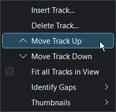

### Supprimer des pistes

Clic droit dans l'en-tête → **Supprimer la piste**. Kdenlive avertit si la piste contient des clips ; on peut supprimer la piste et ses clips, ou annuler.

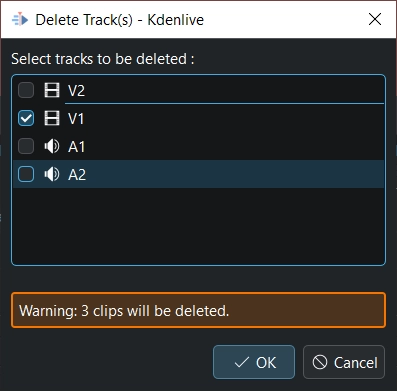

### Redimensionner les pistes

Chaque piste se redimensionne ; **Shift** change simultanément la hauteur de toutes les pistes vidéo ou audio.

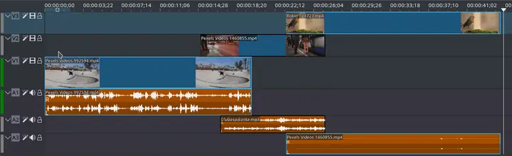

### Ajuster les pistes à la hauteur de la vue

Toutes les pistes peuvent être ajustées à la hauteur de la vue de la timeline.

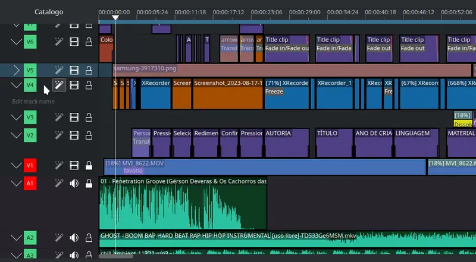

### Rétablir la hauteur par défaut d'une piste

**Shift+double-clic** sur la séparation de piste rétablit sa hauteur par défaut.

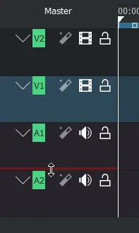

### Audio mixte ou séparé

Basculez en direct entre les modes **Mixte** et **Séparé**.

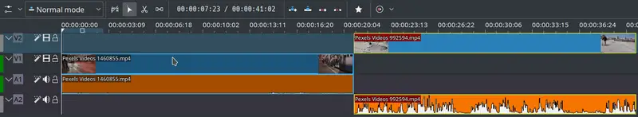

## Lecture en boucle continue

- Désactivez **Mettre la lecture en pause lors du déplacement** dans **Menu ‣ Paramètres ‣ Configurer Kdenlive ‣ Timeline**.
- Créez une zone de timeline de la durée à boucler.
- Activez **Boucler la zone** (**Ctrl+Shift+Espace**).

## Voir aussi

- [Kdenlive — les éléments de l'interface](../kdenlive-ui-elements/)
- [Kdenlive — raccourcis clavier](../kdenlive-shortcuts/)
- [Kdenlive — les moniteurs](../kdenlive-monitors/)
- [Kdenlive — démarrage rapide](../kdenlive-quickstart/)
