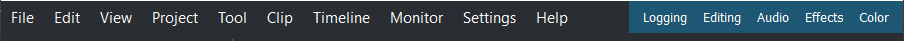
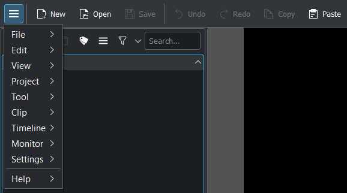
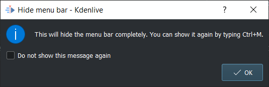
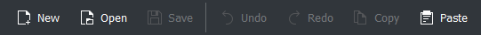
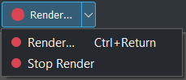
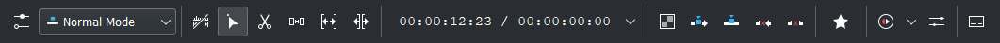
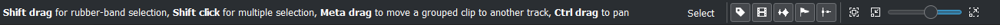
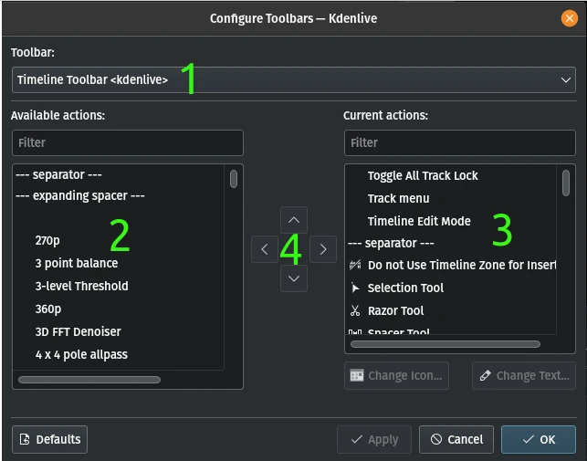

<!-- start-replace-fm field="title" -->
# Kdenlive — barres d'outils
<!-- end-replace-fm -->
<!-- start-replace-fm field="description" format="blockquote" -->
> Les barres d'outils de Kdenlive : barre de menus, barre principale, barre supplémentaire, barre de la timeline et barre d'état ; configuration et affichage.
<!-- end-replace-fm -->

<!-- start-replace-mediagraphie-fiche -->
> **Référence** — Documentation Kdenlive (2026). Kdenlive — barres d'outils.. https://docs.kdenlive.org/en/user_interface/toolbars.html. [↗](https://docs.kdenlive.org/en/user_interface/toolbars.html)
>
> | **Type** | webpage |
> | **Auteur·e** | Documentation Kdenlive |
> | **Date** | 2026 |
> | **Statut** | stable |
> | **Mots-clés** | video, montage, kdenlive, interface, barres-outils, tutoriel, cours |

**Citation (copier-coller)**

```citation
Documentation Kdenlive (2026). Kdenlive — barres d'outils.. https://docs.kdenlive.org/en/user_interface/toolbars.html.
```
<!-- end-replace-mediagraphie-fiche -->

## Cité par

<!-- start-replace-mediagraphie-cited-by -->
- [Kdenlive — les moniteurs](../kdenlive-monitors/)
- [Kdenlive — l'interface](../kdenlive-user-interface/)
<!-- end-replace-mediagraphie-cited-by -->

---

> 🇫🇷 **Traduction française** de la page officielle [Toolbars](https://docs.kdenlive.org/en/user_interface/toolbars.html) — la page source n'est pas encore traduite. Adaptation : A26. Images : documentation officielle Kdenlive (interface anglaise).

## Barre de menus



Ce n'est pas vraiment une barre d'outils, mais elle donne accès au [menu](https://docs.kdenlive.org/en/user_interface/menu/file_menu.html) et aux dispositions d'espace de travail.

Elle s'affiche ou se masque avec **Paramètres ‣ Afficher la barre de menus** ou **Ctrl+M**. Cela bascule entre une barre de menus et un bouton **menu hamburger** dans la barre d'outils principale.



Si la barre d'outils principale est masquée, un avertissement apparaît :



## Barre d'outils principale



La barre d'outils principale se configure dans **Paramètres ‣ Configurer les barres d'outils**, ou par clic droit sur la barre → **Configurer les barres d'outils…**. Elle s'affiche ou se masque dans **Paramètres ‣ Barres d'outils affichées**.

## Barre d'outils supplémentaire



La barre supplémentaire contient par défaut le bouton **Rendre**. Elle se configure de la même façon et s'affiche ou se masque dans **Paramètres ‣ Barres d'outils affichées**.

## Barre d'outils de la timeline



La barre d'outils de la timeline se configure de la même façon, mais **ne peut pas être masquée**.

## Barre d'état



Ce n'est pas vraiment une barre d'outils : la barre d'état affiche à gauche des astuces sur ce que l'on peut faire, et à droite des commutateurs et le curseur de zoom. Elle s'affiche ou se masque dans **Paramètres ‣ Afficher la barre d'état**. Pour plus de détails, voir *Montage, barre d'état*.

## Configurer les barres d'outils

Les outils et actions disponibles dans les barres d'outils se définissent dans **Paramètres ‣ Configurer les barres d'outils**, ou par clic droit sur une barre → **Configurer les barres d'outils…**.



1. Choisissez la barre d'outils à configurer.
2. Liste des actions, commandes et outils disponibles. Utilisez le champ **Filtre** pour les rechercher ; sélectionnez un élément et cliquez sur la flèche droite en (4) pour l'ajouter.
3. Liste des éléments déjà présents dans la barre sélectionnée. Sélectionnez un élément et utilisez les flèches en (4) : haut et bas le déplacent dans la liste, gauche le retire.
4. Flèches pour déplacer les éléments (haut/bas) et les faire entrer ou sortir des listes (gauche/droite).

> **Astuce** — Si l'écran manque de place à cause du nombre de pistes, déplacez des commandes du menu vers la barre supplémentaire ou celle de la timeline, et de la barre d'état vers celle de la timeline. Masquez ensuite la barre de menus (**Menu ‣ Paramètres ‣ Afficher la barre de menus** ou **Ctrl+M**) et la barre d'état (**Menu ‣ Paramètres ‣ Afficher la barre d'état**). Attention : sans barre d'état, les informations de raccourcis ne s'affichent plus.

## Masquer et afficher les barres d'outils

Cela se contrôle aussi avec l'entrée **Barres d'outils affichées** du menu **Paramètres**.

## Voir aussi

- [Kdenlive — l'interface](../kdenlive-user-interface/)
- [Kdenlive — les moniteurs](../kdenlive-monitors/)
- [Kdenlive — démarrage rapide](../kdenlive-quickstart/)
