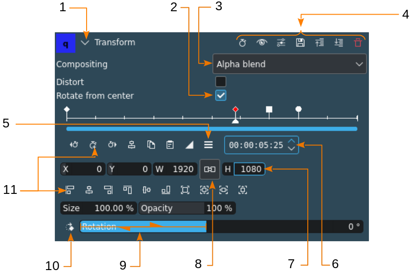
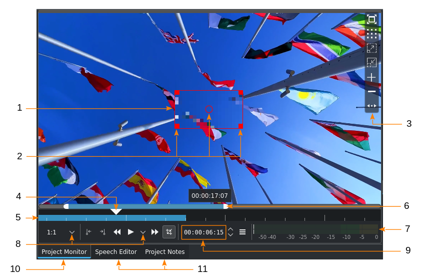
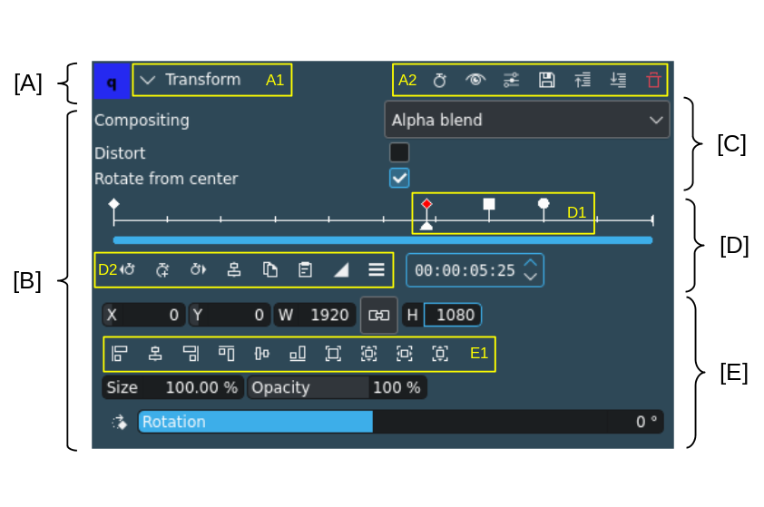
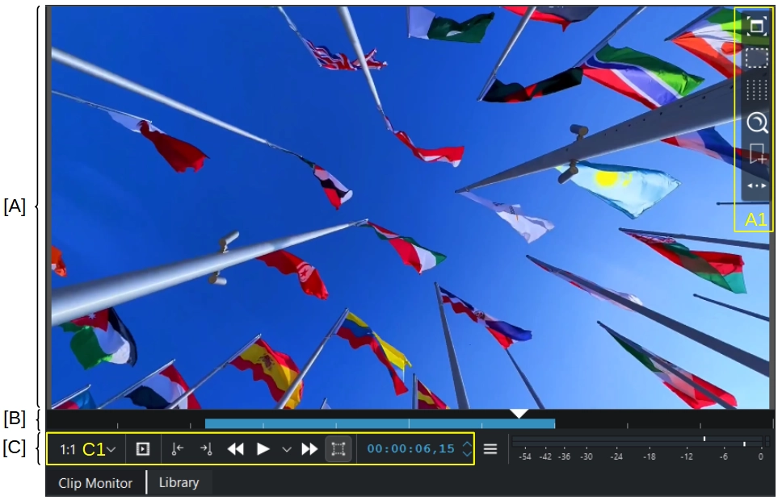
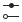

<!-- start-replace-fm field="title" -->
# Kdenlive — les éléments de l'interface
<!-- end-replace-fm -->
<!-- start-replace-fm field="description" format="blockquote" -->
> Les éléments de l'interface de Kdenlive : contrôles, zones du moniteur, panneaux d'effets, images clés et référentiel des icônes.
<!-- end-replace-fm -->

<!-- start-replace-mediagraphie-fiche -->
> **Référence** — Documentation Kdenlive (2026). Kdenlive — les éléments de l'interface.. https://docs.kdenlive.org/en/user_interface/ui_elements.html. [↗](https://docs.kdenlive.org/en/user_interface/ui_elements.html)
>
> | **Type** | webpage |
> | **Auteur·e** | Documentation Kdenlive |
> | **Date** | 2026 |
> | **Statut** | stable |
> | **Mots-clés** | video, montage, kdenlive, interface, icônes, tutoriel, cours |

**Citation (copier-coller)**

```citation
Documentation Kdenlive (2026). Kdenlive — les éléments de l'interface.. https://docs.kdenlive.org/en/user_interface/ui_elements.html.
```
<!-- end-replace-mediagraphie-fiche -->

## Cité par

<!-- start-replace-mediagraphie-cited-by -->
- [Kdenlive — les moniteurs](../kdenlive-monitors/)
- [Kdenlive — raccourcis clavier](../kdenlive-shortcuts/)
- [Kdenlive — la timeline](../kdenlive-timeline/)
<!-- end-replace-mediagraphie-cited-by -->

---

> 🇫🇷 **Traduction française** de la page officielle [UI Elements](https://docs.kdenlive.org/en/user_interface/ui_elements.html) — la page source n'est pas encore traduite. Adaptation : A26. Images : documentation officielle Kdenlive (interface anglaise).
>
> Les icônes ci-dessous reproduisent celles de l'interface ; elles proviennent de la documentation officielle Kdenlive.

## Contrôles



| Élément | Description |
|---|---|
| 1. Réduire/développer | Réduit ou développe une section de l'interface. |
| 2. Case à cocher | Sélectionne un élément ou une fonction facultative. |
| 3. Liste déroulante | Permet de choisir parmi une liste de valeurs. |
| 4. Icônes de barre d'outils | Icônes d'action propres au panneau. |
| 5. Menu hamburger | Ouvre un menu volant avec plus d'options. |
| 6. Compteur | Augmente ou diminue une valeur pas à pas. |
| 7. Saisie directe | Permet d'entrer une valeur précise. La molette augmente ou diminue la valeur ; **Maj** pour +1, **Ctrl** pour +10. |
| 8. Bouton | Active un état tant qu'il est enfoncé ; cliquez à nouveau pour le relâcher. |
| 9. Curseur | Modification rapide d'une valeur : glissez à gauche ou à droite ; la saisie directe voisine se met à jour. **Maj** pour +1, **Ctrl** pour +10. |
| 10. Bouton d'action | Change une valeur par pas définis ; chaque clic modifie la valeur, avec retour au début de l'échelle. |
| 11. Icône d'action | Exécute une action non répétable (sauf exceptions). |



| Élément | Description |
|---|---|
| 1. Cadre d'édition | **Moniteur de projet seulement.** Identifie l'objet ou la zone de l'effet. Le mode Édition doit être activé. |
| 2. Poignées du cadre d'édition | Redimensionnent (poignées carrées) et déplacent (cercle central) le cadre. |
| 3. Surimpression du moniteur | Survolez la zone sensible (en haut à droite par défaut) pour afficher la liste d'icônes. |
| 4. Tête de lecture | Indique la position dans la timeline ou le clip. |
| 5. Zone de timeline | Indique la zone définie avec **I** et **O**, ou en cliquant sur les icônes correspondantes. |
| 6. Barre de zoom | Zoome la timeline : tirez les poignées blanches aux extrémités, ou **Ctrl+molette** dans la timeline du moniteur. |
| 7. Vumètre audio | Affiche le niveau audio du projet ou du clip pendant la lecture ; les réglages de la table de mixage modifient l'affichage. |
| 8. Liste d'options | Ouvre une liste d'options. |
| 9. Timecode | Position de la tête de lecture en `hh:mm:ss:ff` : heures, minutes, secondes, images. |
| 10. Onglet actif | Widget actif. |
| 11. Onglet inactif | Widgets disponibles dans cette section de l'espace de travail. |

## Éléments



| Élément | Description |
|---|---|
| [A] En-tête du panneau d'effet | Nom de l'effet, icône de réduction et barre d'outils de l'effet. |
| [B] Paramètres de l'effet | Tous les paramètres de contrôle de l'effet. |
| [C] Paramètres normaux | Paramètres qui ne sont pas animables. |
| [D] Panneau d'images clés | Règle temporelle, images clés et icônes d'action. |
| [E] Paramètres animables | Paramètres pouvant recevoir des images clés. |
| [A1] | Nom de l'effet. |
| [A2] | Barre d'outils de l'effet. |
| [D1] | Images clés : rouge = sélectionnée ; losange = linéaire, carré = discrète, cercle = lissée. |
| [D2] | Icônes d'action des images clés. |
| [E1] | Icônes d'action Position et taille. |



| Élément | Description |
|---|---|
| [A] Zone du moniteur | Affichage du clip et modification des effets (moniteur de projet uniquement, si l'effet le permet et si le mode Édition est actif). |
| [B] Règle temporelle du moniteur | Timeline du projet ou du clip ; la tête de lecture indique l'image courante. Barre de zoom et zone s'affichent si elles sont définies. |
| [C] Barre d'outils du moniteur | Contrôles et actions du moniteur de clip ou de projet. |
| [A1] Surimpression du moniteur | Panneau de sélection des surimpressions. |
| [C1] Contrôles et actions du moniteur | Voir les icônes ci-dessous. |

## Icônes et boutons

### Barre d'outils du panneau d'effets

| Icône | Description |
|---|---|
|  | Afficher/masquer les images clés dans la timeline. |
|  | Activer/désactiver l'effet. |
|  | Ouvrir le menu avancé de l'effet. |
|  | Enregistrer les réglages actuels comme nouveaux réglages par défaut de l'effet. |
| .") | Descendre l'effet d'un niveau (modifie l'ordre d'application). |
| .") | Monter l'effet d'un niveau (modifie l'ordre d'application). |
|  | Supprimer l'effet de la pile. |

### Icônes d'images clés

| Icône | Description |
|---|---|
|  | Aller à l'image clé précédente. |
|  | Ajouter une image clé à la position courante. |
|  | Aller à l'image clé suivante. |
| .") | Supprimer l'image clé courante (ou toutes les images clés sélectionnées). |
|  | Déplacer l'image clé sélectionnée sur le curseur. |
|  | Copier les images clés sélectionnées. |
|  | Coller des images clés. |
|  | Type **linéaire** : interpolation linéaire vers cette image clé. |
|  | Type **discret** : aucune interpolation entre l'image précédente et celle-ci. |
|  | Type **lissé** : interpolation légèrement dynamique, avec entrée/sortie en douceur et un léger dépassement. |
|  | Ouvrir la fenêtre d'options des images clés. |

### Icônes de position et de taille

| Icône | Description |
|---|---|
|  | Aligner le cadre à gauche. |
|  | Centrer horizontalement. |
|  | Aligner à droite. |
|  | Aligner en haut. |
|  | Centrer verticalement. |
|  | Aligner en bas. |
|  | Zoomer le cadre à sa taille d'origine. |
|  | Zoomer pour ajuster aux dimensions du projet et centrer. |
|  | Ajuster à la largeur du projet. |
|  | Ajuster à la hauteur du projet. |

### Icônes des moniteurs de projet et de clip

| Icône | Description |
|---|---|
|  | **Moniteur de clip seulement** : insérer la zone dans le bac à projets. |
|  | `1:1` : définir la résolution de prévisualisation. |
|  | Définir le point d'entrée à la position courante. |
|  | Définir le point de sortie à la position courante. |
|  | Lecture arrière. |
|  | Lecture ; options de lecture. |
|  | Avance rapide. |
|  | **Moniteur de projet seulement** : activer/désactiver le mode Édition. |
|  | Menu d'options du moniteur. |
|  | Plein écran. |
|  pour le texte et les graphiques, a") | Afficher les zones de sécurité : titre (80 % intérieur) pour le texte et les graphiques, action (90 % intérieur) pour les éléments importants. |
|  | Changer la surimpression : parcourir les motifs disponibles. |
|  | Menu volant : zoom avant, zoom arrière, réinitialiser le zoom. |
|  | Ajouter/supprimer des repères. |
| .") | Déplacer la barre d'outils (droite ↔ gauche). |

### Icônes de la timeline

| Icône | Description |
|---|---|
|  | Réglages de la timeline. |
|  | Activer/désactiver la zone de timeline. |
|  | Outil Sélection. |
|  | Outil Rasoir. |
|  | Outil Espaceur. |
|  | Outil Glissement. |
|  | Outil Ripple. |
| .") | Mélanger des clips (transition sur la même piste). |
|  | Insérer la zone de clip dans la timeline. |
|  | Écraser avec la zone de clip. |
|  | Extraire la zone de timeline. |
|  | Soulever la zone de timeline. |
|  | Effets favoris. |
|  | Lancer le rendu de prévisualisation. |
|  | Options du rendu de prévisualisation. |
|  | Table de mixage audio. |
|  | Outil d'édition des sous-titres. |

### Icônes du bac à projets

| Icône | Description |
|---|---|
|  | Ajouter un clip ou un dossier ; ouvrir la boîte d'ajout de source. |
|  | Créer un dossier. |
|  | Supprimer les clips/dossiers sélectionnés. |
|  | Ouvrir le panneau des étiquettes. |
|  | Filtre ; ouvrir la sélection de filtres. |

### Icônes de la barre d'état

| Icône | Description |
|---|---|
|  | Afficher les étiquettes de couleur dans la timeline. |
|  | Afficher les vignettes vidéo. |
|  | Afficher les vignettes audio. |
|  | Afficher les commentaires des marqueurs. |
|  | Aimantation. |
|  | Zoomer pour ajuster au projet. |
|  | Zoom arrière. |
|  | Zoom avant. |
## Voir aussi

- [Kdenlive — l'interface](../kdenlive-user-interface/)
- [Kdenlive — les moniteurs](../kdenlive-monitors/)
- [Kdenlive — la timeline](../kdenlive-timeline/)
- [Kdenlive — démarrage rapide](../kdenlive-quickstart/)

<style>
img[src$=".svg"] { width: 24px; height: 24px; }
@media (prefers-color-scheme: dark) {
  img[src$=".svg"] { filter: invert(1); }
}
</style>
