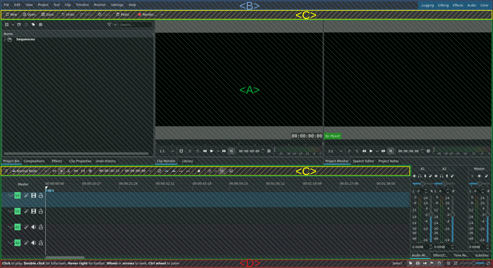
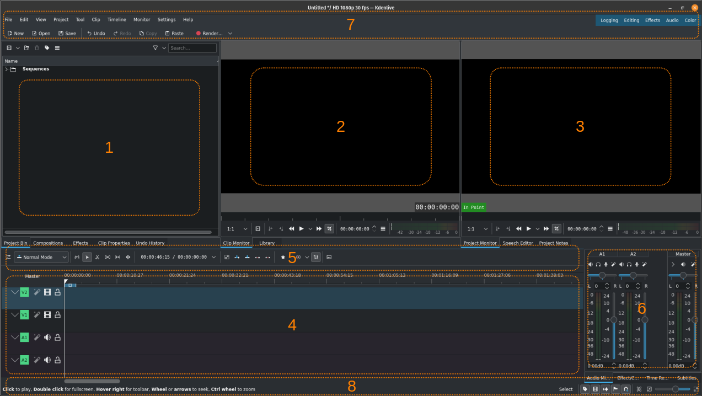

<!-- start-replace-fm field="title" -->
# Kdenlive — l'interface
<!-- end-replace-fm -->
<!-- start-replace-fm field="description" format="blockquote" -->
> Vue d'ensemble de l'interface de Kdenlive : espace de travail, barre de menus, barres d'outils, barre d'état et disposition des espaces de travail.
<!-- end-replace-fm -->

<!-- start-replace-mediagraphie-fiche -->
> **Référence** — Documentation Kdenlive (2026). Kdenlive — l'interface.. https://docs.kdenlive.org/en/user_interface.html. [↗](https://docs.kdenlive.org/en/user_interface.html)
>
> | **Type** | webpage |
> | **Auteur·e** | Documentation Kdenlive |
> | **Date** | 2026 |
> | **Statut** | stable |
> | **Mots-clés** | video, montage, kdenlive, interface, tutoriel, cours |

**Citation (copier-coller)**

```citation
Documentation Kdenlive (2026). Kdenlive — l'interface.. https://docs.kdenlive.org/en/user_interface.html.
```
<!-- end-replace-mediagraphie-fiche -->

## Cité par

<!-- start-replace-mediagraphie-cited-by -->
- [Kdenlive — capturer l'audio](../kdenlive-capturing-audio/)
- [Kdenlive — propriétés du clip](../kdenlive-clip-properties/)
- [Kdenlive — les moniteurs](../kdenlive-monitors/)
- [Kdenlive — barres d'outils](../kdenlive-toolbars/)
- [Kdenlive — les éléments de l'interface](../kdenlive-ui-elements/)
- [Kdenlive — écran d'accueil](../kdenlive-welcome-screen/)
<!-- end-replace-mediagraphie-cited-by -->

---

> 🇫🇷 **Traduction française** de la page officielle [User Interface](https://docs.kdenlive.org/en/user_interface.html) — la page source n'est pas encore traduite. Adaptation : A26. Images : documentation officielle Kdenlive (interface anglaise).

Cette section présente l'**interface de Kdenlive** : les éléments, icônes et boutons, les menus, les raccourcis clavier par défaut et la personnalisation de la disposition pour votre méthode de travail.

Au démarrage, la fenêtre de Kdenlive ressemble à l'image ci-dessous. L'interface est cohérente sur toutes les plateformes (Linux, Windows, macOS) ; seuls les icônes et les textes changent.

L'interface se divise en quatre parties principales :

- **[A] L'espace de travail** — les widgets, organisables selon vos besoins. Voir le [menu Vue](https://docs.kdenlive.org/en/user_interface/menu/view_menu.html) et les dispositions d'espace de travail.
- **[B] La barre de menus** — le menu et la liste des dispositions d'espace de travail.
- **[C] Les barres d'outils** — sous la barre de menus et au-dessus de la timeline.
- **[D] La barre d'état** — en bas de l'écran.



## Espaces de travail

Le modèle d'espace de travail suit le flux du montage vidéo et s'adapte à votre style. Par défaut, Kdenlive démarre avec l'espace **Montage** :



**[1] Bac à projets, bibliothèque :** les fichiers sources (clips vidéo, images et séquences d'images, titres et clips de couleur, animations, fichiers audio). Dans cette capture, les widgets **Historique des annulations**, **Compositions** et **Effets** ont été ajoutés à cette section.

**[2] Moniteur de clip :** affiche le clip sélectionné dans le bac à projets. Dans cette capture, le widget **Bibliothèque** a été ajouté à cette section. Voir le chapitre [Moniteur de clip](../kdenlive-clip-monitor/).

**[3] Moniteur de projet :** affiche le contenu de la timeline avec tous les effets et compositions appliqués. Dans cette capture, les widgets **Éditeur de parole** et **Notes de projet** ont été ajoutés. Voir le chapitre [Moniteur de projet](../kdenlive-project-monitor/).

**[4] Timeline :** l'essentiel du travail s'y déroule : ordonner les sources, faire les coupes et les ajustements, appliquer des effets, ajouter des compositions et transitions, et monter les pistes audio. Voir le chapitre [Timeline](../kdenlive-timeline/).

**[5] Barre d'outils de la timeline :** tous les outils nécessaires au montage du projet. Voir le chapitre *Barre d'outils de la timeline*.

**[6] Table de mixage audio :** le panneau de mixage où l'on règle le volume et le panoramique des pistes audio et du bus principal.

**[7] Barre de menus, barre d'outils :** en haut de l'écran, accès au menu, aux dispositions d'espace de travail et à la barre d'outils principale. La barre de menus s'affiche ou se masque avec **Ctrl+M**.

**[8] Barre d'état :** Kdenlive affiche à gauche des informations ou des astuces selon la position du pointeur. Au centre apparaissent les noms des clips survolés dans la timeline, ainsi que les messages d'erreur. À droite, l'outil de montage actif et les icônes qui activent diverses fonctions de la timeline.

## Voir aussi

- [Kdenlive — écran d'accueil](../kdenlive-welcome-screen/)
- [Kdenlive — barres d'outils](../kdenlive-toolbars/)
- [Kdenlive — les moniteurs](../kdenlive-monitors/)
- [Kdenlive — démarrage rapide](../kdenlive-quickstart/)
