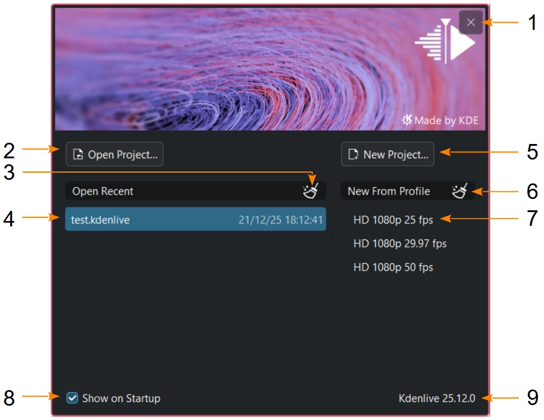
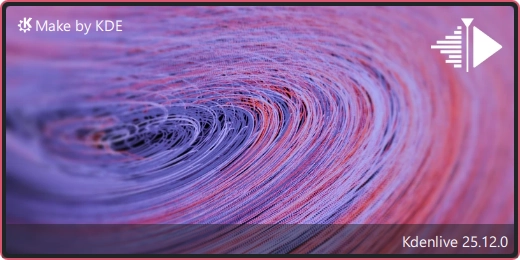

<!-- start-replace-fm field="title" -->
# Kdenlive — écran d'accueil
<!-- end-replace-fm -->
<!-- start-replace-fm field="description" format="blockquote" -->
> L'écran d'accueil et l'écran de démarrage de Kdenlive : ouvrir un projet récent, créer un nouveau projet, gérer les profils récents et désactiver l'écran d'accueil.
<!-- end-replace-fm -->

<!-- start-replace-mediagraphie-fiche -->
> **Référence** — Documentation Kdenlive (2026). Kdenlive — écran d'accueil.. https://docs.kdenlive.org/en/user_interface/welcome_and_splash_screen.html. [↗](https://docs.kdenlive.org/en/user_interface/welcome_and_splash_screen.html)
>
> | **Type** | webpage |
> | **Auteur·e** | Documentation Kdenlive |
> | **Date** | 2026 |
> | **Statut** | stable |
> | **Mots-clés** | video, montage, kdenlive, interface, accueil, tutoriel, cours |

**Citation (copier-coller)**

```citation
Documentation Kdenlive (2026). Kdenlive — écran d'accueil.. https://docs.kdenlive.org/en/user_interface/welcome_and_splash_screen.html.
```
<!-- end-replace-mediagraphie-fiche -->

## Cité par

<!-- start-replace-mediagraphie-cited-by -->
- [Kdenlive — l'interface](../kdenlive-user-interface/)
<!-- end-replace-mediagraphie-cited-by -->

---

> 🇫🇷 **Traduction française** de la page officielle [Welcome and Splash Screen](https://docs.kdenlive.org/en/user_interface/welcome_and_splash_screen.html) — la page source n'est pas encore traduite. Adaptation : A26. Images : documentation officielle Kdenlive (interface anglaise).

Au démarrage, Kdenlive affiche un **écran d'accueil** avec les fonctions suivantes :



1. **Annule** le démarrage de Kdenlive.
2. Ouvre la boîte de dialogue **Ouvrir** après le démarrage.
3. **Efface la liste** des projets récents.
4. Ouvre directement un **projet récent** (même liste que *Ouvrir un projet récent*).
5. Ouvre la boîte de dialogue **Nouveau** après le démarrage.
6. **Efface la liste** des profils récents.
7. Ouvre un **nouveau projet** avec la configuration d'un profil récent.
8. Si l'option n'est pas cochée, Kdenlive affiche l'écran de démarrage (*splash*) au lancement. L'écran d'accueil se réactive dans les réglages d'environnement.
9. Affiche la **version** de Kdenlive.

Si un projet est ouvert depuis la ligne de commande ou le gestionnaire de fichiers, l'**écran de démarrage** s'affiche à la place de l'écran d'accueil.



## Voir aussi

- [Kdenlive — l'interface](../kdenlive-user-interface/)
- [Kdenlive — démarrage rapide](../kdenlive-quickstart/)
