<!-- start-replace-fm field="title" -->
# Krita — l'animation 2D
<!-- end-replace-fm -->
<!-- start-replace-fm field="description" format="blockquote" -->
> Le chapitre du manuel Krita sur l'animation : le flux de production image par image et les calques d'animation — créer une boucle animée dans Krita.
<!-- end-replace-fm -->

<!-- start-replace-mediagraphie-fiche -->
> **Référence** — Documentation Krita (2026). Krita — l'animation 2D.. https://docs.krita.org/fr/user_manual/animation.html. [↗](https://docs.krita.org/fr/user_manual/animation.html)
>
> | **Type** | webpage |
> | **Auteur·e** | Documentation Krita |
> | **Date** | 2026 |
> | **Statut** | stable |
> | **Mots-clés** | image, krita, animation, tutoriel, cours |

**Citation (copier-coller)**

```citation
Documentation Krita (2026). Krita — l'animation 2D.. https://docs.krita.org/fr/user_manual/animation.html.
```
<!-- end-replace-mediagraphie-fiche -->

## Cité par

<!-- start-replace-mediagraphie-cited-by -->
- [Krita — le panneau Courbes d'animation](../krita-animation-curves/)
- [Krita — la chronologie d'animation](../krita-animation-timeline/)
- [Krita — le panneau Pelures d'oignon](../krita-onion-skin/)
- [Krita — le panneau Storyboard](../krita-storyboard-docker/)
- [05](../../../../01-deroulement/05/)
- [06](../../../../01-deroulement/06/)
- [Exercice — Storyboard d'une séquence](../../../../02-activites/02/exercices/01-storyboard/)
- [Exercice — Animation image par image](../../../../02-activites/02/exercices/02-image-par-image/)
- [Exercice — La brique qui tombe](../../../../02-activites/02/exercices/03-brique-qui-tombe/)
- [Exercice — La balle rebondissante](../../../../02-activites/02/exercices/04-balle-rebondissante/)
- [Exercice — La tête qui se tourne](../../../../02-activites/02/exercices/05-tete-qui-se-tourne/)
- [Exercice — Titres et transitions](../../../../02-activites/02/exercices/06-titres-transitions/)
- [Exercice — Le sac de farine](../../../../02-activites/02/exercices/07-sac-de-farine/)
- [Exercice — Le cycle de marche](../../../../02-activites/02/exercices/08-cycle-de-marche/)
- [Exercice — Le changement d'émotion](../../../../02-activites/02/exercices/09-changement-emotion/)
- [Exercice — Lever une charge](../../../../02-activites/02/exercices/10-lever-une-charge/)
- [Exercice — La boucle de chargement](../../../../02-activites/02/exercices/11-boucle-spinner/)
- [Exercice — Montage simple](../../../../02-activites/02/exercices/12-montage-simple/)
- [Exercice — Exporter en GIF](../../../../02-activites/02/exercices/13-export-gif/)
- [Exercice — Le cycle de course](../../../../02-activites/02/exercices/14-cycle-de-course/)
- [Exercice — Encodage et export](../../../../02-activites/02/exercices/15-encodage-export/)
- [02](../../../../02-activites/02/)
<!-- end-replace-mediagraphie-cited-by -->

---
> 🇫🇷 **Traduction française** de la page officielle [Animation with Krita](https://docs.krita.org/fr/user_manual/animation.html) — la page source n'est pas encore traduite. Adaptation : A26.

Grâce au Kickstarter de 2015, Krita a l'animation. Plus précisément : de l'animation matricielle image par image.

Pour accéder aux fonctions d'animation, le plus simple est de changer l'espace de travail pour **Animation** : les panneaux d'animation et le flux de travail apparaissent.

## Flux de production

Dans le flux d'animation traditionnel, on fait des **images clés** (*keyframes*) qui contiennent les poses importantes, puis on dessine les images entre elles — le *tweening* dans le jargon des animateurs.

Quatre panneaux importants pour ce flux :

1. Le [panneau Chronologie d'animation](../krita-animation-timeline/) — voir et contrôler toutes les images de l'animation ; il gère aussi les calques, qui apparaissent également dans le panneau Calques normal.
2. Le [panneau Pelures d'oignon](../krita-onion-skin/) — règle l'aspect des pelures d'oignon, pour voir l'image précédente.
3. Le [panneau Courbes d'animation](../krita-animation-curves/) — du petit *tweening* sur les courbes d'animation.
4. Le [panneau Storyboard](../krita-storyboard-docker/) — créer et suivre ses storyboards.

Et surtout : dès qu'on veut une grande animation — plus de 3 secondes — il faut penser son approche. Krita est spécialisé dans l'image par image, et garde **toutes les images en mémoire** (RAM). Les fichiers d'animation dévorent la mémoire vive. Si vous ne savez pas ce qu'est la mémoire de travail, vous en avez probablement trop peu pour une longue séquence dans Krita. Il faut donc emprunter une page à l'animation professionnelle : planifier !

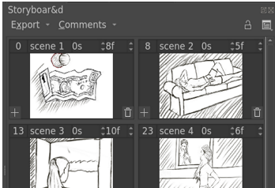

La plupart des projets d'animation commencent par un script — ou au minimum un déroulé des actions. Un éditeur de texte suffit. L'étape suivante : le [storyboard](../krita-storyboard-docker/) — l'esquisse de la composition de base de chaque scène, avec des notes sur ce qui va bouger : caméra, personnages, son, couleur. On pense à une BD, mais la différence clé : dans la BD, la composition aide le lecteur à parcourir la page des yeux, alors qu'en animation le regard du spectateur reste à peu près au même endroit — les cases consécutives du storyboard gardent leurs éléments importants à peu près à la même place. On peut faire le storyboard avec les fonctions d'animation, à condition d'utiliser le moins d'images possible ; l'exporter avec l'option de rendu d'animation.

Puis vient l'**animatique** (*animatic*) : le storyboard, mais animé. À faire dans un éditeur vidéo comme [Kdenlive](https://kdenlive.org/), [OpenShot](https://www.openshot.org/), [Olive](https://olivevideoeditor.org/) — voire Windows Movie Maker. *Si vous voulez tout assembler en une grande animation, il faudra apprendre un tel programme : Krita n'a pas de fonctions étendues de montage vidéo et audio.*

L'animatique montre comment subdiviser l'animation en petits clips. Pour débuter, limitez-vous à **12 images par seconde** — un clip de 10 secondes fait alors 120 images. Essayez de subdiviser votre idée d'animation en clips de 10 secondes ou moins. Les images du storyboard d'un clip s'importent via **Fichier ‣ Importer des images d'animation**. De là, on construit l'animation lentement. Pendant la phase d'esquisse, travailler en basse résolution aide aussi — 800×450 pixels : la haute résolution ne commence à compter qu'au dessin au trait, et on n'atteindra jamais ce stade sans un brouillon d'abord.

Gardez toujours un œil sur la consommation mémoire : elle s'affiche dans la barre d'état, en cliquant l'étiquette de résolution — avec une petite barre de progression montrant la mémoire utilisée. Ne laissez pas la barre se remplir : Krita ralentit, et parfois il ne pourra même plus exporter l'animation sur votre machine. Pour réduire la consommation :

1. **Fusionner les calques.** On ne peut pas se payer un calque par changement — souvent, moins de calques, mieux vaut.
2. Parfois, **Image ‣ Rogner les calques à la taille de l'image** : rogne tout ce qui dépasse du canevas.
3. Certains calques n'ont pas besoin de couleur — noir et blanc ? **Calques ‣ Convertir ‣ Convertir l'espace de couleurs du calque** vers les niveaux de gris : la RAM de ce calque est divisée par deux.
4. **Travailler plus petit.** Même si vous vous imaginiez animer en 4K, acceptez peut-être que votre machine ne peut pas — un cran plus bas : en animation, une réduction de 20 % fait une énorme différence mémoire, pour une petite différence de résolution.

Attention aussi aux autres programmes qui accaparent la RAM : navigateurs web et logiciels de discussion en tête, surtout s'ils diffusent musique ou vidéos. Si la mémoire manque, déplacez ces fonctions sur un autre appareil — un téléphone, par exemple.

Et faites **plein de sauvegardes**. Chaque fois que vous atteignez une section importante — dessin au trait fini, passage délicat réussi — utilisez **Fichier ‣ Enregistrer en version incrémentale** pour une copie séparée dans laquelle continuer. Ainsi, si le fichier d'animation se corrompt (coupure de courant, chat sur le clavier), vous gardez un instantané de la dernière section importante. Copier vers un service en ligne ou un disque de sauvegarde est aussi fortement recommandé.

> **ASTUCE** — En y étant, à chaque étape franchie : prenez une pause ! Les grands projets d'animation demandent beaucoup d'effort et de concentration — les pauses rechargent.

Quand c'est fini, **Rendre l'animation** à nouveau : exporter une séquence d'images ou un petit fichier vidéo, puis composer toutes les séquences et vidéos dans l'éditeur vidéo, rendre en `WebM`, et téléverser sur votre plateforme vidéo favorite.

Tout cela semble compliqué — mais si votre ordinateur a peu de ressources, il faut être débrouillard soi-même !

## Introduction à l'animation : le cycle de marche

Le meilleur moyen de comprendre toutes ces parties : s'en servir. Le cycle de marche est considéré comme la forme la plus simple de l'animation complète, parce qu'il implique toutes les parties. Le parcourir sert donc d'introduction.

## Configuration

On crée un nouveau fichier. Premier onglet : un ratio sympa comme 1280×1024, 72 dpi (c'est pour l'écran), et le titre « walk cycle ».

Dans le deuxième onglet, on choisit une couleur de fond et on règle l'arrière-plan sur **couleur du canevas** : Krita remplira automatiquement toute zone transparente avec cette couleur. Modifiable dans **Image ‣ Propriétés de l'image**. Très utile pour l'animation : le calque sur lequel on anime **doit** être semi-transparent pour que les pelures d'oignon fonctionnent.

> **NOTE** — Krita a plein de fonctions de métadonnées dès l'écran de création de document : le titre sert de suggestion d'enregistrement, la description peut alimenter des bases de données ou laisser des commentaires. Peu de gens les utilisent seuls, mais c'est utile en grand groupe.

Puis **Créer** !

Et pour obtenir tous les outils d'animation : sélectionner l'espace de travail Animation dans **Fenêtre ‣ Espace de travail ‣ Animation**. Résultat :


## Animer

S'assurer qu'il y a deux calques transparents dans le panneau Calques — en ajouter avec **+** ou `Ins`. Nommer le calque du bas « environment » et celui du haut « walkcycle » (double-clic sur leurs noms).


Avec l'[outil de lignes droites](https://docs.krita.org/fr/reference_manual/tools/line.html), tracer une ligne horizontale : le sol.

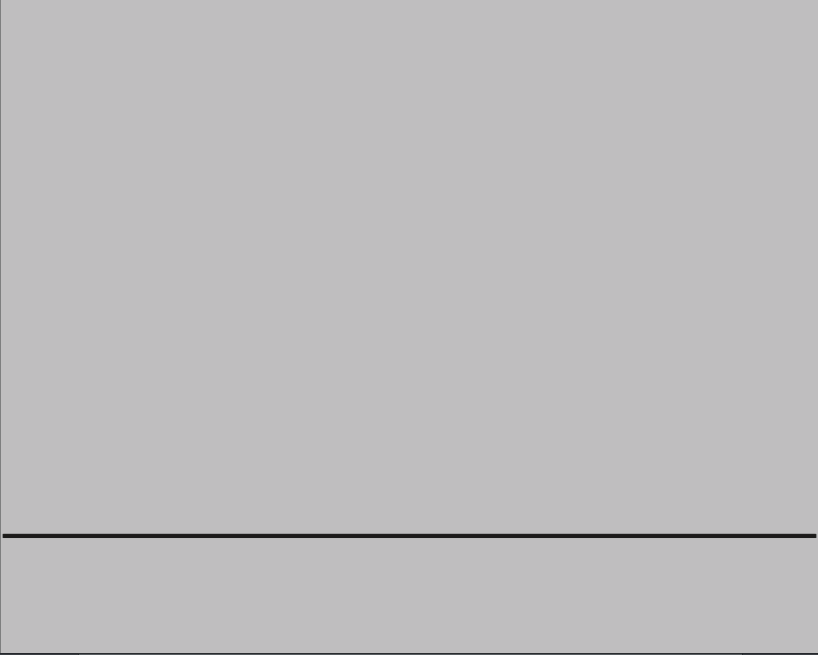

Sélectionner le calque « walkcycle » et dessiner tête et torse (n'importe quel pinceau).

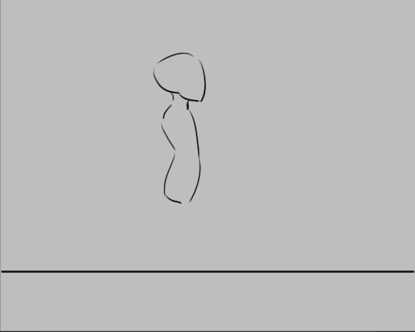

Maintenant, sélectionner une nouvelle image ne crée pas d'image automatiquement — Krita ne voit même pas le calque « walkcycle » comme un calque animé !

On le rend animé en ajoutant une image à la chronologie : clic droit sur la chronologie pour le menu contextuel, puis **Créer une image dupliquée** ().

> **ATTENTION** — Si vous choisissez **Créer une image vide**, le contenu du calque est jeté et une image vide apparaît ; pour conserver l'image, il faut **Créer une image dupliquée**.

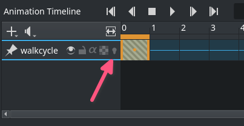

Le calque est devenu animé : l'icône pelures d'oignon () apparaît dans le panneau Chronologie.

Utiliser **Créer une image dupliquée** pour copier la première image sur la seconde. Puis l'[outil de déplacement](https://docs.krita.org/fr/reference_manual/tools/move.html) (`T`), avec `Shift + ↑` pour monter le contenu de l'image.

La différence se voit en activant les pelures d'oignon (presser  pour qu'elle devienne ) :

On voit maintenant l'image précédente en rouge.

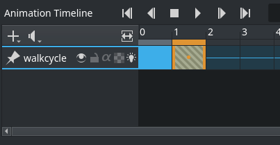

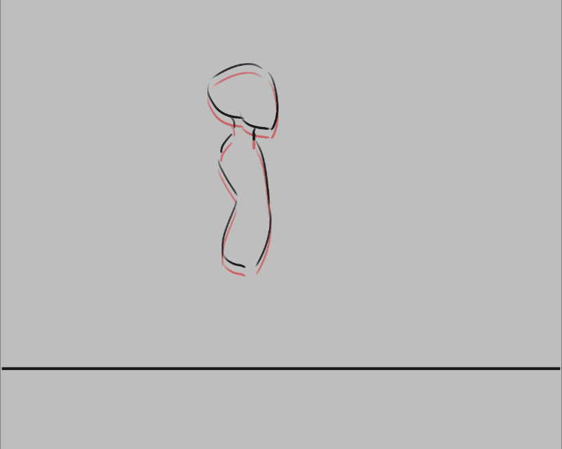

> **AVERTISSEMENT** — Krita voit le blanc comme une **couleur**, pas comme de la transparence : le calque d'animation doit être transparent là où il n'y a pas de dessin. On peut réparer avec le filtre [Couleur vers alpha](https://docs.krita.org/fr/reference_manual/filters/colors.html), mais mieux vaut prévenir.

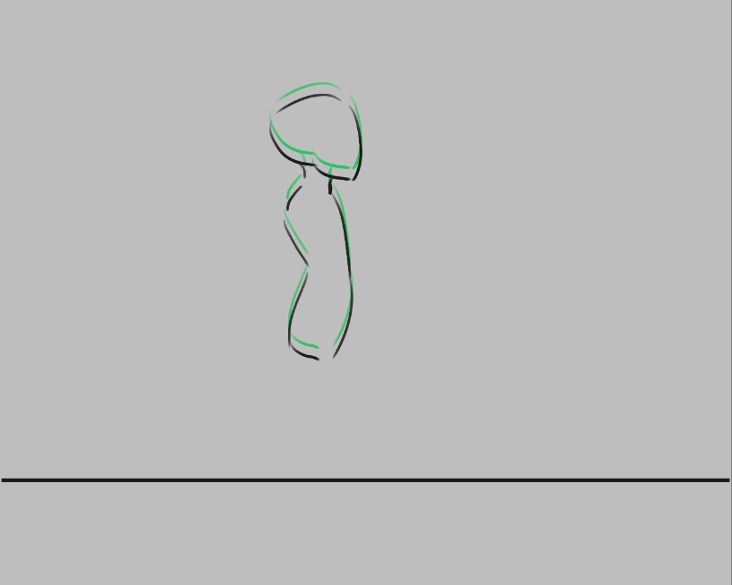

Les images futures s'affichent en vert — les deux couleurs se règlent dans le panneau Pelures d'oignon.

On va maintenant dessiner les **deux extrêmes** du cycle de marche : la pose où les deux jambes sont aussi écartées que possible, et celle où une jambe est tendue et l'autre repliée, prête à faire le pas suivant.

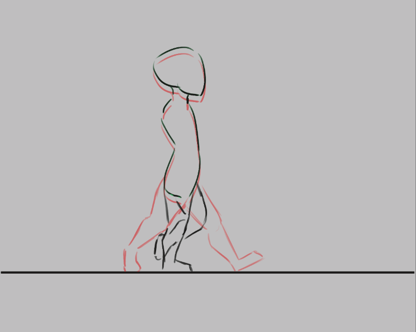

Copions ces deux images : clic droit sur l'image → **Copier les images clés**, sélectionner la position dans la chronologie, clic droit → **Coller les images clés**.

Ensuite :

1. Copier l'image 0 vers l'image 2.
2. Copier l'image 1 vers l'image 3.
3. Effacer les lignes semi-transparentes pour montrer clairement quelle jambe est devant l'autre : en 0 et 1, la jambe proche est à droite puis se plie ; en 2 et 3, la jambe lointaine est à droite puis se plie.

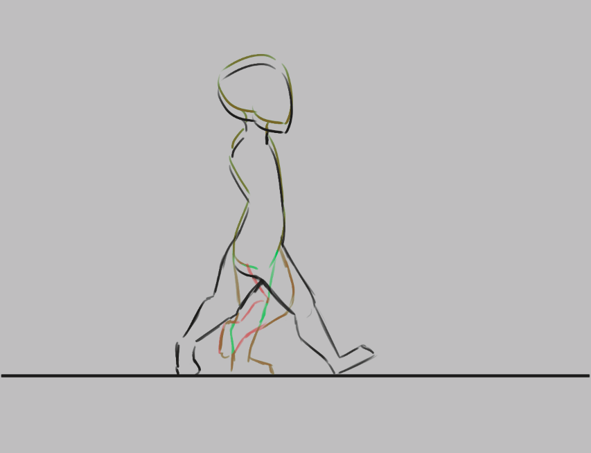

4. Dans les réglages d'animation, régler la cadence à 4.


5. Sélectionner toutes les images dans le panneau Chronologie en les englobant à la souris.

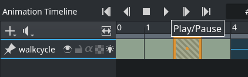

6. Presser lecture dans l'en-tête.

7. Savourez votre première animation !

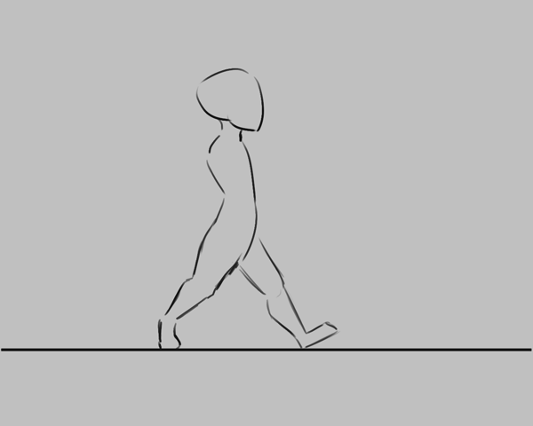

## Développer le cycle approximatif


On fait vite de la place : `Alt` + glisser sur une image la déplace **elle et toutes les suivantes** d'un coup. Plus efficace : sélectionner toutes les images, clic droit, **Images tenues ‣ Insérer une image tenue** — un espace vide (image tenue) s'insère entre chaque image clé.

Puis on crée de nouvelles images entre chaque image clé, en essayant d'**intercaler** (*inbetween*).

> **NOTE** — Beaucoup a été écrit sur le bon intercalage : c'est un des domaines où les animateurs expriment le plus leur style. Nous ne couvrons pas l'intercalage ici — cherchez des tutoriels d'intercalage sur le web, et des analyses d'animation pour mesurer la finesse du sujet. Pour cet exemple, je commence par trouver la position du talon dans l'image, puis je dessine le reste du pied, puis les genoux, puis le reste des jambes.


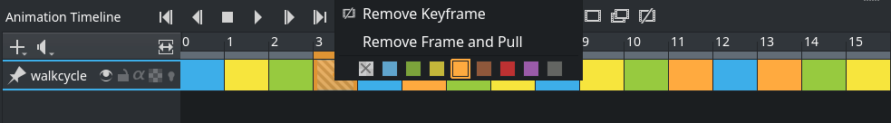

Plus on ajoute d'images, plus l'animation est difficile à suivre. Deux remèdes : d'abord **étiqueter les images par couleur** — clic droit sur les images clés, choisir une couleur en bas de menu.


Ensuite, ajuster les pelures d'oignon.

Le [panneau Pelures d'oignon](../krita-onion-skin/) règle le nombre d'images visibles d'un coup (rangée du haut), la transparence (rangée du dessous), et les couleurs et intensités du marquage encore en dessous.

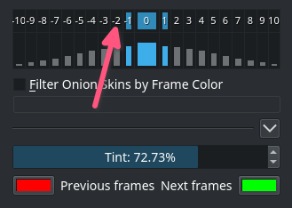

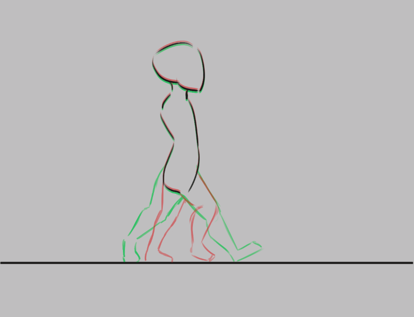

## Animer avec plusieurs calques

Il manque des mains à notre cycle de marche — ajoutons-les sur un calque séparé. Nouveau calque, nommé « hands » et…

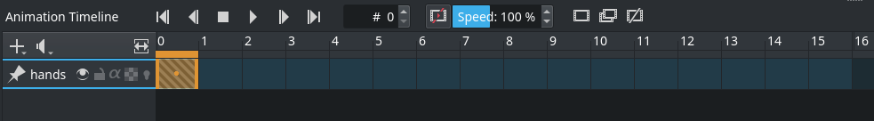

Le cycle de marche a disparu du panneau Chronologie ! C'est une fonctionnalité : une animation complète a tant de petites parties qu'on peut retirer de la chronologie les calques sur lesquels on ne travaille pas.

Ajouté dans la version 4.3.0 : depuis Krita 4.3.0, tous les nouveaux calques sont épinglés à la chronologie par défaut.

Pour afficher un calque, actif ou non : l'**épingler** à la chronologie en cliquant l'icône , le calque voulu étant sélectionné dans le [panneau Calques](https://docs.krita.org/fr/reference_manual/dockers/layers.html). Épinglez les calques sur lesquels vous animez.


## Exporter

Quand c'est terminé : **Fichier ‣ Rendre l'animation**. Pour rendre vers un fichier vidéo, il faut un programme appelé **FFmpeg** — voir [Rendu de l'animation](https://docs.krita.org/fr/reference_manual/render_animation.html).

Profitez de votre cycle de marche !


## Animer avec des masques de transformation

Ajouté dans la version 5.0.

Pour déplacer votre cycle de marche, les [masques de transformation](https://docs.krita.org/fr/reference_manual/layers_and_masks/transformation_masks.html) déplacent les images de gauche à droite **sans éditer les pixels**.

D'abord, ouvrir le [panneau Courbes d'animation](../krita-animation-curves/) s'il ne l'est pas : **Configuration ‣ Panneaux ‣ Courbes d'animation**.

Puis grouper les calques à transformer — ici « hands » et « walkcycle ». Clic droit sur le groupe, **Ajouter ‣ Masque de transformation**.

Dans le panneau d'animation, sélectionner la première image et choisir **Ajoute une image clé pour contrôler une propriété scalaire** (). Dans la Chronologie, les images scalaires sont marquées d'un losange.

Sélectionner l'[outil de transformation](https://docs.krita.org/fr/reference_manual/tools/transform.html), presser l'écran et déplacer le groupe au point de départ. `Entrée` pour confirmer. Sélectionner la dernière image dans le panneau, presser l'écran à nouveau, tout déplacer vers le point d'arrivée. Presser **Zoom de la vue sur la plage du canal** pour voir l'ensemble.

À la lecture, le contenu du calque se déplace — mais probablement trop vite. Deux remèdes : copier-coller les images du cycle pour le répéter 3 à 4 fois, puis déplacer l'image scalaire à la dernière image.


Cela ne synchronise toujours pas le cycle avec la vitesse du déplacement. La meilleure méthode — un peu laborieuse — : aller à la première image où un pied touche le sol, marquer cette section (par exemple avec des [guides](https://docs.krita.org/fr/reference_manual/dockers/grids_and_guides.html)), puis, dans les images suivantes, utiliser l'outil de transformation sur chaque image pour que le pied **reste en place** tant qu'il touche le sol. Pareil pour le prochain contact du pied, et le suivant, etc.


Après tout cela, le cycle de marche glisse en douceur :


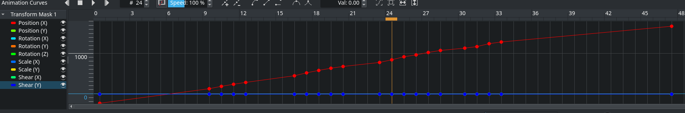

Krita sait interpoler les courbes (ease-in, ease-out…), mais ici l'ajustement image par image est plus rapide.

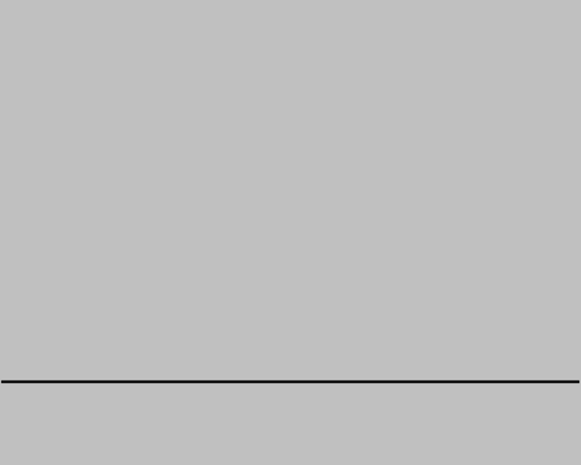

> **VOIR AUSSI** — [Chronologie d'animation](../krita-animation-timeline/) · [Pelures d'oignon](../krita-onion-skin/) · [Courbes d'animation](../krita-animation-curves/) · [Storyboard](../krita-storyboard-docker/) · [Importer une animation](https://docs.krita.org/fr/reference_manual/import_animation.html) · [Audio pour l'animation](https://docs.krita.org/fr/reference_manual/audio_for_animation.html) · [Rendu de l'animation](https://docs.krita.org/fr/reference_manual/render_animation.html) · [Gabarit d'animation japonaise](https://docs.krita.org/fr/user_manual/japanese_animation_template.html)
