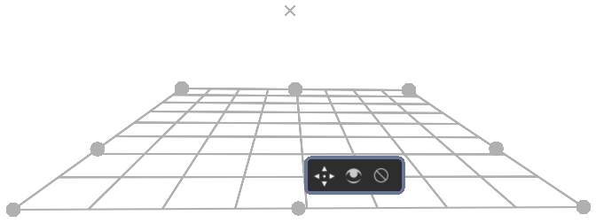
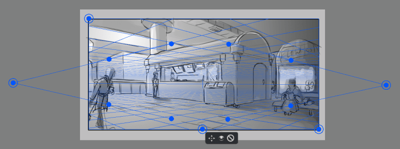
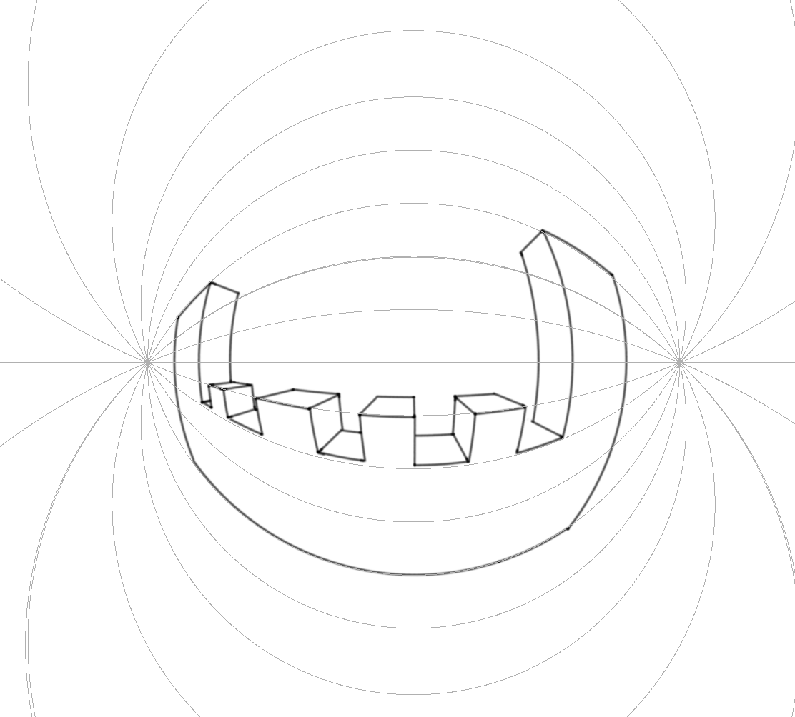
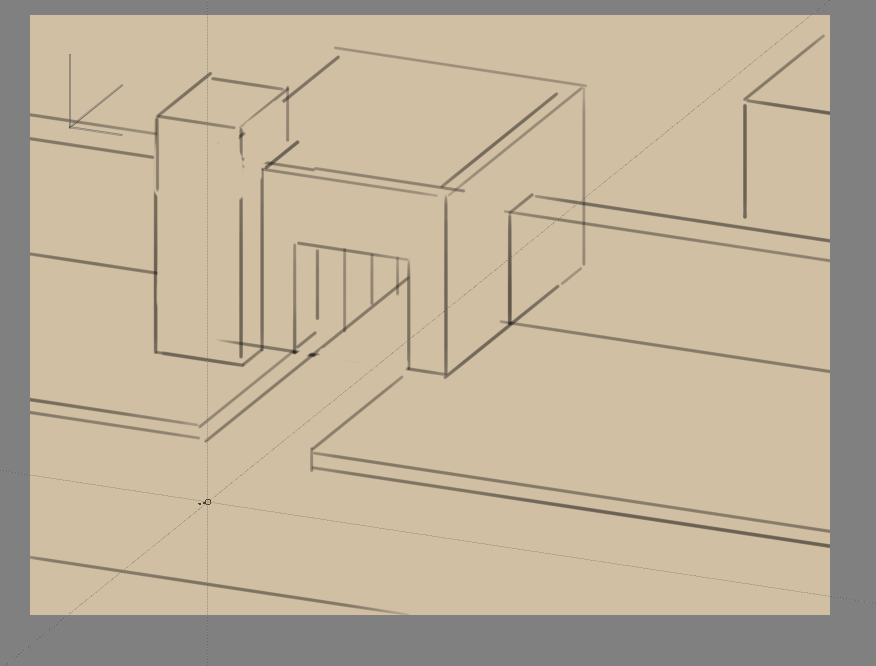
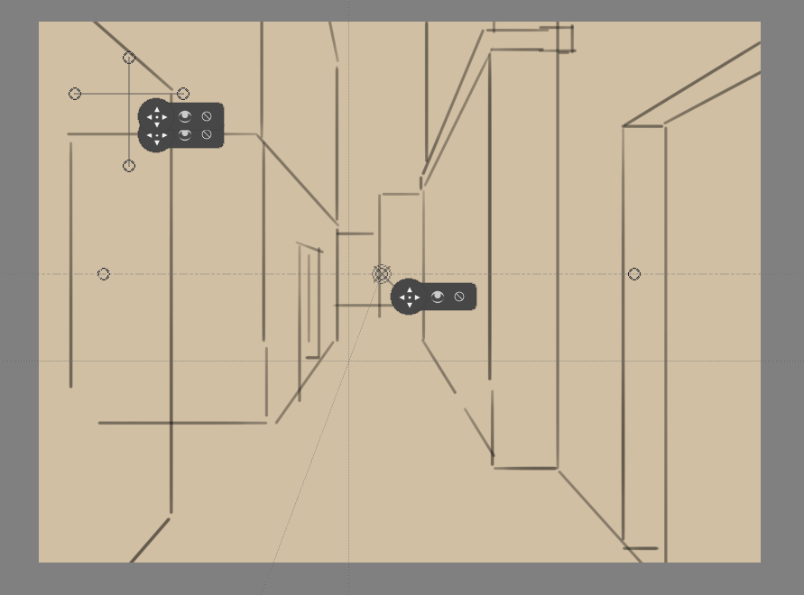
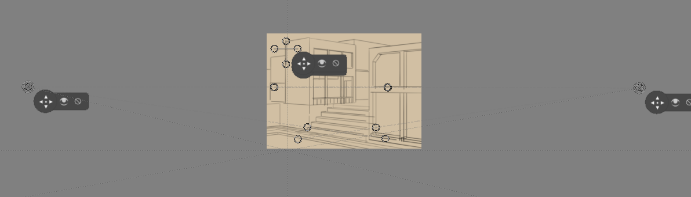
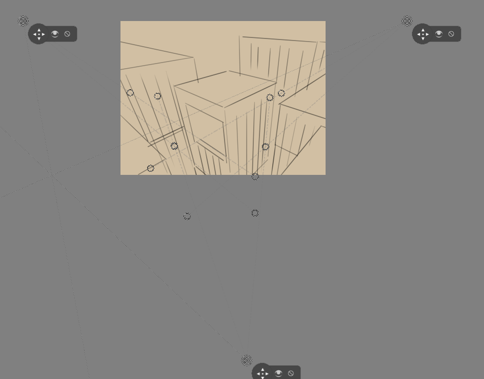
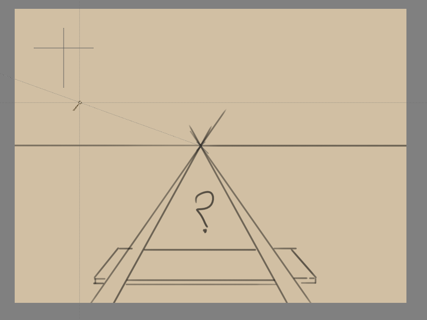
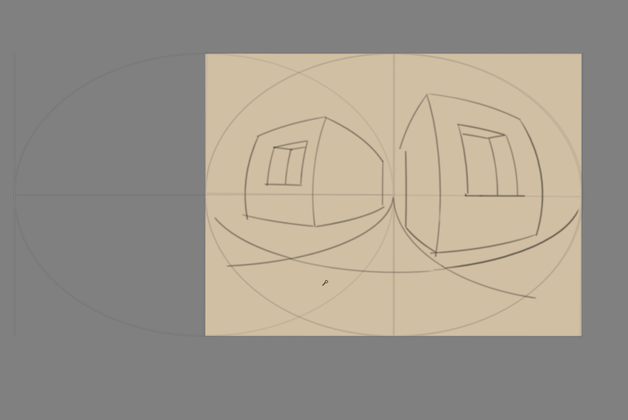

<!-- start-replace-fm field="title" -->
# Krita — les assistants de peinture
<!-- end-replace-fm -->
<!-- start-replace-fm field="description" format="blockquote" -->
> Le chapitre du manuel Krita sur les assistants de peinture : perspective, ellipse, grille et spline — construire l'espace avant de peindre.
<!-- end-replace-fm -->

<!-- start-replace-mediagraphie-fiche -->
> **Référence** — Documentation Krita (2026). Krita — les assistants de peinture.. https://docs.krita.org/fr/user_manual/painting_with_assistants.html. [↗](https://docs.krita.org/fr/user_manual/painting_with_assistants.html)
>
> | **Type** | webpage |
> | **Auteur·e** | Documentation Krita |
> | **Date** | 2026 |
> | **Statut** | stable |
> | **Mots-clés** | image, krita, perspective, assistant, construction, tutoriel |

**Citation (copier-coller)**

```citation
Documentation Krita (2026). Krita — les assistants de peinture.. https://docs.krita.org/fr/user_manual/painting_with_assistants.html.
```
<!-- end-replace-mediagraphie-fiche -->

## Cité par

<!-- start-replace-mediagraphie-cited-by -->
- [Krita — les fonctions image](../../../../03-savoirs/02-utiliser/04-exploitation-logiciels/01-image/)
<!-- end-replace-mediagraphie-cited-by -->

---
> 🇫🇷 **Traduction française** de la page officielle [Painting with Assistants](https://docs.krita.org/fr/user_manual/painting_with_assistants.html) — la page source n'est pas encore traduite. Adaptation : A26.

Le système d'assistants apporte un petit coup de main pour tracer des lignes droites ou des cercles.

Ils servent de forme de prévisualisation, ou l'on s'y accroche avec le pinceau à main levée : dans ses options d'outil, activer **S'accrocher aux assistants**.


## Les types

Plusieurs types d'assistants existent — on les choisit via le panneau des options d'outil.

## Ellipse

Un assistant pour les ellipses et les cercles.

Trois points le composent : les deux premiers définissent l'axe de l'ellipse, le dernier sa largeur.

Il existe aussi en version **ellipses concentriques**. `Shift` sur les deux premières poignées : accrochage à l'horizontale ou la verticale parfaite ; `Shift` sur la troisième : cercle parfait.

## Ellipse en perspective

Assistant alternatif pour les ellipses. Usage simple — l'ellipse tangente à un quadrilatère — ou en perspective : l'ellipse comme transformation perspective d'un cercle.

Quatre points : les coins du quadrilatère qui définit l'ellipse.

Les marques en X indiquent les points de fuite de la perspective.

Deux jeux de lignes dans l'ellipse : les pleines relient les points où l'ellipse touche le quadrilatère — l'axe du cercle en perspective ; les pointillés marquent l'axe réel de l'ellipse finale.


## Perspective

Cette règle permet de dessiner et manipuler des **grilles** sur la zone de dessin — des guides de perspective pour la peinture. On ajoute une grille en cliquant l'outil, puis quatre points sur le canevas, qui servent de coins.

La grille s'utilise avec le capteur *perspective*, qui peut influencer les brosses.

Elle se manipule en tirant ses quatre coins, et s'étend en glissant le milieu d'un bord — ce qui l'agrandit sous d'autres angles. Le processus se répète sur toute section de grille. `Shift` sur une poignée de coin : accrochage aux autres coins, par ensembles. Chaque grille se supprime via le bouton d'annulation en son centre. Cet outil bâtit les références des scènes complexes.



## Règle simple

Trois assistants dans ce groupe :

- **Infini** — une ligne droite entre deux points.
- **Parallèle** — extrapole la droite au-delà des deux points visibles.
- **Parallèle simple** — trace n'importe où une ligne parallèle à celle des deux points.

`Shift` sur les deux premières poignées : accrochage horizontal ou vertical parfait.

Ajouté dans la version 5.1 : l'assistant **Règle** a des options supplémentaires pour des marqueurs — des encoches régulières sur la longueur de l'assistant, et des encoches plus petites entre les **Subdivisions**.

## Spline

Positionner et ajuster quatre points pour créer une **courbe de Bézier cubique**, puis dessiner le long — le trait s'accroche à la courbe. Des courbes parfaites, à chaque fois !

`Shift` sur les deux premières poignées : horizontal/vertical parfait ; sur les troisième et quatrième : accrochage relatif à la poignée à laquelle elles sont attachées.

## Point de fuite

Créer un point de fuite — typiquement pour une ligne d'horizon. Une ligne d'aperçu est tracée, et toutes vos lignes accrochées convergent vers elle.

Un point central, avec quatre points d'aide pour l'aligner sur des lignes de perspective déjà créées.

Les assistants se créent et se manipulent avec l'[outil d'assistant](https://docs.krita.org/fr/reference_manual/tools/assistant.html).

`Shift` sur la poignée centrale : accrochage horizontal ou vertical selon sa position d'origine.

Modifié dans la version 4.1 : l'assistant point de fuite affiche aussi plusieurs lignes générales. À la création ou après un déplacement, l'assistant est sélectionné — le nombre de lignes affichées se règle alors dans les options de l'outil d'assistant.

## Point « Fisheye »

Comme le point de fuite, cet assistant agit sur un jeu de lignes parallèles dans un espace 3D. Pour l'utiliser efficacement : deux assistants, le second à 90° du premier, et un point de fuite au centre des deux. Ou combiner avec une règle parallèle et un point de fuite — voire deux points de fuite. Les combinaisons sont nombreuses.

Cet assistant donne aussi un retour à gauche et à droite de sa position : il sert aux cas limites comme les panoramas.

`Shift` sur les deux premières poignées : horizontal/vertical parfait ; sur la troisième : cercle parfait.

## Perspective à deux points

Ajouté dans la version 5.0.

Cet assistant simplifie la perspective à deux points en combinant les fonctions du [point de fuite](#point-de-fuite) et de la [règle simple](#règle-simple) verticale. Il affiche en plus des plans de grille carrés exacts de la perspective configurée — pour régler visuellement l'intensité de la distorsion.

Trois points suffisent : les deux premiers sont les points de fuite, le troisième détermine le **centre de vision** — qui règle l'affichage de la grille. En perspective à deux points, le centre de vision est sur la ligne d'horizon : une petite encoche indique sa position. Généralement, c'est aussi là que vit le sujet principal de l'illustration.

Une option supplémentaire règle la densité de la grille ; une autre désactive la règle verticale — il ne reste alors que deux points de fuite et une grille.



## Perspective curviligne

Ajouté dans la version 5.3.

Tracer des lignes parallèles qui se courbent pour converger vers deux points de fuite définis. Semblable à l'assistant « Fisheye », mais avec des arcs circulaires au lieu d'ellipses — une perspective courbe différente, surtout en dehors des points de fuite.

Combiné à d'autres assistants (comme le [point de fuite](#point-de-fuite)), il produit les perspectives à 4, 5 points et certaines formes à 6 points.



### Astuces

Maintenir ces combinaisons en déplaçant un point de fuite :

- la touche majuscule (`Shift`) : le point ne se déplace que le long de la ligne d'horizon ;
- une autre combinaison : la grille tourne avec le point sur l'horizon — pour dessiner facilement plusieurs objets à deux points d'une même scène, sous des angles différents ;
- les deux points se déplacent ensemble pour changer le champ de vision de la grille.

### Tutoriels

Une discussion et un tutoriel approfondis : [sur YouTube](https://www.youtube.com/watch?v=OhEv2pw3EuI).

## Configurer Krita pour le dessin technique

Maintenant qu'on a vu l'étendue des assistants — un exemple de configuration pour le dessin technique. Ce tutoriel montre comment régler les assistants pour des types de vues précis.

Pour la véritable projection : voir [la catégorie projection](https://docs.krita.org/fr/general_concepts/projection.html).

## Orthogonale (orthographic)

L'orthogonale : regarder l'objet de gauche ou de face — en gardant tout à l'échelle exacte, sans déformation perspective.

L'assistant clé : la règle parallèle. Horizontale ou verticale, pour toujours avoir accès à une grille.

## Axonométrique

Toutes ces configurations utilisent trois règles parallèles.

- **Oblique** : deux règles horizontale et verticale, une inclinée — la profondeur.
- **Isométrique** : techniquement trois règles à 120° l'une de l'autre. Sauf l'isométrique des jeux — une dimétrique où les diagonales font 116,565° avec l'axe principal ; facile à régler en accrochant les assistants à une grille.




Et la **trimétrique** : tous les angles légèrement différents — ressemble souvent à une isométrique légèrement inclinée.

## Perspective linéaire

- **À un point** : 1 point de fuite + deux règles parallèles perpendiculaires croisées.
- **À deux points** : 2 points de fuite + 1 règle parallèle verticale. Placer un peu les points de fuite hors du cadre en atténue la force. L'assistant [perspective à deux points](#perspective-à-deux-points) le configure très vite.
- **À trois points** : 3 assistants à point de fuite.






## La logique du point de fuite

Un petit secret que les tutoriels de perspective ne disent pas toujours : un point de fuite est le point où **deux lignes parallèles quelconques se rencontrent**. La perspective à un point et celle à deux points sont donc pratiquement la même chose.

La preuve par un grand classique : dessiner une voie ferrée.

Le problème connu : où placer le prochain traverse, la projection perspective les rapprochant ?



La solution habituelle : une ligne au milieu, puis des lignes en diagonale par-dessus — elles sont parallèles, donc à distance égale.


Mais puisqu'elles sont parallèles, on peut utiliser un assistant point de fuite à la place : les poignées d'alignement le règlent sur la diagonale des traverses et sur l'horizontale (en rouge ici).

Cette diagonale détermine ensuite la position des traverses :


Tout jeu de lignes a son point de fuite (hors celles à plat sur le plan de vision) : il peut y en avoir une infinité en perspective linéaire. C'est pourquoi Krita vous laisse placer vos points de fuite librement.

## La perspective Fisheye

Elle fonctionne comme la linéaire — différence majeure : en fisheye, tout jeu de lignes parallèles a **deux** points de fuite, un de chaque côté.

Pour les régler : une horizontale, une verticale, au même endroit, et un point de fuite au milieu.


On peut aussi faire une horizontale de même taille que la verticale et la placer à mi-chemin :


