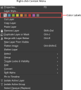
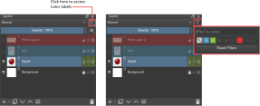
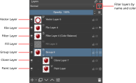
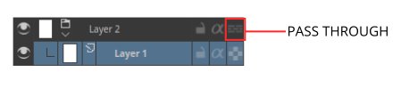
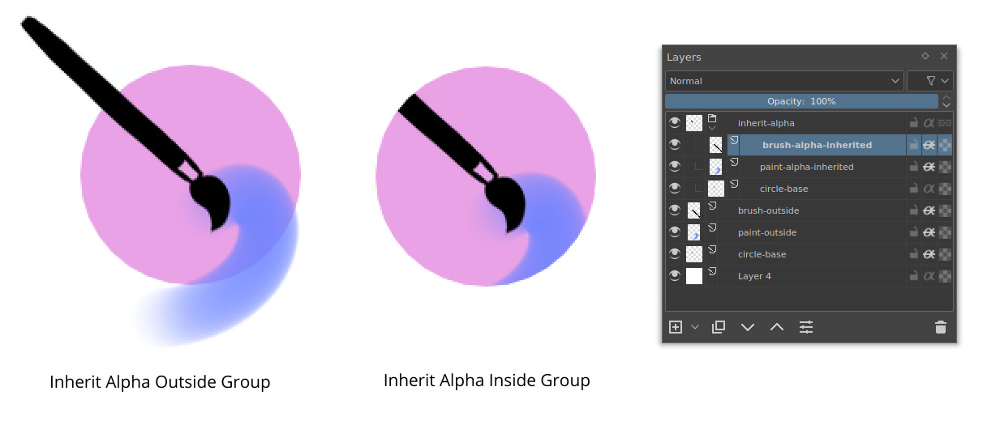
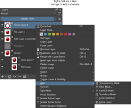

<!-- start-replace-fm field="title" -->
# Krita — calques et masques
<!-- end-replace-fm -->
<!-- start-replace-fm field="description" format="blockquote" -->
> Le chapitre du manuel Krita sur les calques et les masques : types de calques, composition, masques de transparence, travail non destructif.
<!-- end-replace-fm -->

<!-- start-replace-mediagraphie-fiche -->
> **Référence** — Documentation Krita (2026). Krita — calques et masques.. https://docs.krita.org/fr/user_manual/layers_and_masks.html. [↗](https://docs.krita.org/fr/user_manual/layers_and_masks.html)
>
> | **Type** | webpage |
> | **Auteur·e** | Documentation Krita |
> | **Date** | 2026 |
> | **Statut** | stable |
> | **Mots-clés** | image, krita, calques, masques, tutoriel, cours |

**Citation (copier-coller)**

```citation
Documentation Krita (2026). Krita — calques et masques.. https://docs.krita.org/fr/user_manual/layers_and_masks.html.
```
<!-- end-replace-mediagraphie-fiche -->

## Cité par

<!-- start-replace-mediagraphie-cited-by -->
- [Exercice — Détourage d'un sujet](../../../../02-activites/01/exercices/01-detourage/)
- [Exercice — Photomontage non destructif](../../../../02-activites/01/exercices/02-photomontage/)
- [Exercice — Coloriser un crayonné](../../../../02-activites/01/exercices/08-coloriser-crayonne/)
<!-- end-replace-mediagraphie-cited-by -->

---
> 🇫🇷 **Traduction française** de la page officielle [Introduction to Layers and Masks](https://docs.krita.org/fr/user_manual/layers_and_masks.html) — la page source n'est pas encore traduite. Adaptation : A26.

Krita gère les calques (*layers*), qui permettent de mieux contrôler les parties et les éléments de sa peinture.

Pensez à une œuvre ou un collage fait de piles de papiers : certains papiers découpés laissent voir ceux du dessous, d'autres le cachent. Pour remplacer un élément, on remplace ce morceau de papier au lieu de refaire l'ensemble. Dans Krita, au lieu de papiers, il y a les **calques** : parties du document transparentes ou non, plus petites ou plus grandes que le document lui-même, empilables, nommables et groupables.

Les calques donnent un meilleur contrôle : on peut recolorer toute une œuvre en travaillant sur le seul calque de couleur, sans détruire le dessin au trait qui repose au-dessus.

On édite chaque calque individuellement, et on peut même lui ajouter des effets spéciaux — styles de calque, modes de fusion, transparence, filtres, transformations. Krita prend tous ces calques dans sa pile, effets compris, et les combine — composites — en une image finale. Ce n'est qu'une des nombreuses astuces de manipulation d'image numérique de Krita !

En général, quand un calque de peinture en recouvre un autre, le calque du dessus est pleinement visible, et celui derrière est masqué, occulté ou partiellement visible.

## Gérer les calques

Certains artistes dessinent avec peu de calques, d'autres préfèrent un élément par calque. Krita offre une bonne gestion des calques.

On peut [grouper les calques](https://docs.krita.org/fr/reference_manual/layers_and_masks/group_layers.html) pour organiser les éléments de son œuvre.

L'ordre des calques se change — et les calques entrent et sortent des groupes — par simple glisser-déposer dans la pile. Les calques se copient aussi entre documents en [mode sous-fenêtre](https://docs.krita.org/fr/reference_manual/preferences/general_settings.html), en glissant d'un document à l'autre.

Ces fonctions font gagner du temps et aident à garder un fichier dont la pile de calques reste compréhensible pour d'autres. Calques et groupes peuvent en plus être étiquetés par couleurs et filtrés : c'est visuel.

Pour étiqueter un calque ou un groupe : clic droit, puis choisir une des couleurs du menu contextuel (la case « x » du menu retire une étiquette existante).



Une fois les étiquettes posées, on filtre les calques par couleur en cliquant une ou plusieurs couleurs de la liste déroulante en haut à droite du panneau Calques.



Ajouté dans la version 5.0 : cette liste déroulante filtre aussi les calques par nom.

## Les types de calques

L'image ci-dessous montre les différents types de calques dans le panneau [Calques](https://docs.krita.org/fr/reference_manual/dockers/layers.html). Chaque type a son usage : les éléments vectoriels ne vivent que sur un calque vectoriel, les éléments matriciels ordinaires sur un calque de peinture — la catégorie [Calques et masques](https://docs.krita.org/fr/reference_manual/layers_and_masks.html) détaille chaque type.



Voyons comment ces calques se compositent dans Krita.

## Comment les calques se compositent-ils ?

Dans Krita, les calques visibles forment l'image composite affichée sur la zone de dessin. L'ordre de composition va du bas vers le haut — comme notre pile de papiers. En ajoutant des calques, l'image change selon les propriétés des nouveaux venus.

Les groupes de calques se compositent séparément du reste de la pile, sauf quand le mode *pass-through* est activé : les calques du groupe forment d'abord une image composite, et c'est ce résultat qui est pris en compte quand la pile entière se compose. Si le mode pass-through est activé — l'icône en mur de briques — les calques du groupe sont traités comme s'ils étaient hors du groupe dans la pile ; la visibilité des calques du groupe reste toutefois liée à celle du groupe.



Les groupes d'un fichier PSD enregistré depuis Photoshop ont le mode pass-through activé par défaut, sauf réglage explicite d'un autre mode de fusion.

## Hériter de l'alpha — les calques d'écrêtage

Krita a une fonction d'écrêtage appelée *hériter de l'alpha*, signalée par une icône alpha dans la pile de calques.


Le fonctionnement est déroutant au premier abord. Une fois l'icône activée sur un calque, ses pixels se trouvent confinés à l'aire combinée de tous les calques du dessous. Conséquence : avec le calque de fond blanc par défaut en première position, activer l'héritage alpha et peindre au-dessus semble ne rien faire — tout le canevas est blanc. Conseil : mettre le calque de base dans un **groupe de calques**. Comme les groupes se compositent séparément, le calque le plus bas du groupe devient la borne, et le contenu des calques supérieurs s'y écrête si l'héritage alpha est activé.



On peut aussi activer l'héritage alpha sur un groupe de calques lui-même.


## Masques et filtres

Krita gère l'édition **non destructive** du contenu d'un calque : modifier un calque ou une image sans changer durablement l'image source — les changements s'ajoutent comme filtres ou masques par-dessus l'original, qui reste intact. Précieux quand le flux de travail demande des allers-retours : un clic sur le bouton d'affichage ramène l'image d'origine, il suffit de masquer le filtre ou le masque.


On ajoute des filtres à un calque avec un **masque de filtre**, ou en **calque de filtre** qui affecte toute l'image. Les calques se transforment de façon non destructive avec les **masques de transformation**, et des parties se cachent temporairement avec un **masque transparent**. Ces effets non destructifs sont très utiles quand on change d'avis — ou pour faire des variations d'une même image.

> **NOTE** — On peut fusionner tous les calques visibles : d'abord **Calque ‣ Sélectionner ‣ Calques visibles**, puis **Calque ‣ Fusionner avec le calque du dessous**.



Ces filtres et masques sont accessibles par le menu contextuel (clic droit, comme ci-dessus) et par l'icône **+** du panneau Calques.

On peut aussi ajouter un filtre en masque depuis la boîte de dialogue du filtre elle-même, avec le bouton **Créer un masque de filtre**.


Tous ces filtres et masques s'appliquent aussi à un **groupe** entier : éditer de façon non destructive plusieurs calques d'un coup. La catégorie [Calques et masques](https://docs.krita.org/fr/reference_manual/layers_and_masks.html) détaille chaque type de calque et de masque.

Le panneau [Calques](https://docs.krita.org/fr/reference_manual/dockers/layers.html) documente les raccourcis et les autres flux de gestion des calques.
