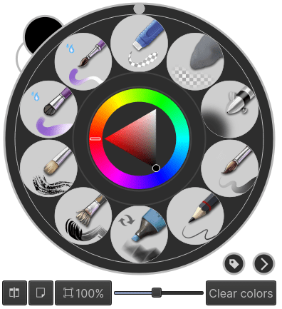
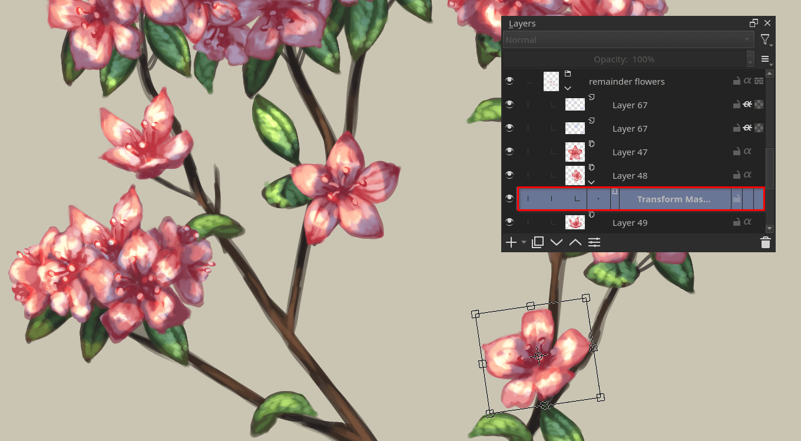
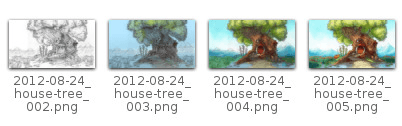
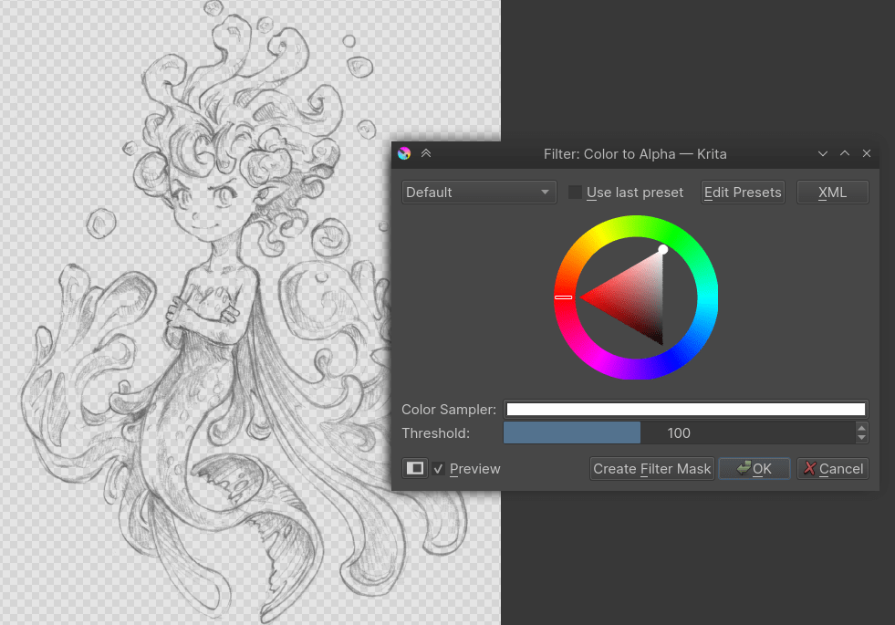
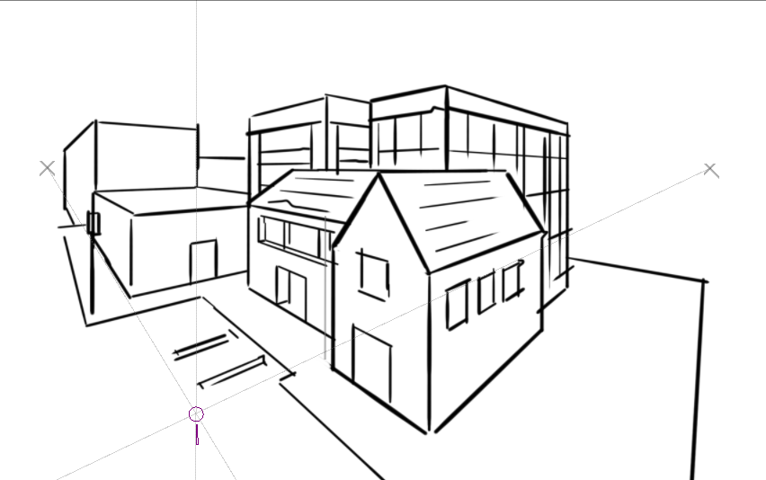
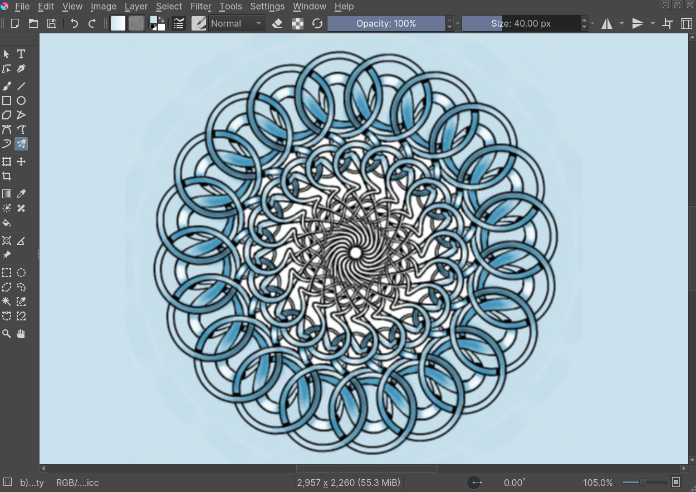
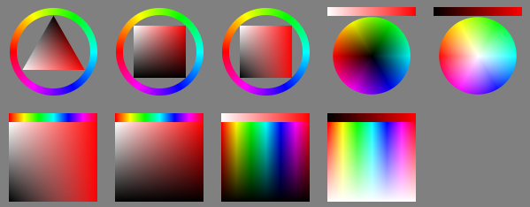
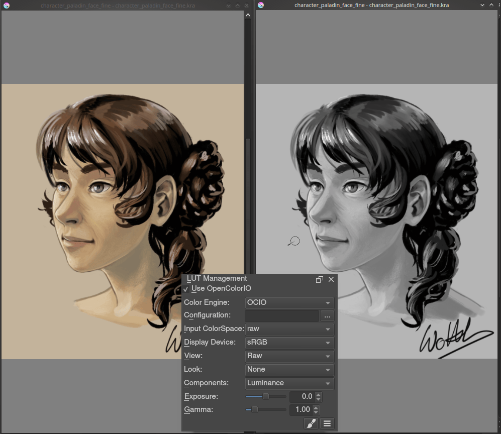
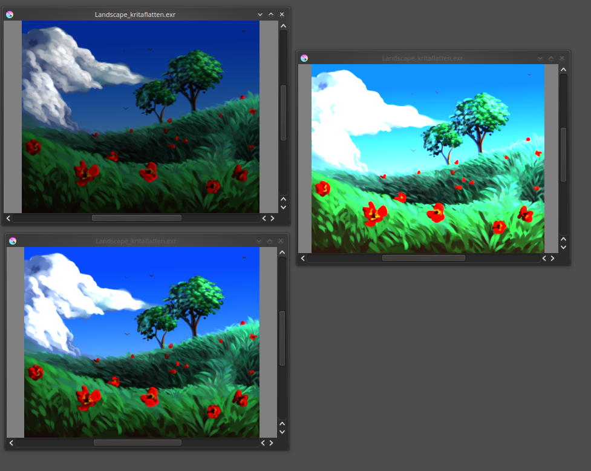
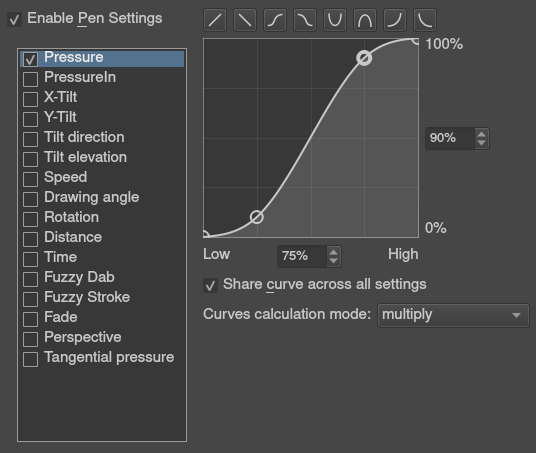

<!-- start-replace-fm field="title" -->
# Krita — passer d'autres logiciels
<!-- end-replace-fm -->
<!-- start-replace-fm field="description" format="blockquote" -->
> Transposer son vocabulaire d'un logiciel propriétaire vers Krita : concepts équivalents, raccourcis, et la posture d'apprentissage libre.
<!-- end-replace-fm -->

<!-- start-replace-mediagraphie-fiche -->
> **Référence** — Documentation Krita (2026). Krita — passer d'autres logiciels.. https://docs.krita.org/fr/user_manual/introduction_from_other_software/introduction_from_photoshop.html. [↗](https://docs.krita.org/fr/user_manual/introduction_from_other_software/introduction_from_photoshop.html)
>
> | **Type** | webpage |
> | **Auteur·e** | Documentation Krita |
> | **Date** | 2026 |
> | **Statut** | stable |
> | **Mots-clés** | image, krita, photoshop, transposition, tutoriel, cours |

**Citation (copier-coller)**

```citation
Documentation Krita (2026). Krita — passer d'autres logiciels.. https://docs.krita.org/fr/user_manual/introduction_from_other_software/introduction_from_photoshop.html.
```
<!-- end-replace-mediagraphie-fiche -->

## Cité par

<!-- start-replace-mediagraphie-cited-by -->
_Aucune citation pour l'instant._
<!-- end-replace-mediagraphie-cited-by -->

---
> 🇫🇷 **Traduction française** de la page officielle [Introduction to Krita coming from Photoshop](https://docs.krita.org/fr/user_manual/introduction_from_other_software/introduction_from_photoshop.html) — la page source n'est pas encore traduite. Adaptation : A26.

## Introduction

Ce document introduit Krita aux utilisateurs de Photoshop. L'intention : devenir productif dans Krita le plus vite possible et convertir les anciennes habitudes en nouvelles. Il a été écrit avec Krita 2.9 et Photoshop CS2/CS3 en tête — les choses évolueront, mais les bases resteront. Première chose à retenir : Krita est un logiciel de **peinture** 2D, Photoshop (PS) un logiciel de **manipulation d'image**. PS a donc plus de fonctions en général, mais Krita a les outils pertinents pour la peinture numérique — et quand vous serez habitué, vous découvrirez que Krita a des fonctions absentes de PS.

## Les bases de Krita

Les opérations de base, comparées à PS.

### Vue et affichage

#### Navigation

Dans Krita, on navigue de plusieurs façons :

1. **Molette** : vers le bas et le haut pour le zoom ; bouton du milieu enfoncé pour déplacer le document.
2. **Clavier** : les touches + et − du pavé numérique.
3. Comme dans Photoshop, Painter, Manga Studio : `Ctrl + Espace` pour zoomer, `Espace` pour déplacer. Avec `Ctrl + Alt + Espace`, un zoom discret (pas à pas).

#### Rotation

Faire tourner le canevas : `Shift + Espace`, ou `Ctrl + [` et `Ctrl + ]`, ou les touches `4` et `6`. Réinitialiser avec `5`.

#### Miroir

La touche `M` affiche votre dessin ou peinture en miroir dans la vue.

#### Déplacer et transformer

Le déplacement et la transformation se font avec des **outils**, dans la barre d'outils. Si vous avez l'habitude de déplacer les calques de PS en maintenant `Ctrl` : dans Krita, pressez `T` pour l'outil de déplacement (pensez « T »ranslate) ou `Ctrl + T` pour l'outil de transformation.

`B` ramène au pinceau une fois la transformation faite. Pour les déformations avancées de l'outil **Transformation** : ne pas faire de clic droit sur le widget sur le canevas — toutes les options sont dans le panneau **Options d'outil**. Les changements s'appliquent avec `Entrée`.

> **NOTE** — Les changements de l'outil de déplacement s'appliquent automatiquement.

### Sélections

Comme dans PS : `Alt` ou `Shift` pendant une sélection retire ou ajoute à la sélection active — et `Alt + Shift` intersecte. Krita propose aussi des sous-outils, sélectionnables dans les **Options d'outil** quand un outil de sélection est actif (représentés par des icônes).

> **NOTE** — On ne peut pas presser `Ctrl` pour déplacer le contenu de la sélection : il faut `T` ou l'**Outil de déplacement**.

Autres astuces :

- Convertir un calque en sélection (sélectionner les pixels visibles) : clic droit dans le panneau Calques → **Sélectionner les zones opaques**.
- Avec une sélection polygonale ou « fermable » : double-clic ou `Shift` + clic pour clore.
- Redimensionner une sélection : **Sélection ‣ Échelle et taille de la sélection**.
- Le menu **Sélection** a aussi les options classiques : agrandir, contracter, adoucir, bordure…
- **Afficher le masque de sélection global** (menu Sélection) activé, on peut redimensionner/tourner/transformer/déplacer ou **peindre** la sélection comme un calque en niveaux de gris ordinaire.

- `Ctrl + H` : afficher/masquer la sélection.
- `Ctrl + A` : tout sélectionner.
- `Ctrl + Shift + A` : tout désélectionner (pas `Ctrl + D` comme dans PS).

Utilisateurs de GIMP : Krita auto-agrandit et auto-déflotte les nouveaux calques créés par `Ctrl + C` / `Ctrl + V` — pas d'inquiétude à ne pas pouvoir peindre hors de l'élément collé.

> **NOTE** — L'intersection a un souci : son raccourci `T` sert aussi à l'outil de déplacement — utiliser le bouton des **Options d'outil**.

### Gestion des calques

Les raccourcis par défaut les plus courants sont très proches de PS :

- `Ctrl + J` : dupliquer
- `Ctrl + E` : fusionner vers le bas
- `Ctrl + Shift + E` : aplatir tout (pas `Ctrl + Shift + M` comme dans PS)
- `Ins` : insérer un nouveau calque de peinture
- `Ctrl + G` : créer un groupe et y déplacer les calques sélectionnés

#### Groupes et mode de fusion (mode de composition)

Le mode de fusion d'un groupe dans Krita a **priorité sur les calques enfants** — surprenant pour un utilisateur de Photoshop. Dans PS, les groupes servent à nettoyer la pile et le mode de fusion du calque traverse toute la pile. Dans Krita, la composition se fait d'abord à l'intérieur du groupe, puis selon le mode du groupe lui-même. Les deux systèmes ont leurs mérites : Krita est plus prévisible côté compositing, PS donne une pile visuellement plus propre.

#### Transformation ou déplacement multi-calques

On sélectionne plusieurs calques de la pile en maintenant `Shift` comme dans PS ; déplacer un calque dans un groupe peut déplacer ou transformer tout le groupe — y compris sélectionner le groupe et couper tous les sous-calques à la volée. En revanche, on n'applique pas de filtres à un groupe pour affecter plusieurs calques.

#### Masques d'écrêtage

Krita n'a pas de masque d'écrêtage, mais une solution plus simple avec les groupes et **Hériter de l'alpha** (l'icône alpha) : placer dans un groupe le calque de forme à la base, et au-dessus les calques avec l'option **Hériter de l'alpha**. Même effet que le « clipping mask » de PS — et une pile plus propre.

`Ctrl + Shift + G` automatise ce réglage : un groupe avec le calque de base et un calque au-dessus, héritage alpha coché par défaut.

#### Mode pass-through

Il existe dans Krita, mais pas comme mode de fusion : c'est une option à côté de « hériter de l'alpha » sur les groupes.

#### Calques intelligents

Au lieu des smart layers à transformations non destructives, Krita a cet ensemble :

- **Calques de fichier** — pointent vers un fichier externe et se mettent à jour s'il change. Depuis la 4.0 : clic droit sur un calque → **Convertir ‣ en calque de fichier**, ou **Calque ‣ Convertir ‣ en calque de fichier**. Une boîte d'enregistrement demande l'emplacement, puis le calque est remplacé par un calque de fichier pointant vers ce fichier.
- **Calques de clone** — « instances » du calque sélectionné à leur création, mises à jour quand l'original change.
- **Masques de transformation** — transforment de façon non destructive tous les types de calques, fichier et clone compris.
- Comme les calques de réglage, les **masques de filtrage** appliquent des filtres de façon non destructive à tous les types, fichier et clone compris.

#### Styles de calque

Les layer styles de Photoshop s'appliquent dans Krita : clic droit sur n'importe quel calque → « style de calque ». Krita ouvre et enregistre les fichiers ASL, mais pas toutes les fonctions des styles existent encore.

#### Autre

Calques et groupes peuvent être exportés — voir le menu **Calque** pour cela et bien d'autres options.

> **NOTE** — Krita a au moins 5 fois plus de modes de fusion que PS, triés par catégories dans le menu déroulant. Les favoris se cochent dans la catégorie Favorite.

## Les outils de peinture

Le point fort de Krita : beaucoup d'outils de peinture, avec beaucoup d'options.

### Outils

Krita a un paradigme totalement différent de PS pour définir un « outil ». Ici, pas de pinceau, gomme, clone, flou… mais des **façons de tracer** sur la zone de dessin : à main levée, ligne, rectangle, cercle, multi-brosse… Une fois la « façon de tracer » choisie, on choisit la **façon de peindre** — effacer, cloner, flouter — gérée par les options des moteurs de brosses. Ces options s'enregistrent en *préréglages*, trouvés dans **Préréglages de brosses** ; on les affine et crée les siens via l'icône **Éditer les réglages de la brosse** de la barre d'outils.

### Effacer

Dans Krita, la gomme n'est pas un outil : c'est un **mode de fusion**. La touche `E` bascule entre mode effacer et mode peindre, individuellement pour chaque brosse.

### Raccourcis utiles

- `Shift` : agrandir/rétrécir le pinceau (ou les touches `[` et `]`).
- `/` : alterner entre le dernier préréglage et le courant (ex. : un crayon, une gomme).
- `K` et `L` : foncer/éclaircir la valeur de la couleur active.
- `I` et `O` : augmenter/diminuer l'opacité.
- `D` : réinitialiser noir (avant-plan) / blanc (arrière-plan).
- `X` : échanger arrière-plan et avant-plan.
- `Shift + I` / `Shift + N` / `Shift + M` : raccourcis par défaut du sélecteur de couleurs sur le canevas.

> **NOTE** — Ces raccourcis sont jugés malheureux par certains : ils servent pendant la peinture, mais le `Shift` gauche est à l'opposé du clavier par rapport à `I`, `M` et `N` — difficile pour un droitier au stylet. Tout se réassigne dans **Configuration ‣ Configurer Krita… ‣ Raccourcis**.

### Stabilisation / lissage du chemin

Dans les options d'outil du pinceau à main levée : davantage de réglages pour lisser le chemin et stabiliser les traits.

### Courbe de pression globale

Si Krita semble trop dur ou trop doux à la pression : **Configuration ‣ Configurer Krita… ‣ Tablette graphique** pour une courbe plus douce ou plus dure.

### Réglages

Comme dans PS, les filtres classiques pour ajuster en peignant :

- `Ctrl + L` : niveaux
- `Ctrl + U` : réglage TSL
- `Ctrl + I` : inverser

### Outils Éclaircir / Densité / Flou

Contrairement à Photoshop où ce sont des outils séparés, dans Krita ils passent par le **moteur de filtre de brosses**, qui applique la plupart des filtres de Krita en forme de brosse.

### Thèmes

Le thème sombre par déçût ? **Configuration ‣ Thèmes** pour choisir plus clair ou plus sombre. La couleur hors de la vue : **Configuration ‣ Configurer Krita… ‣ Affichage** → couleur de la bordure du canevas.

## Ce que Krita a de plus que Photoshop

Krita est une application de peinture spécialisée — avec des outils spécialisés absents des logiciels généralistes comme PS. Les plus importants :

### Moteurs de brosses

Krita a beaucoup de moteurs de brosses — chacun définit une façon dont les pixels arrivent sur le canevas. Grid, Particles, Sketch… : de nouvelles expériences et un nouveau paysage de résultats. La personnalisation passe par l'éditeur de réglages de la barre d'outils — ou plus simplement `F5`.

### Les étiquettes de préréglages de brosses

Très utile : chaque brosse peut avoir autant d'étiquettes que voulu — des étiquettes pour les brosses de fusion, de texture, d'effets, les favorites…

### Les courbes de réglage

Chaque réglage de brosse peut être relié à la pression (vitesse, distance, inclinaison, aléatoire…) par une courbe.

### La palette contextuelle (pop-up palette)

Accessible par clic droit : brushes, historique des couleurs et sélecteur à portée de main. Les brosses sont déterminées par étiquette, et le bouton de configuration en bas à droite ouvre un menu pour changer d'étiquette — on étiquette ses brosses par flux de travail et on accède aux bonnes au bon moment.



### Transformations

L'outil de transformation de Krita transforme un **groupe** et affecte les calques enfants. Plusieurs modes : libre, perspective, warp, le puissant cage, liquider. Et les **masques de transformation** appliquent des transformations non destructives à n'importe quel type de calque — matriciel, vectoriel, groupe.



### Enregistrement incrémental

Enregistrer son œuvre en `monoeuvre_001.kra`, `monoeuvre_002.kra`, `monoeuvre_003.kra`… d'une seule touche : Krita incrémente le nombre final si le motif « _XXX » est reconnu en fin de nom. Plus d'écrasements — et un suivi des anciennes versions et des étapes en cours.



### Filtre : Couleur vers alpha

Pour retirer le blanc du papier d'une œuvre scannée : ce filtre prend une couleur et la transforme en transparence pure.



### Beaucoup de modes de fusion

Si vous aimez les modes de fusion, Krita en a plus de 70 — de la place pour expérimenter. Un système de favoris donne un accès rapide aux plus utilisés.

### Les assistants de peinture

De nombreuses formes vectorielles à influence magnétique sur les coups de pinceau — des règles, y compris pour des formes autres que droites.



### Multi-brosses : symétrie / parallèle / miroir / flocon

L'outil multi-brosse peint avec plusieurs brosses à la fois — les autres brosses miroir ou dupliquées autour de n'importe quel axe, ou en mode parallèle.



### Une grande variété de sélecteurs de couleurs

Le panneau **Sélecteur de couleurs avancé** offre un large choix de sélecteurs.



### Filtres de couleur par vue

Avec le panneau LUT, un filtre de correction colorimétrique **par vue**. Utile aux coloristes au quotidien — et pour l'artiste : voir une copie de l'image en luminance grise pour connaître instantanément les valeurs.



### La peinture de couleurs HDR

Le même panneau LUT pilote la peinture en couleurs HDR — exposition par vue, et support natif d'OpenEXR !



### Courbes de réglage

Chaque réglage de brosse peut être piloté par un capteur (pression, vitesse, distance, inclinaison…) via une courbe éditable :



## Ce que Krita n'a pas

Krita est un logiciel de peinture, PS un manipulateur d'images avec des fonctions de peinture : certaines choses de PS manquent donc à Krita. Une courte liste :

### Filtres

Le pack de filtres de Krita est impressionnant, mais un ou deux filtres spéciaux ou outils de réglage de PS manqueront — par exemple, impossible d'ajuster une couleur spécifique dans le réglage TSL.

### L'outil de correction automatique

Pas d'outil de guérison automatique (*healing*). Il y a l'outil de clone, qui permet une correction manuelle de type guérison.

### L'enregistrement de macros

L'enregistrement et la lecture de macros existent dans Krita, mais ne fonctionnent pas bien pour l'instant.

### L'outil Texte

Depuis Krita 5.3, l'[outil Texte](../krita-texte/) est assez avancé. Les moteurs de composition sous-jacents restent différents, et chacun a ses forces. Petit comparatif :

Photoshop a…

- une autre gestion de l'[interlettrage](https://docs.krita.org/fr/reference_manual/dockers/text_properties.html), parfois utilisée pour du crénage manuel — dans Krita, préférer le [mode de composition typographique](../krita-texte/) ;
- une option où le paragraphe entier est pris en compte à la coupure de ligne — absente de Krita ;
- des justifications (européenne, est-asiatique, moyen-orientale) plus avancées ;
- du texte latin qui tourne quand composé verticalement ;
- l'étirement en largeur et hauteur des glyphes.

Krita a…

- la capacité de composer du texte dans **plusieurs formes** ;
- un [mode de composition typographique](../krita-texte/) plus souple pour positionner les glyphes arbitrairement ;
- une meilleure gestion du texte bidirectionnel, avec sélection Unicode bidi ;
- l'alignement du texte sur sa ligne de base suspendue ;
- un système de sélection des fonctions OpenType plus flexible.

Et au-delà : le moteur de PS style des plages de texte, celui de Krita un arbre stylé en CSS — dans Krita, les plages héritent des propriétés et certaines s'appliquent en imbrication. Voir le panneau [Propriétés du texte](https://docs.krita.org/fr/reference_manual/dockers/text_properties.html) pour le détail de chaque propriété.

### Les modes de fusion pendant la transformation

Quand on transforme un calque ou une sélection dans Krita, la transformation s'affiche en haut de la pile, en ignorant le mode de fusion du calque.

> **INDICATION** — Depuis Krita 5.0, le réglage de performance « Utiliser l'aperçu dans la pile dans l'outil de transformation » permet de prévisualiser le mode de fusion pendant la transformation.

### Photomerge

L'outil PS qui assemble automatiquement et sans couture un dessin scanné en segments n'a pas d'équivalent dans Krita. Alternative : **Hugin**, multiplateforme et libre comme Krita.

[Site de Hugin](http://hugin.sourceforge.net) · [Tutoriel : assembler des scans avec Hugin](https://www.davidrevoy.com/article314/autostiching-scan-with-hugin) par David Revoy.

### Autre

Pas de « Export for web », d'« Image Ready » pour les GIF images par images ou le découpage d'images web, etc.

## Conclusion

Avec ces conseils, vous serez vite au niveau dans Krita. Si vous trouvez d'autres choses dignes de figurer ici, les auteurs sont intéressés. Krita évolue vite — la liste de ce qui est possible dans Photoshop mais pas dans Krita devrait raccourcir avec le temps, et ce document sera maintenu en conséquence.
