<!-- start-replace-fm field="title" -->
# Krita — l'encrage
<!-- end-replace-fm -->
<!-- start-replace-fm field="description" format="blockquote" -->
> Le tutoriel officiel de l'encrage : la ligne nette sur un croquis — pinceaux, pression et stabilisation, du crayonné à l'encre.
<!-- end-replace-fm -->

<!-- start-replace-mediagraphie-fiche -->
> **Référence** — Documentation Krita (2026). Krita — l'encrage.. https://docs.krita.org/fr/tutorials/inking.html. [↗](https://docs.krita.org/fr/tutorials/inking.html)
>
> | **Type** | webpage |
> | **Auteur·e** | Documentation Krita |
> | **Date** | 2026 |
> | **Statut** | stable |
> | **Mots-clés** | image, krita, encrage, ligne, dessin, tutoriel |

**Citation (copier-coller)**

```citation
Documentation Krita (2026). Krita — l'encrage.. https://docs.krita.org/fr/tutorials/inking.html.
```
<!-- end-replace-mediagraphie-fiche -->

## Cité par

<!-- start-replace-mediagraphie-cited-by -->
- [Exercice — Coloriser un crayonné](../../../../02-activites/01/exercices/08-coloriser-crayonne/)
- [Exercice — Ma brosse sur mesure](../../../../02-activites/01/exercices/09-brosse-sur-mesure/)
- [Krita — les fonctions image](../../../../03-savoirs/02-utiliser/04-exploitation-logiciels/01-image/)
<!-- end-replace-mediagraphie-cited-by -->

---
> 🇫🇷 **Traduction française** de la page officielle [Inking](https://docs.krita.org/fr/tutorials/inking.html) — la page source n'est pas encore traduite. Adaptation : A26.

Première chose à comprendre sur l'encrage : contrairement à l'anatomie, la perspective, la composition ou la théorie des couleurs, on ne peut pas compenser le manque de pratique par l'étude ou le raisonnement. Toute la magie du trait se joue de l'épaule aux doigts — très peu dans la tête — et le trait s'améliore avec la pratique.

En revanche, c'est une bénédiction : pas besoin de se demander si l'on est assez intelligent ou assez créatif pour bien encrer. Juste assidu. L'encrage est sans conteste la discipline de dessin des Poufsouffle.

Cela dit, quelques conseils rendent la vie plus facile :

## La posture

Remarquez que j'ai dit plus haut que la magie se joue entre l'épaule et les doigts ? Étrange, non ? Vous avez peut-être entendu parler d'adopter une posture différente pour dessiner.

En réalité, on fait des traits différents selon les muscles et les articulations utilisés : les doigts, le poignet et les muscles de l'avant-bras, le coude et les muscles du bras, ou l'épaule et les muscles du dos.

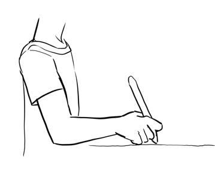
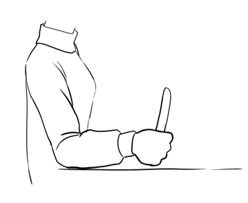
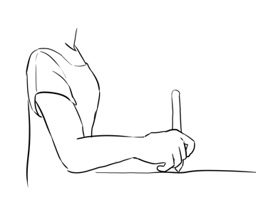
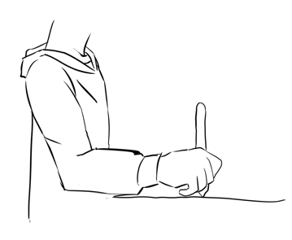

Plus on descend vers la main, plus les traits sont faciles à préciser — mais moins les articulations durent dans le temps. On commence naturellement par les doigts et le poignet, parce que c'est précis. Mais les longs traits deviennent difficiles, et doigts et poignet se fatiguent bien plus vite.

Épaules et coudes, en revanche, encaissent très bien l'effort : en utilisant tout le bras, les longs traits deviennent faciles. Les calligraphes fondent leurs fleurons sur des traits d'épaule — je recommande personnellement d'améliorer son écriture manuscrite pour progresser en encrage — et s'entraînent à faire les grands et les petits traits du bras entier.

Pour contrôler la pression dans cette posture : appuyer l'auriculaire contre la surface de la tablette pendant le trait. On juge ainsi précisément la hauteur du stylet tout en laissant la position à l'épaule — la pression vient du coude.

Pas de règles secrètes à l'encrage, mais s'il y en a une : *plus le trait est long, plus il faut mobiliser le bras*.

## Le lissage du trait

Si le secret des longs traits est là, comment se fait-il que des gens encrent de jolies planches depuis des années sans lissage ? Utiliser un lissage, n'est-ce pas la décadence, un raccourci de paresseux ?

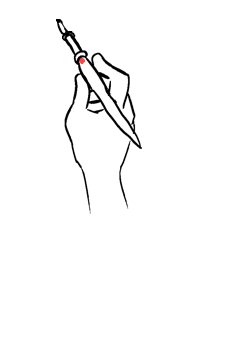

Pas vraiment. Du moins, pas les deux. Les encreurs ont un outil réel qui facilite l'encrage : le pinceau *rigger*, aux poils très longs. Cette longueur lisse le tremblement — le pinceau favori des sessions d'encrage à trois heures du matin.

Sur certaines marques de tablettes, les événements de position envoyés ne sont pas très précis : d'où un lissage de base qui applique la plus petite retouche aux traits.

À l'inverse, trop de lissage pendant tout le dessin rend le trait mécanique au pire sens : sans tremblements ni petites aspérités, le dessin perd son humanité — et représenter un tissu devient impossible.

Donc : entraîner sa main d'encreur, sans se vouer un culte du refus du lissage — on fatigue, on a froid, on a parfois une mauvaise journée. Un stabilisateur vers 50 apporte un peu de confort en gardant les petites irrégularités.

## Les courbes de Bézier et autres outils

Vous connaissez peut-être le pistolet de forms (French curve) : un gabarit de plastique courbé pour tracer des courbes parfaitement lisses par-dessus un crayonné.

En peinture numérique, on n'a pas le luxe de deux mains : impossible de tenir une règle d'une main et d'encrer de l'autre. D'où les courbes de Bézier, faites avec l'[outil de courbe de Bézier](https://docs.krita.org/fr/reference_manual/tools/path.html).

On peut même les faire sur un calque vectoriel — modifiables à la volée.

Leur défaut : pas de variation d'épaisseur de ligne, ce qui rend un peu robotique.

On fait aussi des petites courbes de Bézier avec l'[outil d'assistant](https://docs.krita.org/fr/reference_manual/tools/assistant.html), parmi ses autres fonctions. Puis, dans les options du pinceau à main levée, cocher **S'accrocher aux assistants** : les traits s'accrochent à l'assistant.

## Les préréglages

Quelques points à considérer dans les préréglages de brosse utilisés :

## Anti-aliasing contre pixels crénelés

L'encreur débutant tend à vouloir des pinceaux anti-aliasés — ils sont si lisses à l'écran. Mais à l'impression, ils deviennent flous. Krita propose donc deux types par défaut : les pinceaux anti-aliasés comme *ink_brush_25*, et les pinceaux légèrement crénelés comme *ink_tilt* — ce dernier donne de meilleurs résultats à l'impression. Pour préparer les deux : envisager la planche d'encrage à 600 dpi et la planche couleur à 300 dpi — l'encrage a plus de résolution et les « créneaux » se voient moins. N'importe quel pinceau pixel devient crénelé : touche `F5`, cocher **Netteté** (*Sharpness*).

## Texture

Traits lisses et « mouillés », ou texturés ? Pendant longtemps, le lisse a été préféré — moins de maux de tête à la colorisation. Mais Krita offre plusieurs méthodes de colorisation facile — le masque de coloration en tête — et le texturé devient viable, même pour les paresseux.

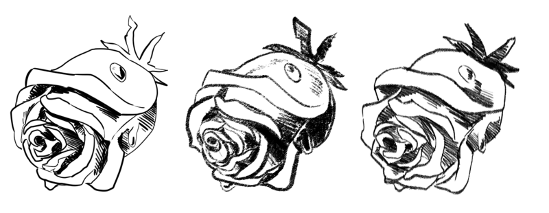

## La courbe de pression

Les plus beaux traits naissent de la sensibilité à la pression : l'épaisseur passe dynamiquement de fort à fin. Mais différentes courbes de pression donnent des résultats différents. L'exemple typique : une ligne légèrement concave pour un pinceau qui fait facilement des traits fins.

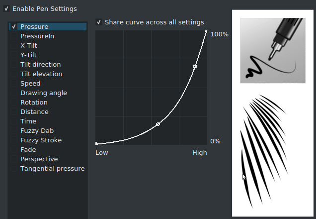

*Ink_gpen_25* est un bon exemple de pinceau à courbe concave — les traits fins viennent plus facilement.

À l'inverse, un pinceau convexe — les traits sont bien plus ronds :

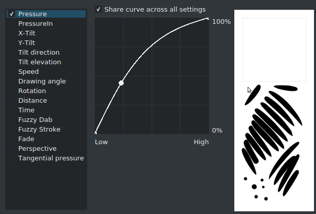

*Fill_circle* combine les deux en courbe en S — des traits très dynamiques :

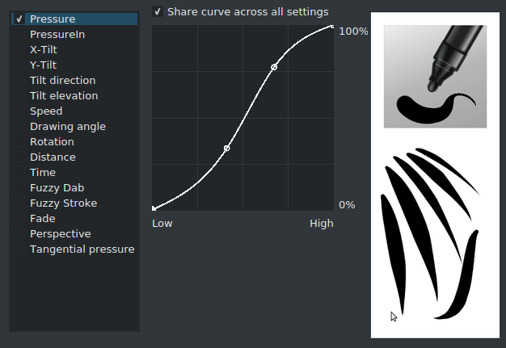

La pression n'est pas la seule piste : ajouter une courbe inverse-convexe sur la **vitesse** donne un joli supplément aux traits.

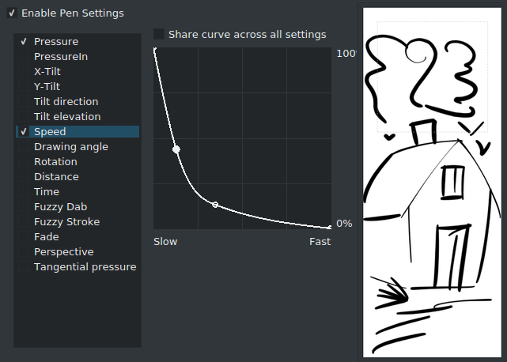

## Préparer un crayonné pour l'encrage

Vous avez un croquis à encrer — scanné ou numérique. Quelques façons de se faciliter la vie :

## Baisser l'opacité à 10 %

Placer un calque blanc (presser simplement `Retour arrière`) sous le croquis. Baisser l'opacité du croquis très bas, puis ajouter un calque au-dessus pour l'encrage.

## Colorer le croquis

Placer entre croquis et encrage un calque rempli d'une couleur choisie, réglé sur *Superposition* (écran) ou *Addition* : tous les traits noirs deviennent de cette couleur ! Si le fond est transparent, ou si le calque va dans un groupe, cocher l'héritage alpha !

## Colorer le croquis — version alternative

Ou : clic droit sur le calque → propriétés du calque, décocher le canal « bleu ». Plus simple pour un croquis à calque unique — la méthode précédente fonctionne mieux sur les croquis multi-calques.

## Les lignes très fines

Pour des lignes ultra-fines : encrer au double, voire au triple de la taille de travail habituelle, avec un pinceau pixel crénelé uniquement. Encrage terminé, utiliser l'outil de remplissage pour poser les aplats sur un calque séparé, scinder le calque via **Calque ‣ Diviser ‣ Diviser le calque**, puis redimensionner à la taille d'origine.

La méthode paraît étrange, mais les traits fins deviennent triviaux — et il est moins cher d'acheter de la RAM pour faire des images IMMENSES que de passer des heures à colorer précisément des lignes fines, d'autant que le masque de coloration gère mal les lignes fines anti-aliasées.

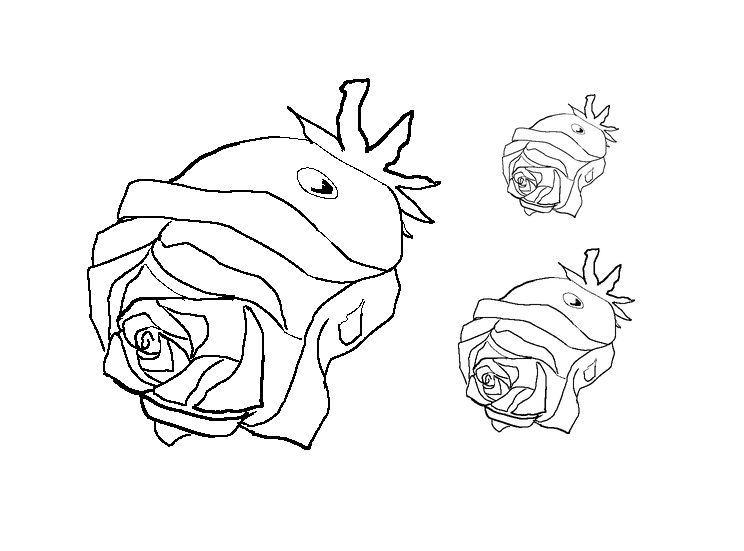

> **ASTUCE** — David Revoy a fait sa propre série de conseils d'encrage pour Krita, expliquée dans cette [vidéo YouTube](https://www.youtube.com/watch?v=xvQ5l0edsq4).
