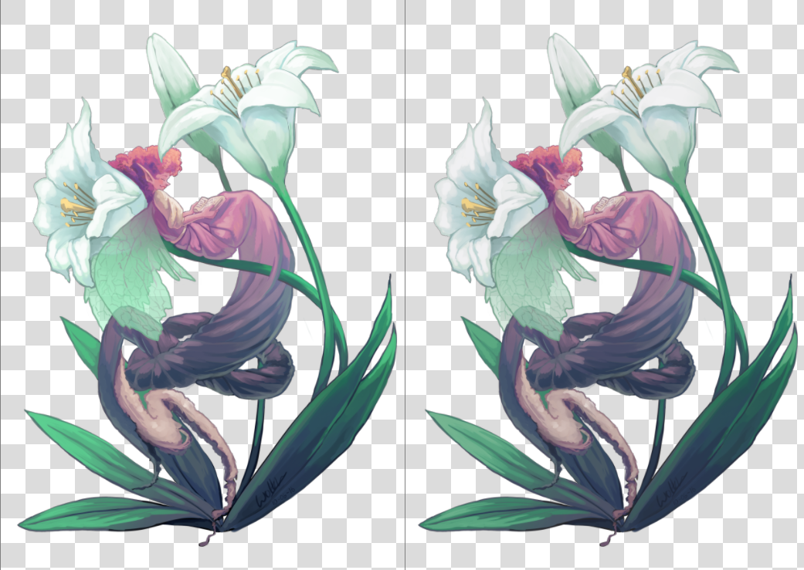
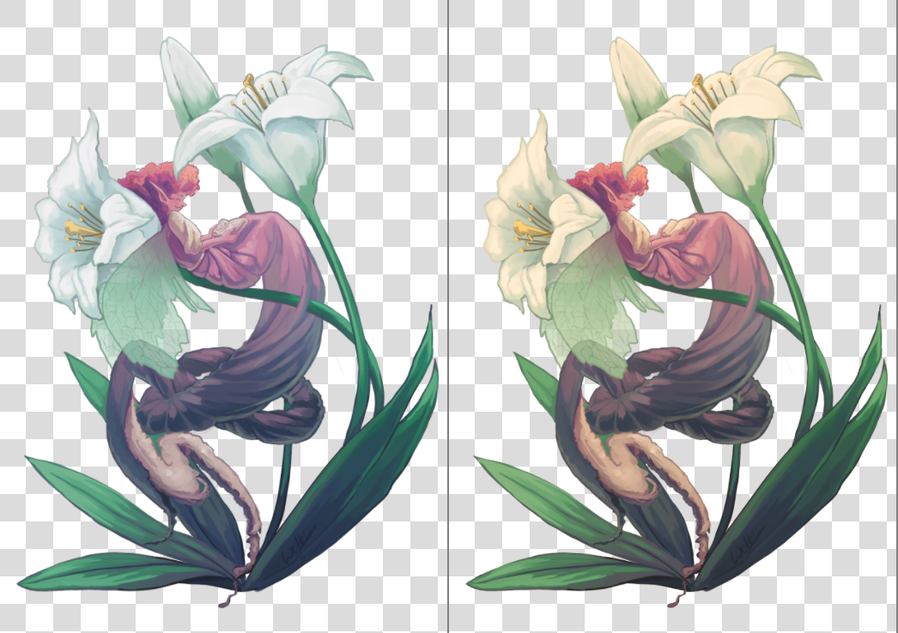
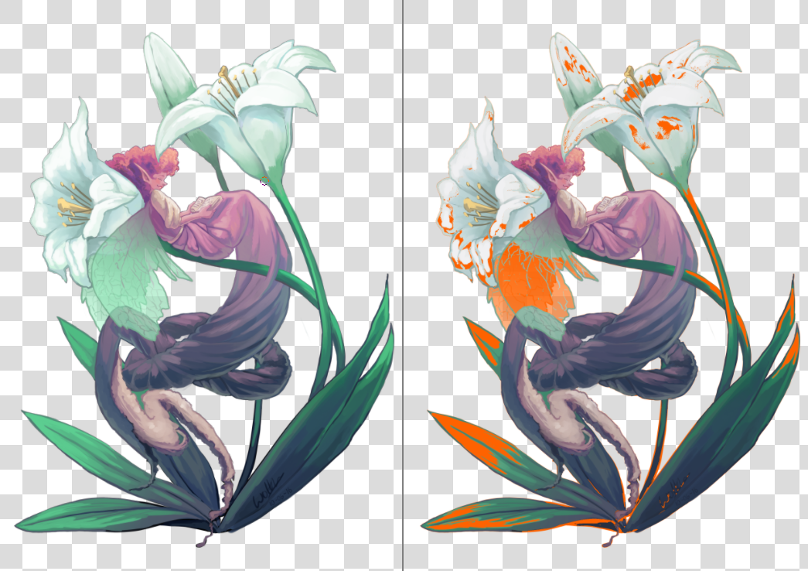

<!-- start-replace-fm field="title" -->
# Krita — l'épreuve numérique
<!-- end-replace-fm -->
<!-- start-replace-fm field="description" format="blockquote" -->
> L'épreuve numérique dans Krita : simuler à l'écran le rendu d'un profil d'impression, et surveiller l'avertissement de dépassement du gamut — les couleurs impossibles à imprimer.
<!-- end-replace-fm -->

<!-- start-replace-mediagraphie-fiche -->
> **Référence** — Documentation Krita (2026). Krita — l'épreuve numérique.. https://docs.krita.org/fr/user_manual/soft_proofing.html. [↗](https://docs.krita.org/fr/user_manual/soft_proofing.html)
>
> | **Type** | webpage |
> | **Auteur·e** | Documentation Krita |
> | **Date** | 2026 |
> | **Statut** | stable |
> | **Mots-clés** | image, krita, couleur, cmjn, impression, gamut, tutoriel, cours |

**Citation (copier-coller)**

```citation
Documentation Krita (2026). Krita — l'épreuve numérique.. https://docs.krita.org/fr/user_manual/soft_proofing.html.
```
<!-- end-replace-mediagraphie-fiche -->

## Cité par

<!-- start-replace-mediagraphie-cited-by -->
_Aucune citation pour l'instant._
<!-- end-replace-mediagraphie-cited-by -->

---
> 🇫🇷 **Traduction française** de la page officielle [Soft Proofing](https://docs.krita.org/fr/user_manual/soft_proofing.html) — la page source n'est pas encore traduite. Adaptation : A26.

> **NOTE** — L'épreuve numérique ne fonctionne qu'avec l'[accélération graphique du canevas](https://docs.krita.org/fr/reference_manual/preferences/display_settings.html) activée.

Quand on crée une image dans Krita et qu'on l'imprime, le résultat diffère : couleurs plus sombres ou plus claires que prévu, rouges plus agressifs, contraste perdu. Pour un document simple, pas grave — pour une impression professionnelle, c'est dramatique : le rendu de l'image change radicalement.

La raison : l'imprimante utilise un autre modèle de couleur (CMJN) et a souvent accès à une gamme de couleurs plus restreinte (un *gamut*).

La solution naïve : travailler directement en CMJN ! Trois problèmes :

- Peindre dans un espace CMJN ne garantit pas les mêmes couleurs à l'impression. Chaque combinaison encre/papier/imprimante a son propre gamut — et donc son propre profil.
- L'espace CMJN est très irrégulier : les maths des couleurs y sont moins agréables, et les modes de fusion y sont différents.
- Travailler dans un CMJN précis fige l'image dans cet espace. Si l'on prépare pour un autre profil — papier, imprimante ou encres différents —, on a peut-être un gamut plus large avec des couleurs vives qu'on aurait voulu exploiter.

L'idéal : faire l'image en RVB avec tous ses outils favoris, et laisser l'ordinateur convertir à la volée vers un espace CMJN donné, juste pour la prévisualisation. C'est possible — c'est l'**épreuve numérique** (*soft proofing*).



L'épreuve s'active sur toute image avec `Ctrl + Y`. Contrairement à d'autres logiciels, c'est **par vue** : on peut comparer l'image épreuvée et non-épreuvée côte à côte. La configuration d'épreuvage se règle par image et s'enregistre dans le fichier `.kra` — cocher **Stocker la configuration d'épreuvage dans l'image** dans **Image ‣ Propriétés de l'image ‣ Épreuvage**. Sinon, Krita utilise les réglages globaux de **Configuration ‣ Configurer Krita… ‣ Gestion des couleurs ‣ Épreuvage**.

> **NOTE** — Quand cette option est activée, Krita embarque le profil ICC d'épreuvage complet dans le `.kra` — certains profils de sortie, surtout CMJN, sont volumineux.

Les options disponibles :

- **Profil** — le seul vraiment important : le profil d'impression visé par l'épreuve. Dans un flux professionnel, il est fourni par l'imprimeur.
- **Intention de rendu de la conversion** — l'intention de conversion vers le profil de l'appareil de sortie. Mêmes options que dans le [flux géré par profil](https://docs.krita.org/fr/general_concepts/colors/color_managed_workflow.html) ; elle doit coïncider avec celle de l'imprimeur. Si l'imprimeur ne fait pas de conversion interne, faites-la vous-même avant d'envoyer le fichier.
- **Adaptation chromatique de l'intention absolue** — voir ci-dessous.



- **Compensation du point noir** — à la conversion vers le profil de sortie : désactivée, elle écrête les ombres au minimum gérable par l'écran ou le profil d'épreuvage ; activée, elle ramène le noir à l'échelle de l'écran et montre toute la gamme de gris. Comme l'intention, elle doit coïncider avec celle de l'imprimeur.
- **Options d'affichage** — comment l'espace épreuvé (et possiblement écrêté) s'affiche à l'écran : quelle intention et quels drapeaux pour convertir du profil de sortie vers le profil **de l'écran**.
  - **Utiliser les réglages d'affichage globaux** — les réglages de **Configuration ‣ Configurer Krita… ‣ Gestion des couleurs ‣ Affichage**.
  - **Simuler le blanc du papier et le noir** — prévisualiser le point blanc (la teinte) du papier à l'écran : papier mat, métallisé, sépia… À noter : le point blanc des conditions de vision reste ajusté à celui de l'écran — on ne peut comparer visuellement l'impression physique et l'écran que si les trois points blancs coïncident : profil papier, réglage écran, ampoule qui éclaire l'impression.
  - **Personnalisé** — régler la dernière étape de conversion manuellement, selon le but : prévisualiser le gamut → **Intention de rendu** *Colorimétrique relative*, **Compensation du point noir** activée ; prévisualiser le rendu imprimé → **Intention de rendu** *Colorimétrique absolue*, **Adaptation chromatique de l'intention absolue** activée.
- **Couleur de l'avertissement hors gamut** — sa couleur, réglable.

Les valeurs par défaut se règlent dans **Configuration ‣ Configurer Krita… ‣ Gestion des couleurs ‣ Épreuvage**. Pour bien configurer : faire une image-test, la faire imprimer par une imprimante bien réglée, comparer, et approximer dans les options d'épreuvage le rendu réel obtenu.

## L'avertissement hors gamut

L'avertissement hors gamut (alarme de gamut) complète l'épreuvage : il montre quelles couleurs sont écrêtées, en remplaçant le résultat par la couleur d'alarme choisie.

Utile pour repérer où les contrastes se perdent — et adapter l'image progressivement vers moins de contraste.



À activer avec `Ctrl + Shift + Y` — l'épreuvage doit être actif pour fonctionner pleinement. Krita enregistre la couleur d'alarme avec les options d'épreuvage dans le KRA : choisir une couleur qui ressort pour l'image courante.

> **NOTE** — L'épreuvage ne fonctionne pas correctement dans les espaces flottants ; le forcer donnerait des alarmes de gamut incorrectes — il est donc désactivé.

> **ATTENTION** — Les avertissements de gamut donnent parfois des alertes étranges pour les profils linéaires dans les ombres. C'est un bug de LittleCMS — voir [ici](https://ninedegreesbelow.com/bug-reports/soft-proofing-problems.html).
