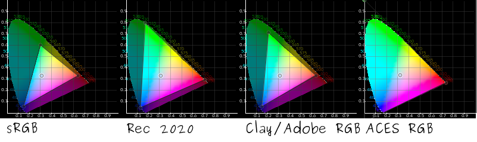
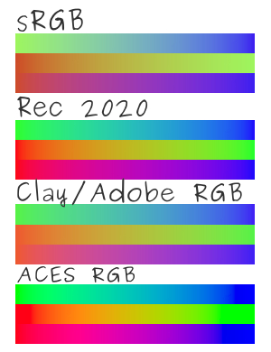

<!-- start-replace-fm field="title" -->
# Krita — la taille de l'espace colorimétrique
<!-- end-replace-fm -->
<!-- start-replace-fm field="description" format="blockquote" -->
> La taille de l'espace colorimétrique dans Krita : pourquoi choisir un espace large (échanges entre programmes, archivage, travail de correction) — et l'exigence d'au moins 16 bits par canal pour éviter les bandes.
<!-- end-replace-fm -->

<!-- start-replace-mediagraphie-fiche -->
> **Référence** — Documentation Krita (2026). Krita — la taille de l'espace colorimétrique.. https://docs.krita.org/fr/general_concepts/colors/color_space_size.html. [↗](https://docs.krita.org/fr/general_concepts/colors/color_space_size.html)
>
> | **Type** | webpage |
> | **Auteur·e** | Documentation Krita |
> | **Date** | 2026 |
> | **Statut** | stable |
> | **Mots-clés** | image, krita, couleur, espace-colorimetrique, profondeur, tutoriel, cours |

**Citation (copier-coller)**

```citation
Documentation Krita (2026). Krita — la taille de l'espace colorimétrique.. https://docs.krita.org/fr/general_concepts/colors/color_space_size.html.
```
<!-- end-replace-mediagraphie-fiche -->

## Cité par

<!-- start-replace-mediagraphie-cited-by -->
_Aucune citation pour l'instant._
<!-- end-replace-mediagraphie-cited-by -->

---
> 📄 **Réhébergement** — le contenu ci-dessous est la reproduction intégrale de la page officielle [Krita — la taille de l'espace colorimétrique](https://docs.krita.org/fr/general_concepts/colors/color_space_size.html) de la documentation Krita, déjà publiée en français par l'équipe de Krita. La source fait foi et est mise à jour en premier ; cette copie peut dater.

## Taille de l'espace colorimétrique

Avec l'utilisation du navigateur d'espaces colorimétriques de Krita, vous pouvez voir qu'il y a plusieurs espaces colorimétriques différents.



Comment affectent-elles votre image et pourquoi les utiliseriez-vous ?

Il y a trois raisons principales pour utiliser un espace large :

1. Même si vous ne pouvez voir les couleurs, le logiciel de l'ordinateur ne les comprend pas et ne peut faire ses traitements mathématiques sur les couleurs.

2. Pour les échanges entre programmes et périphériques : la plupart des profils « CMYK » sont légèrement plus larges que celui par défaut en « sRGB » dans certaines conditions, alors que dans d'autres conditions, ils sont plus petits. Pour obtenir la meilleure conversion, veuillez intégrer votre image dans un espace colorimétrique englobant à la fois le profil de votre écran et celui de votre imprimante.

3. Pour les besoins d'archivage. En d'autres termes, peut être que les écrans futurs auront une grande quantité de couleurs à afficher (Informations : ils le font déjà). Ceci vous permet de vous préparer à cela.

Effectuez une comparaison des gradients suivants dans différents espaces colorimétriques :




Sur la gauche, se trouve un fichier « JPEG » avec une gestion des couleurs pilotée par les artefacts avec un profil joint « ACES sRGBtrc v2 » (Ou non. Si non, vous pouvez voir les différences exactes de couleurs plus clairement). Ceci devrait donné une approximation des couleurs actuelles. Sur la droite, se trouve le profil « sRGB PNG » converti dans Krita à partir du fichier de base.

Chaque gradient l'est pour un maximum de canaux donnés. Comme vous pouvez le voir, le ton médian de l'espace colorimétrique « ACES » est beaucoup plus clair que celui de l'espace colorimétrique « RGB ». Cela s'explique car les couleurs primaires sont plus espacées.

Ceci signifie que lors du démarrage du mélange ou de l'application des filtres, Krita peut produire des valeurs de sortie plus grandes que les valeurs visibles. Mais, cela génère aussi des mélanges et des gradients beaucoup plus corrects. En particulier, lors de la correction des couleurs, un espace colorimétrique plus important peut contribuer à fournir des informations plus précises.

Si vous avez un profil d'affichage utilisant « LUT », alors, vous pouvez utiliser une perception pour fournir une indication sur la façon dont votre image apparaitra.

Les grands espaces colorimétriques ont l'inconvénient de nécessiter plus de précision si vous ne voulez pas voir des anneaux. Ainsi, veuillez vous assurer d'avoir au moins 16 bits par canal lors de la sélection d'un espace colorimétrique plus important.
