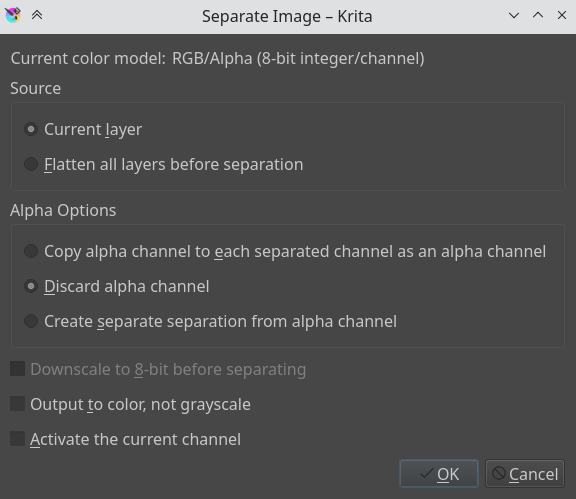

<!-- start-replace-fm field="title" -->
# Krita — enregistrer et exporter
<!-- end-replace-fm -->
<!-- start-replace-fm field="description" format="blockquote" -->
> Le chapitre du manuel Krita sur les fichiers : contenu matriciel/vectoriel, métadonnées, DPI/PPI, taille et résolution, rogner, redimensionner — et surtout enregistrer (source) contre exporter (aplati).
<!-- end-replace-fm -->

<!-- start-replace-mediagraphie-fiche -->
> **Référence** — Documentation Krita (2026). Krita — enregistrer et exporter.. https://docs.krita.org/fr/user_manual/working_with_images.html. [↗](https://docs.krita.org/fr/user_manual/working_with_images.html)
>
> | **Type** | webpage |
> | **Auteur·e** | Documentation Krita |
> | **Date** | 2026 |
> | **Statut** | stable |
> | **Mots-clés** | image, krita, export, formats, resolution, tutoriel, cours |

**Citation (copier-coller)**

```citation
Documentation Krita (2026). Krita — enregistrer et exporter.. https://docs.krita.org/fr/user_manual/working_with_images.html.
```
<!-- end-replace-mediagraphie-fiche -->

## Cité par

<!-- start-replace-mediagraphie-cited-by -->
_Aucune citation pour l'instant._
<!-- end-replace-mediagraphie-cited-by -->

---
> 🇫🇷 **Traduction française** de la page officielle [Working with Images](https://docs.krita.org/fr/user_manual/working_with_images.html) — la page source n'est pas encore traduite. Adaptation : A26.

Les ordinateurs travaillent avec des fichiers, et en tant que logiciel de peinture, Krita travaille avec des images.

## Que contient une image ?

Un document texte contient des lettres, enchaînées dans le bon ordre, que l'ordinateur charge en phrases cohérentes. Une image Krita contient :

### Les données matricielles

Les données principales des calques de peinture : les coups de pinceau, pixelisés de près. Un fichier multi-calques en contient plusieurs, superposés pour composer l'image finale. Un fichier à calque unique n'en contient généralement que ça.

### Les données vectorielles

Des opérations mathématiques qui disent à l'ordinateur de dessiner des pixels à tel endroit — beaucoup plus évolutives (agrandir = multiplier les coordonnées par 4), plus éditables, plus légères, mais plus gourmandes en CPU.

### Les données d'opération

Les calques de filtrage, masques de transparence, groupes et masques de transformation s'enregistrent dans les fichiers multi-calques. La possibilité de les recharger dépend du logiciel d'origine : Krita charge et enregistre groupes, masques de transparence et effets de calque depuis le PSD, mais pas les masques de transformation.

### Les métadonnées

Date de création, auteur, description — et aussi le DPI.

## La taille de l'image

Dimensions et résolution du canevas. La taille de l'image affecte directement le poids du document : plus de pixels à retenir et plus la profondeur de couleur est grande, plus le fichier est lourd.

## DPI/PPI

`DPI` = points par pouce (*dots per inch*) ; `PPI` = pixels par pouce. À l'impression, si votre imprimante imprime à 300 `DPI`, elle dépose 300 points de couleur sur un pouce — le nombre de pixels de votre œuvre par pouce de surface.

Le `DPI` regarde l'imprimante ; l'artiste, lui, garde le `PPI` en tête : c'est selon le `PPI` que les imprimantes décident de la taille de votre image sur le papier.

Quelques standards :

- **72 PPI** — le PPI supposé des écrans par tous les programmes. Pas tout à fait juste (les écrans actuels font 125 PPI, les rétina 300) — mais c'est le défaut pour une image destinée à l'écran.
- **120 PPI** — souvent utilisé comme standard pour les affiches de basse qualité.
- **300 PPI** — le minimum pour une impression de qualité.
- **600 PPI** — la qualité du dessin au trait des comics.

## Le nombre de couleurs

La profondeur de couleur est traitée sur la [page Gestion des couleurs](https://docs.krita.org/fr/general_concepts/colors.html). À comprendre : Krita a des espaces de couleur d'image **et** de calque — ces derniers économisent la mémoire si bien utilisés. Un calque de dessin au trait en niveaux de gris divise par deux la mémoire, par exemple.

### Espace d'image vs espace de calque vs conversion

**Image ‣ Propriétés de l'image…** change le seul espace de l'image — les calques restent intacts. **Image ‣ Convertir l'espace de couleurs de l'image…** convertit aussi tous les calques.

## Auteur et description

Krita enregistre automatiquement l'auteur de l'image dans ses métadonnées, avec la date et l'heure de création et de modification — et le **temps d'édition** du document, utile aux illustrateurs professionnels et speed-painters pour facturer. Il détecte les périodes d'inaction, avec une précision de ±60 secondes ; vidable dans la boîte d'informations du document.

Ces informations s'éditent dans **Fichier ‣ Informations sur le document…**, et pour l'auteur : **Configuration ‣ Configurer Krita… ‣ Auteur**. Les profils se changent sous **Configuration ‣ Profil d'auteur actif**.


## Couleur de fond du canevas

Via **Image ‣ Couleur et transparence de l'arrière-plan du canevas…** : rendre le fond non transparent et changer sa couleur. Utile aussi pour les formats qui forcent une couleur de fond au lieu de la transparence — les exports PNG et JPG utilisent cette couleur pour remplir la transparence, si on ne veut pas l'exporter.

Venir de Paint Tool SAI ? Cette option, ou le bouton radio **Comme couleur du canevas** dans les options de nouveau fichier, donne un environnement plus confortable — la transparence n'est plus un damier.

## Transformations de base

Dans le menu Image : cisailler l'image entière et ses calques, la faire tourner rapidement (sous-menu), la retourner avec tous ses calques. Et plus encore…

## Rogner et redimensionner le canevas

On rogne avec l'[outil de rognage](https://docs.krita.org/fr/reference_manual/tools/crop.html) — couper l'espace superflu et améliorer la composition.

### Le rognage (trimming)

- **Image ‣ Rogner au calque actif** : redimensionne l'image aux dimensions du calque sélectionné — utile après avoir collé une image trop grande.
- **Image ‣ Rogner à la sélection** : le cousin rapide de l'outil de rognage — le canevas se règle aux dimensions de toute sélection active. Astuce : clic droit sur le calque → **Sélectionner les zones opaques**, puis rogner à la sélection : le canevas se cale sur la boîte englobante du contenu.
- **Image ‣ Rogner à la taille de l'image** : en fait pour les calques — rogne tous les calques à la taille de l'image, allégeant le fichier en supprimant les données invisibles.

### Redimensionner le canevas

**Image ‣ Redimensionner le canevas…** (`Ctrl + Alt + C`) :


**Conserver les proportions** garde hauteur et largeur accordées. Le décalage (*offset*) indique où le nouveau canevas s'ajoute autour de l'image actuelle — on décide où va l'image (bouton gauche : image au centre-gauche, l'espace s'ajoute à droite).

Autre façon, en dessinant : en défilant au-delà du bord du canevas, une bande avec une flèche apparaît — cliquer étend le canevas dans cette direction :


### Redimensionner l'image

**Image ‣ Mettre l'image à l'échelle…** redimensionne l'image entière — et c'est là qu'on change la résolution ou sur-échantillonne. Exemple : on a bloqué les grandes formes à 72 PPI, et on veut passer à 300 ou 400 PPI pour le travail de détail — c'est ici.

Comme dans toutes les boîtes à chaînette : chaîne liée, le rapport hauteur/largeur se conserve ; cliquer la chaîne pour la délier.


## Séparer les images

Cette fonction puissante sépare une image en ses composantes ou canaux — pour l'impression ou les textures de jeux. Pas de fonction inverse, mais avec une sortie colorée : régler deux canaux en mode de fusion Addition. Pour les images en niveaux de gris dans l'espace RVB : les modes de fusion *Copier le rouge/vert/bleu*, le rouge pour l'image du canal rouge, etc.



## Enregistrer, exporter et ouvrir les fichiers

Quand Krita crée ou ouvre un fichier, il en garde une copie en mémoire — c'est comme ça que fonctionnent les ordinateurs : une copie du fichier en RAM. À l'enregistrement, Krita copie sa copie par-dessus le fichier existant. Quelques astuces d'enregistrement :

- **Enregistrer** — enregistre l'image courante en mémoire à l'endroit défini du disque. Jamais enregistrée ? Krita demande où.
- **Enregistrer sous…** — copie du fichier courant sous un autre nom ; Krita bascule sur le nouveau fichier.
- **Ouvrir…** — ouvre un fichier enregistré. Simple.
- **Exporter…** — enregistre une copie à un autre emplacement sans l'ouvrir : utile quand on travaille sur un fichier à calques mais n'a besoin que d'une version aplaties à tel endroit.
- **Ouvrir un document existant comme document sans titre…** — ouvre un fichier en oubliant son emplacement : à « Enregistrer », Krita demande où. C'est le « importer » d'ailleurs.
- **Créer une copie à partir de l'image actuelle** — nouvelle copie de l'image courante, comme l'option sans titre, mais pour des fichiers déjà ouverts.
- **Enregistrer en version incrémentale** — enregistre sous `nomfichier_XXX.kra` et bascule dessus.
- **Enregistrer une copie de sauvegarde** — copie et renomme la dernière version enregistrée en fichier de sauvegarde, et enregistre le document sous son nom d'origine.

> **NOTE** — Le format de fichier de Krita est une archive compressée : en cas de fichier corrompu, on peut l'ouvrir avec un gestionnaire d'archives et extraire le contenu des calques — pour récupérer un maximum de données. Sous Windows, renommer d'abord en `nomfichier.zip`.
