<!-- start-replace-fm field="title" -->
# Krita — les flux de travail courants
<!-- end-replace-fm -->
<!-- start-replace-fm field="description" format="blockquote" -->
> Le tutoriel officiel des flux de travail courants : du nouveau document à l'export — les chaînes de gestes que les illustrateurs répètent à chaque projet.
<!-- end-replace-fm -->

<!-- start-replace-mediagraphie-fiche -->
> **Référence** — Documentation Krita (2026). Krita — les flux de travail courants.. https://docs.krita.org/fr/tutorials/common_workflows.html. [↗](https://docs.krita.org/fr/tutorials/common_workflows.html)
>
> | **Type** | webpage |
> | **Auteur·e** | Documentation Krita |
> | **Date** | 2026 |
> | **Statut** | stable |
> | **Mots-clés** | image, krita, workflow, processus, tutoriel |

**Citation (copier-coller)**

```citation
Documentation Krita (2026). Krita — les flux de travail courants.. https://docs.krita.org/fr/tutorials/common_workflows.html.
```
<!-- end-replace-mediagraphie-fiche -->

## Cité par

<!-- start-replace-mediagraphie-cited-by -->
- [Exercice — Coloriser un crayonné](../../../../02-activites/01/exercices/08-coloriser-crayonne/)
- [Krita — les fonctions image](../../../../03-savoirs/02-utiliser/04-exploitation-logiciels/01-image/)
<!-- end-replace-mediagraphie-cited-by -->

---
> 🇫🇷 **Traduction française** de la page officielle [Common Workflows](https://docs.krita.org/fr/tutorials/common_workflows.html) — la page source n'est pas encore traduite. Adaptation : A26.

L'objectif principal de Krita : aider les artistes à créer une peinture numérique de zéro. Krita est utilisé par des BDistes, des peintres de matte painting, des créateurs de textures et des illustrateurs du monde entier. Cette section présente les flux de travail courants. À l'ouverture d'un nouveau document, on peut peindre immédiatement — l'outil pinceau est sélectionné par défaut. Mais voyons ce que font les artistes :

## Speed painting et conceptualisation

Certains artistes ne travaillent qu'en numérique, esquisse et visualisation de concepts dans Krita de zéro. La **speed painting** : une peinture réalisée en quelques heures pour visualiser vite la scène, le personnage, l'ambiance d'un environnement — la forme, la valeur, la disposition. Les finitions ne sont pas le but : la représentation des masses et de la composition, si.

Certains se donnent une limite de temps, d'autres peignent sans contrainte. La speed painting peut ensuite être reprise : détails et poli pour la pièce finale. En général, on **bloque** d'abord la composition — taches et aplats, silhouette — et Krita a des pinceaux efficaces pour ça, sous l'étiquette **Block** du panneau de préréglages (Block fuzzy, Block basic, layout_block…).

Composition posée, on ajoute un maximum de détails dans le temps imparti — ce qui demande une bonne connaissance des formes, des valeurs, de la perspective et des proportions. Exemple de speed painting par [David Revoy](https://www.davidrevoy.com/) en une heure :

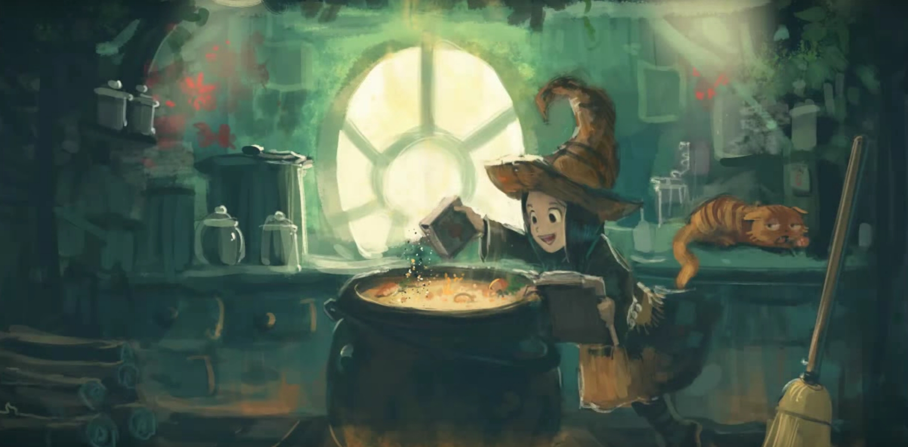

*Artwork par David Revoy, licence [CC-BY](https://creativecommons.org/licenses/by/3.0/) — [la démonstration enregistrée est sur YouTube](https://www.youtube.com/watch?v=93lMLEuxSLk).*

## Coloriser du dessin au trait

Souvent, l'artiste — un coloriste de BD, par exemple — prend un crayonné ou un dessin au trait et peint **sous** l'image. Qu'elle soit numérique ou scannée.

### Préparer le dessin au trait

Si votre image a un fond blanc ou uni, deux méthodes pour préparer la colorisation :

Placer le dessin au trait **en haut** de la pile et régler son mode de fusion sur **Multiplier**.

Pour nettoyer un peu le trait : `Ctrl + L` ou **Filtres ‣ Ajuster ‣ Niveaux**.

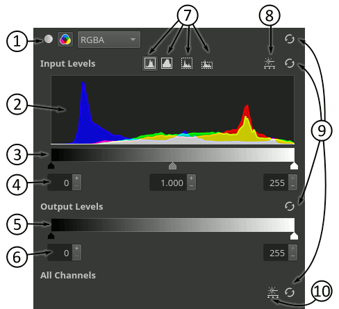

Déplacer le triangle blanc des niveaux d'entrée vers la gauche pour nettoyer les gris indésirables, le triangle noir vers la droite pour foncer le noir.

Si vous crayonnez en bleu avant d'encrer, il faut d'abord retirer les lignes bleues : **Filtres ‣ Ajuster ‣ Courbes de réajustement des couleurs** (`Ctrl + M`).

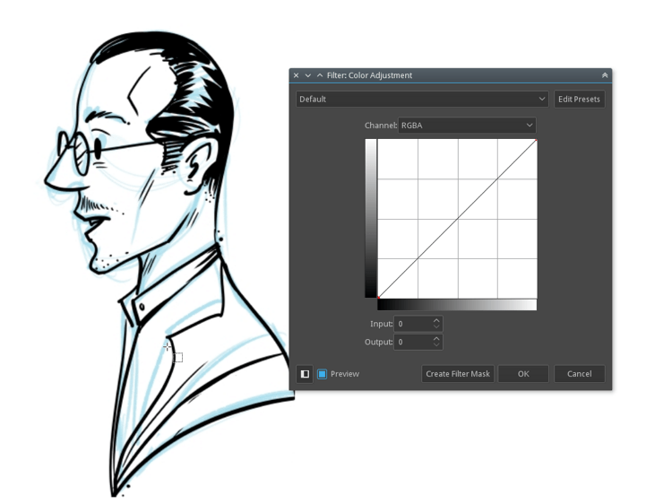

Dans le menu déroulant, sélectionner **Rouge**, cliquer le nœud en haut à droite du graphique et le faire glisser complètement vers le bas — ou saisir **0**. Répéter pour **Vert**.

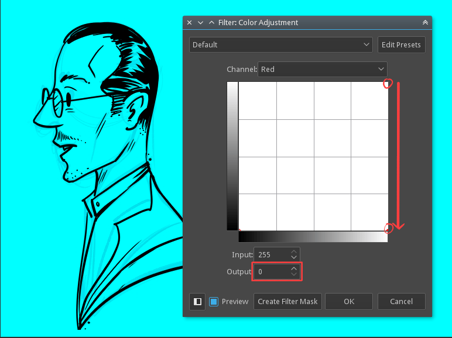

Tout le dessin a maintenant une teinte bleue : zoomer et vérifier si le crayonné bleu transparaît encore. Si oui, dans le canal **Bleu**, déplacer légèrement le nœud haut-droit vers la gauche — ou saisir une valeur vers 190 (celle qui retire les lignes résiduelles).


Appliquer le filtre — oui, il reste beaucoup de bleu. Patience, étape suivante : **Filtres ‣ Ajuster ‣ Dé-saturer** (`Ctrl + Shift + U`), et choisir **Maximum** dans la liste.

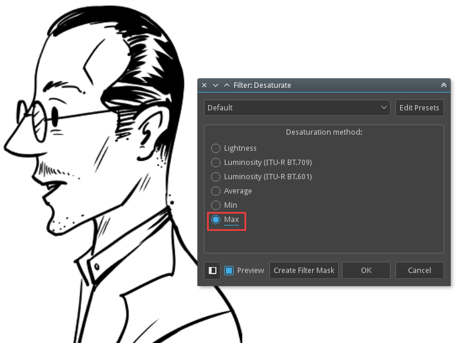

> **INDICATION** — Utiliser des crayons *non-photo-blue* pour les lignes bleues : ils se retirent facilement. En numérique, dessiner en bleu avec le #A4DDED, proche du non-photo-blue.

Un tutoriel de David Revoy explique tout le chemin du croquis bleu à la peinture numérique : [Clean blue sketch](https://www.davidrevoy.com/article239/clean-blue-sketch-traditional-line-art-to-color-it-digital-with-in-krita).

Une fois le trait propre et noir-blanc, il faut effacer le blanc pour ne garder que le trait : **Filtres ‣ Couleurs ‣ Couleur vers alpha…**. La boîte de dialogue transforme toutes les zones blanches en transparence — le sélecteur de couleurs est réglé sur blanc par défaut ; si l'art scanné a un papier d'une autre couleur, c'est ici qu'on le choisit.

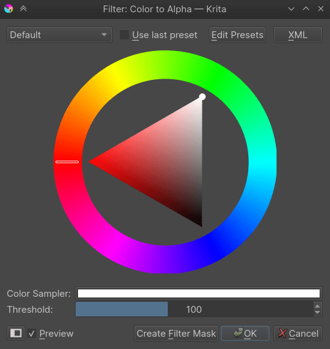

Le blanc du dessin au trait devient alpha — seul le trait reste. Le trait peut même vivre dans un espace de niveaux de gris : une particularité de Krita, qui permet à un calque d'avoir un espace de couleur indépendant de l'image.

### Poser les aplats

Il y a beaucoup de façons de coloriser un dessin au trait ; trois sont courantes chez les artistes :

1. Peindre des blocs de couleur directement, aux pinceaux de bloc.
2. Remplir avec l'outil de remplissage (*flood fill*).
3. Utiliser un masque de coloration.

#### Bloquer au pinceau

La méthode la plus traditionnelle : une brosse de forme ou les outils géométriques pour poser la couleur — comme un marqueur analogique sur papier. Les brosses de bloc : étiquette **Block** du panneau de préréglages.

Ajouter un calque **sous** le calque de trait et peindre. Pour corriger une zone : `E` transforme le même pinceau en gomme. Un calque par couleur donne plus de souplesse.

#### Remplir avec l'outil de remplissage

La seconde : l'outil de remplissage pour les grandes zones — qui exige un trait fermé. Placer d'abord le trait sur son calque. Activer l'outil de remplissage, régler **Étendre la sélection** à 2 px, décocher **Limiter au calque actif** si coché.

Choisir une couleur et cliquer la zone à remplir : grâce à l'extension, la couleur passe légèrement sous le trait — remplissage propre.


#### Masque de coloration

La troisième : le [masque de coloration](https://docs.krita.org/fr/reference_manual/tools/colorize_mask.html) intégré — un outil puissant qui améliore radicalement le flux de production. Sélectionner le calque de trait, puis cliquer l'icône **Outil d'édition du masque de coloration** dans la barre d'outils.

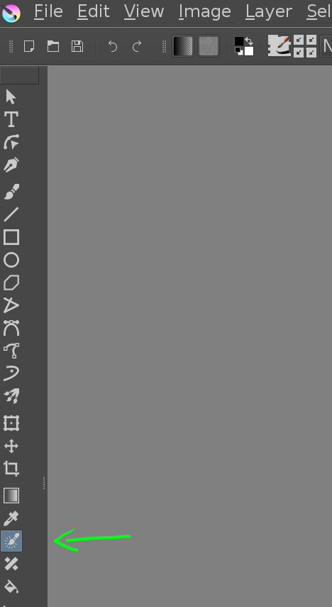

L'outil activé, cliquer sur la zone de dessin — un calque de masque de coloration s'ajoute au document et le trait paraît légèrement flou. Poser alors des coups de pinceau unis pour indiquer quelle zone reçoit quelle couleur :

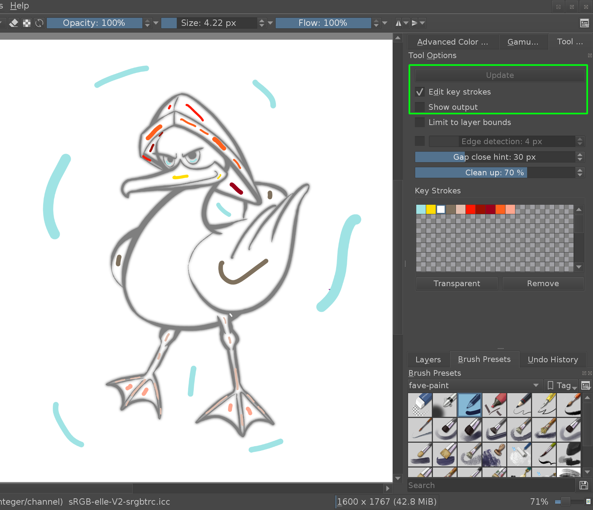

À chaque pression sur **Update** dans les options d'outil, on voit quelle couleur remplit quelle zone. On continue d'éditer jusqu'à satisfaction. Pour un rendu propre, décocher « Edit key strokes » :

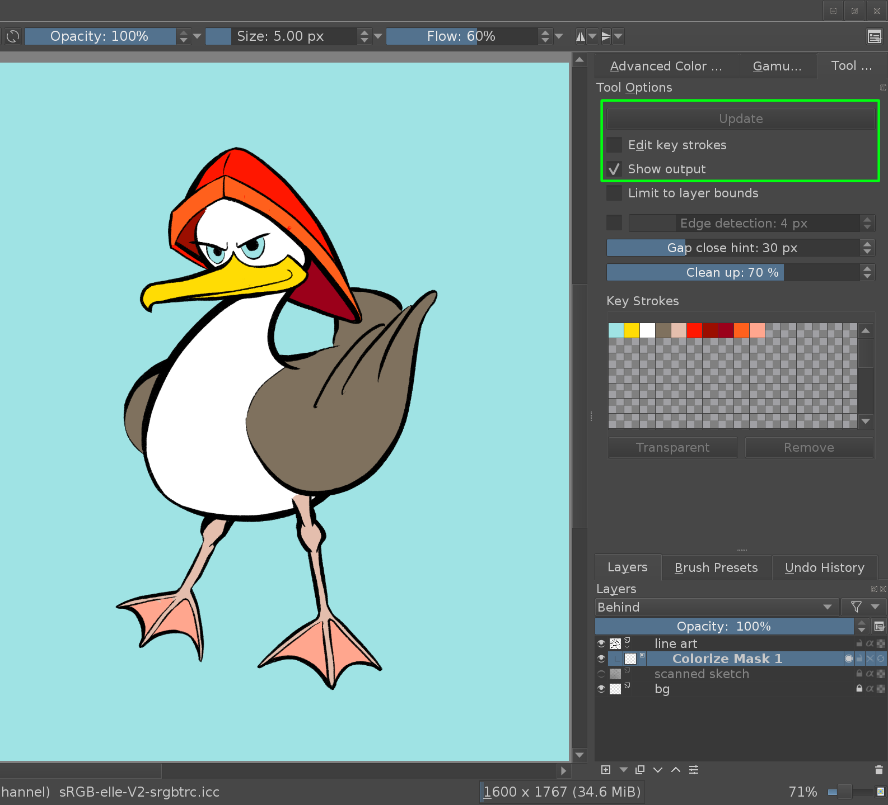

Une fois terminé, convertir le calque de masque de coloration en calque de peinture dans le panneau Calques. Le manuel du [masque de coloration](https://docs.krita.org/fr/reference_manual/tools/colorize_mask.html) détaille l'outil.

### Changer la couleur du dessin au trait

Pour changer la couleur du trait : le **verrou alpha**. Dans le panneau Calques, cliquer l'icône la plus à droite du calque de trait — le petit damier :


Le verrou alpha activé, on ne change que la **couleur** des pixels, pas leur opacité : tout ce qu'on peint ne colore que les lignes existantes, sans en ajouter.

Pour teindre tout le trait d'une seule couleur : l'outil de remplissage ne s'appliquera qu'aux lignes. Pour plusieurs couleurs par zones : un pinceau large par-dessus le trait :


## Peindre

### Partir du chaos

On commence par faire du désordre — formes et textures aléatoires — puis on tire des concepts du chaos obtenu. Comme trouver des figures dans les nuages ou dans des textures abstraites. Beaucoup de concept artists travaillent ainsi.


Pinceau de forme, pinceau à pulvérisation — beaucoup de formes différentes, et le cerveau en extrait formes et compositions du bruit résultant. On raffine ensuite ces formes vers ce qu'elles évoquent, peintes par-dessus au pinceau normal. Idéalement dans un contexte de peinture (pas de lignes).

### Partir d'une peinture en valeurs

Cette méthode vient de la peinture à l'huile ancienne : d'abord une sous-couche, puis la couleur par-dessus — la sous-couche sombre transparaît.

Avec Krita, les modes de fusion font ça : choisir le mode de fusion *Couleur* sur un calque supérieur change les couleurs de l'image **sans changer la luminosité relative** — précieux, car l'œil humain est bien plus sensible aux différences tonales qu'aux différences de saturation et de teinte. On peut donc travailler en niveaux de gris avant la phase couleur.

Plus sur cette technique : [Getting started with Krita 1.3 — B/W portrait](https://www.davidrevoy.com/article185/tutorial-getting-started-with-krita-1-3-bw-portrait) par David Revoy.

## Tuiles et textures

Beaucoup d'artistes créent dans Krita les textures des assets 3D de jeux et d'animation. Krita propose de nombreux gabarits de textures — tailles, profondeur et profils de couleur courants du texturing.

Krita a aussi un mode tuile sans couture en temps réel : **Affichage ‣ Mode enveloppant** (*wrap around*). En peignant, le canevas se tuile en direct — motifs et textures sans couture, et les motifs imbriqués s'y préparent facilement.

## Créer du pixel art

Krita sait aussi faire du pixel art haute définition. L'effet vient d'un **calque de filtrage couleur indexée** et de motifs de tramage (*dithering*) par-dessus. La pile de calques :

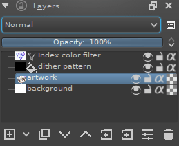

Le filtre couleur indexée associe des couleurs choisies par l'utilisateur aux valeurs de gris de l'œuvre. Ci-dessous, la bande sous le dégradé noir-blanc a un index colorisé appliqué : chaque valeur de gris reçoit sa couleur.


On choisit couleurs et rampes dans la boîte de dialogue du filtre :


Le tramage enrichit le rendu et adoucit les bandes du filtre. Krita a plusieurs motifs de tramage par défaut, dans le panneau Motifs. À utiliser comme calque de remplissage, en mode de fusion **Incrustation** (overlay), opacité entre 10 et 25 %.

Peindre en niveaux de gris, ajouter le calque de filtre couleur indexée en haut, puis le calque de remplissage à motifs entre les deux — comme sur la pile ci-dessus. Tout reste modifiable à tout moment, puisque le filtre est un calque de filtre.

On peut faire un groupe par couleur et donner à chaque groupe son motif de tramage.

Résultat :

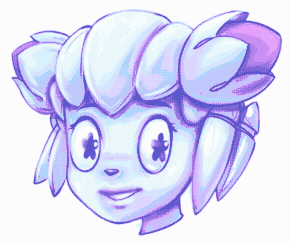
