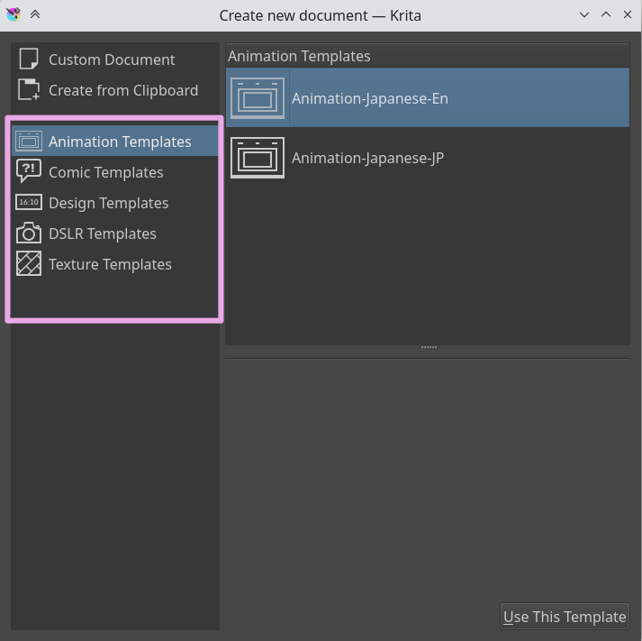

<!-- start-replace-fm field="title" -->
# Krita — les gabarits de document
<!-- end-replace-fm -->
<!-- start-replace-fm field="description" format="blockquote" -->
> Le chapitre du manuel Krita sur les gabarits : créer un document à partir d'un gabarit (dimensions, résolution, espace couleur) et enregistrer ses propres gabarits — le format du projet, sans le refaire.
<!-- end-replace-fm -->

<!-- start-replace-mediagraphie-fiche -->
> **Référence** — Documentation Krita (2026). Krita — les gabarits de document.. https://docs.krita.org/fr/user_manual/templates.html. [↗](https://docs.krita.org/fr/user_manual/templates.html)
>
> | **Type** | webpage |
> | **Auteur·e** | Documentation Krita |
> | **Date** | 2026 |
> | **Statut** | stable |
> | **Mots-clés** | image, krita, gabarit, document, resolution, tutoriel |

**Citation (copier-coller)**

```citation
Documentation Krita (2026). Krita — les gabarits de document.. https://docs.krita.org/fr/user_manual/templates.html.
```
<!-- end-replace-mediagraphie-fiche -->

## Cité par

<!-- start-replace-mediagraphie-cited-by -->
- [Exercice — Composition d'une affiche](../../../../02-activites/01/exercices/05-affiche-composition/)
<!-- end-replace-mediagraphie-cited-by -->

---
> 🇫🇷 **Traduction française** de la page officielle [Templates](https://docs.krita.org/fr/user_manual/templates.html) — la page source n'est pas encore traduite. Adaptation : A26.

Les gabarits (*templates*) sont simplement des fichiers `.kra` enregistrés dans un emplacement spécial, pour que Krita puisse les rappeler rapidement. C'est l'équivalent de **Ouvrir un document existant comme document sans titre…**, avec une meilleure place dans l'interface.



On crée son propre gabarit à partir de n'importe quel fichier `.kra`, via l'élément de menu **Fichier ‣ Créer un gabarit à partir de l'image…**. Le document courant devient un nouveau gabarit, avec toutes ses propriétés, ses calques et leur contenu.

Krita propose ces gabarits par défaut :

## Gabarits d'animation

Destinés à l'animation de style japonais. Conçus pour la coproduction : on adapte les dossiers de calques à l'échelle et au détail de son travail. Disponibles en anglais et en japonais.

- Animation-Japanese-En
- Animation-Japanese-Jp

## Gabarits de bandes dessinées

Conçus pour démarrer une BD directement. Le gabarit BD repose sur un système de vecteurs et de clones de ces calques vectoriels, qui reflètent automatiquement tout changement : on dessine entre les cases sans craindre de déborder, l'option **Hériter de l'alpha** restant le dessin dans le cadre.

- Un modèle rappelant le système de *Tintin* ou *Spirou et Fantasio* — cases larges, découpes horizontales.
- Un modèle rappelant les vieux comics DC et Marvel (*Batman*, *Captain America*) — neuf cases pour une progression rapide de l'histoire.
- Un modèle basé sur le manga japonais — gouttière verticale fine, gouttière horizontale épaisse, pour garantir la lecture de la rangée avant la suivante.

Douze petites cases à disposition.

## Gabarits de design

Gabarits de design avec diverses valeurs par défaut et un PPI correct :

- Cinema 16:10
- Cinema 2.93:1
- Presentation A3-landscape
- Presentation A4 portrait
- Screen 4:3
- Design Web

## Gabarits DSLR

Tailles par défaut pour la photo :

- Canon 55D
- Canon 5DMK3
- Nikon D3000
- Nikon D5000
- Nikon D7000

## Gabarits de textures

Pour créer des textures 3D : de 1024 à 4096.
