<!-- start-replace-fm field="title" -->
# Krita — la gestion colorimétrique
<!-- end-replace-fm -->
<!-- start-replace-fm field="description" format="blockquote" -->
> Le chapitre du manuel Krita sur la gestion des couleurs : profils, espaces de travail et conversion — la chaîne qui garde les couleurs cohérentes de l'écran à l'export.
<!-- end-replace-fm -->

<!-- start-replace-mediagraphie-fiche -->
> **Référence** — Documentation Krita (2026). Krita — la gestion colorimétrique.. https://docs.krita.org/fr/general_concepts/colors/color_managed_workflow.html. [↗](https://docs.krita.org/fr/general_concepts/colors/color_managed_workflow.html)
>
> | **Type** | webpage |
> | **Auteur·e** | Documentation Krita |
> | **Date** | 2026 |
> | **Statut** | stable |
> | **Mots-clés** | image, krita, couleur, profil, gestion, tutoriel |

**Citation (copier-coller)**

```citation
Documentation Krita (2026). Krita — la gestion colorimétrique.. https://docs.krita.org/fr/general_concepts/colors/color_managed_workflow.html.
```
<!-- end-replace-mediagraphie-fiche -->

## Cité par

<!-- start-replace-mediagraphie-cited-by -->
- [Krita — les fonctions image](../../../../03-savoirs/02-utiliser/04-exploitation-logiciels/01-image/)
<!-- end-replace-mediagraphie-cited-by -->

---
> 📄 **Réhébergement** — le contenu ci-dessous est la reproduction intégrale de la page officielle [Krita — la gestion colorimétrique](https://docs.krita.org/fr/general_concepts/colors/color_managed_workflow.html) de la documentation Krita, déjà publiée en français par l'équipe de Krita. La source fait foi et est mise à jour en premier ; cette copie peut dater.

## Flux de production géré par couleurs

Vous avez peut-être entendu parler que Krita possède quelque chose appelé la gestion des couleurs. Ou, peut-être que vous vous demandez ce que signifient des termes comme « modèles de couleurs » et « profils de couleurs » que vous trouvez dans les menus. La gestion des couleurs est assez utile pour les personnes travaillant dans l'imagerie numérique de manière professionnelle. Aussi, nous espérons que cette page va expliquera pourquoi.

### Informations élémentaires

Si vous n'avez jamais travaillé avec la gestion des couleurs et que vous n'avez aucune idée de ce que c'est, sachez que vous avez probablement travaillé dans l'espace colorimétrique « RVB » 8 bits. Cela signifie que vous pouvez choisir *sRGB intégré* ou *sRGB-elle-v2-srgbtrc.icc*. Avec le nouveau navigateur d'espaces colorimétriques, ce profil est marqué par *(défaut)* lorsque vous utilisez le mode en 8 bits.

Nous allons détailler la signification de ces termes dans la théorie, mais si vous êtes ici uniquement pour essayer de savoir quel est le défaut, vous le savez maintenant. Peut-être, après avoir lu ceci, vous aurez envie de changer le défaut, pour obtenir de nouveaux résultats intéressants avec les filtres, les modes de mélange, ou simplement le pinceau de couleurs.

### Quel est le problème ?

Pour expliquer la portée de la gestion des couleurs, vous devez d'abord apprendre quels problèmes la gestion des couleurs tente de résoudre.

Imaginons nous dans un jardin d'enfants :

La classe des 28 enfants est sous-divisée en groupes de 7. Chaque groupe possède sa propre table.

L'enseignant leur donne un devoir de peinture. Ils doivent peindre un triangle rouge, un carré bleu, un cercle vert et mettre une bordure jaune autour des trois. Les enfants ont déjà une grande expérience de la peinture. Ainsi, l'enseignant peut donc laisser les plus intelligents se débrouiller seuls avec leurs appareils et passer plus de temps avec ceux qui ont besoin d'aide.

Les résultats suivants proviennent du dessin :

Même si tous les groupes ont la même allocation, le résultat de chaque groupe semble différent.

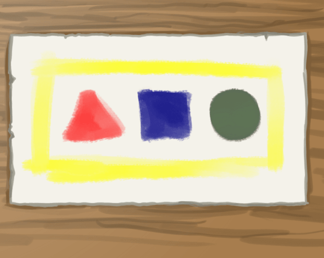

Group 1 had vermilion red, citron yellow and ultramarine blue to their disposal. This means their triangle looks nice and red, but their circle's green is muddy. This is because ultramarine is too dark of a blue to create nice greens with.

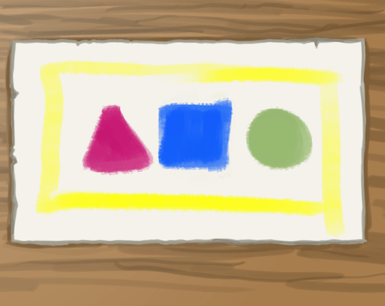

Group 2 had magenta red, citron yellow and cerulean blue. Magenta is a type of red that is closer to pink, opposed to vermilion, which is closer to orange. However, their green looks nice because cerulean is a much lighter blue.

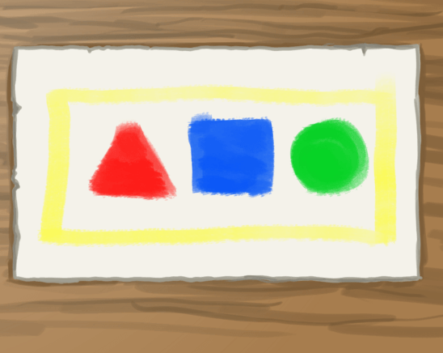

Group 3 had vermilion red, citron yellow, emerald green and cerulean blue. They didn't mix their green, and thus ended up with a purer color.

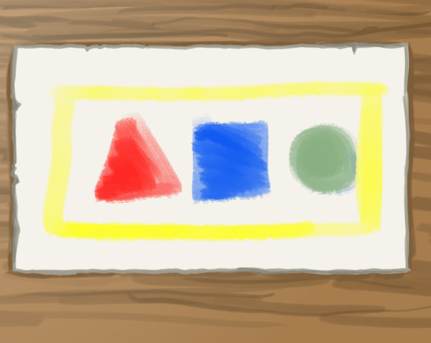

Finally, group 4 has vermilion red, citron yellow and cerulean blue. Their colors probably look like what you imagined.

Maintenant, ce sont des enfants de la maternelle,. Ainsi, ce n'est pas le plus grand problème dans le monde. Cependant, imaginez que quelque chose comme cela arrive dans une imprimerie ? Imaginez quatre imprimantes, imprimant le même magazine avec des résultats extrêmement différents ? Cela serait catastrophique ?

Pour cette raison, la gestion des couleurs a été imaginée.

### Qu'est-ce que la gestion des couleurs ?

La gestion de couleurs est, grossièrement expliquée, un ensemble de systèmes tentant d'avoir la même traduction de couleurs et de façon correcte entre des périphériques avec des couleurs.

Il fonctionne généralement en essayant de convertir une couleur dans l'espace colorimétrique de référence « XYZ ». Ce dernier est un système de coordonnées ayant un emplacement pour toutes les couleurs que l'œil humain moyen peut percevoir.

A partir de XYZ, il peut alors être traduit en retour vers un autre espace colorimétrique de périphérique, tel que RGB (pour les écrans) ou CMYK (pour les imprimantes).

Krita dispose de deux systèmes dédiés à la gestion des couleurs. D'une part, nous avons **lcms2**, qui traite des profils « ICC ». D'autre part, nous avons **OCIO**, traitant de la gestion des couleurs « LUT ».

Pour donner une estimation grossière, les profils « ICC » s'arrangent pour conserver la cohérence des couleurs, sur de nombreuses interpolations de périphériques (écrans, imprimantes), par utilisation d'un espace de référence. Les profils « OCIO » s'arrangent par manipulation de l'interprétation des prétendues couleurs.

Grâce au deux, les profils colorimétriques suivants peuvent être identifiées :

Les espaces de périphériques sont ceux décrivant votre écran. Ils doivent être réalisés à l'aide d'un petit appareil appelé « colorimètre ». Cet appareil, associé au logiciel adéquat, mesure le rouge, le vert et le bleu les plus intenses que votre écran peut produire, ainsi que le blanc, le noir et le gris qu'il produit. À partir de ces mesures et de plusieurs autres, il crée un profil « ICC » spécifique à votre écran. Vous les définissez dans l'onglet de gestion des couleurs de Krita. Par défaut, nous supposons « sRGB » pour les écrans. Mais, il est très probable que votre écran ne corresponde pas exactement à « sRGB », surtout si vous avez un écran de haute qualité, qui peut posséder un espace plus grand. Les espaces de périphériques sont également la raison pour laquelle vous devez d'abord consulter votre imprimeur pour savoir quel profil il attend. De nombreuses imprimeries possèdent leurs propres profils de périphériques pour leurs imprimantes ou préfèrent effectuer elles-mêmes la conversion des couleurs. Vous pouvez en savoir plus sur l'utilisation du colorimètre :ref : « ici <profilage_et_calibrage> ».

Ils sont livrés avec Krita pour les profils « ICC » et peuvent être téléchargés à partir du site Internet de « OCIO ». Les espaces de travail sont particulièrement agréables pour effectuer des calculs de couleurs, ce que des programmes comme Krita font souvent. Il est donc recommandé d'avoir un profil d'espace de travail pour votre image.

Ce sont des espaces spéciaux qui ont été déformés pour donner un certain aspect à une image. Krita ne fournit pas de profils « d'apparence » pour « ICC ». Il ne prend pas encore les espaces « d'apparence » pour « OCIO ».

### Flux de production géré par couleurs

Le fait de connaître ces espaces ne vous donne bien sûr pas une idée de la façon de les utiliser. Mais, cela facilite l'explication de leur utilisation. Examinons donc un flux de travail typique de gestion des couleurs :

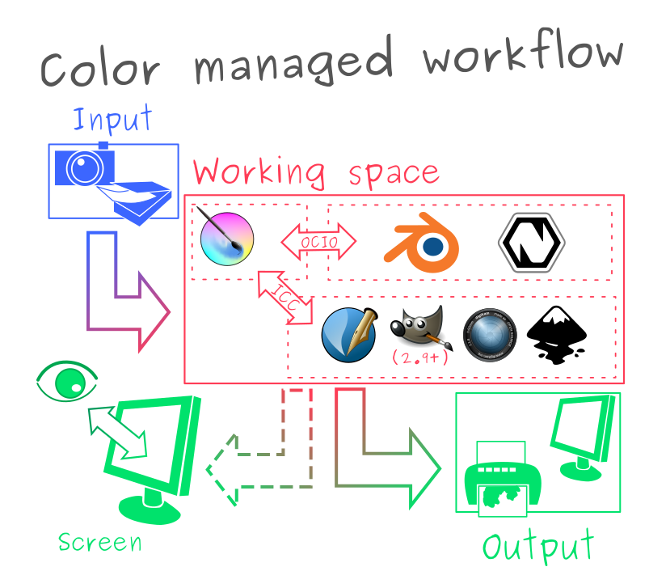

*Un exemple classique de flux de travail reposant sur la gestion des couleurs. Nous avons une entrée provenant de périphériques de numérisation et d'appareils photographiques, que nous transformons dans un espace de travail pouvant être utilisé entre différents logiciels d'édition et est converti dans un espace de sortie pour affichage sur un écran ou pour impression.[¶](#id4)*

Dans un flux de travail traditionnel de gestion des couleurs, nous pensons généralement en termes de couleurs du monde réel converties en couleurs informatiques et inversement : par exemple, des photos prises avec un appareil photo ou des images numérisées. Si vous disposez d'un espace de périphérique pour un tel appareil, nous attribuons d'abord cet espace à l'image, puis nous la convertissons dans un espace de travail.

Nous effectuons alors toutes nos modifications dans l'espace de travail et utilisons cet espace pour communiquer avec d'autres programmes de montage. Dans le cas de Krita, qui possède deux systèmes de gestion de couleurs, nous utilisons des profils « ICC » entre des programmes comme Gimp 2.9+, Inkscape, digiKam et Scribus, ainsi que la configuration « OCIO » entre Blender et Natron.

Vous enregistrez aussi vos fichiers de travail dans votre espace de travail, exactement comme avoir des calques non fusionnés dans votre fichier de travail ou les conserver avec une très haute résolution.

Parfois, nous appliquons des espaces colorimétriques esthétiques ou « d'apparence » à une image dans le cadre du processus d'édition. Il s'agit d'un processus plutôt avancé, dont il n'y a probablement pas lieu de s'inquiéter dans le cas de Krita.

Ensuite, lorsque nous avons terminé l'édition, nous essayons de la convertir vers un espace de sortie, étant un autre espace de périphérique. Il peut s'agir de « CMYK » pour les imprimantes ou d'un profil « RGB » spécial pour écran. Lorsque vous traitez avec des imprimeries professionnelles, il est préférable de leur demander cette étape. Ils ont beaucoup d'expérience en matière de conversion et peuvent préférer effectuer la conversion de votre espace de travail vers l'espace de périphérique de leurs imprimantes.

Une autre forme de sortie est la façon dont votre écran affiche la couleur. Contrairement à la sortie normale, celle-ci est effectuée en permanence pendant l'édition : après tout, vous devez être en mesure de voir ce que vous faites, mais votre écran est toujours un périphérique avec un espace de périphérique. Ainsi, il déforme l'apparence de l'image. De cette manière, vous pouvez voir votre écran comme un ensemble de jumelles à travers lesquelles vous devez regarder pour un affichage de votre image.

Par conséquent, sans un écran calibré, vous ne savez pas quelles sont les couleurs réelles avec lesquelles vous travaillez, car l'ordinateur ne connaît pas les propriétés pertinentes de votre écran. Donc, si vous avez calibré votre écran, il suffit de donner le profil à Krita dans sa configuration et de sélectionner l'espace « sRGB » pour dessiner. Ainsi, vous verrez pour la première fois les couleurs réelles de l'espace « sRGB ».

### Ainsi, qu'est-ce que cela signifie ?

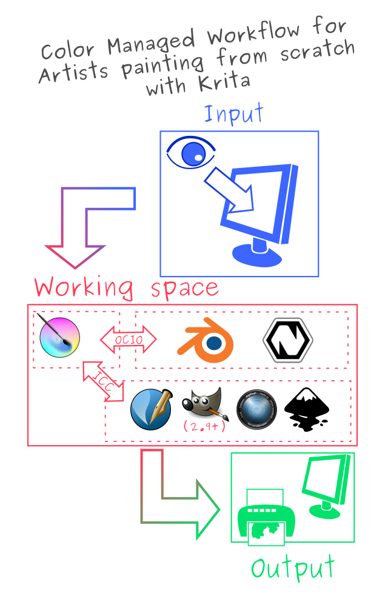

*Lors d'une peinture à partir de rien, nous pouvons voir notre profil d'écran comme un espace de travail, parce que nous n'utilisons pour déterminer quelles couleurs sélectionner. Ceci simplifie quelque peu le flux de travail mais donne plus d'importance au profil de l'écran et aux conditions d'affichage.[¶](#id5)*

Les photographes et les personnes s'occupant d'une discipline délicate concernant les effets visuels appelée « étalonnage de couleurs » deviennent complètement fous lorsqu'ils essaient d'obtenir des couleurs 100% correctes. Ils tiennent même compte de facteurs tels que l'heure de la journée et la couleur de leurs murs. Par exemple, si le mur derrière votre ordinateur est rouge pur, vos yeux s'adapteront pour être moins sensibles au rouge, ce qui signifie que les couleurs choisies dans le programme pourraient être plus rouges. Nous appelons cela les *conditions d'affichage*.

Heureusement, les artistes ont un peu moins de souci à se faire à ce sujet. Les illustrations étant entièrement réalisées à la main, nous sommes en mesure d'identifier les éléments importants et de créer des contrastes appropriés entre les couleurs. Cela signifie que même si nos images s'avèrent être légèrement plus rouges que prévu, il est moins probable que l'image entière soit gâchée. Si nous reprenons l'exemple du jardin d'enfants ci-dessus, nous comprenons toujours à quoi l'image était censée ressembler, même si les couleurs sont différentes sur chaque image. En outre, comme les couleurs des illustrations sont délibérément choisies, nous pouvons les corriger plus facilement par la suite. Mais en même temps, c'est bien sûr un gros effort à faire pour ceci et nous aurions pu avoir beaucoup plus de flexibilité si nous avions pris en compte les conditions d'affichage.

Une fois cela dit, pour les artistes, il est aussi très utile de comprendre les espaces de travail. Différents espaces de travail donnent des résultats différents avec des filtres et du mélange et seuls quelques espaces de travail peuvent être utilisés pour des technologies avancées comme le « HDR ».

De même, Krita, en tant que programme destiné à créer des images à partir de rien, ne se soucie pas vraiment de l'attribution d'espaces de travail après avoir créé l'image. Mais comme vous utilisez l'écran comme un binoculaire pour regarder votre image et pour sélectionner des couleurs, vous pouvez considérer l'espace de périphérique pour votre écran comme un espace d'entrée pour l'image. C'est pourquoi le fait de calibrer votre écran et de donner ce profil à Krita dans les paramètres peut vous aider à préparer votre travail pour l'impression et pour de futurs projets à long terme.

Dans l'ensemble, il est utile de conserver à l'esprit des éléments tels que les conditions d'affichage en arrière pensée. De nombreux artistes professionnels utilisent une couleur de gris moyen comme arrière plan par défaut de leur toile parce qu'ils trouvent leurs créations d'images beaucoup plus dynamiques grâce à l'amélioration de leurs conditions d'affichage. C'est également la raison pour laquelle de nombreux programmes graphiques, dont Krita, sont aujourd'hui proposés avec un thème sombre. (Bien sûr, cela peut aussi être dû au fait que les thèmes sombres peuvent être considérés comme agréable, qui sait).

### Profils « ICC »

Un profil « ICC » est un ensemble de coordonnées décrivant les extrémités de l'espace du périphérique dans « XYZ x. Il s'agit de données de gestion des couleurs que vous utilisez pour communiquer votre espace de travail aux imprimantes et aux applications conçues pour l'impression, telles que Gimp, Scribus, Photoshop, Illustrator, Inkscape, digiKam, RawTherapee, etc. Vous disposez de deux types de profils « ICC » :

Ils sont livrés avec Krita. Les profils de mise en forme matricielle sont réalisés grâce à des paramètres de configuration et en interpolant entre eux pour obtenir la taille exacte de l'espace colorimétrique. Pour cette raison, le navigateur d'espaces colorimétriques de Krita peut vous donner beaucoup d'informations sur ces profils. De tels profils sont également préférables comme espace de travail.

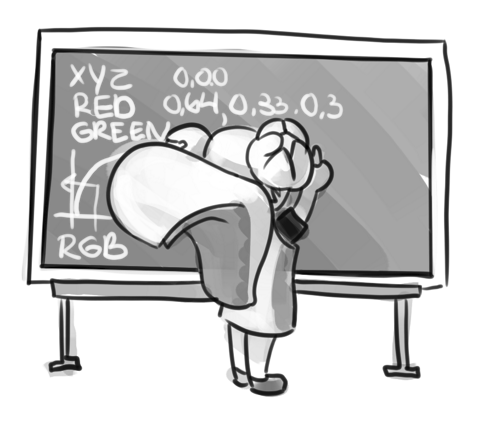

*Les profils de formatage matriciel possèdent peu de paramètres décrivant l'espace colorimétrique,ce qui nécessite ainsi de faire des interpolations. Ceci conduit à beaucoup de calculs mathématiques.[¶](#id6)*

Ces profils sont assez rares et sont principalement utilisés pour décrire les profils d'imprimante, tels que « CMYK ». Les profils « cLUT » (Color Look-up Table), enregistrent beaucoup plus de données que les profils « Matrix Shaper ». Ainsi, ils peuvent gérer des données pour de petites particularités causées, par exemple, par des résultats inattendus du mélange de pigments. Il s'agit d'une approche beaucoup plus organique de la description d'un espace colorimétrique, ce qui explique pourquoi de nombreux programmes ne se souciant pas beaucoup de la gestion des couleurs ne les prennent pas en charge.


*Les profils « cLUT » fonctionnent en gérant des tables pour chaque couleur dans un espace colorimétrique et leurs coordonnées respectives dans un espace de référence. Pour « CMYK », il s'agit généralement de « L*A*B* » et pour le reste « XYZ ». Ces tables sont délicates à réaliser, ce qui signifie que ces profils sont beaucoup plus rares.[¶](#id7)*

La chose importante concernant les profils « ICC » est que votre espace de travail peut être plus large que l'est votre espace de périphérique. Ceci n'est pas généralement mauvais. Cependant, lors de la conversion, vous devez terminer en vous posant la question de comme traduire les valeurs de l'espace de travail.

Cela ne fait qu'écraser les valeurs de l'espace de travail vers l'espace dans lequel il est converti. C'est une bonne méthode pour afficher toutes les valeurs possibles, mais pas si bonne si vous voulez une reproduction fidèle des couleurs. Utilisez cette méthode si vous voulez afficher toutes les couleurs d'une image ou si vous voulez exprimer tous les contrastes possibles. Ne fonctionne pas avec les profils « Matrix Shaper », la valeur par défaut est la colorimétrie relative.

Par opposition à la colorimétrie perceptuelle, la colorimétrie absolue va tenter de conserver toutes les couleurs correctes à n'importe quel prix, ce qui peut aboutir à des couleurs avec une horrible apparence. Ceci n'est recommandé que pour les travaux de reproduction. Ne fonctionne pas avec les profils « Matrix Shaper » dans Krita en raison des normes de flux de travail « ICC » v4.

Une solution intermédiaire entre la solution perceptuelle et la solution absolue, la solution relative essaiera de faire correspondre toutes les couleurs qu'elle peut faire correspondre entre les espaces colorimétriques. Il le fait en alignant les points blancs et noirs. Il coupe le reste à leurs frontières respectives. C'est ce que tous les profils de mise en forme de matrice utilisent par défaut pendant la conversion, car le flux de travail « ICC v4 » spécifie de n'utiliser que la colorimétrie relative pour les profils de mise en forme de matrice.

Tout est fait pour conserver la coloration, même si la teinte est sacrifiée. Utilisé dans les infographies. Ne fonctionne pas avec les profils de matrice de mise en forme, la valeur par défaut est la colorimétrie relative.

[*](#id1)La version du profil « ICC » est la dernière chose à conserver à l'esprit lorsqu'il s'agit de profils « ICC ». Krita fournit à la fois les profils en version 2 et 4, ce dernier donnant de meilleurs résultats dans les calculs mathématiques concernant les couleurs, mais le premier étant plus largement pris en charge (comme indiqué ci-dessous dans « Interaction avec d'autres applications »). C'est également la raison pour laquelle Krita utilise la version 2 par défaut et nous recommandons d'utiliser cette version 2 lorsque vous n'êtes pas certain que les autres programmes que vous utilisez prennent en charge la version 4.

### Panneau « LUT » et affichage « HDR »

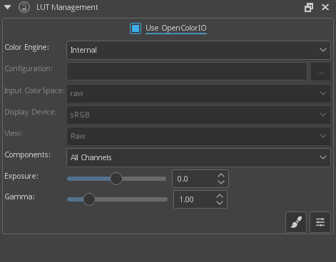

Le conteneur :ref : « lut_docker » est la deuxième partie importante de la gestion des couleurs dans Krita, partagée entre Krita et des programmes comme Blender, Natron et Nuke. Il utilise uniquement des tables de recherche, configurées grâce un fichier de configuration.

Vous pouvez définir un espace de travail de l'image sous l'espace colorimétrique d'entrée et l'affichage vers un profil « sRGB » ou votre propre profil « LUT » si vous l'avez ajouté dans votre configuration. L'affichage dans ce cas est pour faire une épreuve des transformations vers un périphérique donné d'affichage.

Composante, exposition, gamma, point blanc et point noir sont les paramètres vous permettant de modifier le filtre d'affichage.

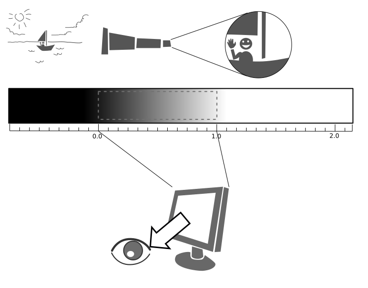

Comme expliqué précédemment, nous pouvons considérer notre écran comme un télescope ou une jumelle dans le monde de notre image. Ce qui signifie qu'il déforme un peu l'affichage de l'image. Mais, nous pouvons modifier cette jumelle ou ce filtre d'affichage pour afficher notre image d'une manière différente. Par exemple, pour nous permettre de voir les blancs d'une image plus blancs que le blanc de notre écran. Pour expliquer ce que cela signifie, nous devons réfléchir à ce qu'est le blanc.

Par exemple, le blanc, sur notre écran, est entièrement rouge, entièrement vert et entièrement bleu. Mais il est certainement différent du blanc de notre papier, de la couleur du lait, du blanc du soleil,ou même du blanc de l'écran de nos téléphones portables.

Le noir, de façon similaire, est plus brillant sur un écran « LCD » qu'un écran à « LED » et incomparable par rapport au noir d'une pièce soigneusement fermée.

Cela signifie qu'il y a potentiellement des noirs plus noirs que l'écran noir et des blancs plus blancs que l'écran blanc. Cependant, pour des raisons de simplicité, nous attribuons le point noir et le point blanc à certaines valeurs. A partir de là, nous pouvons déterminer si un blanc est plus blanc que le point blanc ou un noir plus noir que le point noir.

Le conteneur « LUT » nous permet de contrôler ce filtre d'affichage et de modifier la distorsion. Ceci est utile quand nous allons modifier les images réalisées avec les valeurs référencées de scènes, comme les photos « HDR » ou des images provenant d'un moteur de rendu.

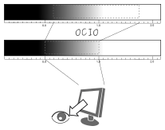

Ainsi, par exemple, nous pouvons choisir de mettre à l'échelle le blanc plus blanc que l'écran vers le blanc de l'écran afin d'en voir les contrastes ici.

L'intérêt de cette méthode est que vous pouvez tirer parti de plus de détails de luminosité dans une image. Bien que vous ne puissiez pas voir la différence entre le blanc de l'écran et le plus blanc que le blanc d'écran (parce que votre écran ne peut pas afficher la différence), les programmes de graphisme peuvent certainement l'utiliser.

Un exemple courant est la correspondance entre l'éclairage d'un modèle 3D et celui d'une scène du monde réel. D'autres sont des retouches photo avancées, avec beaucoup plus d'informations de contraste disponibles pour l'utilisateur. Dans la peinture elle-même, cela vous permet de créer une image où vous pouvez être désinvolte avec le contraste et vous permettre d'être aussi brillant que vous le souhaitez.

Les manipulations de conteneur « LUT » se font par vue. Vous pouvez donc créer une nouvelle vue et la régler sur la luminosité. De cette façon, vous pouvez voir l'image à la fois en couleur et en niveaux de gris et conserver un œil averti sur vos valeurs.

Un autre exemple est de regarder avec soin les gradients dans une section particulière.

Comme le profil « ICC », le conteneur « LUT » vous permet de créer une sorte de profil pour votre périphérique. Dans ce cas, il s'agit de la table de recherche « LUT» (« Look Up Table »), qui peut être ajoutée au profil « OCIO » en modifiant le fichier de configuration. Lorsque le profil « OCIO » est activé, la configuration dans **Configuration / Configurer Krita... / Gestion des couleurs** est désactivée, sauf si vous utilisez le moteur de couleurs **Interne**.

### Dans le sommaire

Krita possède deux modes de gestion des couleurs :

- ICC fonctionne en termes d'espaces concernant l'espace colorimétrique « CIEXYZ » et nécessite un profil « ICC ».

- OCIO fonctionne en termes d'interprétation et fait usage des tables de correspondance (LUT).

- Les deux peuvent être faits avec un colorimètre.

- Si vous voulez avoir un flux de travail correctement géré au niveau des couleurs, vous devez en faire un profil personnalisé pour le périphérique d'entrée (votre écran) et les périphériques de sortie (votre imprimante ou l'écran cible). Pour Internet, la sortie est toujours « sRGB ».

- Définir vos profils d'écran sous :menuselection : « Configurer / Configurer Krita... / Gestion des couleurs ».

- N'utilisez AUCUN profil d'écran ou de périphériques pour dessiner. Utilisez un profil d'espace de travail tel que l'un des profils « elle » pour cela, car les mathématiques pour le calcul des couleurs seront beaucoup plus prévisibles et agréables. Krita effectuera une conversion entre votre écran et votre espace de travail à la volée, vous permettant de sélectionner des couleurs correctes. Votre écran se transformera ainsi en jumelles pour afficher l'image.

- Utilisez la gestion des couleurs appropriée pour le flux de travail approprié. Si vous travaillez avec Blender, il est préférable d'utiliser « OCIO » plutôt que « ICC ». Si vous travaillez avec Scribus ou Photoshop, utilisez « ICC ».

Krita fait beaucoup de calculs mathématiques concernant les couleurs, souvent concernant le mélange des couleurs. Ces calculs fonctionnent mieux dans l'espace colorimétrique linéaire. L'espace colorimétrique linéaire exige une profondeur de bits d'au moins 16 bits pour fonctionner correctement. L'inconvénient est que le travail dans l'espace linéaire peut être une source de confusion.

Si vous aimez peindre, que vous disposez d'une quantité décente de RAM et que vous souhaitez commencer à profiter des avantages de la gestion des couleurs de Krita, essayez de passer de toutes vos images dans le profil « sRGB » intégré à vers celui « sRGB-v2-elle-g10.icc » ou « rec2020-v2-elle-g10.icc » en 16 bits en virgule flottante. Vous obtiendrez ainsi un meilleur mélange des couleurs en offrant la possibilité de commencer à travailler en « HDR » !

> **NOTE** — Certaines cartes graphiques, comme celles de la marque NVidia, ont actuellement les meilleures performances sous 16 bits en virgule flottante, parce que les cartes NVidia convertissent en virgule flottante en interne. Lorsqu'elles n'ont pas besoin de le faire, elles accélèrent !

> **NOTE** — Aucune correction de la gestion de couleurs dans le monde ne peut faire correspondre à 100 % les couleurs entre votre écran et l'image sortant de votre imprimante.

### Exportation

Quand vous avez terminé votre travail sur l'image et que vous êtes prêt pour son exportation, vous pouvez modifier son espace colorimétrique pour l'optimiser :

Si vous préparez une image pour l'Internet :

- Si vous utilisez une profondeur de couleurs sur 16 bits ou plus, convertissez l'image vers une profondeur de couleurs de 8 bits. Ceci rend l'image bien moins volumineuse. Krita ne possède pas de tramage intégré pour le moment, ce qui signifie que les conversions de 16 bits vers 8 bits peuvent conduire à la présence de quelques bandes. Mais, vous pouvez les simuler en ajoutant un calque de remplissage avec un motif, puis en définissant ce calque de remplissage comme calque de superposition avec 5 % d'opacité. Aplatissez ensuite l'ensemble de l'image et convertissez-la en 8 bits. Le motif fonctionnera comme un tramage donnant une apparence plus lisse aux dégradés.

- Si c'est une image en nuances de gris, convertissez la en échelle de gris.

- S'il s'agit d'une image en couleurs, conservez-la dans le profil de l'espace de travail : de nombreux navigateurs actuels prennent en charge les profils intégrés de couleurs dans les images. Firefox, par exemple, essaiera de convertir votre image pour l'adapter au profil de couleurs de l'autre moniteur (s'il en a un). De cette façon, l'image aura presque la même apparence sur votre écran et sur les autres moniteurs calibrés.

> **NOTE** — Dans certaines versions de Firefox, les couleurs ont une apparence étrange : il s'agit d'un bogue de Firefox, à cause de son « système de gestion des couleurs » incomplet <[https://ninedegreesbelow.com/galleries/viewing-photographs-on-the-web.html](https://ninedegreesbelow.com/galleries/viewing-photographs-on-the-web.html)>. Pour le contourner, veuillez enregistrer votre image PNG, JPG ou TIFF sans profil intégré.

Si vous vous préparez à imprimer :

- Avec un peu de chance, vous avez pris la photo dans un profil d'espace colorimétrique de travail au lieu du profil personnalisé courant de votre écran. Si ce n'est pas le cas, convertissez-la en quelque chose comme « Adobe RGB », « sRGB » ou « Rec. 2020 ».

- Vérifier avec l'imprimante quel type d'image est attendu. Peut être, un espace colorimétrique sRGB est attendu ou peut être qu'un profil propre est nécessaire.

### Interaction avec d'autres applications

### Blender

Si vous souhaitez utiliser la fonctionnalité « OCIO » de Krita, et en particulier en combinaison avec la gestion de couleurs de Blender, vous pouvez essayer de lui faire utiliser la configuration « OCIO » de Blender.

La configuration « OCIO » de Blender se trouve sous « <Blender-folder>/version nombre/datafiles/colormanagement ». Configurez le conteneur « LUT » pour utiliser le moteur « OCIO » et sélectionnez la configuration à l'emplacement ci-dessus. Cela vous donnera les espaces d'entrée et d'écran de Blender, mais pas les apparences, car celles-ci ne sont pas encore prises en charge par Krita.

### Afficheur de photos pour Windows

Il se peut que vous rencontriez certains problèmes lorsque vous utilisez différentes applications ensemble. Il est important de noter que l'application standard « Windows Photo Viewer » ne gère pas les profils « ICC » modernes. Krita utilise les profils de la version 4 et « Photo Viewer » ne peut gérer que les profils de la version 2. Si vous exportez vers un format « JPEG » avec un profil intégré, « Photo Viewer » affichera votre image de façon beaucoup trop sombre.

### Exemple de flux de production

Vous trouverez ici quelques exemples de flux de production pour avoir un ressenti sur comment un flux de production avec gestion de couleurs pourrait ressembler.

Comme indiqué précédemment, une entrée pour votre écran est définie grâce au menu :menuselection: « Configuration / Configurer Krita... / Gestion des couleurs » ou grâce « l'espace de travail » de votre conteneur « LUT ». Un espace de travail est défini grâce à un nouveau fichier par document ou dans le conteneur « LUT » grâce à « Espace de travail ».

### Bande dessiné Internet

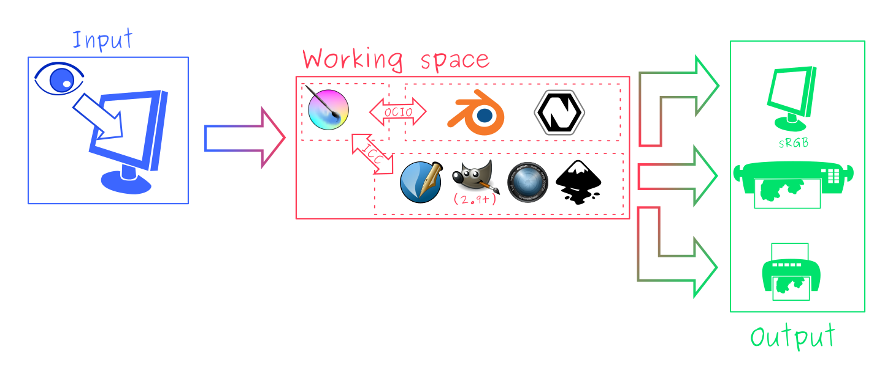

Votre profil d'écran (Vous sélectionner les couleurs grâce à votre écran).

sRGB (le profil d'écran par défaut) ou tout profil plus large si vous pouvez économiser de la profondeur de bits et si vous appréciez de travailler avec.

sRGB, ICC version 2, sRGB TRC pour l'Internet et un profil spécialisé « CMYK » à partir d'une imprimerie pour les images imprimées.

Utilisez le profil « sRGB-elle-V2-srgbtrc.icc » pour naviguer entre Inkscape, Photoshop, Paint Tool SAI, Illustrator, Gimp, Manga Studio, Paintstorm Studio, MyPaint, Artrage, Scribus, etc. et Krita.

Si vous utilisez un espace plus large que celui de « ICC », vous ne serez plus en position que de l'échanger avec les logiciels Krita, Photoshop, Illustrator, Gimp 2.9, Manga Studio et Scribus. Tous les autres logiciels supposeront que le profil de votre espace est « sRGB », sans s'en préoccuper, car ils ne possèdent pas de gestion de couleurs.

Si vous passez de Krita à Blender, Nuke ou Natron, utilisez « OCIO » et définissez l'espace d'entrée sur « sRGB », mais veillez à sélectionner le profil « sRGB » pour « ICC » lors de la création d'un nouveau fichier.

Pour la version finale destinée à Internet, convertissez l'image en « sRGB » en 8 bits, « srgbtrc », ne pas intégrer le profil « ICC ». Ensuite, si vous utilisez un le format « PNG », traitez le avec quelque chose comme « pngcrush » ou d'autres optimiseurs de format « PNG ». Dans ce cas, le format « sRGB » est choisi parce que vous pouvez supposer que la grande majorité de votre public n'a pas calibré son écran et qu'il n'a pas non plus un écran assez avancé pour un gamut large. C'est pourquoi nous convertissons vers l'écran par défaut de l'Internet, le « sRGB ».

### Imprimer

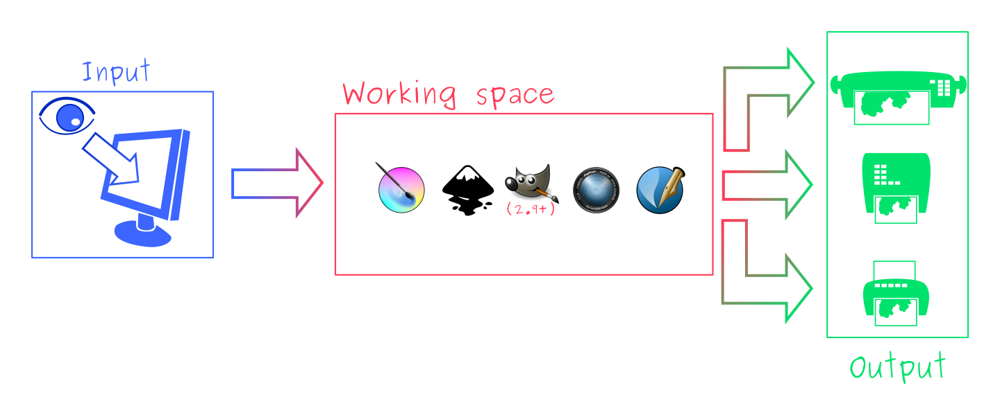

Votre profil d'écran (Vous sélectionner les couleurs grâce à votre écran).

« sRGB » ou « Rec. 2020 », si vous pouvez prendre en charge une profondeur de 16 bits.

Le profil spécialisé « CMYK » de l'imprimerie pour les images imprimées.

Les profils « CMJN » sont différents selon l'imprimante et même selon le type de papier ou d'encre. Aussi, ne soyez donc pas présomptueux et demandez-les à l'avance, au lieu de faire quelque chose comme essayer de peindre dans un profil « CMJN » quelconque. Comme nous l'avons mentionné dans la section sur les conditions d'affichage, vous devez conserver vos options ouvertes.

Vous pouvez configurer le sélecteur avancé de couleurs pour qu'il se transforme en un profil donné grâce à :menuselection: « Configuration / Configurer Krita... / Paramètres du sélecteur de couleurs ». Là, cochez :guilabel: « Le sélecteur de couleurs utilise un espace colorimétrique différent de celui de l'image » et sélectionnez le profil « CMJN » que vous souhaitez utiliser. Cela limitera un peu vos couleurs, mais conservera toutes les options intéressantes de filtrage et de mélange du « RVB ».

### Jeux

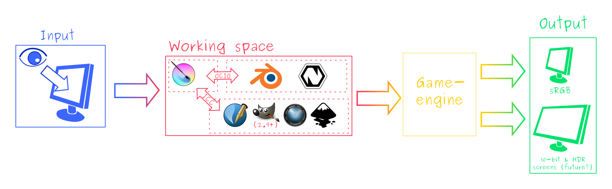

Votre profil d'écran (Vous sélectionner les couleurs grâce à votre écran).

sRGB ou échelle linéaire de gris pour la rudesse et des cartes spéculaires.

Celui-ci est délicat mais, à la fin, il sera en sRGB pour un utilisateur classique.

Cette question est donc délicate. Vous pouvez utiliser les profils « OCIO » et « ICC » entre les programmes. Mais, il est recommandé d'envoyer vos images au moteur en « sRGB » ou en niveaux de gris. De nos jours, de nombreux moteurs de rendu reposant sur la physique vous permettent de définir si une image doit être lue comme une image linéaire ou « srgbtrc ». Ceci est même vital pour que les images soient considérées correctement dans les calculs reposant sur la physique du moteur de rendu du jeu.

Alors que les moteurs de jeux doivent avoir un contenu optimisé et qu'il est recommandé de rester en 8 bits, les écrans futurs peuvent avoir des profondeurs de bits plus élevées. Lorsque les moteurs de rendu commenceront à les prendre en charge, il pourrait être bénéfique de développer un flux de travail où les fichiers de l'espace de travail sont inutilement gros et où vous exécutez quelques scripts pour les optimiser pour vos besoins de rendu actuels, rendant la mise à jour du jeu dans le futur pour des écrans plus sophistiqués, moins pénible.

Les cartes normales et les cartes de hauteur sont officiellement supposées être définies avec un espace de travail « Sans données de couleurs ». Mais, vous constaterez que la plupart des moteurs ne s'en soucient guère. Au lieu de cela, indiquez au moteur de jeu de ne pas faire de conversion sur le fichier lors de l'importation.

Les cartes de brillance, de métallisation et de rugosité reposent toutes sur des calculs linéaires. Lorsque vous trouvez qu'un certain matériau a une métallisation de 0,3, cela correspond à 30 % de gris dans un espace linéaire. Par conséquent, veuillez vous assurer d'indiquer au moteur de rendu du jeu qu'il s'agit d'une image en espace linéaire (ou du moins, qu'elle ne doit PAS être convertie).

> **SEEALSO** — « Affichage de l'espace colorimétrique « XYZ »<[https://www.youtube.com/watch?v=x0-qoXOCOow](https://www.youtube.com/watch?v=x0-qoXOCOow)> ». « Bases pour la correction de gamma<[https://www.cambridgeincolour.com/tutorials/gamma-correction.htm](https://www.cambridgeincolour.com/tutorials/gamma-correction.htm)> ». L'exemple avec « Panda3D » de comment une image ayant un encodage de gamma sans rendu 3D lui a signalé que cet encodage gamma peut conduire à des images beaucoup trop sombres. <[https://www.panda3d.org/blog/the-new-opengl-features-in-panda3d-1-9/](https://www.panda3d.org/blog/the-new-opengl-features-in-panda3d-1-9/)>. « Exemples « 2D » de l'effet de l'encodage de gamma avec les mathématiques des couleurs <[https://ninedegreesbelow.com/photography/linear-gamma-blur-normal-blend.html](https://ninedegreesbelow.com/photography/linear-gamma-blur-normal-blend.html)> ». « Aperçu standard de la gestion des couleurs provenant du manuel « ArgyllCMS »<[https://www.argyllcms.com/doc/ColorManagement.html](https://www.argyllcms.com/doc/ColorManagement.html)> »_.
