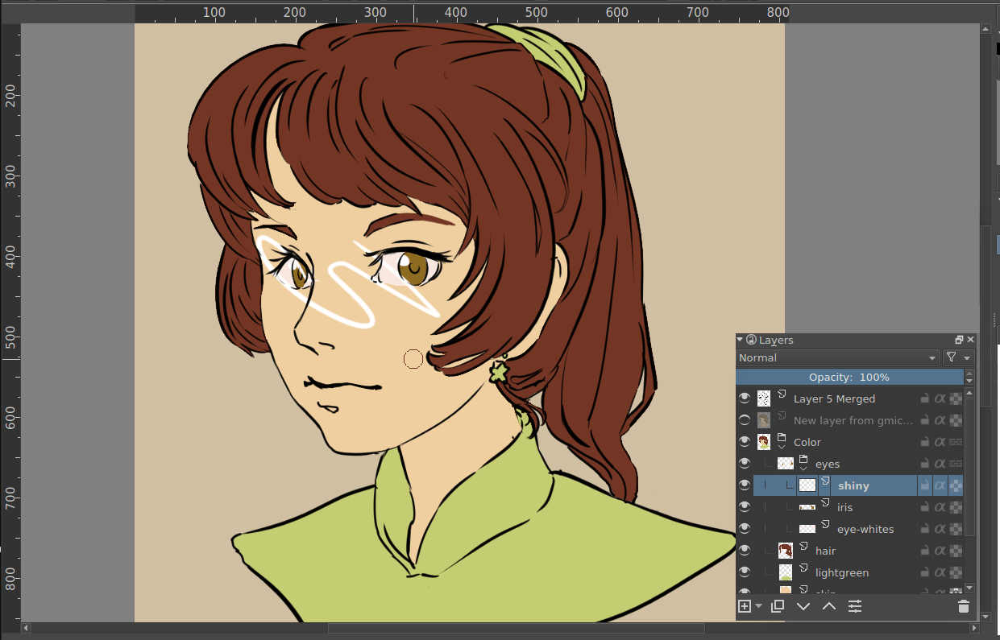
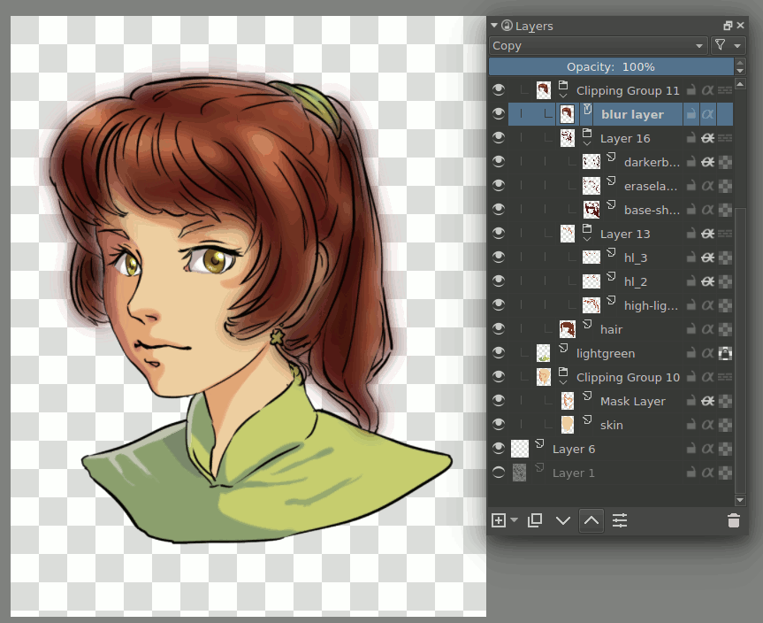

<!-- start-replace-fm field="title" -->
# Krita — masques d'écrêtage et héritage alpha
<!-- end-replace-fm -->
<!-- start-replace-fm field="description" format="blockquote" -->
> Le tutoriel officiel sur les masques d'écrêtage et l'héritage alpha : limiter un effet ou une correction aux pixels du calque du dessous — la correction non destructive ciblée.
<!-- end-replace-fm -->

<!-- start-replace-mediagraphie-fiche -->
> **Référence** — Documentation Krita (2026). Krita — masques d'écrêtage et héritage alpha.. https://docs.krita.org/fr/tutorials/clipping_masks_and_alpha_inheritance.html. [↗](https://docs.krita.org/fr/tutorials/clipping_masks_and_alpha_inheritance.html)
>
> | **Type** | webpage |
> | **Auteur·e** | Documentation Krita |
> | **Date** | 2026 |
> | **Statut** | stable |
> | **Mots-clés** | image, krita, masque, alpha, non-destructif, tutoriel |

**Citation (copier-coller)**

```citation
Documentation Krita (2026). Krita — masques d'écrêtage et héritage alpha.. https://docs.krita.org/fr/tutorials/clipping_masks_and_alpha_inheritance.html.
```
<!-- end-replace-mediagraphie-fiche -->

## Cité par

<!-- start-replace-mediagraphie-cited-by -->
- [Exercice — Photomontage non destructif](../../../../02-activites/01/exercices/02-photomontage/)
<!-- end-replace-mediagraphie-cited-by -->

---
> 🇫🇷 **Traduction française** de la page officielle [Clipping Masks and Alpha Inheritance](https://docs.krita.org/fr/tutorials/clipping_masks_and_alpha_inheritance.html) — la page source n'est pas encore traduite. Adaptation : A26.

Krita n'a pas de masque d'écrêtage (*clipping mask*) au sens de Photoshop et des logiciels qui l'imittent. La raison : dans Krita, contrairement à ces logiciels, un groupe de calques n'est pas une collection arbitraire de calques. Les groupes sont composités séparément du reste de la pile, puis le résultat est réinjecté dans la pile. Autrement dit, dans Krita, un groupe de calques est en pratique une image distincte à l'intérieur de votre image.


L'exception : le mode *pass-through*. L'héritage alpha ne fonctionne pas correctement quand le mode pass-through est activé sur le calque.


Quand on active l'**héritage alpha**, le calque concerné conserve la même transparence que les calques du dessous.


Combiné aux groupes de calques, c'est très puissant. Un cas particulièrement utile :

On a une image avec un dessin au trait et un calque par aplat de couleur.

 On veut ajouter un ombrage complexe, à plusieurs calques, tout en gardant la propreté des aplats existants. Pour obtenir un masque d'écrêtage, il faut d'abord mettre les calques dans un groupe : créer un groupe et y glisser-déposer les calques, ou sélectionner les calques puis `Ctrl + G`. Ici, avec les calques de l'iris et du blanc de l'œil.


On ajoute un calque de reflet au-dessus des deux autres, avec quelques gribouillis blancs.



À gauche, le calque avec les gribouillis blancs ; à droite, le même calque avec l'héritage alpha actif — limité à l'aire combinée des calques de l'iris et du blanc de l'œil.


Il y a plus simple pour mettre en place l'héritage alpha : sélectionner un calque ou un ensemble de calques et presser `Ctrl + Shift + G` crée un **groupe d'écrêtage rapide** — les calques sont groupés et un calque de masque réglé sur héritage alpha est ajouté au-dessus.


Comme l'héritage alpha peut utiliser la transparence compositée d'une combinaison de calques, on peut insérer un calque en mode de fusion *Supprimer* (Effacer) entre deux, et limiter l'aire du calque du dessus.

 Sur l'exemple, l'image du bas est identique à celle du haut, sauf le calque d'effacement masqué. Les filtres affectent aussi l'héritage alpha :


Sur l'exemple, un calque de filtre de flou donne des résultats différents selon sa position dans le groupe — ce qui est flouté diffère.


