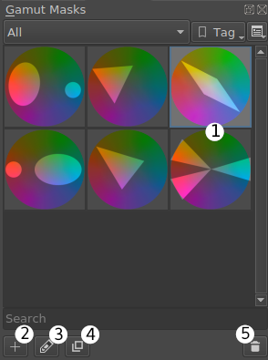
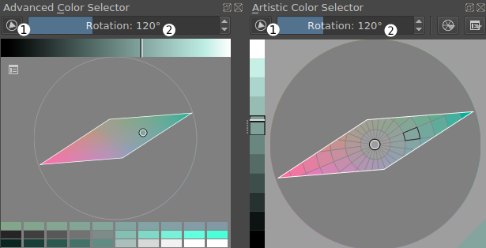
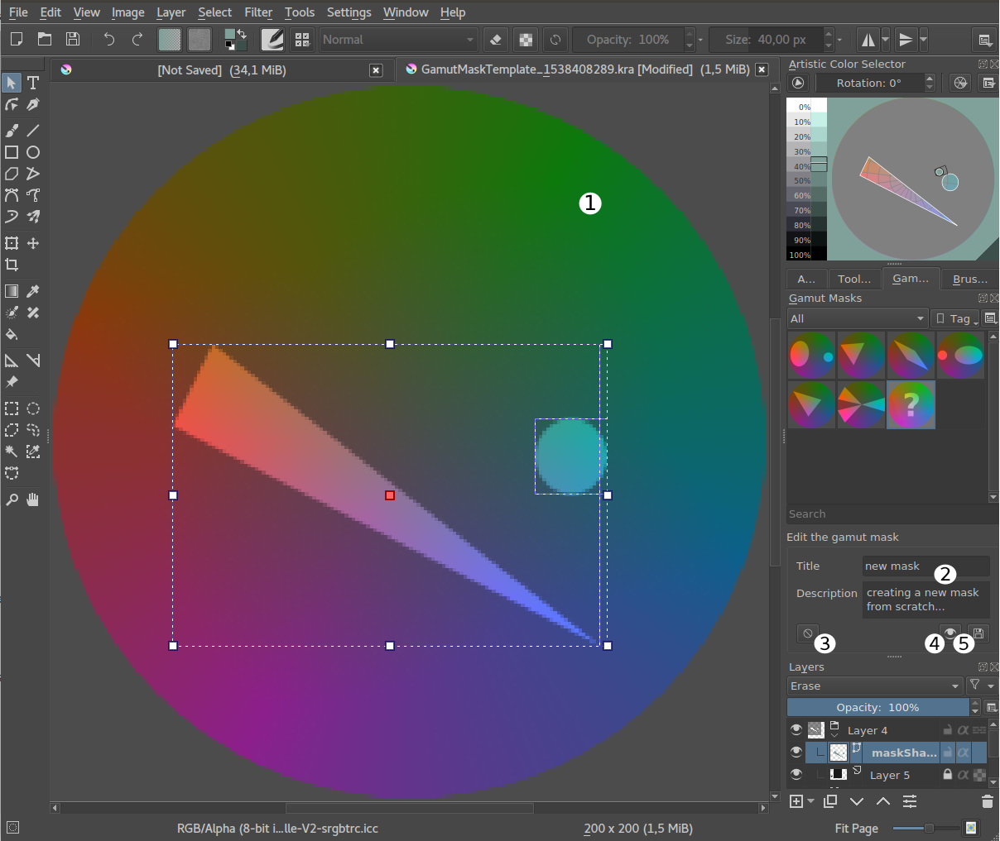

<!-- start-replace-fm field="title" -->
# Krita — les masques de gamut
<!-- end-replace-fm -->
<!-- start-replace-fm field="description" format="blockquote" -->
> Le chapitre du manuel Krita sur les masques de gamut : contraindre sa palette à une harmonie — choisir ses couleurs dans un volume limité pour garder l'accord.
<!-- end-replace-fm -->

<!-- start-replace-mediagraphie-fiche -->
> **Référence** — Documentation Krita (2026). Krita — les masques de gamut.. https://docs.krita.org/fr/user_manual/gamut_masks.html. [↗](https://docs.krita.org/fr/user_manual/gamut_masks.html)
>
> | **Type** | webpage |
> | **Auteur·e** | Documentation Krita |
> | **Date** | 2026 |
> | **Statut** | stable |
> | **Mots-clés** | image, krita, couleur, gamut, harmonie, palette, tutoriel |

**Citation (copier-coller)**

```citation
Documentation Krita (2026). Krita — les masques de gamut.. https://docs.krita.org/fr/user_manual/gamut_masks.html.
```
<!-- end-replace-mediagraphie-fiche -->

## Cité par

<!-- start-replace-mediagraphie-cited-by -->
- [Exercice — Contraste et harmonie des couleurs](../../../../02-activites/01/exercices/03-couleur-contraste/)
<!-- end-replace-mediagraphie-cited-by -->

---
> 🇫🇷 **Traduction française** de la page officielle [Gamut Masks](https://docs.krita.org/fr/user_manual/gamut_masks.html) — la page source n'est pas encore traduite. Adaptation : A26.

Ajouté dans la version 4.2.

Le masquage de gamut est une approche de la couleur formalisée par James Gurney, à partir de l'idée que tout schéma de couleurs peut s'exprimer comme des formes découpées dans la roue chromatique.

Cela vient de la peinture traditionnelle — planifier et prémélanger sa palette. Mais cela se transpose bien au numérique : explorer et analyser la couleur, planifier des schémas, guider ses choix.

Comment ça marche ?

On dessine une ou plusieurs formes par-dessus la roue chromatique. On limite ses choix de couleur aux couleurs intérieures aux formes. En excluant des couleurs, on établit une relation entre celles qui restent — c'est l'harmonie.

Le masquage de gamut est disponible dans les sélecteurs de couleurs **Avancé** et **Artistique**.

> **VOIR AUSSI** — [Color Wheel Masking, Part 1 par James Gurney](https://gurneyjourney.blogspot.com/2008/01/color-wheel-masking-part-1.html) · [The Shapes of Color Schemes par James Gurney](https://gurneyjourney.blogspot.com/2008/02/shapes-of-color-schemes.html) · [Gamut Masking Demonstration par James Gurney (YouTube)](https://youtu.be/qfE4E5goEIc)

## Choisir un masque de gamut

Pour choisir et gérer les masques, ouvrir le panneau **Masques de gamut** : **Configuration ‣ Panneaux ‣ Masques de gamut**.

On y choisit parmi plusieurs masques classiques — « Triade atmosphérique », « Complémentaire », « Teinte dominante avec accent »… On peut dupliquer ces masques et les modifier, ou en créer de nouveaux de zéro.



Cliquer la vignette du masque l'applique aux sélecteurs de couleurs.

## Dans le sélecteur de couleurs

On peut faire tourner un masque existant directement dans le sélecteur, en glissant le curseur de rotation au-dessus du sélecteur.

Le masque s'active et se désactive avec le bouton en haut à gauche du sélecteur.



## Éditer ou créer un masque personnalisé

> **ASTUCE** — pour faire tourner un masque autour du point central, utiliser le curseur de rotation du sélecteur de couleurs.

Si l'on choisit de créer un nouveau masque, d'éditer ou de dupliquer le masque sélectionné, le document gabarit du masque s'ouvre dans une nouvelle vue.

On y crée de nouvelles formes et on modifie le masque avec les outils vectoriels standards (voir [Krita — le graphisme vectoriel](../krita-vectoriel/)).

 À noter : le masque doit être composé de formes vectorielles simples. Des techniques avancées peuvent donner des résultats intéressants, mais toutes ne sont pas garanties (groupement, texte vectoriel, etc.).

> **ATTENTION** — Les transformations faites avec l'outil de transformation ou une transformation de calque ne peuvent pas être enregistrées dans un masque de gamut. La vignette reflète les changements, mais pas les formes du masque.

On peut **Prévisualiser** le masque dans le sélecteur de couleurs. Si le résultat convient, **Enregistrer** le masque. **Annuler** ferme la vue d'édition sans enregistrer.

## Importer et exporter

Les masques de gamut s'importent et s'exportent en lots dans le gestionnaire de ressources.
