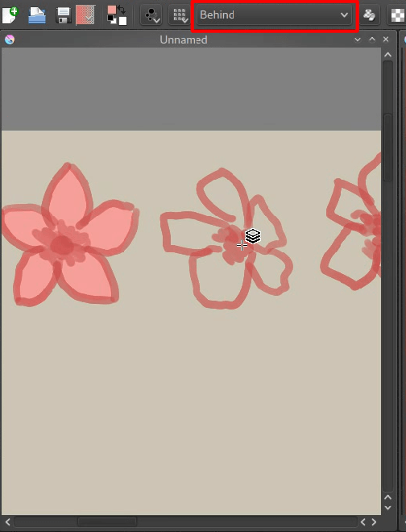
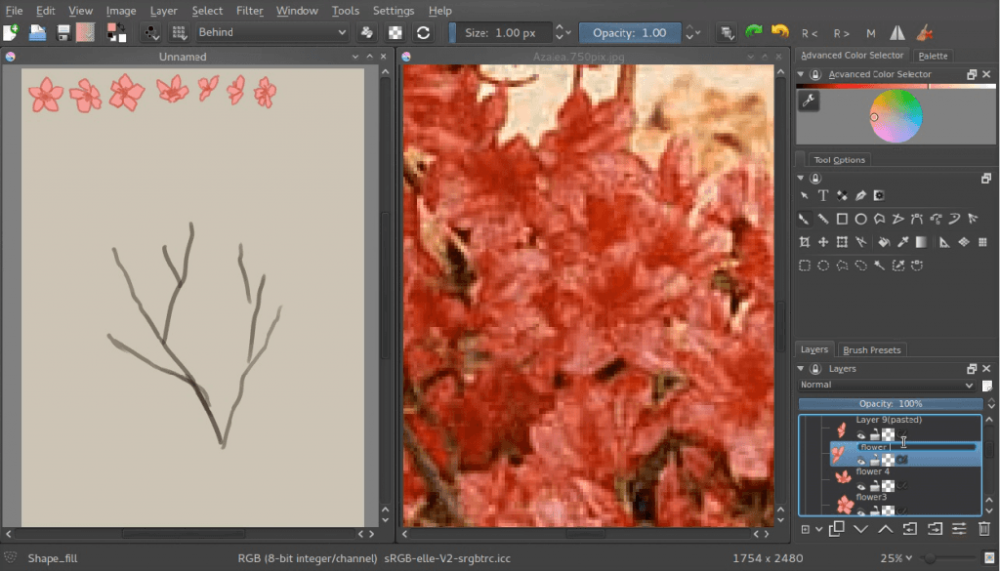
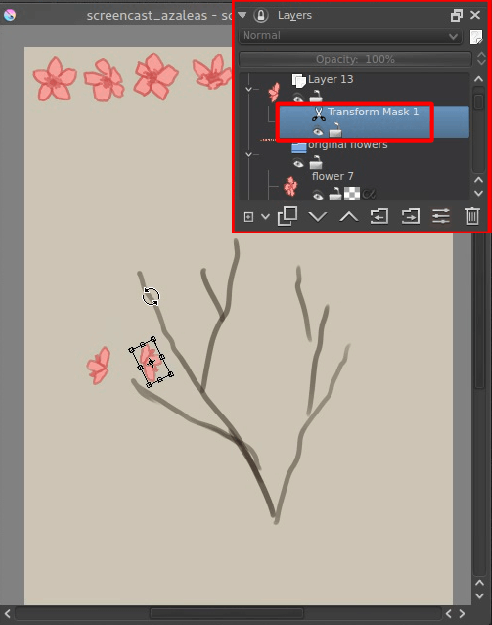
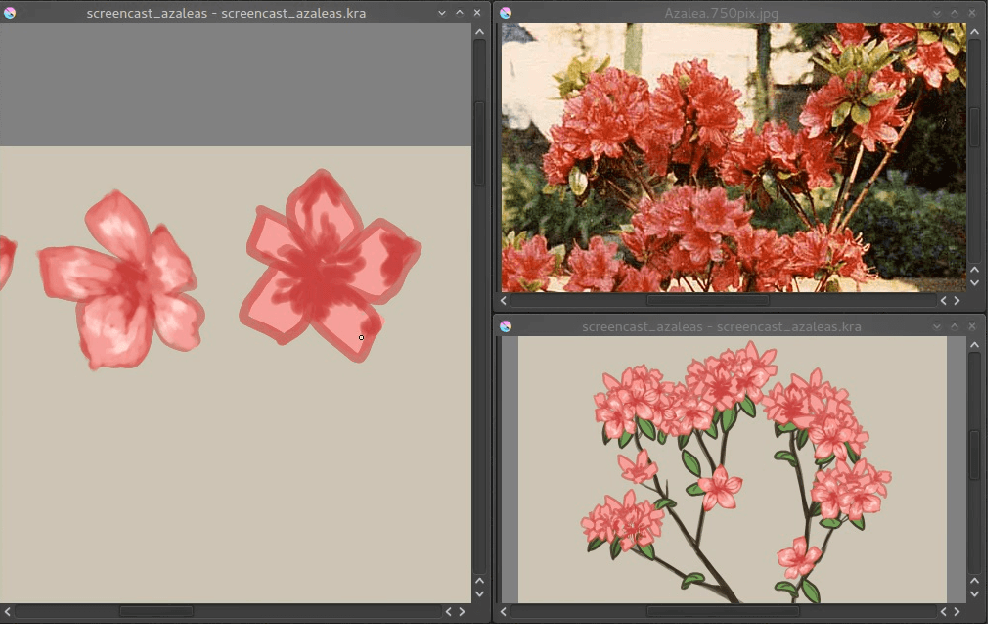
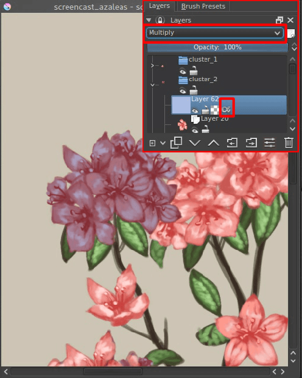
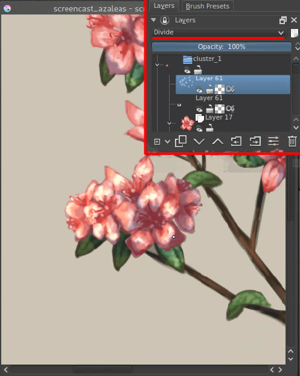

<!-- start-replace-fm field="title" -->
# Krita — les masques de transformation
<!-- end-replace-fm -->
<!-- start-replace-fm field="description" format="blockquote" -->
> Le tutoriel officiel des masques de transformation : transformer sans détruire le calque source — recomposer, recadrer, redresser et toujours revenir en arrière.
<!-- end-replace-fm -->

<!-- start-replace-mediagraphie-fiche -->
> **Référence** — Documentation Krita (2026). Krita — les masques de transformation.. https://docs.krita.org/fr/tutorials/making_an_azalea_with_the_transformation_masks.html. [↗](https://docs.krita.org/fr/tutorials/making_an_azalea_with_the_transformation_masks.html)
>
> | **Type** | webpage |
> | **Auteur·e** | Documentation Krita |
> | **Date** | 2026 |
> | **Statut** | stable |
> | **Mots-clés** | image, krita, masque, transformation, non-destructif, tutoriel |

**Citation (copier-coller)**

```citation
Documentation Krita (2026). Krita — les masques de transformation.. https://docs.krita.org/fr/tutorials/making_an_azalea_with_the_transformation_masks.html.
```
<!-- end-replace-mediagraphie-fiche -->

## Cité par

<!-- start-replace-mediagraphie-cited-by -->
- [Exercice — Détourage d'un sujet](../../../../02-activites/01/exercices/01-detourage/)
<!-- end-replace-mediagraphie-cited-by -->

---
> 🇫🇷 **Traduction française** de la page officielle [Making An Azalea With The Transformation Masks](https://docs.krita.org/fr/tutorials/making_an_azalea_with_the_transformation_masks.html) — la page source n'est pas encore traduite. Adaptation : A26. Tutoriel original de Wolthera (Wolthera van Hövell tot Westerflier), pour Krita 2.9.4 minimum. Page importée du billet d'origine vers le wiki KDE UserBase.

Je voulais depuis un moment faire un tutoriel sur les masques de transformation, et voici donc — d'une certaine façon — un tutoriel de dessin floral. À noter : ce tutoriel exige **Krita 2.9.4 au minimum**, version qui apporte l'accélération permettant de travailler confortablement avec les masques de transformation !

J'aime dessiner les fleurs : sujet un peu sous-estimé, mais qui permet beaucoup de pratique du rendu — et d'explorer de belles astuces de Krita.

La fleur du jour : l'azalée. Rose à rouge, elle pousse en grappes — et les grappes sont parfaites pour s'exercer aux masques de transformation !

J'ai pris une image de Wikipédia comme référence, d'abord parce qu'elle est du domaine public, et parce qu'en tant qu'artiste je trouve important de respecter le travail des autres. Copiez-la puis, si un canevas est déjà ouvert, **Édition ‣ Coller dans une nouvelle image** ou **Nouveau ‣ Créer depuis le presse-papiers**.


Si vous n'avez pas encore de canevas, créez-en un. J'ai pris un A5 à 300 dpi — pas bien grand, c'est un exercice. Le fond est réglé sur un jaune-grisâtre (#CAC5B3) : cela évoque le papier, et le blanc éclatant de l'écran fatigue les yeux et rend difficile de se concentrer sur les valeurs et les couleurs. Moins de fatigue, plus d'apaisement. D'autres artistes utilisent #c0c0c0, ou d'autres valeurs encore.

Avec **Fenêtre ‣ Mosaïque**, la référence et le canevas de travail se placent côte à côte. J'utilise cette méthode plutôt que le panneau parce que je suis paresseuse et que je n'ai pas envie d'enregistrer l'image de Wikipédia — nous ne toucherons de toute façon presque pas à l'image.


## Au dessin !

On commence par un certain nombre de branches, dans une couleur légèrement plus foncée que d'habitude : je sais que je peindrai par-dessus avec des couleurs plus claires. Observez la référence pour voir comment les branches se forment.


Puis on fait une approximation d'une seule fleur, sur un calque. On en fait plusieurs, chacun sur son calque. On ne prélève pas le rouge de l'image avec la pipette : on l'estime. C'est un bon exercice — apprendre à analyser une couleur et à maîtriser son sélecteur. Si l'on se contente de prélever, la relation entre les couleurs reste difficile à comprendre ; mieux vaut tenter de les accorder à l'œil.


J'ai choisi de rendre la forme de la fleur opaque rapidement avec le mode de fusion *Derrière* : Krita peint alors les nouveaux pixels derrière les anciens. Très utile pour remplir vite une forme — n'oubliez pas de revenir à *Normal* ensuite.



Maintenant, on place les fleurs dans le coin supérieur gauche et on les groupe : créer un groupe de calques, sélectionner les calques de fleurs dans le panneau avec `Ctrl` + clic, et les y glisser. Pourquoi le coin supérieur gauche ? Parce qu'on les sélectionnera souvent : Krita permet de sélectionner un calque sur la zone de dessin avec `R` + clic — maintenez `R` et cliquez les pixels du calque voulu, Krita le sélectionne dans le panneau Calques.



## Les calques de clone

On va maintenant faire des grappes : sélectionner une fleur donnée et créer un nouveau calque de clone. Un calque de clone est littéralement un clone de l'original : il n'est pas éditable directement, mais modifiez l'original et le clone suit. Les calques de clone et les calques de fichier sont nos meilleurs amis avec les masques de transformation — vous allez vite comprendre pourquoi.


Vous constaterez vite que nos fleurs ne suffisent pas pour une grappe : il faudrait bien plus d'angles de profil. Si seulement on pouvait les transformer… mais impossible avec des calques de clone. Ou bien… ?

## Voici les masques de transformation !

Fonction très puissante introduite en 2.9 — si puissante qu'au premier usage, on ne sait même pas où l'employer.

Les masques de transformation appliquent une opération de transformation à un calque — n'importe lequel — de façon **totalement dynamique**. Y compris à nos fleurs clonées !

Mode d'emploi : clic droit sur le calque à transformer, et ajouter un **masque de transformation**.



Le masque de transformation est ajouté — on le reconnaît à sa petite icône en ciseaux.

Masque sélectionné, prendre l'outil de transformation et faire pivoter le calque cloné. Appliquer. Le test de réussite : masquer le masque de transformation, et le calque revient à son état d'origine !

On peut même rééditer la transformation : réactiver l'outil de transformation sur un masque de transformation, la transformation d'origine réapparaît, éditable. Attention : changer d'opération de transformation réinitialise tout.

Ce tutoriel n'utilise que des transformations affines (transformation ordinaire et perspective), mais c'est possible aussi avec warp, cage et liquider — avec un délai de 3 secondes, pour ne pas saturer la machine et pouvoir continuer à peindre.


On continue les grappes jusqu'à obtenir une belle disposition. Puis même chose pour les feuilles.


Si maintenant vous sélectionnez les calques de peinture d'origine et peignez dessus, tous les clones se mettent à jour immédiatement !



Une nouvelle vue a été ajoutée pour peindre la fleur tout en voyant le résultat. Nouvelle vue : **Fenêtre ‣ Nouvelle vue**, puis choisir le nom du canevas courant (enregistrez d'abord !). Chaque vue peut être tournée et miroirée différemment.

On continue à peindre fleurs et feuilles d'origine, puis on passe aux ombres pour donner du relief !

## Héritage alpha

Place à l'*héritage alpha*. Concept mal compris : beaucoup de logiciels utilisent des *masques d'écrêtage*, qui limitent l'alpha du calque au seul alpha du calque immédiatement en dessous.

L'héritage alpha, lui, utilise tous les calques de la pile : tous les calques du groupe qui n'ont pas eux-mêmes l'héritage alpha actif — ou toute la pile si le calque n'est pas dans un groupe. Comme la plupart des gens ont un calque opaque au bas de leur pile, l'héritage alpha ne semble pas faire grand-chose.


Pour nous, il est précieux : on peut utiliser tous les calques de clone d'une grappe (si vous les avez groupés), transformés ou non, comme surface d'écrêtage. Tracez un carré bleu clair par-dessus toutes les fleurs d'une grappe donnée.


Puis pressez la dernière icône de la pile de calques, le bouton hériter de l'alpha, pour activer l'héritage.



Réglez le calque sur *Multiplier* : tout paraît bleu plus sombre.


Toujours en *Multiplier* avec héritage alpha, gommez les zones où il ne doit pas y avoir d'ombre.



Pour les reflets, exactement même méthode et même couleur — mais réglez le calque sur *Diviser* (dans les modes de fusion arithmétiques). *Diviser* produit exactement l'effet inverse de *Multiplier* avec la même couleur : de quoi bâtir facilement une harmonie complémentaire entre ombres et reflets.


Faites-le pour toutes les grappes et feuilles — et peut-être toute la plante (il faudra d'abord la glisser dans un groupe, le fond étant opaque) — et voilà !

Les masques de transformation fonctionnent sur les calques de peinture, vectoriels, de groupe, de clone et même de fichier. J'espère que ce tutoriel vous donne une bonne idée de leur usage — et j'espère voir les masques de transformation de plus en plus employés !

Le fichier source du tutoriel est [téléchargeable ici](https://share.kde.org/public.php?service=files&t=48c601aaf17271d7ca516c44cbe8590e) pour l'examiner ! (Attention : il fige Krita en version inférieure à 2.9.4 — les accélérations de 2.9.4 viennent justement de ce fichier.)
