<!-- start-replace-fm field="title" -->
# Krita — le mélange de couleurs
<!-- end-replace-fm -->
<!-- start-replace-fm field="description" format="blockquote" -->
> Le mélange de couleurs dans Krita : sur tableau (vernissage, barbouillage, frottis) et hors tableau (mélange de l'échantillonneur de couleurs) — reproduire les gestes de la peinture traditionnelle.
<!-- end-replace-fm -->

<!-- start-replace-mediagraphie-fiche -->
> **Référence** — Documentation Krita (2026). Krita — le mélange de couleurs.. https://docs.krita.org/fr/general_concepts/colors/color_mixing.html. [↗](https://docs.krita.org/fr/general_concepts/colors/color_mixing.html)
>
> | **Type** | webpage |
> | **Auteur·e** | Documentation Krita |
> | **Date** | 2026 |
> | **Statut** | stable |
> | **Mots-clés** | image, krita, couleur, melange, pinceau, tutoriel, cours |

**Citation (copier-coller)**

```citation
Documentation Krita (2026). Krita — le mélange de couleurs.. https://docs.krita.org/fr/general_concepts/colors/color_mixing.html.
```
<!-- end-replace-mediagraphie-fiche -->

## Cité par

<!-- start-replace-mediagraphie-cited-by -->
_Aucune citation pour l'instant._
<!-- end-replace-mediagraphie-cited-by -->

---
> 📄 **Réhébergement** — le contenu ci-dessous est la reproduction intégrale de la page officielle [Krita — le mélange de couleurs](https://docs.krita.org/fr/general_concepts/colors/color_mixing.html) de la documentation Krita, déjà publiée en français par l'équipe de Krita. La source fait foi et est mise à jour en premier ; cette copie peut dater.

## Mélange de couleurs

De façon similaire aux média physiques, il y a plusieurs façons de mélanger les couleurs ensemble dans Krita. Les dessinateurs et illustrateurs traditionnels utilisent souvent des techniques comme le **vernissage**, le **frottis** et le **hachurage** pour mélanger directement les couleurs, le plus généralement en les mélangeant sur une **palette** ou même avec les poils de leur **brosse**. Avec un petit peu de pratique et de savoir-faire et grâce à un éventail de puissants outils dans Krita, il est possible de reproduire ces techniques de mélange pour le dessin numérique.

Dans les techniques de dessin, à la fois traditionnelles et numériques, les techniques de mélange peuvent être divisées en *deux catégories majeures* : elles peuvent être nommées ** « sur le tableau » * et ** « hors tableau » [**](#id1).

### Mélange direct

Les techniques de mélange sur tableau sont celles où les couleurs multiples sont mélangées directement sur le tableau comme un artiste le fait en peignant. Ceci recouvre quelques façons, y compris une **couleur avec calque semi-transparent** au dessus d'une autre couleur, utilisant une **texture** pour modifier la façon dont une couleur est perçue ou même par interaction entre deux zones de la peinture fraîche sur un média traditionnel. Conclusion : le mélange sur tableau se réalise directement sur le tableau et il est un outil important pour les expériences artistiques et les « accidents heureux ».

### Vernissage

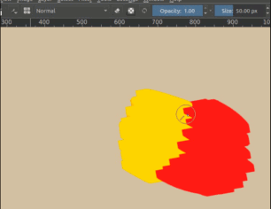

Dans le dessin traditionnel, le **vernissage** superpose plusieurs différents calques semi-transparents pour créer un mélange de couleurs sur le tableau. De la même manière, dans le dessin numérique, le vernissage peut aussi être utilisé pour mélanger directement les couleurs de votre tableau. Ceci est l'une des techniques la plus fondamentale et largement utilisée de mélange pour le dessin numérique.

Tout d'abord, un calque semi-transparent est placé au dessus d'une autre couleur, à intégrer dans un mélange. Ensuite, la **couleur résultante** est sélectionnée grâce au raccourci :kbd:` « CTRL » +` clic gauche (ceci peut être configuré dans les paramètres d'entrée du tableau) et elle est utilisée pour peindre. Selon les **paramètres d'opacité** de votre brosse, à chaque fois qu'un vernissage est fait avec une couleur sur une autre, une couleur, quelque part entre ces deux couleurs, sera obtenu, souvent conduisant à une jolie texture.

Vous pouvez même mélanger plus facilement le vernissage quand votre **passage** de brosse à un paramètre plus bas. Subtilement différent de l'opacité, le [flux](../../reference_manual/brushes/brush_settings/opacity_and_flow.html#option-opacity-n-flow) est une transparence par tamponnage plutôt que par appui. Ainsi, il vous donne des appuis plus doux, sans perdre le contrôle.

De plus, le vernissage peut être combiné avec divers **modes de mélange* pour réaliser différents effets intéressants. Quelques exemples de vernissage avec le mode de mélange en **multiplication** pour la création de jolies ombrages :

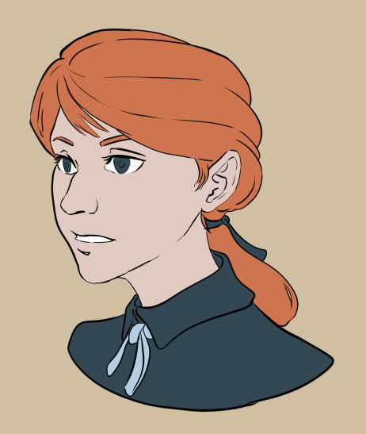

Un coup d'œil sur le dessin au trait et les couleurs de base.

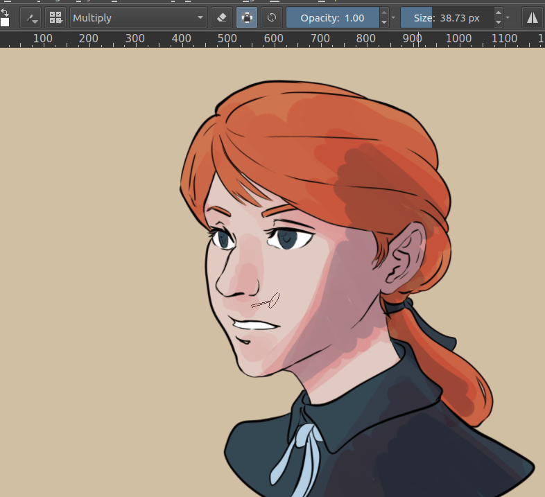

En utilisant un brosse semi-transparente, en mode « Multiplier », vous pouvez ajouter des calques colorés pour suggérer des ombrages et de demi-tons. Le mélange en mode « Multiplier » assombrira et interagira avec chaque couleur de base différemment.

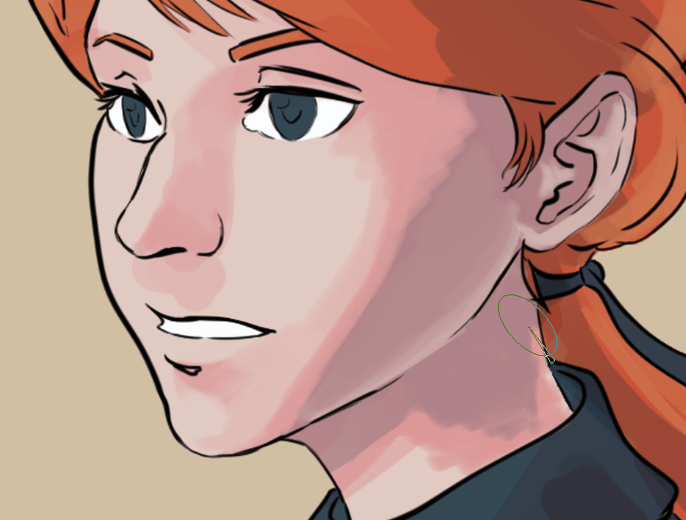

Alors, l'utilisation d'un brosse avec un passage étroit vous permet de sélectionner les couleurs résultantes et de déposer plus de calques. Non seulement ceci vous aide à définir les différents plans et formes, si importants pour la création d'un sensation de profondeur et d'effet 3D, mais il vous donne aussi un joli effet pictural !

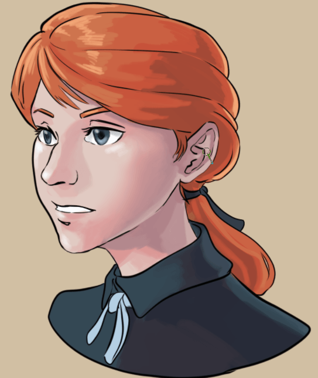

Continuer avec une opacité et un flux plus faibles pour créer des dégradés encore plus doux. Rendez vos **bords** aussi marqués ou doux selon la nature de votre sujet et vos besoins de conception artistique !

### Barbouillage

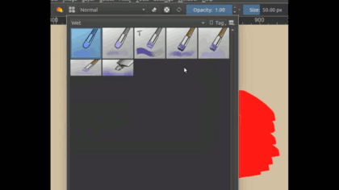

Le **mélange de tâches** est fait avec le [Color Smudge Brush Engine](../../reference_manual/brushes/brush_engines/color_smudge_engine.html#color-smudge-brush-engine), un moteur spécial de brosses vous permettant de mélanger la couleur de votre brosse courante avec la ou les couleur(s) sous votre brosse. C'est un type très puissant de brosses, vous donnant un charmant effet artistique. * Équilibré en performances, il est un peu plus gourmand et plus lent que la brosse normale de pixels*.

Si vous *supprimez tous les dessins d'une brosse de tâches*, vous obtiendrez un effet de tâches simple mais puissant :

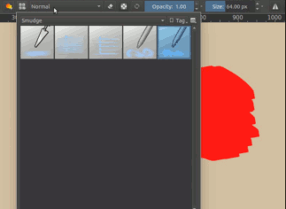

Les brosses de tâches vous proposent des effets différents. Ainsi, veuillez vous assurer de les essayer toutes !

### Frottis

Le **frottis** est similaire au vernissage, excepté le fait d'avoir un calque semi-transparent, des calques de dessin **texturés** ou **avec des motifs** sont utilisés.

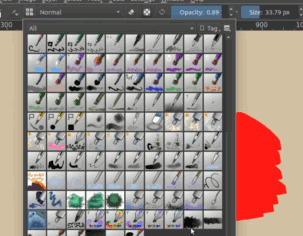

Comme la plupart des logiciels de dessin, Krita vous permet de sélectionner un [Brush Tips](../../reference_manual/brushes/brush_settings/brush_tips.html#option-brush-tip), pouvant être utilisé pour la création d'effet texturé comme celui de frottis.

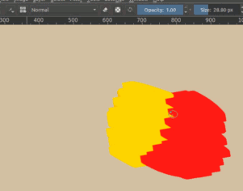

Les moteurs de brosses de Krita vous permettent aussi d'utiliser [Texture](../../reference_manual/brushes/brush_settings/texture.html#option-texture). Ceci vous permet de créer des effets intéressant et stylisés, similaire à des tons d'écran.

Avec le vernissage, vous pouvez aller assez loin quand il s'agit de *définir des plans et des formes. Le frottis est la meilleure méthode pour *créer une texture et *casser les grandes zones uniformes* dans votre dessin.

### Mixage indirect

Le mélange **Hors tableau** a toujours été, principalement, l'outil central des artistes, en tout lieu. En se référant au stéréotype de l'artiste, nous imaginons une personne avec quelques **pinceaux** dans une main et une **palette** en bois dans l'autre. Que cela soi de la peinture à l'huile ou à l'eau ou un autre média traditionnel, pour qu'un artiste ait un contrôle absolu sur ses couleurs, il est impératif d'avoir une sorte de palette, assiette, récipient ou une autre **zone hors tableau** pour mélanger les couleurs ensemble. Bien qu'il soit facile de sous-estimer ceci pour le dessin numérique (Où la sélection de nouvelles couleurs fraîches sans les mélanger du tout est à la fois simple et sans contrainte),Krita possède quelques fonctionnalités très utiles et uniques pour le mélange hors tableau.

### Mélange d'échantillons de couleurs

Ajouté dans la version 4.1.

Krita, comme la plupart de chaque logiciel pour des œuvres artistiques et de graphisme, possède un outil_sélecteurs_couleurs, vous permettant très simplement d'échantillonner une couleur à partir de tout pixel sur votre tableau. Bien que cet outil puisse sembler relativement simple et sans prétention, il est aussi un des outils les plus importants et les plus généralement utilisés dans la boite à outils de tout artiste numérique, peut être seulement le second après la brosse ! En fait, le sélecteur de couleurs est au cœur même du mélange de couleurs. Il est souvent utilisé en conjonction avec les techniques sur tableau, comme le vernissage ou le frottis pour réaliser des mélanges harmonieux de couleurs.

Et encore, il y a beaucoup plus concernant ce petit outil, qui ravit les yeux. Non seulement vous pouvez configurer l'échantillonneur de couleurs de Krita pour échantillonner une couleur moyenne d'un **cercle** de pixels. Cet échantillonneur possède aussi une fonctionnalité unique de **mélange** : un outil puissant et intuitif pour le mélange de couleurs hors tableau !

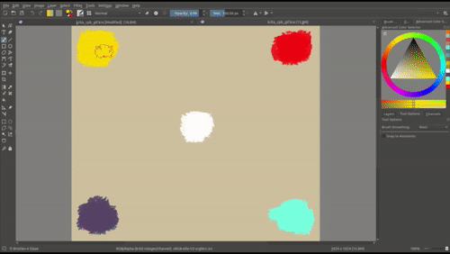

La fonctionnalité de mélange de l'échantillonneur de couleurs modifie la façon dont la sélection de couleurs a fonctionné traditionnellement depuis des décennies. Plutôt de réaliser le remplacement complet de la couleur de votre brosse courante par la nouvelle couleur échantillonnée, le *mélange vous permet rapidement « d'absorber » une certaine partie de la couleur échantillonnée*, qui est ensuite mélangée avec la couleur de votre brosse courante.

You can use Color Sampler Blending much like a physical paint brush in traditional media. If you were to dip your paint brush into a pool of *blue* paint, and then immediately dip again into a pool of *red* paint and paint a stroke across your canvas, the stoke wouldn't be pure red - it would be some combination of blue and red which would mix to create an intermediate purple color. Which shade of purple would depend on the ratio of paints that mix together within the hairs of your brush, and this is essentially what the Color Sampler's "blend" option controls: what percentage of sampled color is mixed together with your current brush color!

Not only does Krita's Color Sampler Blending feel even more like mixing paints, it is also completely off-canvas and independent of opacity, flow, shape, and other brush settings. Furthermore, unlike most on-canvas mixing techniques, Color Sampler Blending works regardless of the location of colors on your canvas - enabling you to mix with colors at any position, on any layer, or even in different documents! Quickly mix lighting colors with local colors, mix the ambient sky color into shadows, create atmospheric depth, mix from a preselected palette of colors in another layer/document, etc.

To use Color Sampler Blending, simply set the "blend" option in the **Tool Options Docker** while the Color Sampler Tool is active; setting blend to 100% will cause your Color Sampler to work in the traditional way (completely replacing your brush color with the picked color), setting to around 50% will give you a half-way mix between colors, and setting to a lower value will create more subtle shifts in colors each click. Of course, blending affects both your dedicated Color Sampler Tool as well as the Ctrl +  shortcut.

> **NOTE** — Clicking and dragging the Color Sampler around the canvas currently causes it to sample many times as it switches pixels. You can use this trait to quickly soak up more color by "dipping" your color sampler into color and swirling it around. This can be pretty satisfying! However, this also means that some care must be taken to prevent from accidentally picking up more color than you want. It's pretty easy to click a single pixel only one time using a **mouse**, but when painting with a **drawing tablet and pen** it can sometimes be desirable to use a slightly lower blend setting!

### Le mélangeur numérique de couleurs

Quelque peu caché dans le menu **Panneaux** (**Paramètres / Panneaux / Mélangeur numérique de couleurs**), ceci peut être un outil utile pour le mélange hors tableau. Ce mélangeur numérique de couleurs ressemble un peu à un panneau de mixage audio, visible dans un studio d'enregistrement, mais au lieu de mixer de la musique, il mélange des couleurs ! Il contient 6 **mélangeurs de couleurs** indépendants, mélangeant la couleur de votre brosse de couleurs avec n'importe quelle couleur de votre choix.

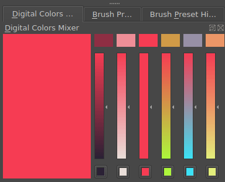

En cliquant sur les **boutons de couleurs** sous chaque mélangeur, vous pouvez sélectionner une palette de couleurs avec laquelle faire le mélange. Au dessus de chaque mélangeur, il y a une ** pastille de couleurs**, affichant une couleur résultant du mélange d'une certaine quantité de la couleur de votre brosse courante avec la palette de couleurs. Les couleurs au dessus du mélangeur présenteront des modifications subtiles de votre couleur courante, bien que les couleurs en bas seront plus proche de la couleur de la palette pour ce canal.

### Autres astuces

En dehors de le rendre plus facile pour la création de dégradés doux, le mélange présente un autre bénéfice. Il vous permet de créer une pièce cohésive.

La limitation du nombre de couleurs utilisées et ensuite le mélange a tendance à donner une palette plus harmonieuse, bien que vous ne tentiez pas d'en faire autant en une seule fois. En retour, cette palette harmonieuse rendra plus facile la création d'une certaine ambiance dans une image. Quelque fois, le mélange avec un peu d'une couleur d'accent peut aussi créer des résultats inattendus, qui, en retour, peut être une petite découverte pour séduire le public lors de la découverte de l'environnement de votre image.

Ce qu'il est possible d'apprendre de ceci, est que lors de la prochaine sélection, par exemple, de gris, au lieu d'atteindre un gris aléatoire ou générique à partir du sélecteur avancé de couleurs, vous pouvez utiliser l'un des nombreux outils fantastiques de mélange de Krita pour créer un gris intéressant et correspondant, à partir des teintes, approximativement complémentaires (à l'opposé des uns des autres sur la route de nuances).

Bien que les techniques sur tableau et hors tableau sont des types fondamentalement différents de mélange de couleurs, ils ne sont pas mutuellement exclusifs. Toutes les méthodes de mélange de cet article ont leurs avantages et leurs inconvénients. Différents outils peuvent être utiles pour différentes situations et la combinaison de ces diverses techniques peut être extrêmement puissante et amusante !

En conclusion, le mélange de couleurs fonctionnera souvent encore mieux avec une [profondeur de bits plus grande comme en 16 bits](bit_depth.html#bit-depth). Ainsi, il impliquera prendre bien plus de **mémoire vide** (RAM) de travail pour l'image. De plus, l'utilisation d'un:ref:espace colorimétrique linéaire<linear_and_gamma> permet l'obtention de bien meilleurs mélanges qu'en espace corrigé de gamma. Ainsi, la création de croquis et de dessin au trait est plus facile à faire dans un espace corrigé de gamma.
