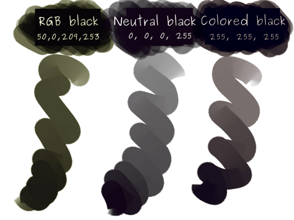

<!-- start-replace-fm field="title" -->
# Krita — les modèles de couleur
<!-- end-replace-fm -->
<!-- start-replace-fm field="description" format="blockquote" -->
> Le chapitre du manuel Krita sur les modèles de couleur : RVB, gris, CMJN, XYZ — ce que chaque modèle encode et quand l'utiliser.
<!-- end-replace-fm -->

<!-- start-replace-mediagraphie-fiche -->
> **Référence** — Documentation Krita (2026). Krita — les modèles de couleur.. https://docs.krita.org/fr/general_concepts/colors/color_models.html. [↗](https://docs.krita.org/fr/general_concepts/colors/color_models.html)
>
> | **Type** | webpage |
> | **Auteur·e** | Documentation Krita |
> | **Date** | 2026 |
> | **Statut** | stable |
> | **Mots-clés** | image, krita, couleur, modele, rvb, cmjn, tutoriel |

**Citation (copier-coller)**

```citation
Documentation Krita (2026). Krita — les modèles de couleur.. https://docs.krita.org/fr/general_concepts/colors/color_models.html.
```
<!-- end-replace-mediagraphie-fiche -->

## Cité par

<!-- start-replace-mediagraphie-cited-by -->
- [Krita — les fonctions image](../../../../03-savoirs/02-utiliser/04-exploitation-logiciels/01-image/)
<!-- end-replace-mediagraphie-cited-by -->

---
> 📄 **Réhébergement** — le contenu ci-dessous est la reproduction intégrale de la page officielle [Krita — les modèles de couleur](https://docs.krita.org/fr/general_concepts/colors/color_models.html) de la documentation Krita, déjà publiée en français par l'équipe de Krita. La source fait foi et est mise à jour en premier ; cette copie peut dater.

## Modèle de couleurs

Krita possède de nombreux espaces colorimétrique et modèles différents. Vous trouverez ici, de brèves explications sur chacun d'entre eux et sur leurs conditions d'utilisation.

### RGB

Rouge, Vert, Bleu.

Il y a des couleurs primaires plus efficaces pour le mélange de couleurs à partir de lumière, comme les écrans d'ordinateur. L'ajout de lumières Rouge, Verte et Bleue ensemble produit du blanc. Ainsi, cela est nommé la roue additive de couleurs.

RGB est utilisé pour deux objectifs :

Images nécessaires pour l'affichage sur un écran :

- Ainsi, ceci pourrait être des images pour Internet, des boutons, des avatars ou seulement des images en collection.

- Ou, pour les jeux vidéo, les sprites et les textures sont bien meilleurs, ici, en RGB.

- Ou, pour un rendu 3D, des effets visuels et une animation « cg ».

Et pour l'espace de travail. Un espace de travail possède un gamut RGB, vraiment important et prévisible, signifiant que c'est une bonne chose pour la manipulation d'images. Vous l'utilisez en conjonction d'un écran calibré. De cette façon, vous pouvez avoir des couleurs précises, tout en étant capable de les afficher correctement sur des écrans multiples.

### Modes de mélange en RGB

|  | Couleur 1 | Couleur 2 | Normal | Multiplier | Écran |

|---|---|---|---|---|---|

|  | R | G | B | R | G | B | R | G | B | R | G | B | R | G | B |

| R & G | 1.0 | 0.0 | 0.0 | 0.0 | 1.0 | 0.0 | 0.5 | 0.5 | 0.0 | 0.0 | 0.0 | 0.0 | 1.0 | 1.0 | 0.0 |

| Gris | 0.5 | 0.5 | 0.5 | 0.5 | 0.5 | 0.5 | 0.5 | 0.5 | 0.5 | 0.25 | 0.25 | 0.25 | 0.75 | 0.75 | 0.75 |

### Modèles RGB : HSV, HSL, HSI et HSY

Ceux-ci ne sont pas inclus comme leurs propres espaces colorimétriques dans Krita. Cependant, ils sont présentés dans les modes de mélanges et les sélecteurs de couleurs. En voici un aperçu rapide :

La nuance d'une couleur ou si c'est un rouge, jaune, vert, etc., la teinte de Krita est mesurée sur 360 degrés, avec 0 représentant le rouge, 120, le vert et 240, le bleu.

A quel niveau, une couleur est vibrante. La saturation est légèrement différente entre « HSV » et les autres. Dans « HSV », il y a une mesure d'écart entre deux ou trois couleurs de base étant utilisées. Dans les autres, il y a une mesure de la distance d'une couleur envers le gris et, quelquefois, cette valeur est appelé « Chrominance ». Les intervalles de saturation vont de 0(gris) à 100(couleur pure).

Quelquefois appelée Intensité lumineuse. Mesure de la quantité de lumière pour l'éclairage des pixels. Aussi mesuré entre 0 et 100.

Quand une couleur s'aligne entre le blanc et le noir. Cette valeur est non linéaire et positionne toutes les couleurs possibles au maximum de saturation à 50. Valeurs de 0 à 100.

Similaire à l'intensité lumineuse, sauf qu'elle accepte que le jaune (1,1,0) est plus clair que le bleu (0,0,1). Valeur de 0 à 100.

Similaire à la luminosité et à l'intensité lumineuse, sauf qu'il pondère les composants de rouge, de vert et de bleu à partir des mesures de l'environnement réel à partir de la quantité de lumière qu'une couleur réfléchit pour déterminer l'intensité lumineuse. Les intervalles vont de 0 à 100. La luminance est bien connue pour être utilisée dans les espaces colorimétriques pour les films.

### Nuances de gris

Cet espace colorimétrique n'enregistre que des valeurs de gris. Ceci est utile car en n'enregistrant que les valeurs de gris, il n'a besoin que d'un seul canal d'informations. En conséquence, cela conduit à avoir une image bien plus économe en consommation mémoire !

Ceci est utile pour les textures mais aussi, n'importe quelle autre chose nécessaire pour rester en échelle de gris, comme les bandes dessinées en noir et blanc.

|  | Couleur 1 | Couleur 2 | Normal | Multiplier | Écran |

|---|---|---|---|---|---|

|  | G | G | G | G | G |

| Gris | 0.5 | 0.5 | 0.5 | 0.25 | 0.75 |

### CMJN

Cyan, magenta, jaune, clé

Ceci est l'espace colorimétrique des imprimantes. Contrairement aux ordinateurs, les imprimantes possèdent ces quatre couleurs et en les ajoutant toutes ensemble, vous obtenez du noir au lieu du blanc. Ceci est alors appelé un espace colorimétrique « soustractif ».

Modifié dans la version 5.2: Krita 5.1 and older had the blending modes apply direct on the channels. Not all software does this, and thus, to make it simpler to work together with other artists, Krita 5.2 by default inverts the channels before applying the blending mode. You can control this in the [preferences](../../reference_manual/preferences/general_settings.html#tool-options-settings).

|  | Couleur 1 | Couleur 2 | Normal | Multiplier | Écran |

|---|---|---|---|---|---|

|  | C | M | Y | K | C | M | Y | K | C | M | Y | K | C | M | Y | K | C | M | Y | K |

| R & G | 0.0 | 1.0 | 1.0 | 0.0 | 1.0 | 0.0 | 1.0 | 0.0 | 0.5 | 0.5 | 1.0 | 0.0 | 0.25 | 0.25 | 1.0 | 0.0 | 0.75 | 0.75 | 1.0 | 0.0 |

| Gris | 0.0 | 0.0 | 0.0 | 0.5 | 0.0 | 0.0 | 0.0 | 0.5 | 0.0 | 0.0 | 0.0 | 0.5 | 0.0 | 0.0 | 0.0 | 0.25 | 0.0 | 0.0 | 0.0 | 0.75 |

Il y a aussi une différence entre un « gris coloré » et un « gris neutre » selon le profil.

|  | 25 % | 50 % | 75 % |

|---|---|---|---|

|  | C | M | Y | K | C | M | Y | K | C | M | Y | K |

| Gris coloré | 0.25 | 0.25 | 0.25 | 0.25 | 0.5 | 0.5 | 0.5 | 0.5 | 0.75 | 0.75 | 0.75 | 0.75 |

| Gris neutre | 0.0 | 0.0 | 0.0 | 0.25 | 0.0 | 0.0 | 0.0 | 0.5 | 0.0 | 0.0 | 0.0 | 0.75 |



*Dans Krita, il y a aussi le fait que la couleur par défaut est un noir parfait en RGB, étant ensuite converti dans l'espace CMYK par défaut d'une drôle de manière, donnant une apparence jaunâtre aux tâches. De nouveau, ceci est une autre bonne raison de travailler en espace RGB et de laisser la réalisation de la conversion à l'imprimerie.[¶](#id2)*

Alors que l'espace CMYK possède un « gamut » plus petit que celui du RGB, il est toujours recommandé d'utiliser un profil d'espace de travail RGB pour faire vos travaux d'édition. Par la suite, vous pouvez le convertir dans le profil CMYK de votre imprimante, utilisant un objectif de colorimétrie perceptuelle ou relative. Ou, vous pouvez juste transmettre vos images dans un espace de travail RGB à votre imprimante et la laisser les traiter.

### YCrCb

Luminosité, saturation en rouge, saturation en bleu

« YCrCb » représente :

Luma / Luminosité, par conséquent, la quantité de lumière renvoyée par une couleur.

Chrominance Rouge. Cette valeur mesure le niveau de rouge de la couleur en comparaison à son niveau de vert.

Chrominance Bleu. Cette valeur mesure le niveau de bleu de la couleur en comparaison à son niveau de jaune.

Cet espace colorimétrique est souvent utilisé en photographie et dans des implémentations (correctes) du format « JPEG ». Comme être humain, vous êtes bien plus sensible à l'intensité lumineuse des couleurs. Et, ainsi, le format « JPEG » tente de comprimer les canaux « Cr » et « Cb » et laisse le canal Y en qualité totale.

### XYZ

En revenant en 1931, l'institut CIE (Institute of Color and Light) a étudié la perception humaine des couleurs. Durant ces études, il a produit les premiers espaces colorimétrique, avec XYZ, le meilleur approchant la vision humaine.

XYZ is used as a baseline reference for all other profiles and models. All color conversions are done in XYZ, and all profiles coordinates match XYZ. An RGB color space where Red is set to 100% X, Green is set to 100% Y and Blue is set to 100% Z, with the gamma correction being linear is in effect the same as an XYZ color space.

### L*a*b*

A Color space based on the opposition theory of color vision, L*a*b* splits colors into the luminosity, red-green contrast and blue-yellow contrast:

Intensité lumineuse, similaire à la luminosité dans ce cas.

a* in this case is the measurement of how magenta a color is versus how green it is.

b* in this case is a measurement of how yellow a color is versus how blue a color is.

L*a*b* is supposed to be a more comprehensible to use that XYZ. It's often used as an in between color space in conversion, but even more as the correct color space to do color-balancing in. It's far easier to adjust the contrast and color tone in L*a*b*.

L*a*b* est techniquement identique au LAB de LAB. Photoshop utilise spécifiquement « CIELAB d50 ».

### Modes de filtres et de mixage.

Peut être avez vous remarqué que les modes de mélange dans LAB ne fonctionnent pas exactement comme ils le devraient en RGB et CMYK. Ceci est dû au fait que les modes de mélange font des calculs mathématiques sur les coordonnées de couleurs et que ces dernières sont différentes par espace colorimétrique. En conséquence, les modes de mélange semblent différents.
