<!-- start-replace-fm field="title" -->
# Krita — concepts de base
<!-- end-replace-fm -->
<!-- start-replace-fm field="description" format="blockquote" -->
> Les concepts de base du manuel Krita : démarrer le logiciel, le document (taille, PPI), la navigation du canvas et l'esprit d'un outil pensé pour les artistes.
<!-- end-replace-fm -->

<!-- start-replace-mediagraphie-fiche -->
> **Référence** — Documentation Krita (2026). Krita — concepts de base.. https://docs.krita.org/fr/user_manual/getting_started/basic_concepts.html. [↗](https://docs.krita.org/fr/user_manual/getting_started/basic_concepts.html)
>
> | **Type** | webpage |
> | **Auteur·e** | Documentation Krita |
> | **Date** | 2026 |
> | **Statut** | stable |
> | **Mots-clés** | image, krita, peinture, demarrage, tutoriel, cours |

**Citation (copier-coller)**

```citation
Documentation Krita (2026). Krita — concepts de base.. https://docs.krita.org/fr/user_manual/getting_started/basic_concepts.html.
```
<!-- end-replace-mediagraphie-fiche -->

## Cité par

<!-- start-replace-mediagraphie-cited-by -->
- [Exercice — Détourage d'un sujet](../../../../02-activites/01/exercices/01-detourage/)
- [Exercice — Photomontage non destructif](../../../../02-activites/01/exercices/02-photomontage/)
- [Exercice — Contraste et harmonie des couleurs](../../../../02-activites/01/exercices/03-couleur-contraste/)
- [Exercice — Retouche photo](../../../../02-activites/01/exercices/06-retouche-photo/)
- [Exercice — Ma brosse sur mesure](../../../../02-activites/01/exercices/09-brosse-sur-mesure/)
- [Krita — les fonctions image](../../../../03-savoirs/02-utiliser/04-exploitation-logiciels/01-image/)
<!-- end-replace-mediagraphie-cited-by -->

---
> 🇫🇷 **Traduction française** de la page officielle [Basic Concepts](https://docs.krita.org/fr/user_manual/getting_started/basic_concepts.html) — la page source n'est que partiellement traduite ; voici la version française complète. Adaptation : A26.

Si vous découvrez la peinture numérique, cette page introduit les concepts de base — mais essentiels — pour démarrer dans Krita. Longue à dessein, elle survole les fonctions les plus importantes du logiciel et aide à comprendre le rôle des menus et des boutons sans entrer dans les détails.

## Trame et vecteur

Krita est avant tout une application matricielle, mais possède aussi des capacités d'édition vectorielle. Si le médium de la peinture numérique est nouveau pour vous, commencez par distinguer l'image **matricielle** (raster) et l'image [vectorielle](../krita-vectoriel/).

En imagerie numérique, un **pixel** (« picture element ») est l'élément de base d'une image : une grille de points affichant chacun une couleur spécifique. L'édition matricielle consiste à manipuler ces pixels. Quand vous peignez avec un pinceau d'un pixel noir sur une toile blanche, vous changez en fait la couleur du pixel sous le pinceau, du blanc au noir. En zoomant sur un coup de pinceau, on voit de nombreux petits carrés de couleur — les pixels :

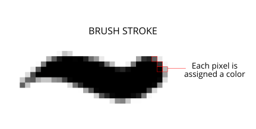

Les images vectorielles, elles, sont construites à partir d'expressions mathématiques, indépendantes des pixels. Quand vous dessinez un rectangle sur un [calque vectoriel](../krita-vectoriel/), vous tracez des chemins passant par des points — les **nœuds** — situés à des coordonnées précises sur les axes x et y. Redimensionnez ou déplacez ces points : l'ordinateur calcule et redessine le tracé. On peut donc redimensionner une forme vectorielle à volonté **sans perte de qualité**. Dans Krita, tout ce qui n'est pas sur un calque vectoriel est matriciel.

## Images, vues et fenêtres

Dans un logiciel de dessin, trois conteneurs majeurs forment votre espace de travail.

### Image

La plus importante : **l'image**.

C'est la copie de travail que vous ouvrez ou créez via la boîte de fichiers. Krita permet d'ouvrir un fichier comme nouvelle copie via le menu **Fichier**, de l'enregistrer sous un nouveau fichier, ou d'en faire une copie incrémentale.

Une image contient les données des calques, l'espace de couleur de l'image et des calques, la taille du canevas et les métadonnées (créateur, date, DPI…). Krita ouvre plusieurs images à la fois — on bascule entre elles via le menu **Fenêtre**.

Comme l'image est une copie de travail du fichier sur le disque, quelques astuces d'enregistrement s'offrent à vous :

- **Nouveau** — crée une nouvelle image. Quand vous pressez **Enregistrer**, un nouveau fichier est créé sur le disque dur.
- **Ouvrir…** — fait une copie interne d'une image existante. À **Enregistrer**, votre copie de travail écrase l'image d'origine.
- **Ouvrir un document existant comme document sans titre…** — comme **Ouvrir…**, mais **Enregistrer** demandera un emplacement : vous faites une nouvelle copie. Équivalent du « Import… » d'autres logiciels.
- **Créer une copie à partir de l'image actuelle** — comme l'option précédente, mais pour l'image actuellement sélectionnée.
- **Enregistrer en version incrémentale** — crée vite un instantané de l'image courante dans un nouveau fichier auquel s'ajoute un numéro de version.

Ces options servent aux gens de la production, qui basculent vite entre fichiers ou veulent des sauvegardes avant les gestes radicaux. Krita a aussi un système de sauvegarde : enregistrement automatique, fichiers de secours, récupération après plantage — configurables dans les réglages généraux.

### Affichage

On regarde l'image à travers une **Vue**.

Une vue est une fenêtre sur votre image. Krita permet d'en avoir plusieurs, et de manipuler la vue — zoom, rotation, miroir, modification des couleurs d'affichage — sans toucher à l'image. Très utile pour diagnostiquer les erreurs courantes : un dessin penché d'un côté se repère instantanément avec le miroir (`M`). Les courbes difficiles se dessinent plus à l'aise avec la rotation, et il y a bien sûr le zoom pour la précision comme pour le geste large.

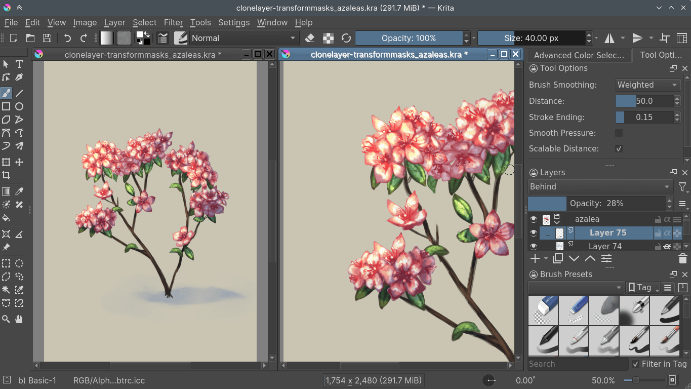

Vues multiples : **Fenêtre ‣ Nouvelle vue ‣ nom de l'image**. On bascule entre elles via le menu **Fenêtre** ou `Ctrl + Tab`, ou on les garde côte à côte en **mode sous-fenêtre** (réglages), via **Fenêtre ‣ Mosaïque**.

### Panneaux

Les panneaux (*dockers*) sont des sous-fenêtres de l'[interface de Krita](https://docs.krita.org/fr/user_manual/getting_started/navigation.html). Ils contiennent les outils utiles : sélecteur de couleurs, pile de calques, options d'outil, etc.

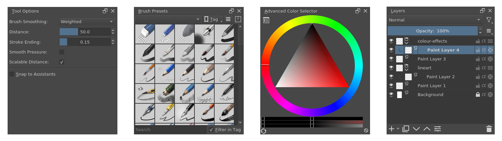

### Fenêtre

Toutes les vues et tous les panneaux vivent dans des **Fenêtres**.

Si vous avez déjà utilisé un ordinateur, vous savez : les fenêtres sont les grands conteneurs des programmes. Krita permet plusieurs fenêtres via **Fenêtre ‣ Nouvelle fenêtre** — à glisser sur un second écran pour le multi-moniteurs.

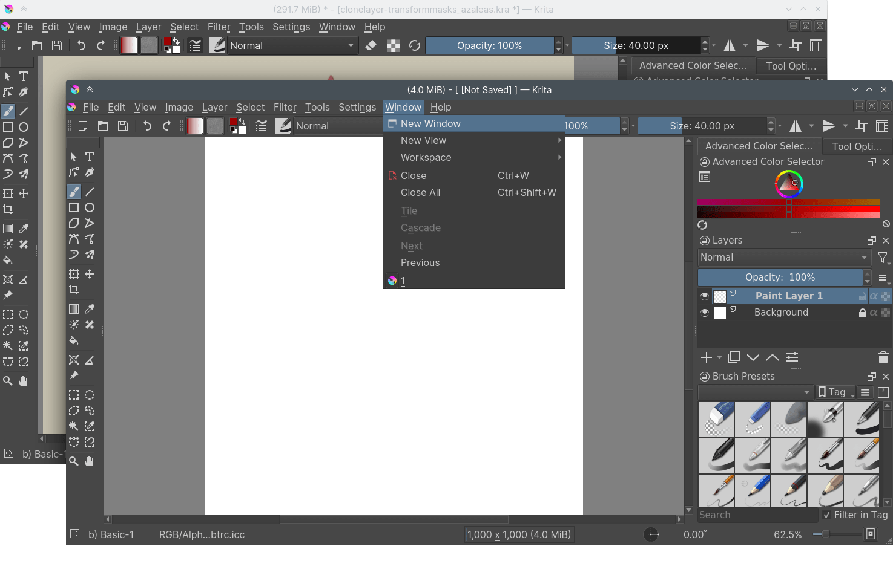

## Canevas dans Krita

À la création d'un nouveau document, on voit une zone rectangulaire blanche : le **canevas** (canvas). La zone entourée de rouge ci-dessous.

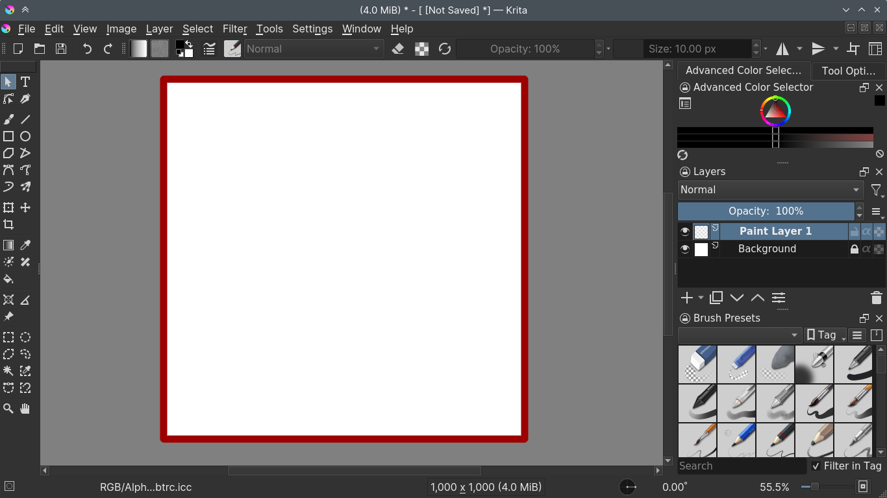

À l'enregistrement en JPG, PNG, etc., ou à l'impression, seul le contenu **à l'intérieur** de cette zone compte — tout ce qui est au-delà est ignoré. Krita stocke pourtant des informations au-delà de la zone : on ne les voit simplement pas. Ces données vivent dans les **calques**.

## Calques et composition

Comme un paysagiste peint d'abord le ciel, puis les éléments les plus lointains avant d'avancer vers le premier plan, l'ordinateur dessine dans l'ordre où on le lui demande : un cercle demandé après un carré, au même endroit, sera toujours peint après le carré. C'est « l'ordre de dessin ».

La **pile de calques** est la façon de séparer les éléments d'un dessin et de manipuler cet ordre — on y voit quel calque est peint quand, on change l'ordre, et on applique toutes sortes d'effets. C'est ce qu'on appelle la **composition** (*compositing*).

Résultat : le dessin au trait au-dessus des couleurs, les arbres devant les montagnes — et chaque élément édité sans toucher aux autres.

Krita possède de nombreux types de calques, chacun avec son usage :

- **Calques de dessin** — les calques matriciels par défaut et les plus communs : ceux sur lesquels vous dessinez.
- **Calques vectoriels** — pour dessiner du vectoriel, typiquement plus simple que le matriciel, avec l'avantage de se déformer sans flou.
- **Calques de groupe** — grouper plusieurs calques par glisser-déposer pour les organiser, les déplacer, appliquer des masques et agir ensemble.
- **Calques de clone** — copies du calque sélectionné à leur création, mises à jour automatiquement quand l'original change.
- **Calques de fichier** — référencent une image extérieure à Krita et se mettent à jour dès qu'elle change. Utile pour les logos et écussons qui évoluent beaucoup.
- **Calques de remplissage** — remplis à la volée par ce que Krita sait générer : couleurs, motifs, formes.
- **Calques de filtrage** — appliquent des filtres qui affectent l'image composite de tous les calques du dessous.

## Outils

On manipule le contenu des calques avec des **Outils**. Le plus courant : le pinceau à main levée, l'outil par défaut à l'ouverture de Krita. Les outils se rangent en cinq familles :

- **Outils de dessin** — peignent sur les calques de peinture : rectangles, cercles, lignes droites, tracés à main levée. Ces formes nourrissent les moteurs de brosses, qui en font des effets.
- **Outils de vecteurs** — la rangée du haut, pour éditer le vectoriel. Détail intéressant : tous les outils de peinture sauf le pinceau à main levée tracent des formes sur les calques vectoriels — mais l'objet résultant n'utilise pas le préréglage de pinceau pour son contour.
- **Outils de sélection** — modifier une zone très précise du calque sans affecter le reste. L'équivalent numérique des fluides de masquage de la peinture traditionnelle — en nettement plus propre.
- **Outils de guidage** — grilles et assistants.
- **Outils de transformation** — transformer calques et objets sur la zone de dessin.

Tous les outils sont dans la boîte à outils ; chaque outil est détaillé dans la section [outils](https://docs.krita.org/fr/reference_manual/tools.html) du manuel.

Certains outils stockent l'opacité différemment des autres. Tous les outils de peinture **partagent** une valeur d'opacité, liée au préréglage de pinceau : on alterne entre pinceau à main levée, ligne, etc. sans restaurer ses réglages à chaque bascule — et en changeant de préréglage, chacun garde la sienne. Les autres outils ont chacun **leur** opacité, indépendante des préréglages : elle reste constante au changement de préréglage.

## Moteurs de brosses

Les moteurs de brosses, donc, prennent un chemin et les informations de la tablette, et y ajoutent des effets — faisant un coup de pinceau.

Le « moteur » est le terme des développeurs de Krita pour un ensemble complexe de code interactif, noyau de certaines fonctionnalités, hautement configurable. Comme le moteur de votre voiture — son type et sa réglage influencent l'usage — le moteur de brosse détermine l'apparence et l'ergonomie du pinceau. Des moteurs différents donnent des résultats différents.

Krita possède [beaucoup de moteurs de brosses](https://docs.krita.org/fr/reference_manual/brushes/brush_engines.html), tous aux effets distincts :

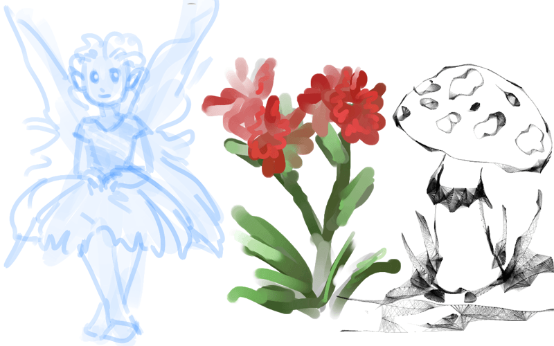

Le moteur de brosse à pixels est simple et couvre l'essentiel du travail de base ; pour beaucoup de peinture, le moteur *color smudge* (taches de couleur) est plus efficace — plus lent, mais son mélange des couleurs accélère le fondu. Pour quelque chose de différent : le moteur de croquis fait des lignes brouillonnes, le moteur de formes produit de grands aplats vite. Il y a beaucoup d'effets dans les moteurs de Krita — essayez-les tous, et lisez leur chapitre.

Ces effets se règlent dans le menu déroulant des réglages de brosse, accessible avec `F5`, puis s'enregistrent en préréglages — accessibles avec `F6` ou le panneau **Préréglages de brosses**.

## Couleurs

Les brosses dessinent avec des couleurs — comment l'ordinateur les traite-t-il ?

L'humain voit quelques millions de couleurs : des combinaisons d'ondes électromagnétiques (la lumière) rebondissant sur une surface, qui en absorbe une partie.

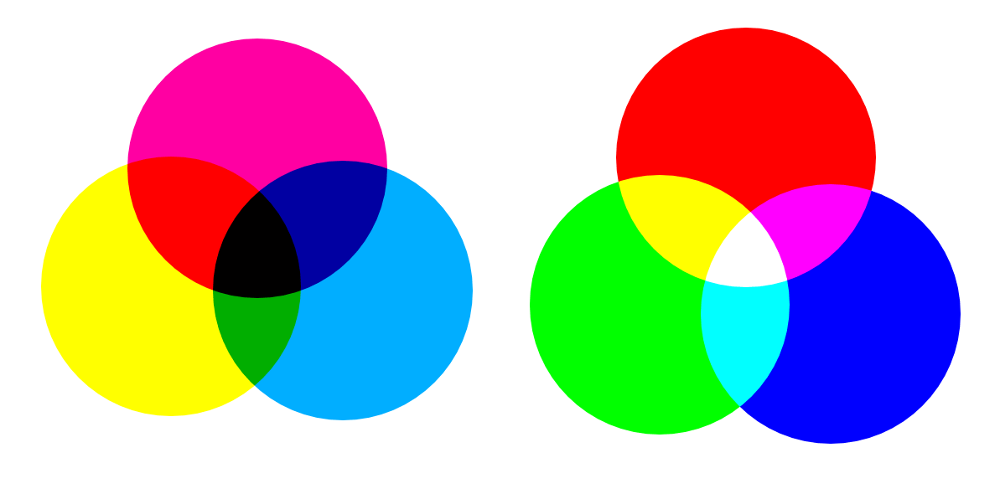

En peinture traditionnelle, on utilise des pigments qui absorbent aussi les ondes correspondant à la couleur voulue. Plus on combine de pigments, plus la lumière est absorbée — vers un noir obscur. C'est le mélange **soustractif** : plus de pigments, moins de lumière. Les trois primaires les plus efficaces sont alors des couleurs claires : cyan, magenta, jaune (CMJ).

L'ordinateur, lui, émet de la lumière — écran. Plus de « pigment » lumineux, plus de lumière : le mélange est **additif**, et l'ajout de lumières colorées mène au blanc. Ses trois primaires efficaces : rouge, vert, bleu (RVB).

Par pixel, l'ordinateur stocke la valeur de chaque primaire, le maximum dépendant de la profondeur de couleur. On appelle ces valeurs **composantes** ou **canaux**.

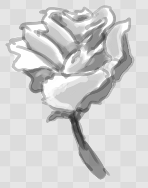

Ci-dessus : le canal rouge d'une rose rouge. Les pétales sont blancs — rouge à plein ; les feuilles, sombres — le vert manque de rouge, logique.

Par défaut les ordinateurs utilisent RVB, mais convertissent aussi vers CMJN (le soustractif) ou vers un modèle perceptuel comme LAB. Dans tous les cas : une autre façon d'indiquer comment les couleurs se relient, généralement 3 composantes. Exception — les niveaux de gris : l'ordinateur ne retient qu'à quel point la couleur est blanche, d'où leur économie mémoire. Vu séparément, chaque canal ressemble à une image en niveaux de gris, où le blanc mesure le rouge, le vert ou le bleu.

Krita a un système de gestion des couleurs très complet, documenté [ici](https://docs.krita.org/fr/general_concepts/colors.html).

## Transparence

Comme le rouge, le vert et le bleu, l'ordinateur stocke aussi la **transparence** d'un pixel — essentiel à la composition : que valent plusieurs calques sans transparence ?

La transparence se stocke comme les couleurs : c'est un canal de plus, le **canal alpha** (ou alpha) — la lettre α le représente en programmation.

Certains vieux logiciels n'ont pas la transparence par défaut. Krita est l'inverse : il ne comprend pas les images qui ne la tracent pas et ajoute toujours un canal alpha. Quand un pixel est totalement transparent sur tous les calques, Krita affiche un damier — comme pour la rose ci-dessus.

## Modes de fusion

Les couleurs étant des nombres, on peut faire des mathématiques avec. On appelle ces opérations **modes de fusion** (ou modes de composition). Ils s'appliquent par calque ou par coup de pinceau — et font donc partie de la composition.

- **Multiplier** — multiplie les composantes, ce qui fonce les couleurs : simuler le mélange soustractif, et peindre des ombres facilement.
- **Addition** — ajoute les composantes d'un calque à l'autre : parfait pour les effets de lueur.
- **Effacement** — un mode de fusion dans Krita ! Pas d'outil gomme : la touche `E` bascule vite le pinceau en gomme. Ça marche aussi sur les calques. Contrairement aux autres modes, il n'affecte que le canal alpha — il rend plus transparent.
- **Normal** — la moyenne des couleurs selon la transparence de la couleur du dessus.

Krita a 76 modes de fusion, chacun un peu différent — voir [les modes de fusion](https://docs.krita.org/fr/reference_manual/blending_modes.html).

## Masques

Puisqu'on peut voir les canaux comme des images en niveaux de gris, on peut convertir une image en niveaux de gris en canal. Utiliser une image en niveaux de gris pour la transparence, par exemple : c'est un **masque**.

Les masques sont un type de sous-effet appliqué à un calque, généralement piloté par une image en niveaux de gris.

Le type principal : les **masques de transparence** — une image en niveaux de gris détermine la transparence : noir rend transparent, blanc garde opaque.

On peint sur un masque avec n'importe quel pinceau, ou on convertit un calque de peinture en masque. Le grand bénéfice : rendre transparent **sans détruire** les pixels du dessous. Et un masque peut révéler ou cacher tout un groupe de calques d'un coup !

Exemple — une femme fantôme en blanc :

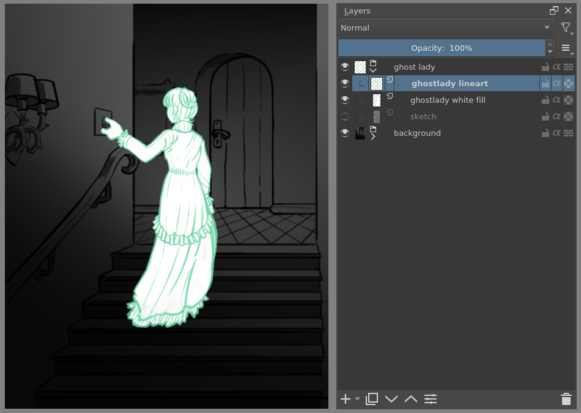

Difficile de dire si c'est un fantôme ou juste quelqu'un de très pâle. Il faudrait qu'elle flotte. Clic droit sur le calque, ajouter un masque de transparence, puis dessiner sur ce masque un dégradé linéaire noir-blanc, noir vers le bas.

Là où il y a du noir, la femme devient transparente — un vrai fantôme !

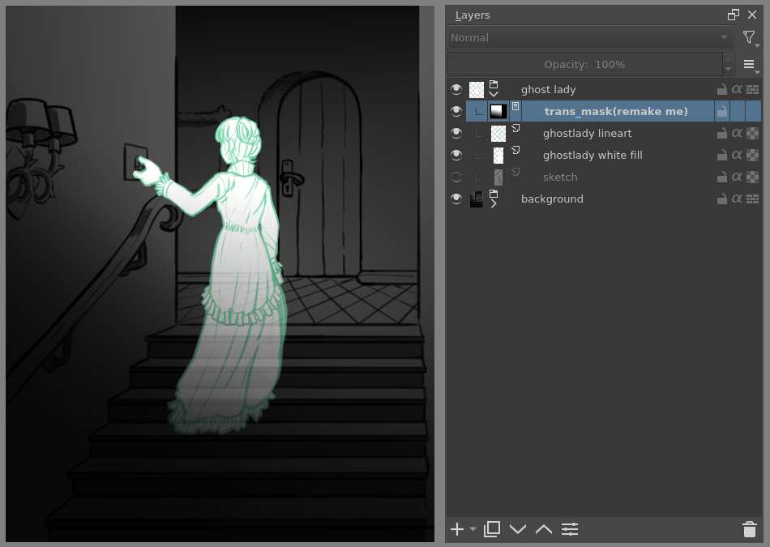

Le mot « masque » vient du fluide de masquage et des films de la peinture traditionnelle — comme la comparaison avec les sélections plus haut. Les sélections sont d'ailleurs stockées en interne comme images en niveaux de gris : on peut les enregistrer comme sélection locale (une sorte de masque) ou les convertir en masque de transparence.

## Filtres

On peut faire des math avec les couleurs — et aussi avec les pixels, des groupes de pixels, des calques entiers. Krita fait toutes sortes de petites opérations sur les calques : les **filtres**.

Quelques exemples :

- **Dé-saturer** — bascule tous les pixels en gris.
- **Flou** — moyenne chaque pixel avec ses voisins : les contrastes nets disparaissent, l'image devient floue.
- **Renforcer** — augmente le contraste entre pixels qui en avaient déjà pas mal.
- **Couleur vers alpha** — un filtre populaire qui rend transparentes toutes les couleurs sélectionnées.

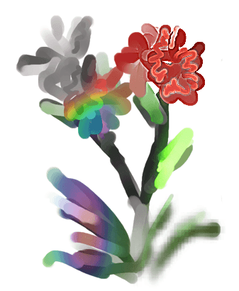

Krita a beaucoup plus de filtres — documentés [ici](https://docs.krita.org/fr/reference_manual/filters.html).

### Le moteur de filtre de brosses

Comme beaucoup de ces opérations sont par pixel, Krita permet d'utiliser les filtres comme [moteur de brosses](https://docs.krita.org/fr/reference_manual/brushes/brush_engines/filter_brush_engine.html) — le moteur de filtre. Dans la plupart des logiciels, c'est un outil séparé ; ici c'est un moteur de brosse, bien plus configurable.

Concrètement : un pinceau qui dé-sature, ou un pinceau qui change la teinte des pixels en dessous.

### Calques de filtres, masques de filtres et styles de calques

Krita met aussi les filtres dans la pile de calques : les [calques de filtrage](https://docs.krita.org/fr/reference_manual/layers_and_masks/filter_layers.html) et les [masques de filtrage](https://docs.krita.org/fr/reference_manual/layers_and_masks/filter_masks.html). Les calques de filtrage affectent tous les calques du dessous dans la même hiérarchie ; la transparence et ses masques délimitent où le calque s'applique.

Les masques de filtrage affectent un seul calque, pilotés par une image en niveaux de gris — et tout un groupe, comme un masque de transparence.

On peut rendre notre femme fantôme plus éthérée encore : sélectionner son calque, créer un calque de clone, clic droit, ajouter un masque de filtrage avec un flou gaussien à ~10 pixels. Le calque de clone passe derrière l'original, en mode de fusion *Densité de couleur* — une lueur spectrale bien nette. Et quand on continue à peindre sur le calque d'origine, tout se met à jour automatiquement !

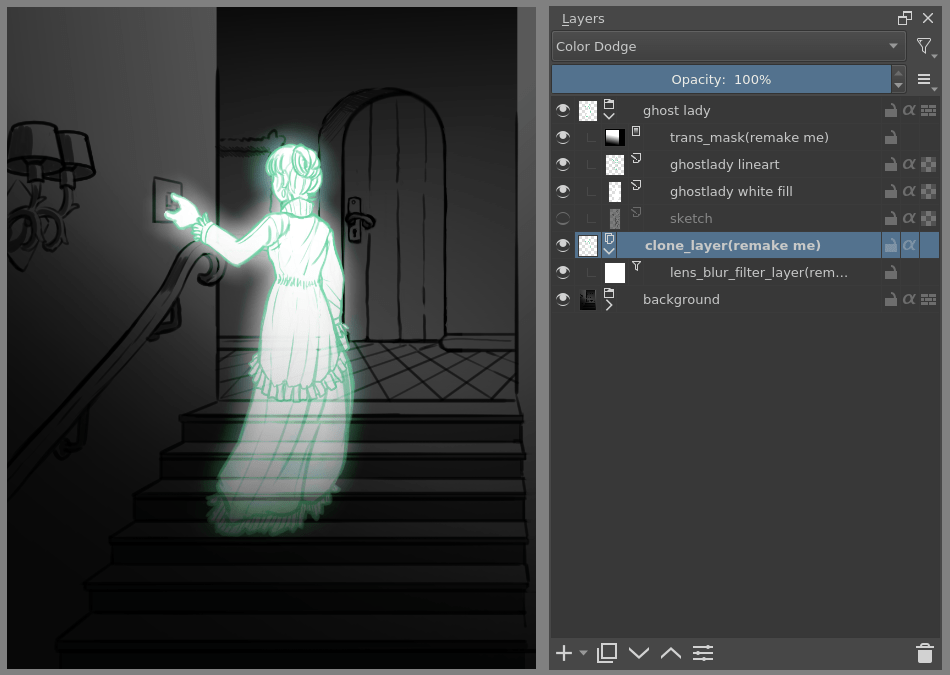

Les effets de calque (*layer styles*), popularisés par Photoshop, sont des masques de filtrage un peu plus rapides mais moins polyvalents — clic droit sur un calque, « style de calque ».

## Transformations

Les **transformations** ressemblent aux filtres : des opérations sur les pixels. Les transformations image et calque sont dans les menus du haut — redimensionner, retourner, faire pivoter le tout.

L'[outil de rognage](https://docs.krita.org/fr/reference_manual/tools/crop.html) ne change que la taille du canevas ; l'[outil de déplacement](https://docs.krita.org/fr/reference_manual/tools/move.html) ne déplace qu'un calque donné. Pour plus de contrôle : l'[outil de transformation](https://docs.krita.org/fr/reference_manual/tools/transform.html) — tourner et redimensionner sur la zone de dessin, ou mettre en perspective. Et les outils avancés : warp, cage et liquider, qui transforment en dessinant des points personnalisés — ou en faisant semblant d'un pinceau qui transforme.

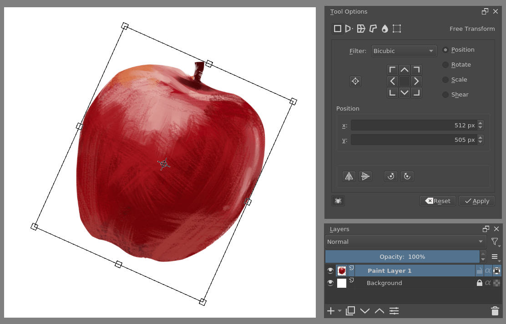

Comme pour les filtres, Krita a un moteur de brosse de déformation (*Deform*) — une version bien plus rapide du mode liquider de l'outil de transformation, en échange d'une qualité moindre.

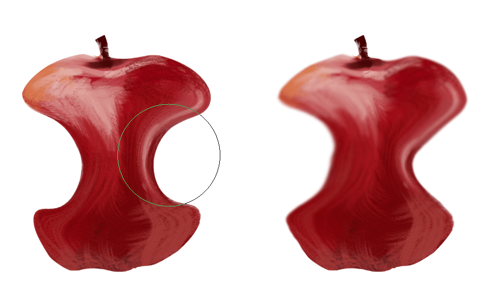

À noter : la brosse de déformation ne s'applique pas comme masque non destructif.

Comme les filtres, les transformations peuvent s'appliquer de façon non destructive dans la pile de calques : les [masques de transformation](https://docs.krita.org/fr/reference_manual/layers_and_masks/transformation_masks.html). Contrairement aux masques de filtre et de transparence, ils ne peuvent pas être pilotés par une image en niveaux de gris — pour des raisons techniques. Ils s'appliquent aussi aux calques de clone et de fichier.

## Animation

Depuis la version 3.0, Krita gère l'[animation](https://docs.krita.org/fr/user_manual/animation.html) matricielle : la chronologie et les panneaux d'animation et d'oignons pelés, plus la gamme de pinceaux de Krita, pour animer, exporter, puis assembler en films ou GIF.


## Assistants, grilles et guides

Avec toute cette technique, on oublierait que Krita est un logiciel de peinture. Comme l'illustrateur traditionnel entouré d'équipements, Krita offre une variété d'outils d'aide :


- Le panneau **Grilles et guides** — un guidage direct, paramétrable, affichant grilles et lignes de repère.
- L'**alignement** (*snapping*) — s'accrocher aux grilles, guides, extensions, orthogonales, centres d'image et boîtes englobantes.
- La **peinture avec assistants** — impossible de plaquer une règle sur la tablette : les assistants aident à dessiner cercles concentriques, perspectives, parallèles et autres détails délicats. L'alignement s'y réfère via les options d'outil.

Ces guides s'enregistrent dans un format natif de Krita : on retrouve son travail rapidement plus tard.

## Personnalisation

Dernier concept : la personnalisation.

En plus de réorganiser les panneaux à son goût, Krita enregistre vos configurations comme [espaces de travail](https://docs.krita.org/fr/reference_manual/resource_management/resource_workspace.html) — le bouton en haut à droite.

La barre d'outils se configure via **Configuration ‣ Configurer les barres d'outils…**, les raccourcis sous **Configuration ‣ Configurer Krita… ‣ Raccourcis** et **Configuration ‣ Configurer Krita… ‣ Réglages du canevas**.
