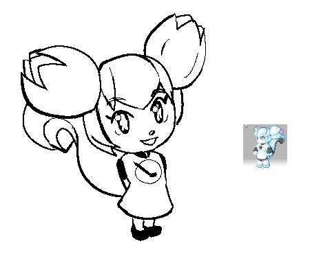
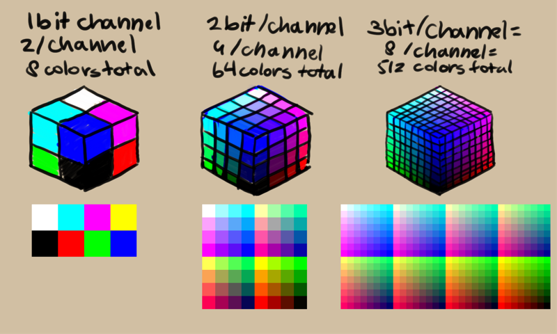

<!-- start-replace-fm field="title" -->
# Krita — la profondeur de couleur
<!-- end-replace-fm -->
<!-- start-replace-fm field="description" format="blockquote" -->
> La profondeur de couleur dans Krita : le travail par canal (8, 16, 16 flottant, 32 flottant bits), les couleurs indexées absentes du logiciel, et quand passer en profondeur supérieure.
<!-- end-replace-fm -->

<!-- start-replace-mediagraphie-fiche -->
> **Référence** — Documentation Krita (2026). Krita — la profondeur de couleur.. https://docs.krita.org/fr/general_concepts/colors/bit_depth.html. [↗](https://docs.krita.org/fr/general_concepts/colors/bit_depth.html)
>
> | **Type** | webpage |
> | **Auteur·e** | Documentation Krita |
> | **Date** | 2026 |
> | **Statut** | stable |
> | **Mots-clés** | image, krita, couleur, profondeur, bits, tutoriel, cours |

**Citation (copier-coller)**

```citation
Documentation Krita (2026). Krita — la profondeur de couleur.. https://docs.krita.org/fr/general_concepts/colors/bit_depth.html.
```
<!-- end-replace-mediagraphie-fiche -->

## Cité par

<!-- start-replace-mediagraphie-cited-by -->
_Aucune citation pour l'instant._
<!-- end-replace-mediagraphie-cited-by -->

---
> 📄 **Réhébergement** — le contenu ci-dessous est la reproduction intégrale de la page officielle [Krita — la profondeur de couleur](https://docs.krita.org/fr/general_concepts/colors/bit_depth.html) de la documentation Krita, déjà publiée en français par l'équipe de Krita. La source fait foi et est mise à jour en premier ; cette copie peut dater.

## Profondeur de couleur

Classiquement, la profondeur en bits se réfère à la quantité de mémoire de travail par pixel, qui est réservée pour toute l'image.

L'utilisation d'un format A2 dans la vie réelle peut permettre beaucoup plus de détails dans le dessin final. Il prend plus de place sur votre bureau qu'un simple papier A4.

Cependant, ceci ne se réfère pas que à la taille de l'image mais aussi à la précision dont vous avez besoin par couleur.

Pour illustrer ceci, une brève discussion sera faite sur quelque chose, qui n'est même pas disponible dans Krita :

### Couleurs indexées

Dans les programmes anciens, l'ordinateur aura pour chaque image, une palette contenant un nombre pour chaque couleur. La taille de la palette est définie en bits, car l'ordinateur ne peut enregistrer des données selon une taille en bits.



Uniquement deux couleurs au total, généralement noir et blanc.

16 couleurs en total, qui sont populaires puisque de nombreux jeux anciens s'exécutent avec cette palette de couleurs.

256 couleurs en total, Les images sur 8 bits sont utilisées fréquemment pour économiser de la mémoire pour les textures et les animations.

Cependant, ceci est non disponible dans Krita. A la place, Krita travaille par canal et calcule combien de couleurs par canal vous avez besoin (décrit en terme de « bits par canal »). Ceci est appelé « Couleur vraie ».

### Couleur naturelle



*Les configurations à 1, 2 et 3 bits par canal n'existent plus actuellement dans toute application de graphismes, en dehors d'ici. Cependant, en les imaginant, il est possible de prévoir comment chaque bit affecte la précision. En général, chaque bit sub-divise chaque section du cube de couleurs, signifiant que la précision est une puissance de 2 plus importante que le cube précédent.[¶](#id2)*

Aussi connu sous le nom de « HiColor » ou un total de couleurs sur 16 bits. Un peu relatif aux vieux systèmes et plus utilisé en dehors d'affichages spécifiques.

Aussi connu sous le nom de « Couleur vraie », « Millions de couleurs » ou « 24 bits / 32 bits ». Le standard pour de nombreux écrans et la profondeur de bits la plus basse que Krita puisse gérer.

Une étape de 8 bits à 16 bits par canal autorise les couleurs qui ne peuvent pas être affichées à l'écran. Cependant, à cause de cela, il vous sera plus facile d'avoir des gradients plus doux, quelquefois appelé « Couleur profonde » Ce type de profondeur de couleurs ne possède pas de valeurs possibles négatives. Ainsi, sa précision est de 16 bits, signifiant que vous avez 65536 valeurs par canal.

Similaire au 16 bits, mais avec un intervalle plus important et moins de précision. Alors qu'une profondeur de seulement de 16 bits offre des coordonnées comme [1, 4, 3], celle en 16 bits en virgule flottante possède des coordonnées comme [0.15, 0.70, 0.3759], avec [1.0,1.0,1.0] représentant le blanc. A cause des différences entre les variables de type entier et virgule flottante et aussi car une image relative à une scène accepte des valeurs négatives, vous avez 10 à 11 bits de précision par canal en 16 bits en virgule flottante, en comparaison des 16 bits en représentation entière sur 16 bits (soit 2048 valeurs par canal sur un intervalle de 0 à 1). Ceci est nécessaire pour les images relatives à un scène ou pour les images à haute résolution. Cette précision est souvent nommée comme « semi-virgule flottante ».

Similaire au 16 bits en virgule flottante, mais avec quand même une plus haute précision. La profondeur native de couleurs pour « OpenColor IO » est donc, plus rapide que la profondeur en 16 bits en virgule flottante dans les images à haute définition, si pas plus volumineux. A cause de la nature des variables de type virgule flottante, la profondeur en 32 bits en virgule flottante est à peu près égale à une précision de 23 - 24 bits de précision par canal (Soit 16777216 valeurs par canal dans l'intervalle 0-1). Mais elle offre un intervalle bien plus important (elle peut aller bien au dessus de 1), ce qui est nécessaire pour les valeurs concernant les scènes à haute résolution. Elle est aussi nommée comme profondeur à « virgule flottante simple ».

Ceci est important si vous avez un espace colorimétrique de travail, plus grand que l'espace colorimétrique de votre périphérique. Au moins, si vous ne voulez pas des auréoles de couleurs.

Et, pendant que vous tentez de créer toutes vos images en 32 bits en virgule flottante, votre mémoire « RAM » se remplira rapidement. Cependant, il est important de tenir compte quelle profondeur en bits vous devez utiliser pour quel type d'image.
