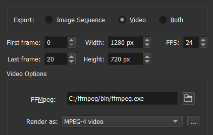

<!-- start-replace-fm field="title" -->
# Krita — le rendu de l'animation et FFmpeg
<!-- end-replace-fm -->
<!-- start-replace-fm field="description" format="blockquote" -->
> Le rendu de l'animation dans Krita : exporter en séquence d'images ou en vidéo, et installer FFmpeg (télécharger, décompresser, lier à Krita) pour produire un GIF, un MP4 ou un MKV.
<!-- end-replace-fm -->

<!-- start-replace-mediagraphie-fiche -->
> **Référence** — Documentation Krita (2026). Krita — le rendu de l'animation et FFmpeg.. https://docs.krita.org/fr/reference_manual/render_animation.html. [↗](https://docs.krita.org/fr/reference_manual/render_animation.html)
>
> | **Type** | webpage |
> | **Auteur·e** | Documentation Krita |
> | **Date** | 2026 |
> | **Statut** | stable |
> | **Mots-clés** | image, krita, animation, ffmpeg, export, gif, tutoriel, cours |

**Citation (copier-coller)**

```citation
Documentation Krita (2026). Krita — le rendu de l'animation et FFmpeg.. https://docs.krita.org/fr/reference_manual/render_animation.html.
```
<!-- end-replace-mediagraphie-fiche -->

## Cité par

<!-- start-replace-mediagraphie-cited-by -->
- [Krita — l'audio pour l'animation](../krita-audio-animation/)
- [06](../../../../01-deroulement/06/)
- [Exercice — Exporter en GIF](../../../../02-activites/02/exercices/13-export-gif/)
<!-- end-replace-mediagraphie-cited-by -->

---
> 🇫🇷 **Traduction française** de la page officielle [Render Animation](https://docs.krita.org/fr/reference_manual/render_animation.html) — la page source n'est pas encore traduite. Adaptation : A26.

Le **rendu de l'animation** exporte votre travail en **séquence d'images** ou en **fichier animé** (GIF, MP4, MKV…). Pour un format animé, Krita rend d'abord une séquence PNG, puis la passe à un **encodeur vidéo (FFmpeg)** — un rendu en deux temps qui permet de ne re-rendre qu'une image ratée sans tout recommencer.

## Installer FFmpeg

> **Note (Krita 5.2+)** — FFmpeg est désormais **optionnel** : Krita embarque une fonctionnalité FFmpeg. Installer une version dédiée reste utile pour choisir une version précise. Sur **Android**, FFmpeg n'est pas utilisé : n'essayez pas de l'installer.

### Étape 1 — Télécharger FFmpeg

- **Windows** : ouvrir la page de téléchargement de FFmpeg, section *release*, et prendre `ffmpeg-release-essentials.zip`. **Ne pas** prendre un fichier contenant `shared` (il ne fonctionne pas avec Krita). Un `.7z` convient aussi (avec un décompresseur 7zip).
- **macOS** : FFmpeg s'obtient [ici](https://evermeet.cx/ffmpeg/) (gros bouton vert), ou via *Download as ZIP*. Un `.7z` nécessite un utilitaire comme Keka.
- **Linux** : FFmpeg s'installe depuis les dépôts de la plupart des distributions. La version **2.6 minimum** est requise pour un bon support du GIF (fonction `palettegen`).
- **Android** : non utilisé.

### Étape 2 — Décompresser et lier à Krita

- **Windows** : clic droit sur l'archive → *Extraire tout…*, puis renommer le dossier `ffmpeg` (idéalement à la racine `C:`). Dans Krita : **Fichier ‣ Rendre l'animation…**, sous *Export ▸ Vidéo*, cliquer l'icône fichier à côté de **FFmpeg** et choisir `C:/ffmpeg/bin/ffmpeg.exe`.
- **macOS** : extraire puis pointer vers le dossier, p. ex. `/Users/user/Downloads/ffmpeg`.
- **Linux** : FFmpeg est en général à `/usr/bin/ffmpeg`.



### Étape 3 — Tester avec un GIF

Dans la boîte **Rendre l'animation**, mettre **Rendu en** = « GIF image », choisir l'emplacement et le nom (`export.gif`), puis rendre.

> **Attention (Windows)** — par défaut, FFmpeg rend les MP4 avec un codec trop récent pour Windows Media Player : choisir le profil **baseline** plutôt que `high422` avant de rendre.

## Le dialogue « Rendre l'animation »

- **Première image / Dernière image** : la plage à rendre (par défaut, la sélection de la chronologie) — utile pour ne re-rendre qu'un petit bout.
- **Export ▸ Séquence d'images** : format imposé **PNG** ; *Emplacement des images*, *Nom de base*, *Numéro de départ*, *Seulement les images uniques* (n'exporte que les images clés).
- **Export ▸ Vidéo** : *Largeur*, *Hauteur*, *IPS* (cadence), *Filtre* de mise à l'échelle (Bicubique, ou Plus proche voisin pour le pixel art), **Rendu en** (GIF, MP4, MKV…), *Emplacement de la vidéo*, *Inclure l'audio*, **FFmpeg**, *Supprimer la séquence après le rendu*.
- Largeur/hauteur > 1920 px et cadence > 30 i/s sont peu supportées : l'export peut échouer ou mal se lire.

> **VOIR AUSSI** — [Krita — l'animation 2D](../krita-animation-2d/) · [Krita — la chronologie d'animation](../krita-animation-timeline/) · [Krita — le panneau Pelures d'oignon](../krita-onion-skin/)
