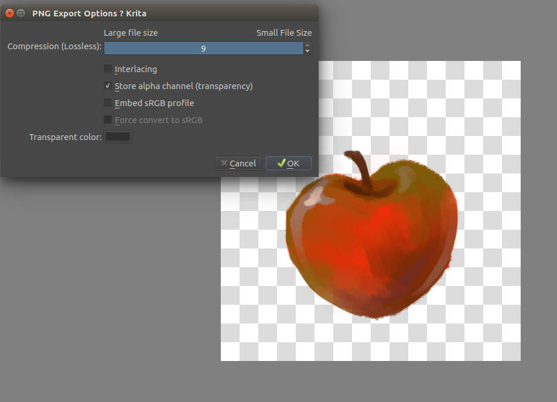

<!-- start-replace-fm field="title" -->
# Krita — enregistrer pour l'Internet
<!-- end-replace-fm -->
<!-- start-replace-fm field="description" format="blockquote" -->
> Le tutoriel Krita pour enregistrer pour l'Internet : le .kra comme source, aplatir, convertir en sRGB 8 bits, redimensionner, accentuer, et exporter en JPEG, PNG ou GIF.
<!-- end-replace-fm -->

<!-- start-replace-mediagraphie-fiche -->
> **Référence** — Documentation Krita (2026). Krita — enregistrer pour l'Internet.. https://docs.krita.org/fr/tutorials/saving-for-the-web.html. [↗](https://docs.krita.org/fr/tutorials/saving-for-the-web.html)
>
> | **Type** | webpage |
> | **Auteur·e** | Documentation Krita |
> | **Date** | 2026 |
> | **Statut** | stable |
> | **Mots-clés** | image, krita, web, export, optimisation, tutoriel, cours |

**Citation (copier-coller)**

```citation
Documentation Krita (2026). Krita — enregistrer pour l'Internet.. https://docs.krita.org/fr/tutorials/saving-for-the-web.html.
```
<!-- end-replace-mediagraphie-fiche -->

## Cité par

<!-- start-replace-mediagraphie-cited-by -->
- [Exercice — Retouche photo](../../../../02-activites/01/exercices/06-retouche-photo/)
- [Optimiser une image](../../../../03-savoirs/02-utiliser/05-optimisation-medias/01-image/)
<!-- end-replace-mediagraphie-cited-by -->

---
> 📄 **Réhébergement** — le contenu ci-dessous est la reproduction intégrale de la page officielle [Krita — enregistrer pour l'Internet](https://docs.krita.org/fr/tutorials/saving-for-the-web.html) de la documentation Krita, déjà publiée en français par l'équipe de Krita. La source fait foi et est mise à jour en premier ; cette copie peut dater.

## Enregistrement pour l'Internet

Le format d'enregistrement par défaut de Krita est [*.kra](../general_concepts/file_formats/file_kra.html#file-kra). Il enregistre tout ce que Krita peut manipuler concernant une image : les calques, les filtres, les assistants, les masques, les espaces colorimétriques, etc. Cependant, cela fait beaucoup de données. Ainsi, les fichiers Krita sont plutôt volumineux. Ceci n'en fait pas une bonne solution pour les envoyez sur Internet. Imaginez combien de personnes atteindraient la limite s'il ne traitaient que des fichiers « [*](#id1).kra » ! Ainsi, à la place, les images sont optimisées pour Internet.

Il y a plusieurs étapes associées :

1. Enregistrer au format « .kra ». Vous obtiendrez un fichier de travail et l'utiliserez comme sauvegarde, si vous faites des erreurs.

2. Mettre à plat tous les calques. Ceci fusionne tous les calques en un seul calque. Veuillez aller dans **Calque / Mettre l'image à plat** ou utiliser le raccourci :kbd:` « CRTL » + « Maj » + « E » [`](#id1). La mise à plat peut prendre un peu de temps. Ainsi, si vous avez une image volumineuse, ne soyez pas inquiet si Krita semble figé pendant quelques secondes. Il redeviendra réactif assez rapidement.

3. Convertir l'espace colorimétrique vers « sRGB » sur 8 bits (si pas encore fait). Il est important de réduire la taille du fichier et le format « png » ne peut, par exemple, prendre en compte plus de 16 bits en profondeur. Veuillez utiliser **Image / Convertir l'espace colorimétrique de l'image...** et définir les options, respectivement vers « **RGB**, **8 bits** » et « **sRGB-elle-v2-srgbtrc.icc** ». Si vous utilisez un espace colorimétrique linéaire, dé-cocher les optimisations « **LittleCMS** ».

4. Re-dimensionner ! Allez dans le menu :menuselection:` Image / Dimensionner l'image à une Nouvelle Taille...` ou utiliser le raccourci :kbd:` « CTRL » + « ALT » + « I » [`](#id1). Ceci permet d'appeler le menu de re-dimensionnement. Une bonne règle de base pour le re-dimensionnement des vignettes est de tenter d'avoir les deux tailles sous la limite des 1200 pixels (Ceci est la taille des formats « HD »). Vous pouvez faire cela facilement en définissant la **Résolution**sous la **Taille d'impression** à **72** points par pouce. Ensuite, appuyez sur **Ok** pour tout redimensionner.

5. Améliorer un peu l'image. Ceci est tout particulièrement nécessaire pour les réseaux sociaux. Les sites Internet de réseaux sociaux dimensionnent et convertissent souvent vos images, les rendant un peu floues. En fait, il les optimisent comme des photos et non comme des dessins. Pour que vos images restent réalistes, cela vaut la peine d'exécuter préalablement un filtre d'accentuation. Puisque ce filtre est tout à fait efficace, vous feriez mieux d'ajouter un masque de filtrage d'accentuation sur le haut de la pile et de réduire son opacité, jusqu'à ce que vous trouviez le niveau d'accentuation approprié.

6. Enregistrer dans un format d'images compatible avec Internet. Il y en a trois particulièrement recommandé :

### JPG

Utiliser ceci pour les images avec beaucoup de couleurs différentes, comme les dessins.

### PNG

Utiliser ceci pour des images avec peu de couleurs ou en noir et blanc, comme les bandes dessinées et le « pixel-art ». Sélectionnez **Enregistrer comme PNG indexé, si possible** pour encore plus d'optimisation.

### GIF

N'utiliser ceci que pour les animations (Sera pris en charge cette année) ou pour des images avec un nombre très réduit de couleurs car elles seront indexées.

### Enregistrement avec transparence



L'enregistrement avec la transparence n'est possible qu'avec les formats « GIF » et « PNG ». Tout d'abord, veuillez vous assurer que les vérificateurs de transparence sont bien visibles. Ceci peut être réalisé facilement en masquant les calques du bas, en changeant la couleur de projections avec **Image / Transparence et couleurs de l'arrière-plan de l'image...** ou en utilisant **Filtres / Couleurs / Couleur vers Alpha...**). Ensuite, enregistrez au format « PNG » et cochez **Enregistrer le canal Alpha (Transparence)**.

Enregistrez votre image, envoyez la et afficher la !
