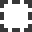
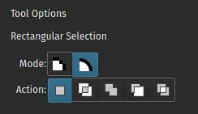

<!-- start-replace-fm field="title" -->
# Krita — les sélections
<!-- end-replace-fm -->
<!-- start-replace-fm field="description" format="blockquote" -->
> Le chapitre du manuel Krita sur les sélections : création, édition, modes d'affichage, sélection depuis la transparence du calque, types pixel et vectoriel.
<!-- end-replace-fm -->

<!-- start-replace-mediagraphie-fiche -->
> **Référence** — Documentation Krita (2026). Krita — les sélections.. https://docs.krita.org/fr/user_manual/selections.html. [↗](https://docs.krita.org/fr/user_manual/selections.html)
>
> | **Type** | webpage |
> | **Auteur·e** | Documentation Krita |
> | **Date** | 2026 |
> | **Statut** | stable |
> | **Mots-clés** | image, krita, selection, masque, tutoriel, cours |

**Citation (copier-coller)**

```citation
Documentation Krita (2026). Krita — les sélections.. https://docs.krita.org/fr/user_manual/selections.html.
```
<!-- end-replace-mediagraphie-fiche -->

## Cité par

<!-- start-replace-mediagraphie-cited-by -->
- [Exercice — Détourage d'un sujet](../../../../02-activites/01/exercices/01-detourage/)
<!-- end-replace-mediagraphie-cited-by -->

---
> 🇫🇷 **Traduction française** de la page officielle [Selections](https://docs.krita.org/fr/user_manual/selections.html) — la page source n'est pas encore traduite. Adaptation : A26.

Les sélections permettent de choisir une zone précise de son travail pour la modifier : déplacer une partie de la peinture, la transformer, ou peindre dessus sans toucher au reste. De nombreux outils de sélection existent, chacun sélectionnant à sa façon. Une fois une zone sélectionnée, la plupart des outils restent confinés dans cette zone — on peut y dessiner ou y appliquer des dégradés pour obtenir rapidement des formes colorées et/ou ombrées aux bords nets. Les sélections de Krita ne sont pas limitées aux bords du canevas : on peut sélectionner des parties du tableau au-delà de la zone de dessin.

## Créer des sélections

Les outils de sélection les plus courants se trouvent en bas de la boîte à outils. Chacun sélectionne un peu différemment :

| Outil | Icône | Usage |
|---|---|---|
| [Sélection rectangulaire](https://docs.krita.org/fr/reference_manual/tools/rectangular_select.html) |  | Sélectionner la forme d'un rectangle. |
| [Sélection elliptique](https://docs.krita.org/fr/reference_manual/tools/elliptical_select.html) |  | Sélectionner la forme d'un cercle. |
| [Sélection polygonale](https://docs.krita.org/fr/reference_manual/tools/polygonal_select.html) |  | Cliquer à chaque sommet du polygone. Double-clic pour terminer le polygone et finaliser la sélection ; `Shift + Z` annule le dernier point. |
| [Sélection à main levée](https://docs.krita.org/fr/reference_manual/tools/freehand_select.html) |  | Le lasso trace à main levée le contour de la sélection sur la zone de dessin. |
| [Sélection par la couleur](https://docs.krita.org/fr/reference_manual/tools/similar_select.html) |  | Sélectionner toutes les zones de couleur similaire. |
| [Sélection contiguë](https://docs.krita.org/fr/reference_manual/tools/contiguous_select.html) |  | La « baguette magique » sélectionne un champ de couleur contigu. Ajuster la **Tolérance** (*fuzziness*) pour accepter plus de variations ; limité au calque courant par défaut. |
| [Sélection par chemin](https://docs.krita.org/fr/reference_manual/tools/path_select.html) |  | Sélectionner à partir d'un chemin vectoriel : clic pour les angles nets, glisser pour les courbes ; fermer avec `Entrée` ou en rejoignant le premier point. |
| [Sélection magnétique](https://docs.krita.org/fr/reference_manual/tools/magnetic_select.html) |  | Sélection à main levée dont le contour s'accroche aux forts contrastes de l'image. |

> **NOTE** — On peut aussi appliquer les outils de transformation à sa sélection : une bonne façon d'essayer différentes proportions sur des parties de l'image.

## Éditer les sélections

Les options de chaque outil de sélection permettent de modifier la sélection :

| Action | Modificateur | Description |
|---|---|---|
| Remplacer | `Ctrl` | Remplace la sélection courante. |
| Intersection | `Shift + Alt` | Ne garde que le recouvrement des deux sélections. |
| Ajouter | `Shift` | Ajoute la nouvelle sélection à la sélection courante. |
| Soustraire | `Alt` | Retire la nouvelle sélection de la sélection courante. |
| Différence symétrique | — | Sélectionne ce que la nouvelle et la courante ne recouvrent pas. |

Ce comportement se règle dans les [préférences des options d'outil](https://docs.krita.org/fr/reference_manual/preferences/general_settings.html).

Survoler une sélection avec un outil de sélection (sans mode activé) permet de la déplacer. Pour passer vite en mode transformation : clic droit, puis **Éditer la sélection**.

## Supprimer les sélections

Pour supprimer toute la sélection : tout désélectionner avec **Sélection ‣ Tout désélectionner** (`Ctrl + Shift + A`). Avec un outil de sélection actif en mode intersection, remplacement ou différence symétrique, un simple clic n'importe où sur le canevas désélectionne aussi.

## Modes d'affichage

En bas à gauche de la barre d'état, un bouton bascule l'affichage de la sélection : **Fourmis** (*marching ants*, par défaut) et **Masque**. La couleur rouge du mode Masque se règle dans **Configuration ‣ Configurer Krita… ‣ Affichage ‣ Surcouche de sélection**. Sans sélection, ce bouton est inactif.


Le mode **Fourmis** est le meilleur pour voir les zones *non* sélectionnées.


Le mode **Masque** montre les différents niveaux de transparence de la sélection — utile quand les bords sont très doux (adoucissement). Modifié en 4.2 : le mode Masque s'active aussi quand un masque de sélection est le calque actif, pour voir les différents niveaux.

## Le masque de sélection global (peindre une sélection)

Le masque de sélection global est votre sélection vue dans le panneau Calques. Caché par défaut : le rendre visible via **Sélection ‣ Afficher le masque de sélection global**.


Une fois affiché, créez une sélection. L'intérêt : peindre sa sélection avec n'importe quel outil de peinture — transformation et déplacement compris. L'information est enregistrée en niveaux de gris.

Depuis un outil de sélection, clic droit → **Éditer la sélection** pour entrer vite dans ce mode.

## Sélection depuis la transparence d'un calque

On crée une sélection à partir de la transparence d'un calque : clic droit sur le calque dans le panneau Calques → **Sélectionner les zones opaques**.

Ajouté en 4.2 : des actions dédiées pour l'ajout, la soustraction et l'intersection dans **Sélection ‣ Sélectionner les zones opaques**.

Pour sélectionner vite des parties de calques : `Ctrl` + clic sur la *vignette* du calque. Ajouter : `Ctrl + Shift` + clic ; soustraire : `Ctrl + Alt` + clic ; intersecter : `Ctrl + Shift + Alt` + clic. Cela fonctionne avec tout masque portant des données pixel ou vectorielles — donc tout sauf les masques de transformation.

## Types de sélection : pixel et vectoriel

Les sélections vectorielles s'éditent avec les outils d'ancrage vectoriels ; les sélections pixel avec des informations pixel. Chacune a ses avantages — et on peut convertir l'une en l'autre.



À la création, le **Mode** dans les options de l'outil choisit le type : Pixel ou Vectoriel — vectoriel par défaut.

Une sélection vectorielle s'édite comme n'importe quelle [forme vectorielle](../krita-vectoriel/) avec l'outil **Sélection de formes** ; peindre sur un masque de sélection vectoriel le convertit en sélection pixel. Les formes vectorielles se convertissent en sélections, et inversement, via le menu **Sélection** — Krita ajoute alors un nouveau calque vectoriel.

Raison majeure d'aimer le vectoriel : déplacer et transformer une sélection **sans les artefacts de redimensionnement** du pixel. L'outil **Édition de formes** ajuste les points d'ancrage — courbes de Bézier précises, angles ajoutés aux rectangles.

Si l'on a commencé en pixel : **Sélection ‣ Convertir en sélection vectorielle** donne ces avantages.

> **NOTE** — Convertir en vectoriel une sélection à plusieurs niveaux de transparence fait perdre les valeurs semi-transparentes.

## La barre d'actions de sélection

Cette barre d'outils contextuelle apparaît quand une sélection est active : accès rapide aux actions courantes. À activer/désactiver dans **Configuration ‣ Configurer Krita… ‣ Général ‣ Outils**.

- Tout sélectionner dans le calque courant.
- Désélectionner.
- Inverser — sélectionner tout ce qui ne l'était pas.
- Rogner à la sélection — tout ce qui est dehors est supprimé.
- Remplir la sélection avec la couleur d'avant-plan.
- Copier la sélection vers un nouveau calque.
- Glisser la poignée pour déplacer la sélection sur le canevas.

## Raccourcis courants des sélections

- Copier — `Ctrl + C` ou `Ctrl + Ins`
- Coller — `Ctrl + V` ou `Shift + Ins`
- Couper — `Ctrl + X` ou `Shift + Del`
- Copier depuis tous les calques — `Ctrl + Shift + C`
- Copier la sélection vers un nouveau calque — `Ctrl + Alt + J`
- Couper la sélection vers un nouveau calque — `Ctrl + Shift + J`
- Afficher/masquer la sélection — `Ctrl + H`
- Sélectionner les zones opaques — `Ctrl` + clic sur la vignette du calque
- Sélectionner les zones opaques (ajouter) — `Ctrl + Shift` + clic
- Sélectionner les zones opaques (soustraire) — `Ctrl + Alt` + clic
- Sélectionner les zones opaques (intersecter) — `Ctrl + Shift + Alt` + clic
