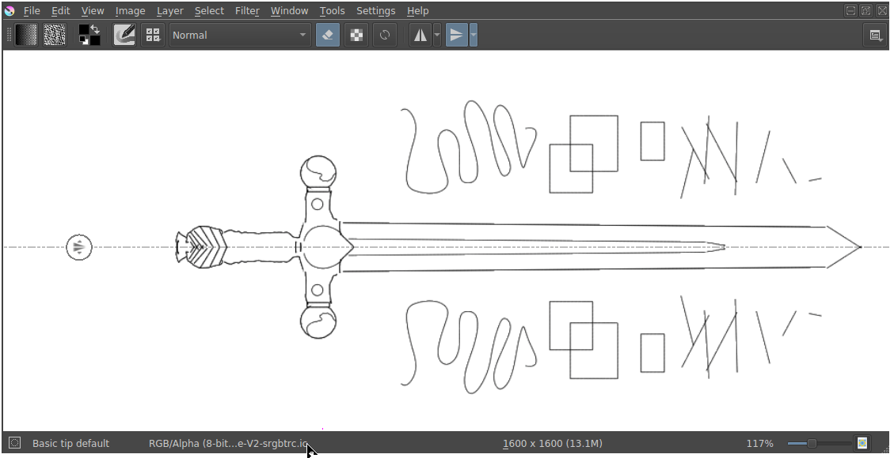

<!-- start-replace-fm field="title" -->
# Krita — les outils miroir
<!-- end-replace-fm -->
<!-- start-replace-fm field="description" format="blockquote" -->
> Le chapitre du manuel Krita sur les outils miroir : symétrie verticale, horizontale et multi-miroir — dessiner en équilibre, utile aux sigles et aux motifs.
<!-- end-replace-fm -->

<!-- start-replace-mediagraphie-fiche -->
> **Référence** — Documentation Krita (2026). Krita — les outils miroir.. https://docs.krita.org/fr/user_manual/mirror_tools.html. [↗](https://docs.krita.org/fr/user_manual/mirror_tools.html)
>
> | **Type** | webpage |
> | **Auteur·e** | Documentation Krita |
> | **Date** | 2026 |
> | **Statut** | stable |
> | **Mots-clés** | image, krita, symetrie, miroir, motif, tutoriel |

**Citation (copier-coller)**

```citation
Documentation Krita (2026). Krita — les outils miroir.. https://docs.krita.org/fr/user_manual/mirror_tools.html.
```
<!-- end-replace-mediagraphie-fiche -->

## Cité par

<!-- start-replace-mediagraphie-cited-by -->
- [Exercice — Logo vectoriel](../../../../02-activites/01/exercices/04-logo-vectoriel/)
<!-- end-replace-mediagraphie-cited-by -->

---
> 📄 **Réhébergement** — le contenu ci-dessous est la reproduction intégrale de la page officielle [Krita — les outils miroir](https://docs.krita.org/fr/user_manual/mirror_tools.html) de la documentation Krita, déjà publiée en français par l'équipe de Krita. La source fait foi et est mise à jour en premier ; cette copie peut dater.

## Outils de réflexion

Dessiner un coté de la ligne de réflexion pendant que l'outil de réflexion copie les résultats de l'autre coté. Les outils de réflexion sont accessibles sur le côté de la barre d'outils. Vous pouvez déplacer l'emplacement de la ligne de réflexion en saisissant la poignée.



Les outils de réflexion fournissent des résultats similaires à ref:multibrush_tool. Mais, contrairement à l'outil « Multibrush » réalisant uniquement des coups de brosses comme [Brosse à main levée](../reference_manual/tools/freehand_brush.html#freehand-brush-tool), l'outil de réflexion peut être utilisé avec d'autres outils, réalisant des coups, tel que [Outil pour lignes droites](../reference_manual/tools/line.html#line-tool) et le [Bezier Curve Tool](../reference_manual/tools/path.html#path-tool), et même avec l'outil « Multibrush ».

Effectuer une copie en miroir selon l'axe horizontal.

Effectuer une copie en miroir selon l'axe vertical.

Il y a des options complémentaires pour chaque outil. Vous pouvez y accéder par un clic sur la flèche à menu déroulant, présente sur la droite de chaque outil.

- Masquer la ligne de réflexion en X / Y (basculement) - Verrouille l'axe de réflexion et masque la ligne d'axe.

- Verrouiller la ligne X / Y (basculement) - Masque l'icône de déplacement sur la ligne d'axe.

- Déplacer vers le centre du tableau en X / Y - Déplace la ligne d'axe vers le centre du tableau.

### Réflexion le long d'une ligne inclinée

L'outil de réflexion ne peut réaliser une réflexion que le long d'une ligne strictement verticale ou horizontale. Pour effectuer une réflexion le long d'une ligne inclinée, veuillez utiliser le [Multi-brosse](../reference_manual/tools/multibrush.html#multibrush-tool) et ses divers paramètres. Cette fonction possède aussi des options plus avancés vis à vis de la symétrie standard.
