<!-- start-replace-fm field="title" -->
# Krita — le texte
<!-- end-replace-fm -->
<!-- start-replace-fm field="description" format="blockquote" -->
> Le chapitre du manuel Krita sur le texte : l'outil texte, les calques vectoriels de texte, les propriétés typographiques — et les limites du texte dans un logiciel de peinture.
<!-- end-replace-fm -->

<!-- start-replace-mediagraphie-fiche -->
> **Référence** — Documentation Krita (2026). Krita — le texte.. https://docs.krita.org/fr/user_manual/working_with_text.html. [↗](https://docs.krita.org/fr/user_manual/working_with_text.html)
>
> | **Type** | webpage |
> | **Auteur·e** | Documentation Krita |
> | **Date** | 2026 |
> | **Statut** | stable |
> | **Mots-clés** | image, krita, texte, typographie, tutoriel |

**Citation (copier-coller)**

```citation
Documentation Krita (2026). Krita — le texte.. https://docs.krita.org/fr/user_manual/working_with_text.html.
```
<!-- end-replace-mediagraphie-fiche -->

## Cité par

<!-- start-replace-mediagraphie-cited-by -->
- [Krita — passer d'autres logiciels](../krita-depuis-photoshop/)
- [Exercice — Logo vectoriel](../../../../02-activites/01/exercices/04-logo-vectoriel/)
- [Exercice — Composition d'une affiche](../../../../02-activites/01/exercices/05-affiche-composition/)
- [Exercice — Titres et transitions](../../../../02-activites/02/exercices/06-titres-transitions/)
<!-- end-replace-mediagraphie-cited-by -->

---
> 🇫🇷 **Traduction française** de la page officielle [Working with Text](https://docs.krita.org/fr/user_manual/working_with_text.html) — la page source n'est pas encore traduite. Adaptation : A26.

## Vue d'ensemble

L'outil principal du texte est l'outil **Texte**, qui crée des objets texte. Il édite des plages de texte — taper, copier, coller — mais règle aussi la fonte, la couleur et la taille sur une plage, et fait une mise en page plus avancée : glyphes alternatifs, positionnement précis des glyphes.

L'outil **Texte** s'utilise avec le panneau **Propriétés du texte**, qui donne le contrôle complet sur toutes les propriétés. Il propose aussi des **préréglages de style** pour réutiliser facilement certaines combinaisons.

L'outil **Texte** n'édite qu'un texte à la fois. Pour éditer plusieurs textes, utiliser l'outil **Sélection de formes** : le panneau **Propriétés du texte** édite alors tous les objets texte sélectionnés. L'outil **Sélection de formes** sert aussi à mettre du texte sur un chemin, ou à répartir du texte dans plusieurs formes.

Quelques exemples pour voir ces outils en action :

## Créer un titre décoratif

Ajouter du texte à une illustration — comme pour une affiche ou une carte.

Sélectionner l'outil **Texte** et cliquer sur la zone de dessin pour créer un texte, puis le taper.

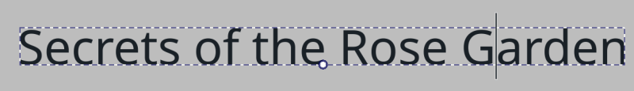

Pour la couleur et le contour : sélectionner une couleur directement dans l'un des sélecteurs de Krita. Pour la fonte et la taille : le panneau **Propriétés du texte**.


Dans ce panneau, l'onglet **Paragraphe** change les propriétés de tout le texte, l'onglet **Caractère** celles de la sélection courante.

Quand une propriété est changée dans l'onglet Caractère, le bouton à gauche s'active : le presser annule le changement ; son état actif signale aussi quelles propriétés sont posées sur les caractères — celles-ci ne sont pas affectées par les propriétés du paragraphe.

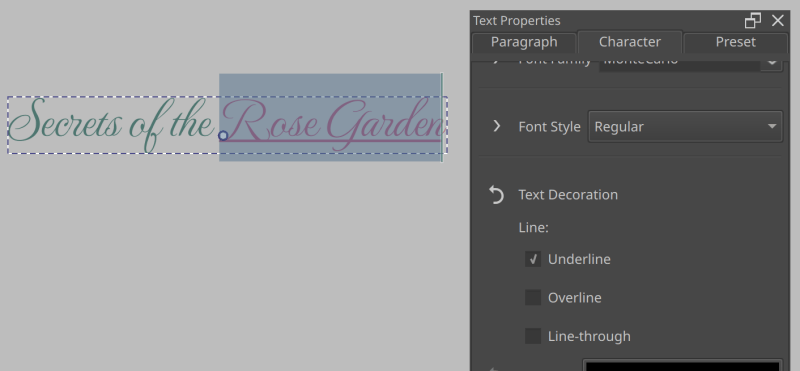

Exemple : souligner un bout de texte. Sélectionner le texte, aller dans l'onglet **Caractère**, **Ajouter une propriété** en bas, taper « underline » — **Text Decoration** apparaît dans la liste. Le sélectionner, activer **Underline**.

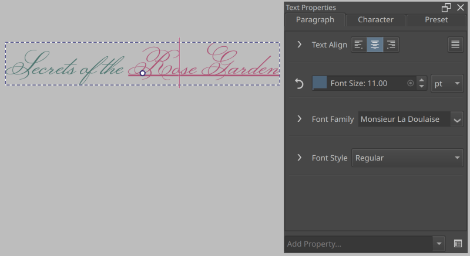

En revenant dans l'onglet **Paragraphe** pour changer la fonte, le soulignement est conservé sur la sélection d'origine. On peut ainsi changer la famille de fonte de tout le texte sans perdre les réglages par caractère.

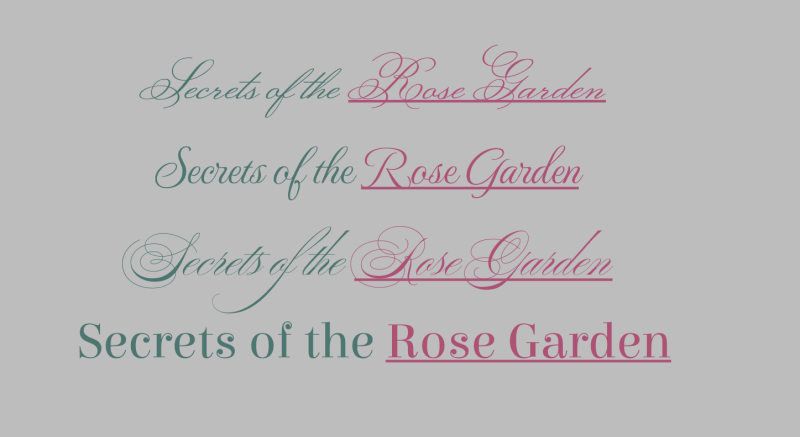

Cela vaut pour toutes les propriétés de caractère : garder la cohérence du texte tout en stylant chaque caractère individuellement.

## Utiliser les glyphes alternatifs

Certaines fontes ont des **glyphes** alternatifs pour des caractères donnés, à visée décorative. On y accède par les **fonctions OpenType** du panneau Propriétés du texte — mais la **palette de glyphes** est plus pratique : options de l'outil Texte, bouton **Palette de glyphes**.

Si un texte est actif et que la fonte propose des alternates pour le glyphe courant, ils s'affichent dans la palette.

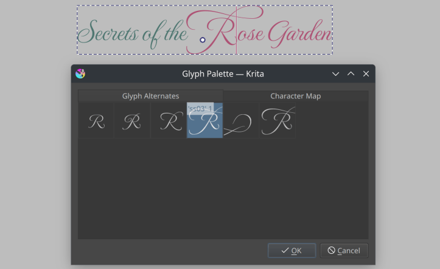

Double-cliquer un glyphe alternatif pour le sélectionner.

## Courber et positionner par caractère

Pour contrôler finement la position des glyphes : le **mode de composition typographique** des options de l'outil Texte. D'abord cocher **Préformaté** dans les options, puis activer le bouton **Type Setting Mode**.

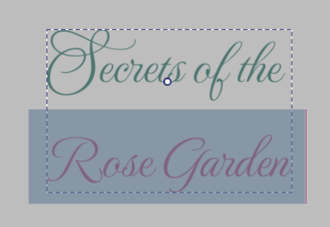

La zone de sélection se remplace par une série de lignes, avec deux points au début et à la fin : cliquer-glisser les points déplace toute la sélection.

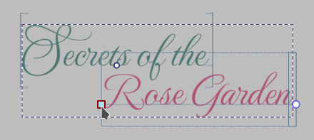

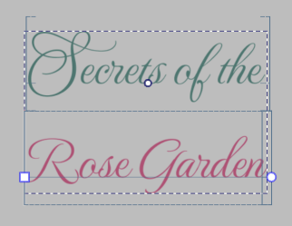

Parfois, on veut que tout le texte suive un chemin sans ajuster chaque caractère. Créer d'abord un chemin sur un calque vectoriel.

Survoler le chemin avec l'outil **Texte** et cliquer.

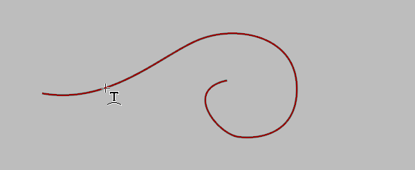

On peut alors ajuster la position du texte sur le chemin, et modifier le chemin avec l'outil **Édition de formes** (passer d'abord en mode contour — l'icône en haut à droite — puis éditer le chemin normalement).

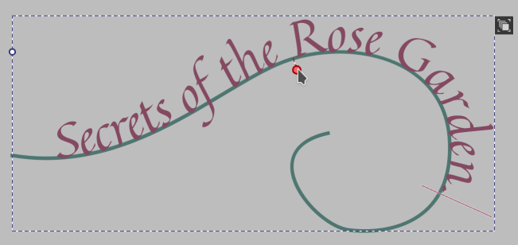

Pour masquer le chemin : le sélectionner avec l'outil **Sélection de formes** et régler l'opacité à 0 %.

Enfin, si rien de tout cela ne suffit : **Convertir en chemin** dans les options de l'outil **Édition de formes**. Le texte devient une forme vectorielle ordinaire (avec plusieurs couleurs, un groupe de formes est produit — le dégrouper via le menu contextuel de **Sélection de formes**).

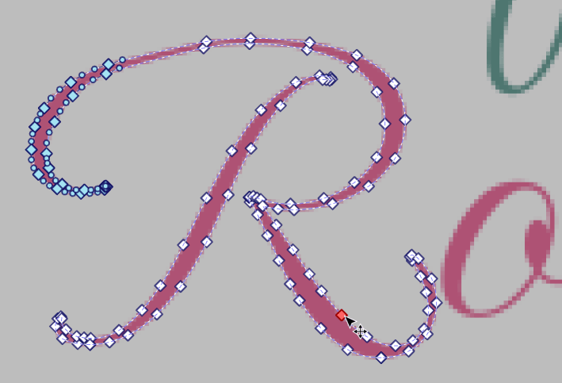

## Bande dessinée

Dans une BD, le texte peut être ajouté à tout moment. Les cas les plus courants : tout au début, à la planification, ou tout à la fin, à la mise en page.

Un texte de BD doit être cohérent et lisible. Les **préréglages de style** y veillent : créer un texte, régler la fonte et la taille voulues dans le panneau **Propriétés du texte**, puis aller dans l'onglet **Préréglage** et choisir **Nouveau préréglage** — une boîte de dialogue permet de nommer le préréglage et de choisir un échantillon de style.

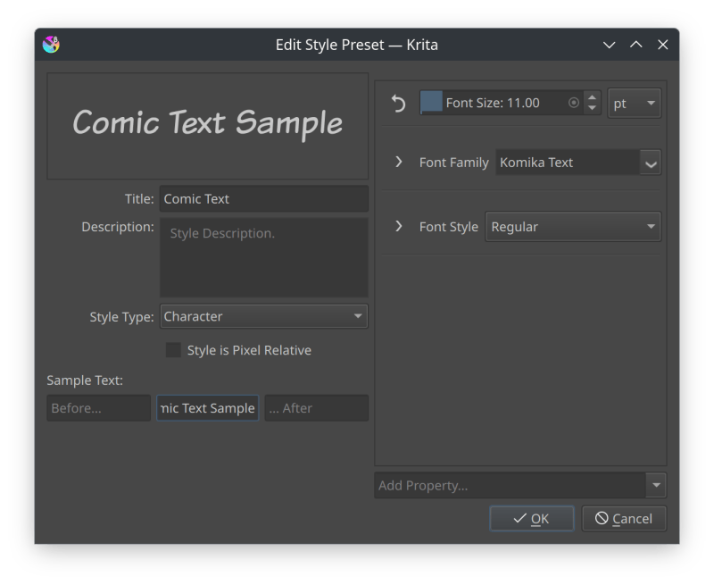

Dans les options de l'outil Texte, décocher **Propriétés du texte courant**, puis sélectionner le nouveau préréglé dans le menu déroulant : chaque nouveau texte naîtra avec ce style, et tout reste cohérent.

> **ASTUCE** — Déterminer une taille de fonte lisible est délicat : à l'écran, une image paraît plus grande ou plus petite que sa sortie imprimée, car Krita affiche à 100 % un pixel de l'image pour un pixel d'écran. On peut basculer en taille physique : le bouton à côté du curseur de zoom, en bas, alterne zoom par pixels et zoom physique — à 100 %, l'image s'affiche alors à sa taille physique réelle. Pour régler une taille lisible : créer le texte avec sa fonte, passer en zoom physique (50 % si l'on travaille au double de la taille physique, sinon 100 %), s'asseoir à une longueur de bras de l'écran, et ajuster la taille de fonte jusqu'à ce que la lecture soit agréable. Sans but d'impression, sauter l'étape du zoom physique : ajuster le zoom pour que l'image ait à l'écran la taille du résultat final, puis régler la fonte.

## Planifier une BD

Placer le texte dès le départ, c'est garantir qu'il aura la place — et planifier les images autour.

On part d'un script ou d'un croquis très grossier. On crée d'abord les textes : avec l'outil **Texte**, cliquer-glisser un grand rectangle pour créer une zone à **retour à la ligne automatique**, puis taper. Ce mode est pratique ici : il ne coupe à aucun endroit, on se concentre sur le texte et on ajuste ensuite.

L'outil **Sélection de formes** sélectionne plusieurs formes texte et les ajuste d'un coup via le panneau **Propriétés du texte** — seules les propriétés de niveau **Paragraphe** sont concernées.

Tous les textes en place, la page est prête au crayonné : la place restante pour les images devient évidente.

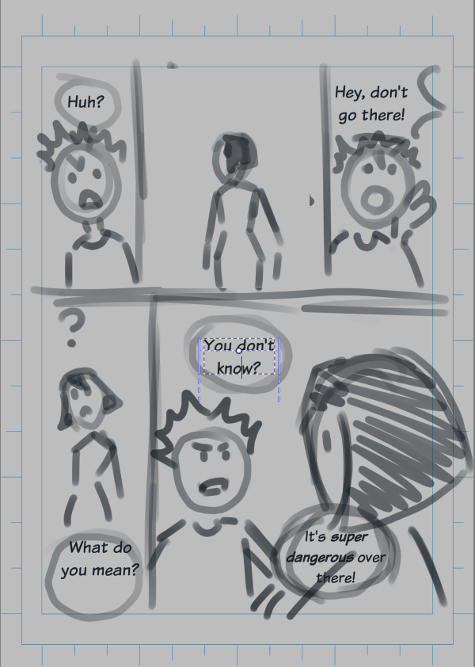

## Mettre en page une BD

L'autre méthode : à la toute fin, couleurs et images terminées. On parle de « mise en page » (*type setting*) — il ne s'agit pas seulement de placer le texte, mais de le marier aux images.

Les exemples précédents montraient le texte décoratif des titres et onomatopées ; ici, on fait couler du texte dans une bulle.

Image et exemple de texte : Pepper and Carrot, CC-BY David Revoy.

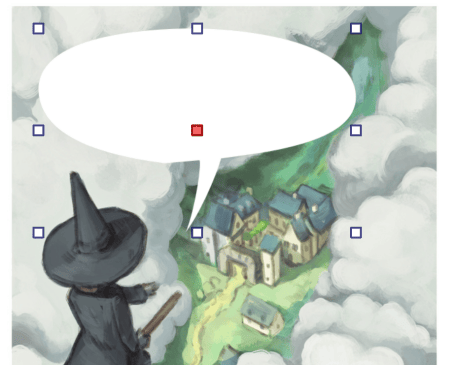

Créer d'abord une forme fermée sur un calque vectoriel.

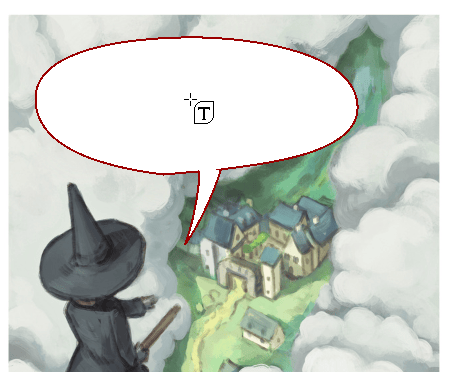

Survoler le centre avec l'outil **Texte** et cliquer, puis taper le texte.

Pour ajouter une marge intérieure : survoler le bord de la forme, cliquer-glisser vers l'intérieur.

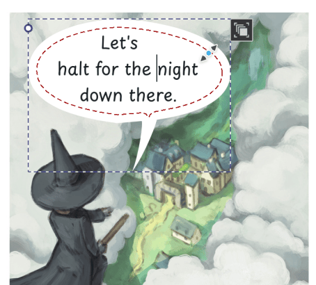

Autre méthode : créer un texte et une forme qui l'accueillera. Avec l'outil **Sélection de formes**, sélectionner les deux, clic droit pour le menu contextuel, choisir **Texte ‣ Faire couler le texte dans une forme**. Avec plusieurs formes sélectionnées, le texte peut couler dans plusieurs formes.

Une fois le texte dans la forme, on redimensionne avec l'outil **Sélection de formes** — ou on passe en mode contour (nouveau bouton en haut à droite) pour déplacer les formes individuellement.

## Texte vertical

Créer un texte avec l'outil **Texte**, puis, dans le panneau **Propriétés du texte**, onglet **Paragraphe** : **Ajouter une propriété** → **Mode d'écriture** → **Vertical, de droite à gauche** pour tout le texte.

Si l'usage est fréquent, créer un préréglage de style dédié.

> **NOTE** — Krita ne prend pas encore en charge les modes d'écriture mixtes ni les orientations de texte mêlées.

## Texte de droite à gauche

Krita implémente l'algorithme **bidirectionnel** Unicode, mais la direction du paragraphe doit être posée explicitement. Créer un texte, puis dans le panneau **Propriétés du texte**, onglet **Paragraphe** : **Ajouter une propriété** → **Direction** → **De droite à gauche**.

L'algorithme bidirectionnel s'initialise alors correctement ; **Alignement du texte** inverse le sens de **Début** et **Fin** ; et la propriété **Unicode Bidi** apparaît dans l'onglet **Caractère** pour régler finement le comportement de l'algorithme.

## Petit glossaire du texte

Des termes techniques traversent le manuel — mieux vaut en fixer le sens une fois pour toutes.

- **Caractère** — une lettre individuelle du texte. « Individuelle » est un mot lourd : toutes les langues n'ont pas de lettres uniques, certaines utilisent des amas de lettres représentés par un seul glyphe. Dans la documentation, *caractère* désigne le texte tel qu'on le tape, *glyphe* les images qui le composent.
- **Glyphe** — le nom de l'image ou de la forme vectorielle qui représente un caractère ou un amas de caractères. Le glyphe choisi dépend de la fonte, de la langue et des fonctions OpenType activées.
- **Fonte et OpenType** — une fonte n'est pas qu'une collection de glyphes : elle contient un petit programme qui indique au composeur comment les utiliser. OpenType est le standard de ces programmes ; Krita permet de configurer ses fonctions via divers contrôles.
- **Avancement** — la place qu'occupe un glyphe dans la ligne où il est posé. Parfois plus grand ou plus petit que le glyphe lui-même ; influencée par le crénage et l'interlettrage.
- **Crénage** — quand on pose les glyphes côte à côte, certaines combinaisons laissent un petit écart. Les fontes ont une liste de ces cas et demandent au composeur de rapprocher un peu les glyphes : c'est le crénage.
- **Bidirectionnel** — certaines écritures se lisent de gauche à droite, d'autres de droite à gauche. Un texte mêlant les deux doit trier et ajuster chaque segment pour que les mots de chaque écriture restent ensemble : c'est l'algorithme bidirectionnel d'Unicode.
