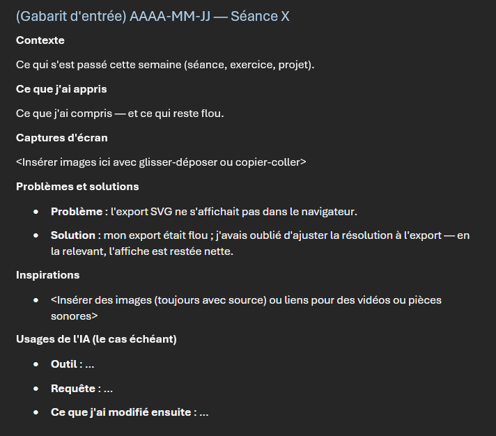

# Gabarit d'entrée et exemples

Chaque entrée du journal suit une structure simple et régulière. Un gabarit d'entrée pour copier-coller est fourni à la fin du [modèle de journal](https://cmontmorency365-my.sharepoint.com/:w:/g/personal/egllagostera_cmontmorency_qc_ca/IQAtf54xEYZ7Q4UME9oBLknVASOYzOVQtvsrG04XAwa2J9g?e=yiUFrU).

## Les sections, en bref

| Section | Contenu |
|---|---|
| **Contexte** | 1–3 phrases : ce qui s'est passé, pourquoi. |
| **Ce que j'ai appris** | les notions, les gestes, les surprises. |
| **Captures d'écran** | des images du logiciel, du résultat, de l'erreur. |
| **Problèmes et solutions** | le cœur du journal — chaque blocage et sa résolution. |
| **Inspirations** | liens vers la médiagraphie, des œuvres, des tutoriels. |
| **Usages de l'IA** | transparence : outil, requête, ce qui a été gardé ou modifié. |

## Règles pratiques

- **Captures d'écran** : montrer l'interface (panneaux, paramètres), pas seulement le résultat — on doit voir *comment*.
- **Problèmes** : documenter l'erreur **avant** la solution (copie du message d'erreur, capture).
- **Inspirations** : au moins une référence par jalon — une fiche de la [médiagraphie du cours](../../05-mediagraphie/) (liée par son URL complète) ou une ressource externe créditée.
- **IA** : toute assistance générative est permise si documentée — c'est un critère d'évaluation (voir [Citer un échange avec une IA](../05-citer-ia/)).
- **Liens** : vérifier qu'ils fonctionnent avant de publier.

## Autovalidation — mon entrée est-elle complète ?

- [ ] **Titre correcte pour l'entrée** — l'entrée dans le document suit le format `AAAA-MM-JJ - <titre>` et le modèle fourni à la fin du document.
- [ ] **Contexte** — 1 à 3 phrases : ce qui s'est passé cette semaine (séance, exercice, projet)
- [ ] **Ce que j'ai appris** — les notions, les gestes, ce qui reste flou
- [ ] **Captures d'écran** — l'interface visible (panneaux, paramètres), pas seulement le résultat
- [ ] **Problèmes et solutions** — au moins un blocage documenté : l'erreur **avant** la solution
- [ ] **Inspirations** — une référence : fiche du cours (URL complète) ou ressource externe créditée
- [ ] **Usages de l'IA** — documentés, le cas échéant (outil, requête, ce qui a été modifié)
- [ ] **Liens vérifiés** — tous fonctionnels avant le commit
